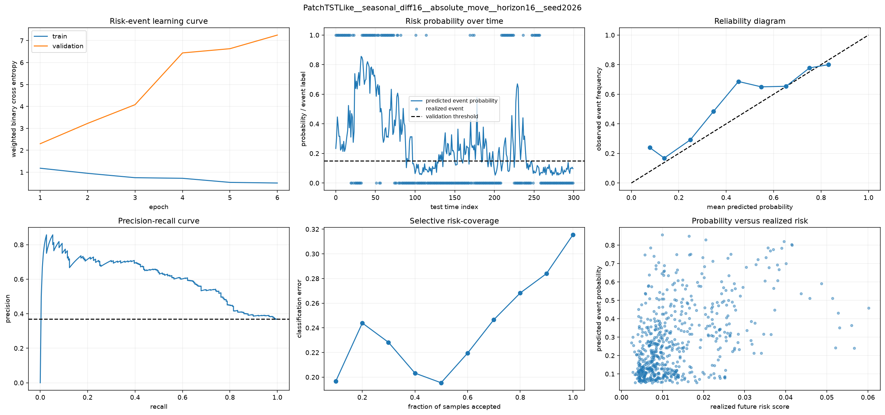
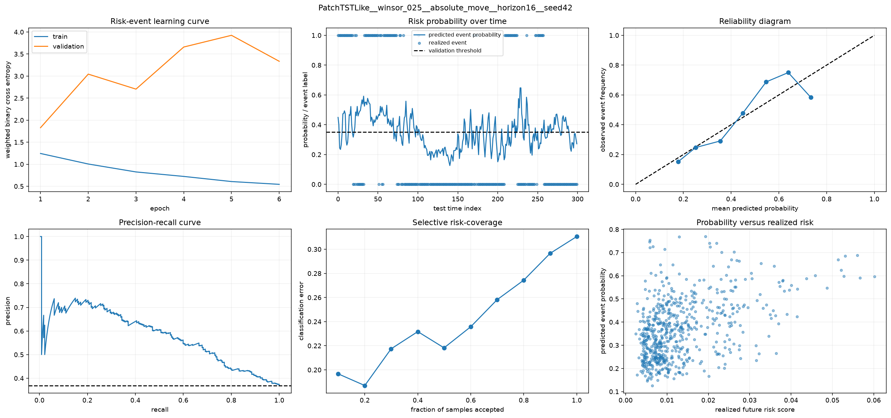
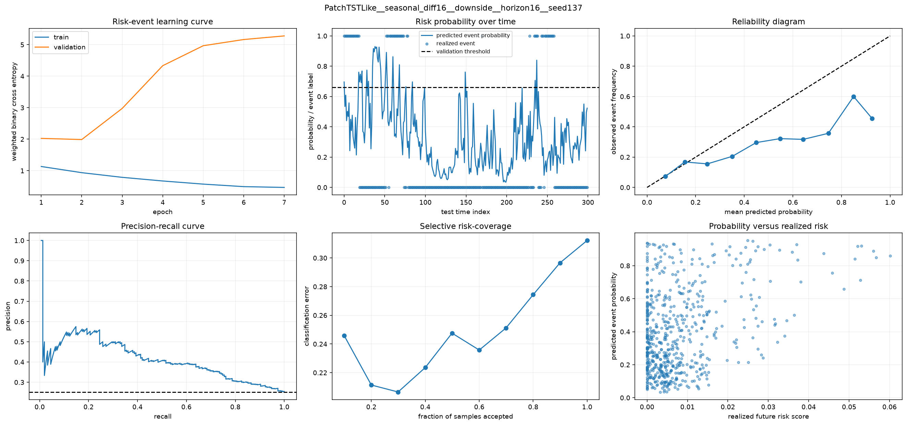
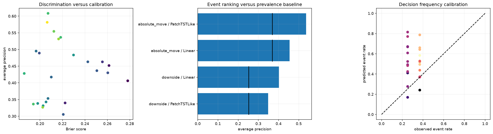

# 11번 위험 이벤트·분포 진단 결과 보고서

## 실험 설계

> 실행 전에 쓴 계획서·설계 문서 원문이다(2026-10-14 `test/experiment_specs/` 폐지 때 이 보고서로 합쳤다. 원 파일은 git 이력에 남아 있다). 제목 수준을 두 단계 내리고 옮겨진 파일의 경로만 새 위치로 고쳤으며, 그 밖의 내용은 고치지 않았다.

> 원문: 구 `test/experiment_specs/11_distributional_capacity_diagnostics_plan_20260623.md`

### 11번 위험 이벤트·분포 예측 진단 계획

#### 1. 결론부터 정리

사용자가 공유한 두 영상의 관점은 현재 연구에 반영할 가치가 있다. 다만 두 내용을 같은 종류의 전처리로 취급하면 안 된다.

- 불확실성 분포화는 **예측 출력과 손실함수의 확장**이다.
- Double Descent는 **모델 용량·표본 수·학습 시간과 일반화 오차의 관계를 확인하는 진단**이다.
- 둘 다 MinMax, Standard, Winsorize 같은 입력 전처리가 아니다.
- Black-Scholes 가격 공식을 15분 업비트 수익률 예측에 직접 적용하지 않는다.
- Black-Scholes에서 가져올 핵심은 “미래 가격은 하나의 확정값이 아니라 불확실한 분포”라는 관점이다.

10번은 objective와 validation-only ensemble로 다음 15분 수익률을 직접 예측하는 실험으로 그대로 보존한다. 11번은 10번을 덮어쓰지 않고, 향후 4시간 급변·하방 위험 확률과 직접 분포 예측을 경쟁 연구 질문으로 분리한다. Double Descent는 주 연구가 아니라 보조 진단으로 둔다.

#### 2. 경쟁 가설과 병렬 실행

##### 10번 점예측 가설

다음 15분 수익률의 방향과 크기를 직접 예측할 수 있다는 가설이다. persistence 대비 원화 MAE, 방향 정확도, 예측 분산을 평가한다.

##### 11번 위험 이벤트 가설

정확한 다음 수익률은 어렵더라도 향후 16개 15분봉, 즉 약 4시간 안의 큰 움직임이나 하방 위험 발생 확률은 예측할 수 있다는 가설이다.

- `downside`: 미래 경로에서 가장 큰 누적 하락폭
- `absolute_move`: 미래 경로에서 가장 큰 절대 누적 움직임
- train 구간 위험 점수의 상위 10%를 event로 정의
- validation에서 분류 임계값을 고르고 test에서는 고정

두 코드는 서로의 결과를 읽지 않으므로 동시에 실행할 수 있다. 기본 자원 slot은 다음과 같다.

| 코드 | slot | GPU 상한 | batch | workers | torch threads |
|---|---|---:|---:|---:|---:|
| 10번 | `point_primary` | 52% | 32 | 2 | 8 |
| 11번 | `risk_secondary` | 36% | 24 | 2 | 6 |

두 프로세스 합계 GPU allocator 상한을 약 88%로 제한해 CUDA context와 일시적 메모리 공간을 남긴다. 한쪽에서 OOM이 발생하면 batch size를 절반으로 줄여 재시도한다.

#### 3. 10번에 이미 들어간 것과 빠진 것

##### 이미 들어간 것

10번에는 여러 seed와 모델의 예측을 평균·중앙값·validation 가중 평균으로 결합하는 ensemble이 있다. 또한 validation 오차로 conformal interval을 만들어 test 예측 주변의 범위를 표시한다.

이 방식은 “예측값 하나만 보여주지 말고 오차 범위도 함께 보자”는 불확실성 관점을 일부 반영한다. 특히 conformal interval은 특정 확률분포를 맞다고 가정하지 않고 validation 잔차를 이용해 경험적 범위를 만든다.

##### 빠진 것

10번 모델은 여전히 다음 수익률 한 개를 출력한다. 구간은 학습 후에 붙인다. 다음 항목은 10번에 없다.

- 모델이 시점별 평균과 표준편차를 직접 출력하는 Gaussian likelihood
- 두꺼운 꼬리를 허용하는 Student-t likelihood
- 5%, 50%, 95% 분위수를 직접 출력하는 quantile regression
- likelihood 또는 quantile이 실제 빈도와 맞는지 보는 PIT·quantile calibration
- 모델 폭·표본 수·epoch를 체계적으로 바꾸는 Double Descent 곡선

따라서 10번은 “점예측을 안정화하고 여러 모델을 결합하는 실험”, 11번은 “예측분포와 모델 용량을 직접 진단하는 실험”으로 역할을 나눈다.

#### 4. 위험 이벤트 예측이 무엇인가

점예측은 “다음 봉 수익률이 몇 퍼센트인가”를 묻는다. 위험 이벤트 예측은 “앞으로 4시간 안에 평소보다 큰 하락이나 큰 움직임이 발생할 확률이 얼마인가”를 묻는다.

예를 들어 실제 다음 수익률을 정확히 맞히지 못해도 하방 위험 확률을 0.80으로 예측하고 그 구간에서 실제 급락이 반복적으로 발생한다면, 신규 진입 회피·현금 비중 확대·포지션 축소에 활용할 수 있다.

평가 지표는 다음과 같다.

- `Average Precision`: 드문 위험 event를 높은 순위에 배치하는 정도다. 단순 기준은 event 발생률이다.
- `Brier score`: 예측 확률과 실제 0/1 결과의 제곱오차다. 작을수록 좋다. Train event 발생률을 모든 시점에 똑같이 내는 climatology 기준보다 좋아야 `Brier skill > 0`이 된다.
- `Reliability`: 0.7로 예측한 표본 중 실제 event가 약 70% 발생하는지 확인한다.
- `Risk-Coverage`: 확신이 높은 표본만 사용할 때 오류가 줄어드는지 확인한다.

#### 5. 분포 예측이 무엇인가

##### 쉬운 정의

점예측은 “다음 수익률은 0.2%다”처럼 숫자 하나를 답한다. 분포 예측은 “중앙 예상은 0.2%지만, 현재 변동성을 고려하면 대체로 -0.8%에서 1.1% 사이일 가능성이 높다”처럼 중심과 불확실성을 함께 답한다.

##### 이번 연구에서 필요한 이유

업비트 15분 수익률은 극단값이 많고 시점에 따라 변동성이 달라진다. 9번 데이터의 수익률 첨도는 약 22.2로 정규분포보다 꼬리가 매우 두꺼웠다. 이런 데이터에 평균 오차만 줄이도록 요구하면 모델은 다음 두 쉬운 해로 갈 수 있다.

- 모든 예측을 0 근처로 줄여 평균 오차를 작게 만든다.
- 극단 구간을 따라가려다 평상시에도 지나치게 큰 진폭을 만든다.

분포 예측은 “중심을 어디에 둘지”와 “얼마나 불확실한지”를 함께 학습한다. 다만 구간을 출력한다고 중심 예측이 자동으로 좋아지는 것은 아니다. 점예측 MAE, 방향 정확도, 분산 비율과 구간 coverage·width를 함께 평가해야 한다.

#### 6. 11번 분포 head

##### Gaussian

모델은 위치 `mu`와 양수 척도 `sigma`를 출력하고 Gaussian negative log likelihood를 최소화한다.

```text
NLL = 0.5 * log(2*pi) + log(sigma) + 0.5 * ((y - mu) / sigma)^2
```

오차가 커질수록 더 큰 벌점을 받지만, 실제 업비트 수익률의 두꺼운 꼬리를 충분히 표현하지 못할 수 있다. Gaussian은 단순 기준선 역할을 한다.

##### Student-t

모델은 위치 `mu`, 척도 `sigma`, 자유도 `nu`를 출력한다. 자유도가 작을수록 정규분포보다 꼬리가 두꺼워져 급등락에 더 높은 확률을 줄 수 있다.

예를 들어 Gaussian이 ±3 표준편차 밖의 움직임을 거의 불가능하다고 보는 반면, Student-t는 그런 사건을 드물지만 가능한 사건으로 남겨 둔다. 첨도가 높은 코인 수익률에서는 Gaussian보다 현실적인 후보지만, 척도를 무작정 크게 만들어 넓은 구간만 출력할 위험도 있다.

##### Quantile

모델이 5%, 50%, 95% 분위수를 직접 출력하고 pinball loss를 최소화한다.

- 5% 분위수: 실제값이 이보다 작을 확률을 약 5%로 맞추려는 하한
- 50% 분위수: 중앙값
- 95% 분위수: 실제값이 이보다 작을 확률을 약 95%로 맞추려는 상한

특정 분포 모양을 정하지 않아도 되며 비대칭 구간을 만들 수 있다. 반면 세 분위수만으로 전체 확률밀도를 알 수는 없다.

##### Conformal 보정

Gaussian, Student-t, quantile이 만든 원시 구간을 validation 자료의 실제 미포함 정도로 다시 넓힌다. 목표 coverage가 90%라면 test 실제값 약 90%가 구간 안에 들어오는지 확인한다.

coverage만 높이는 것은 충분하지 않다. 모든 경우를 포함하도록 구간을 아주 넓게 만들면 쉽게 100% coverage를 얻지만 의사결정에는 쓸 수 없다. 따라서 평균 interval width와 miss distance를 함께 본다.

#### 7. 분포 평가 지표와 그래프

##### Proper score

모델이 실제 관측값에 높은 확률을 주면서도 분포를 불필요하게 넓히지 않는지를 평가한다.

- Gaussian·Student-t: negative log likelihood
- Quantile: 5%, 50%, 95% pinball loss 평균

값이 작을수록 좋지만 서로 다른 score 종류의 절대값을 직접 순위 비교하기보다 같은 head 안에서 전처리·모델·seed를 비교한다.

##### Coverage와 width

- coverage: 실제 수익률이 예측구간 안에 들어온 비율
- width: 상한과 하한의 평균 거리

90% 구간이라면 coverage가 0.90 부근이어야 한다. 같은 coverage라면 더 좁은 구간이 더 유용하다.

##### PIT histogram

PIT는 관측된 실제값이 모델의 누적분포 안에서 어느 위치에 놓이는지 0과 1 사이 값으로 바꾼 것이다. 분포가 잘 맞으면 PIT 값이 0~1에 대체로 균일하게 퍼져야 한다.

- 양 끝에 몰리면 실제 극단값을 과소평가한 것이다.
- 중앙에 몰리면 구간이 필요 이상으로 넓을 가능성이 있다.
- 한쪽으로 치우치면 평균 또는 중앙값 편향이 남아 있다.

Quantile head는 전체 누적분포를 출력하지 않으므로 5%, 50%, 95%의 명목 분위수와 실제 누적 비율을 비교한다.

#### 8. Double Descent가 무엇인가

##### 쉬운 정의

전통적인 설명에서는 모델이 복잡해질수록 처음에는 성능이 좋아지다가 과적합 구간에서 test 오차가 다시 커지는 U자형 곡선을 예상한다.

Double Descent에서는 모델 용량이 더 커져 학습자료를 거의 완전히 맞추는 interpolation threshold 근처에서 test 오차가 크게 나빠졌다가, 그보다 훨씬 큰 과매개변수 모델에서 오히려 다시 낮아질 수 있다.

즉 “큰 모델은 항상 나쁘다”도 아니고 “큰 모델은 항상 좋다”도 아니다. 데이터량과 파라미터 수의 상대적 위치에 따라 위험 구간이 생길 수 있다는 뜻이다.

##### 왜 현재 연구에 관련 있는가

현재 연구는 width 64~128의 shallow-but-wide 구조를 주로 사용한다. 9번과 10번에서 모델별 평탄화와 분산 폭주가 크게 달랐기 때문에, hidden width를 임의로 96에 고정하면 다음 가능성을 놓칠 수 있다.

- width 96이 특정 모델에서 interpolation 위험 구간에 가깝다.
- 더 작은 모델은 underfit이지만 더 큰 모델은 다시 안정화된다.
- 데이터 window 수를 늘리면 위험 구간의 위치가 이동한다.
- epoch가 길어질수록 같은 모델이 interpolation 구간을 통과한다.

##### 전처리인가

아니다. 전처리를 고정하고 다음 축을 바꾸어야 Double Descent를 해석할 수 있다.

- model-wise: hidden width와 parameter count
- sample-wise: 학습 window 수
- epoch-wise: 학습 epoch

전처리까지 동시에 바꾸면 어느 변화가 곡선을 만든 것인지 알 수 없으므로 11번 기본 capacity suite는 9번 선별 후보인 `seasonal_diff16`을 고정한다.

#### 9. 11번 suite

##### risk_event_probe

- horizon: 16개 15분봉, 약 4시간
- event: downside, absolute move
- 모델: Linear, PatchTSTLike
- 전처리: seasonal_diff16, winsor_025
- seed: 42, 137, 2026
- 기본 24개 case

각 case마다 학습 곡선, 시점별 위험 확률, reliability diagram, precision-recall curve, selective risk-coverage, 실현 위험 점수와 예측 확률을 표시한다.

##### distribution_probe

- 모델: Linear, PatchTSTLike
- 전처리: seasonal_diff16, winsor_025
- head: Gaussian, Student-t, Quantile
- seed: 42, 137, 2026
- 기본 36개 case

각 case마다 학습 곡선, 실제·중앙 예측·원시/보정 구간, interval width와 실제 오차, calibration scatter, PIT 또는 quantile calibration, 불확실성 크기와 표준화 잔차를 출력한다.

##### model_capacity_probe

- 모델: Linear, PatchTSTLike
- width: 16, 24, 32, 48, 64, 96, 128, 192, 256
- seed: 42, 137, 2026
- 표본 수: 전체 train window

파라미터 수에 따른 train loss, validation loss, persistence 대비 test MAE를 그린다.

##### sample_size_probe

- 기본 모델: 첫 번째 지정 모델
- width 전체
- train fraction: 25%, 50%, 75%, 100%
- validation과 test 구간은 고정

같은 모델 용량이라도 학습 표본 수가 달라질 때 interpolation 위험 구간이 이동하는지 본다.

##### epoch_probe

- width: 32, 96, 256
- epoch별 train·validation·test diagnostic loss 표시

test 곡선은 현상 진단용으로만 사용하고 checkpoint 선택에는 사용하지 않는다. 최종 모델 상태 선택은 validation loss 기준이다.

##### full

네 suite를 모두 구성한다. 시간이 매우 오래 걸리므로 한 번에 시작하지 않고 각 suite 결과를 확인한 뒤 수행한다.

#### 10. 서버 병렬 실행 순서

##### 커널 A: 10번

첫 번째 venv 커널에서 10번 노트북을 실행한다. 기본 slot은 `point_primary`다.

##### 커널 B: 11번

두 번째 venv 커널에서 11번 노트북을 실행한다. 기본 suite와 slot은 각각 `risk_event_probe`, `risk_secondary`다.

##### case 구성 확인

```bash
python test/models/11_distributional_capacity_diagnostics_test.py \
  --suite risk_event_probe \
  --parallel-slot risk_secondary \
  --max-cases 6 \
  --dry-run
```

##### 위험 이벤트 병렬 본실험

```bash
python test/models/11_distributional_capacity_diagnostics_test.py \
  --suite risk_event_probe \
  --parallel-slot risk_secondary \
  --models Linear,PatchTSTLike \
  --event-kinds downside,absolute_move \
  --preprocessings seasonal_diff16,winsor_025 \
  --seeds 42,137,2026 \
  --horizon 16 \
  --event-quantile 0.90 \
  --epochs 20 \
  --max-windows 4096 \
  --max-cases 24 \
  --continue-on-failure
```

##### 위험 이벤트 통과 후 분포 본실험

```bash
python test/models/11_distributional_capacity_diagnostics_test.py \
  --suite distribution_probe \
  --parallel-slot risk_secondary \
  --epochs 20 \
  --max-windows 4096 \
  --continue-on-failure
```

##### 모델 용량 확인

```bash
python test/models/11_distributional_capacity_diagnostics_test.py \
  --suite model_capacity_probe \
  --preprocessings seasonal_diff16 \
  --capacity-epochs 30 \
  --max-windows 4096 \
  --continue-on-failure
```

##### 표본 수 확인

```bash
python test/models/11_distributional_capacity_diagnostics_test.py \
  --suite sample_size_probe \
  --models PatchTSTLike \
  --preprocessings seasonal_diff16 \
  --capacity-epochs 30 \
  --max-windows 4096 \
  --continue-on-failure
```

##### Epoch-wise 확인

```bash
python test/models/11_distributional_capacity_diagnostics_test.py \
  --suite epoch_probe \
  --models Linear,PatchTSTLike \
  --epoch-widths 32,96,256 \
  --capacity-epochs 60 \
  --max-windows 4096 \
  --continue-on-failure
```

#### 11. 실행 판단 기준

위험 이벤트 가설은 다음 조건을 함께 본다.

1. Average Precision이 event 발생률보다 반복적으로 높다.
2. Brier score와 calibration error가 단순 event-rate 확률보다 낮다.
3. 여러 seed에서 같은 전처리·모델 경향이 반복된다.
4. coverage를 50%로 줄여 확신이 높은 경우만 사용할 때 classification error가 감소한다.
5. 향후 서비스의 진입 회피 또는 포지션 축소 규칙으로 연결할 수 있다.

분포 모델은 다음 조건을 함께 만족해야 후속 후보로 남긴다.

1. copy-risk ratio가 1에 가까워지거나 1 미만이다.
2. direction accuracy와 variance ratio가 평탄화 또는 폭주가 아닌 범위에 있다.
3. 90% interval coverage가 0.90 부근이다.
4. 같은 coverage에서 interval width가 과도하게 넓지 않다.
5. 고변동 구간 coverage가 저변동 구간보다 심하게 무너지지 않는다.
6. 여러 seed에서 같은 경향이 반복된다.

Double Descent는 다음 조건이 있어야 관찰되었다고 판단한다.

1. parameter count 증가에 따라 test error가 단순 잡음이 아니라 상승 후 재하락한다.
2. train error 또는 interpolation 지표와 굴곡 위치가 연결된다.
3. 여러 seed에서 비슷한 위치 또는 방향이 반복된다.
4. sample fraction을 바꾸면 위험 구간 위치가 논리적으로 이동한다.
5. 한 번의 우연한 width 우승을 Double Descent라고 부르지 않는다.

#### 12. 10번과 11번 방향 선택

10번과 11번은 target이 다르므로 MAE 하나로 직접 비교하지 않는다.

- 10번 통과: 여러 seed에서 copy-risk ratio 1 미만, 방향 정확도와 분산이 안정적
- 11번 통과: Average Precision·Brier·calibration·selective risk가 기준선보다 안정적

둘 다 통과하면 점예측은 예상수익, 위험 이벤트는 포지션 크기와 거래 거부에 사용한다. 10번만 실패하면 직접 점예측 연구선을 종료하고 11번 위험 관리 방향을 주 연구로 전환한다. 11번도 실패하면 OHLCV만으로 부족하다는 결론을 내리고 오더북·텍스트·다종목 요인을 추가한다.

#### 13. 추가로 반영할 논문과 우선순위

##### 지금 11번에 직접 반영

- Belkin et al., *Reconciling modern machine-learning practice and the classical bias-variance trade-off*  
  https://arxiv.org/abs/1812.11118
- Nakkiran et al., *Deep Double Descent: Where Bigger Models and More Data Hurt*  
  https://arxiv.org/abs/1912.02292
- Lakshminarayanan et al., *Simple and Scalable Predictive Uncertainty Estimation using Deep Ensembles*  
  https://proceedings.neurips.cc/paper/2017/hash/9ef2ed4b7fd2c810847ffa5fa85bce38-Abstract.html
- Romano et al., *Conformalized Quantile Regression*  
  https://arxiv.org/abs/1905.03222
- Jensen et al., *Ensemble Conformalized Quantile Regression for Probabilistic Time Series Forecasting*  
  https://arxiv.org/abs/2202.08756
- Salinas et al., *DeepAR: Probabilistic Forecasting with Autoregressive Recurrent Networks*  
  https://arxiv.org/abs/1704.04110

##### 11번 결과가 유효할 때 다음 번호에서 검토

- TimeGrad: 분포를 간단한 Gaussian·Student-t로 제한하지 않고 diffusion sampling으로 생성  
  https://arxiv.org/abs/2101.12072
- TimeDiff: 비자동회귀 diffusion 기반 시계열 예측  
  https://arxiv.org/abs/2306.05043
- TFT: 외생변수와 multi-horizon quantile 예측을 함께 다루는 구조  
  https://arxiv.org/abs/1912.09363

Diffusion 계열은 계산량과 구현 복잡도가 커서 현재 11번의 첫 단계에 넣지 않는다. 먼저 Linear와 PatchTSTLike에서 Gaussian·Student-t·quantile이 실제로 coverage와 sharpness를 개선하는지 확인한 뒤 확장한다.

#### 14. 영상의 프로젝트 적용 범위

- 불확실성 영상: https://www.youtube.com/watch?v=99BHnu64pu8
- Double Descent 영상: https://www.youtube.com/watch?v=5ruiphjlOwo

영상은 연구 질문을 이해하는 출발점으로 사용하고, 구현과 보고서의 방법론 근거는 위 원 논문을 기준으로 한다. 영상에서 설명한 수식을 그대로 복제하기보다 현재 업비트 수익률의 heavy-tail, 비정상성, persistence 실패 문제에 맞게 분포 head와 용량 진단으로 번역한다.

#### 15. 산출물 원칙

- 결과 원본은 `test/models/11_distributional_capacity_diagnostics_test.ipynb`의 inline 출력이다.
- 모든 그림은 `plt.show()`로만 표시한다.
- 서버에 PNG, CSV, Markdown 결과 파일을 자동 저장하지 않는다.
- 보고서 이미지는 실행 완료 후 로컬 `test/scripts/extract_notebook_images.py`로 노트북 출력에서 추출한다.

---

## 1. 결론부터

11번은 10번의 점예측과 경쟁하는 별도 가설이다. 이번 실험의 질문은 "다음 15분 값을 하나의 숫자로 맞히는 대신, 향후 4시간 동안 큰 움직임이 날 확률을 예측하면 더 유용한가"이다.

핵심 결론은 다음과 같다.

- 위험 이벤트 예측에서는 `PatchTSTLike`가 `Linear`보다 더 강했다.
- 특히 `absolute_move` 이벤트는 `downside`보다 더 잘 잡혔다.
- 가장 좋은 조합은 `PatchTSTLike + seasonal_diff16 + absolute_move + seed2026`로, AP 0.608, ROC AUC 0.716, Brier skill 0.321, ECE 0.094를 기록했다.
- `downside`는 더 어려웠고, `Linear`는 일부 케이스에서 baseline보다 나은 lift를 보였지만 calibration과 전체 판별력은 약했다.
- 분포 예측과 Double Descent는 아직 보조 축이다. 11번의 본질적 성과는 위험 이벤트 분류가 점예측과는 다른 연구 축임을 보여준 것이다.

즉 11번은 10번의 대체물이 아니라, 10번과 병렬로 놓고 비교할 만한 경쟁 가설이다.

## 2. 왜 11번을 수행했는가

10번의 결과만 보면 아직 다음 문제가 남아 있다.

- 값 자체를 조금 더 잘 맞히는 것과
- 큰 변동이 날 가능성을 미리 아는 것

은 전혀 다른 문제다.

금융에서는 작은 오차를 줄이는 것보다, 큰 급변 구간에 들어가는지 먼저 아는 것이 더 실용적인 경우가 많다. 예를 들어 급변 직전에는 포지션 축소, 리스크 회피, 모니터링 강화가 필요하다. 그래서 11번은 점예측이 아니라 위험 이벤트 확률 예측으로 분리했다.

## 3. 핵심 용어

### 3.1 Event rate

`event_rate`는 실제로 이벤트가 발생한 비율이다.

예를 들어 100개 중 25개가 하방 이벤트면 event rate는 25%다. 이벤트가 희귀할수록 accuracy만 보면 속기 쉬우므로, event rate를 함께 봐야 한다. 희귀 이벤트에서는 모두 안 맞는 모델도 정확도가 높아 보일 수 있기 때문이다.

### 3.2 Average precision과 AP lift

`average_precision`은 정답이 불균형한 상황에서 precision-recall 곡선을 요약한 값이다.

`AP lift`는 이 값이 단순 baseline보다 얼마나 나은지를 보여준다.

- AP lift가 1보다 크면 baseline보다 낫다.
- 1 부근이면 baseline과 비슷하다.
- 1보다 작으면 baseline보다 나쁘다.

11번에서는 AP lift가 1.45~1.65 수준까지 올라간 케이스가 있어, 단순 prevalence보다 확률 정렬이 좋아졌다는 뜻이다. 이것은 좋은 신호다.

### 3.3 Brier score, climatology, Brier skill score

`Brier score`는 확률 예측과 실제 0/1 결과의 차이를 제곱해 평균낸 값이다. 작을수록 좋다.

`climatology Brier score`는 "항상 평균 발생률만 예측"했을 때의 기준값이다.

`Brier skill score`는 이 기준 대비 얼마나 나아졌는지 보여준다.

- 0보다 크면 baseline보다 낫다.
- 0이면 baseline과 같다.
- 0보다 작으면 baseline보다 나쁘다.

11번의 상위 위험 이벤트 케이스는 Brier skill score가 약 0.32 수준까지 올라갔다. 이는 확률 예측이 그냥 prevalence 복사보다 유의하게 낫다는 뜻이다.

### 3.4 Expected calibration error

`ECE`는 예측한 확률과 실제 발생 비율이 얼마나 어긋나는지 보여준다.

- 0에 가까우면 좋다.
- 값이 크면 "70% 확률"이라고 말해도 실제는 50% 수준일 수 있다.

11번의 상위 케이스는 ECE가 0.05~0.09 수준으로, 완벽하진 않지만 완전히 망가진 확률 예측은 아니었다.

### 3.5 Double Descent

Double Descent는 모델이 커질수록 test error가 단순히 줄기만 하지 않고, 어떤 복잡도 구간에서는 한번 나빠졌다가 다시 좋아질 수 있다는 현상이다.

이 실험에서 Double Descent는 본 연구 질문의 중심이 아니다. 다만 width나 parameter count를 늘렸을 때 위험 예측/분포 예측이 어떻게 흔들리는지 확인하는 보조 진단 축으로 남긴다. 즉 "큰 모델이면 무조건 좋다"는 생각을 검증하는 참고용 축이다.

## 4. 실행 환경과 데이터

| 항목 | 값 |
|---|---:|
| Python | 3.13.13 |
| PyTorch | 2.10.0+cu126 |
| CUDA | 12.6 |
| GPU | NVIDIA GeForce RTX 4090 |
| 자원 프로필 | `school_4090_15gb:risk_secondary` |
| 데이터 테이블 | `btc_15m_advance` |
| 관측치 | 39,935 |
| 기간 | 2023-05-21 10:30 ~ 2024-07-11 11:30 |
| 결측 셀 | 0 |

11번도 15분 업비트 비트코인 데이터를 썼다. 원천 OHLCV 결측은 없었지만, 시계열 구조상 몇몇 gap과 feature warm-up 손실은 존재했다. 이 부분은 `missingness audit`에서 따로 보여준다.

## 5. 결측과 event preview

### 5.1 missingness audit

11번의 결측 점검은 다음을 분리해서 보여준다.

- raw OHLC missing: 0
- inferred timestamp gaps: 7
- feature 생성에서 떨어진 행: 65

중요한 점은 구조적 결측은 보간 대상이 아니라는 것이다. rolling window의 초반 warm-up, horizon tail, shift tail은 실제로 미래를 모르는 구간이기 때문에 값을 메우면 안 된다. 반면 실제 누락 간격이 있다면 그때는 데이터 취득 문제로 보고 따로 다뤄야 한다.

### 5.2 event preview

11번은 candle preview 대신 event probability preview를 보여준다.

preview 표에는 보통 다음이 들어간다.

- timestamp
- prev_close
- future_end_close
- future_return
- event_score
- label
- predicted probability
- threshold

이 표의 목적은 "이 모델이 정말 무엇을 맞히는가"를 눈으로 읽게 하는 것이다. 점예측처럼 가격 숫자만 보는 대신, 큰 하락/큰 변동이 나는 시점에 확률이 올라가는지를 확인한다.

## 6. 실험 구조

11번의 기본 suite는 `risk_event_probe`다.

- 모델: `Linear`, `PatchTSTLike`
- event_kind: `downside`, `absolute_move`
- 전처리: `seasonal_diff16`, `winsor_025`
- seed: `42`, `137`, `2026`
- horizon: 16
- 목표: 향후 4시간 위험 이벤트 확률 예측

11번에서는 `absolute_move`를 "큰 방향성 여부", `downside`를 "하방 꼬리 위험"으로 구분했다. 둘 다 중요하지만, 11번에서는 `absolute_move`가 더 쉽게 학습되었다.

## 7. 위험 이벤트 결과

### 7.1 상위 `absolute_move` 케이스

| 순위 | 모델 | 전처리 | seed | AP | AP lift | ROC AUC | Brier skill | ECE | 해석 |
|---:|---|---|---:|---:|---:|---:|---:|---:|---|
| 1 | PatchTSTLike | seasonal_diff16 | 2026 | 0.608 | 1.648 | 0.716 | 0.321 | 0.094 | 가장 강한 위험 이벤트 후보 |
| 2 | PatchTSTLike | winsor_025 | 42 | 0.581 | 1.575 | 0.704 | 0.324 | 0.047 | calibration이 특히 좋음 |
| 3 | PatchTSTLike | winsor_025 | 2026 | 0.554 | 1.502 | 0.674 | 0.304 | 0.081 | seed가 바뀌어도 유지 |
| 4 | PatchTSTLike | seasonal_diff16 | 42 | 0.536 | 1.453 | 0.684 | 0.284 | 0.094 | 안정적이지만 최고는 아님 |
| 5 | PatchTSTLike | seasonal_diff16 | 137 | 0.531 | 1.440 | 0.687 | 0.291 | 0.071 | seed 변화에 덜 민감 |

### 7.2 `downside` 케이스

`downside`는 더 어렵다. 이벤트 비율이 낮고 꼬리 쪽이기 때문에, `absolute_move`처럼 넓은 변동을 잡는 것보다 훨씬 민감하다.

대표적으로 `Linear + winsor_025 + downside + seed2026`는 AP 0.495, AP lift 1.965, ROC AUC 0.697을 보였지만, Brier skill은 0.071에 불과했다. 즉 희귀 이벤트를 baseline보다 조금 더 잘 정렬하긴 했지만, 확률 보정은 약했다.

`Linear + seasonal_diff16 + downside + seed2026`도 AP 0.489, lift 1.941, ROC AUC 0.700으로 비슷한 경향을 보였다. 그러나 `PatchTSTLike`의 `downside` 일부 조합은 Brier skill이 음수까지 내려가, 확률 정렬과 calibration이 함께 좋아지지 않는 경우가 있었다.

### 7.3 해석

11번에서 중요한 점은 `PatchTSTLike`가 `Linear`보다 위험 이벤트에 더 잘 반응했다는 것이다.

- `absolute_move`는 실제 급변을 더 잘 포착했다.
- `downside`는 더 희귀하고 더 불안정해서 성능이 낮았다.
- AP lift와 Brier skill이 모두 양수인 조합은 "전혀 쓸모 없는 확률"이 아니라 "기준선보다 나은 확률"이라는 뜻이다.

그러나 이 결과도 과신하면 안 된다. 예측이 맞는다는 것과, 실제 운용에서 충분히 안정적인 확률이라는 것은 다르다. 특히 downside는 추후 더 많은 seed, 더 긴 horizon, 더 정교한 불균형 보정이 필요하다.

## 8. 분포 예측은 무엇인가

분포 예측은 다음 수익률을 하나의 숫자로 맞히지 않고, 여러 가능성의 분포로 표현하는 방식이다.

예를 들어 "다음 4시간에 -2%가 날 가능성은 15%, -1% 부근은 30%, 0 근처는 25%, +1% 이상도 20%" 같은 식으로 본다. 이렇게 보면 점예측보다 훨씬 정보가 많다.

11번에서 분포 예측은 아직 보조 축이다. 이유는 간단하다. 지금 가장 확실히 검증된 것은 위험 이벤트 분류이며, 분포 head는 그 다음 단계의 확장 지점이다.

좋은 분포 예측의 조건은 다음과 같다.

- 불확실성이 커지는 구간에서 interval이 넓어진다.
- 실제 변동이 작을 때 interval이 불필요하게 넓지 않다.
- coverage와 sharpness의 균형이 맞는다.

나쁜 분포 예측은 다음과 같다.

- 항상 같은 폭의 구간을 내놓는다.
- 넓기만 하고 실제는 맞지 않는다.
- 너무 좁아서 coverage가 무너진다.

## 9. Capacity와 Double Descent

11번에서 Double Descent는 보조 진단이다.

이 실험이 주는 메시지는 "지금 당장 Double Descent가 핵심 결론"이 아니라 "모델 용량이 커질 때 test error가 다시 좋아지는 구간이 있는지 별도로 볼 수 있게 해 두었다"는 것이다.

이 축이 중요한 이유는 다음과 같다.

- 작은 모델이 항상 안전한 것은 아니다.
- 큰 모델이 항상 폭주하는 것도 아니다.
- data regime와 objective에 따라 interpolation threshold 부근의 행동이 달라질 수 있다.

따라서 11번의 capacity branch는 후속 실험에서 width, parameter count, seed를 바꾸며 재사용할 수 있는 진단 프레임이다. 이번 노트북의 주력 산출물은 위험 이벤트 leaderboard이고, capacity는 후속 해석용 보조 축이다.

## 10. 좋게 읽어야 하는 그래프와 나쁘게 읽어야 하는 그래프

### 10.1 가장 강한 후보도 학습 곡선 자체는 과적합 경고를 보인다



이 그림은 `PatchTSTLike + seasonal_diff16 + absolute_move + seed2026` 결과다. 왼쪽 위의 x축은 epoch, y축은 가중 binary cross entropy다. train loss는 내려가지만 validation loss는 빠르게 상승하므로, 마지막 epoch 모델이 좋은 것이 아니라 early stopping으로 저장된 최저 validation 시점 모델을 사용해야 한다.

가운데 위의 x축은 test 시간 순서, y축은 예측 이벤트 확률이다. 실제 이벤트는 0 또는 1의 점으로 표시되고, 예측 확률은 위험 구간에서 올라가는 군집을 만든다. 왼쪽 아래 precision-recall 곡선은 event prevalence 약 36.9%를 나타내는 점선보다 대부분 위에 있어 단순 발생률 예측보다 사건 순위를 잘 나눴다.

이 사례는 AP `0.608`, AP lift `1.648`, Brier skill `0.321`로 가장 강했지만 ECE는 `0.094`다. 즉 위험한 순서를 정하는 능력은 좋지만, "확률 70%"라는 숫자를 그대로 운영 임계값으로 쓰기 전에는 추가 보정이 필요하다.

### 10.2 가장 보정이 좋은 후보는 운영용 위험 게이트에 더 가깝다



이 그림은 `PatchTSTLike + winsor_025 + absolute_move + seed42` 결과다. AP `0.581`, AP lift `1.575`, Brier skill `0.324`로 사건 분리력이 높고 ECE는 `0.047`로 상위 후보 중 가장 낮다. 오른쪽 위 reliability diagram에서 실선이 대각선 주변을 비교적 따라가므로, 예측 확률과 실제 발생률의 간격이 상대적으로 작다.

최고 AP 모델과 최고 calibration 모델이 다르다는 점이 중요하다. 연구 보고에서는 최고 점수 하나만 고르기보다 두 후보를 seed/preprocessing ensemble로 묶고 validation 데이터에서 다시 확률 보정하는 편이 더 타당하다.

### 10.3 Downside 확률은 아직 과신하기 어렵다



이 그림은 `PatchTSTLike + seasonal_diff16 + downside + seed137` 결과다. reliability diagram의 고확률 구간이 대각선 아래에 있어 모델이 실제보다 위험 확률을 높게 말하는 구간이 나타난다. risk-coverage 곡선도 가장 확신하는 50% 표본만 남겼을 때 오류가 줄기는 하지만, `absolute_move` 사례만큼 명확하지 않다.

따라서 downside 예측은 당장 포지션 방향을 결정하는 핵심 신호가 아니라, 높은 확률일 때 진입을 한 번 더 막는 보조 경고로만 다루는 것이 안전하다.

### 10.4 전체 모델 비교는 absolute move branch의 우위를 확인한다



가운데 막대그래프의 점선은 각 이벤트의 단순 발생률 기준선이다. `absolute_move / PatchTSTLike`의 average precision이 가장 높고 기준선과의 간격도 가장 크다. 왼쪽 산점도에서는 Brier score가 낮으면서 average precision이 높은 좌상단에 가까울수록 좋다. 오른쪽 calibration 산점도는 대각선에 가까울수록 예측 발생률과 실제 발생률이 맞는다는 뜻인데, 일부 후보는 위험을 과대평가한다.

이 결과는 11번을 "가격 예측의 우회"가 아니라 실제로 기준선을 넘은 별도 위험 신호로 취급할 근거가 된다.

### 10.5 좋게 읽는 그림

- event probability가 실제 위험 구간에서 올라가는 그림
- AP lift와 Brier skill이 baseline보다 좋아지는 그림
- ECE가 과도하게 크지 않은 그림
- seed가 바뀌어도 순위가 크게 깨지지 않는 그림

### 10.6 나쁘게 읽는 그림

- 확률이 거의 상수로 나오는 그림
- event rate가 낮은데도 모든 구간에서 고확률을 남발하는 그림
- calibration은 좋아 보여도 실제 위험 구간을 잘 못 잡는 그림
- 분포 head가 너무 넓거나 너무 좁아져서 해석이 안 되는 그림

11번의 상위 후보는 좋은 그림 쪽에 더 가깝지만, 아직 완성형은 아니다.

## 11. 11번에서 확정할 수 있는 것과 없는 것

### 확정할 수 있는 것

- 위험 이벤트 예측은 점예측과 별개의 유효한 연구 축이다.
- `PatchTSTLike`는 `Linear`보다 위험 이벤트 분리 능력이 좋다.
- `absolute_move`는 `downside`보다 더 안정적인 1차 목표다.
- AP lift, Brier skill, ECE를 함께 봐야 확률 예측을 제대로 읽을 수 있다.

### 아직 확정할 수 없는 것

- 분포 예측 head가 point forecast보다 실제로 더 낫다는 결론
- Double Descent가 지금 데이터/모델/정규화 조건에서 재현된다는 결론
- `downside`가 충분히 안정적으로 해석 가능하다는 결론

## 12. 다음 스텝

11번은 다음 연구 흐름을 알려준다.

1. 10번의 점예측 branch와 11번의 위험 이벤트 branch를 분리해서 유지한다.
2. risk-event 쪽은 `absolute_move`를 우선 안정화하고, 그 다음에 `downside`를 정교화한다.
3. 분포 예측은 보조 branch로 두고, coverage와 interval width를 명확히 본다.
4. Double Descent는 capacity probe의 형태로만 유지하고, 중심 질문으로 끌어올리지 않는다.
5. 새 방법론을 추가할 때는 "연구 질문을 실제로 강하게 하는가"를 먼저 묻는다.

## 13. 최종 판단

11번은 10번의 실패를 덮기 위한 우회로가 아니다. 오히려 점예측과 위험 이벤트가 서로 다른 문제임을 분리해 준 실험이다.

- 10번은 "어떤 objective가 쉬운 해를 덜 만들까"를 봤다.
- 11번은 "위험한 구간을 미리 알 수 있을까"를 봤다.

둘은 같은 문제의 다른 표현이 아니라, 실제 연구에서 병렬로 비교해야 하는 두 축이다.

이번 11번의 가장 큰 수확은 `PatchTSTLike + seasonal_diff16 + absolute_move`가 위험 이벤트 예측의 강한 기준 후보로 남았다는 점이다. 반면 분포 예측과 Double Descent는 앞으로 더 넓은 후속 실험에서 확인할 보조 축으로 남겨 둔다.
