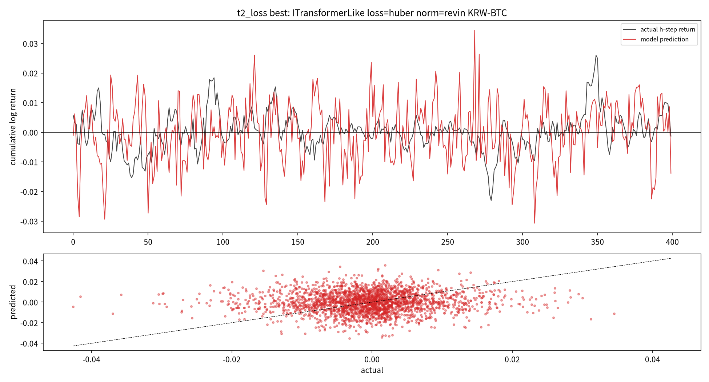

# 16번 보고서 — 비정상성 정규화 + 큰 변동 손실 + KRW 전 종목 cross-sectional

작성일: 2026-07-19 · 브랜치: `stock` · 실험: `test/models/16_nonstationary_crosssectional_test.py`
계획서: 이 보고서 서두의 "실험 설계" 절(2026-10-14 이전에는 `experiment_specs/16_*_plan_20260719.md`) ·
문헌: `test/research_materials/16_nonstationary_trend_capture_literature_review_20260719.md`

> 독립 보고서다. 용어는 매번 다시 풀어 쓴다. 실행 중 발견한 버그·설계 결함·수정·재실행 사유를
> 8절에 raw로 전량 남긴다(취사선택은 사용자 몫 — known_pitfalls P5).

---

## 실험 설계

> 실행 전에 쓴 계획서·설계 문서 원문이다(2026-10-14 `test/experiment_specs/` 폐지 때 이 보고서로 합쳤다. 원 파일은 git 이력에 남아 있다). 제목 수준을 두 단계 내리고 옮겨진 파일의 경로만 새 위치로 고쳤으며, 그 밖의 내용은 고치지 않았다.

> 원문: 구 `test/experiment_specs/16_nonstationary_crosssectional_plan_20260719.md`

### 16번 계획서 — 비정상성 정규화 + 큰 변동(분위/분포) 손실 + KRW 전 종목 cross-sectional

작성일: 2026-07-19 · 브랜치: `stock` · 토대: 공용 엔진 `engine/` + 16번 드라이버 신규 컴포넌트

> 근거 문헌: `test/research_materials/16_nonstationary_trend_capture_literature_review_20260719.md`
> 연구 초고: `test/results/paper_draft_nonstationary_crypto_trend_20260719.md`
> 지침 위계(CLAUDE.md 2.12): 학습 건전성 → 전체 변동 폭 추세 예측 → MDD는 생존 제약.

---

#### 1. 왜 16번인가 (15번까지의 귀결)

15번 T1~T9로 확정된 사실:
- target을 h-step 추세로 바꿔 진폭이 부분 회복(variance_ratio 0.36)됐으나 방향 상관은 0.07,
  큰 변동 방향 정확도는 0.52로 미미하다.
- 이 약한 신호는 BTC 단일 종목의 우연이고 ETH/XRP/SOL로 일반화되지 않는다(T8).
- 진폭 압축의 원인은 시장이 아니라 (평균형 손실 + 과한 정상화 + 앙상블 상쇄)라는 설정이다(T9).

따라서 16번은 세 축을 **동시에** 바꾼다. 하나만 바꾸면(15번처럼) 다시 국소 최적에 갇힌다.

1. **비정상성 정규화**를 window_standard(경량)에서 정식 RevIN → De-stationary로 올려,
   정규화가 지운 급변 정보를 되살린다.
2. **손실**을 평균형(huber)에서 **분위(pinball)/분포(Student-t)/tail-weighted**로 바꿔 큰
   변동을 명시 모델링한다(진폭 압축 정면 해소).
3. **데이터 축**을 BTC 단일에서 **KRW 전 종목**으로 복원하고, 절대 예측이 아니라
   **cross-sectional ranking**(종목 간 상대 강도)도 objective로 도입한다.

#### 2. 연구 질문

- Q1 (건전성·비정상성): RevIN/De-stationary 정규화가 window_standard 대비 variance_ratio를
  1에 가깝게 올리면서 검증 곡선 과적합을 악화시키지 않는가?
- Q2 (큰 변동): 분위/분포/tail 손실이 huber 대비 큰 변동 구간의 정밀도·재현율(tail P/R/F1)과
  variance_ratio를 유의하게 올리는가?
- Q3 (일반화): KRW 전 종목으로 학습한 모델이 종목 가로질러 양의 신호(cross-sectional IC)를
  내는가? 절대 예측이 안 되어도 상대 순위는 남는가?
- Q4 (생존 제약): 위에서 얻은 신호로 구성한 정책이, 변동 재현을 유지하면서(진폭 안 죽이고)
  MDD도 방어하는가?

#### 3. 실험 축 (단계 T1~T5)

| suite | 고정 | 변화 | 답하는 질문 |
|---|---|---|---|
| **t1_normalization** | 손실=huber, 모델=ITransformer/PatchTST, BTC 단일(빠른 비교) | 정규화 {window_standard, revin, dishts_lite, none} | Q1 |
| **t2_loss** | 우승 정규화, h=16 | 손실 {huber, pinball(다중분위), student_t, tail_weighted} | Q2 |
| **t3_crosssection** | 우승 정규화·손실 | 학습 축 {단일종목, 다종목 pooled(CI), 다종목 pooled(CD)} — 전 종목 표본 | Q3 |
| **t4_ranking** | 우승 구성 | objective {absolute return 회귀, cross-sectional rank} | Q3 |
| **t5_policy** | 우승 예측 | risk gate {none, quantile-based} — 변동 재현 유지 조건 | Q4 |

- 단계마다 최적값을 CLI 인자로 명시 승계(silent default 금지, 15번 패턴).
- 격자 크기를 로그로 남겨 silent truncation 금지.

#### 4. 신규 컴포넌트 (엔진 원본 미수정, 16번 드라이버 내 구현)

엔진 모델들은 스칼라 1개를 출력하므로, 16번은 아래를 드라이버에 새로 둔다.

- `RevIN`(nn.Module): instance 정규화-역정규화 + 학습 affine(γ,β). RevIN 근거 ICLR22.
- `MultiOutputHead`: backbone 특징 → {점예측 1개 | 분위 K개 | 분포 파라미터(μ,σ,ν)} 로 분기.
- 손실: `pinball_loss`(다중 분위), `student_t_nll`(DeepAR 계열), `tail_weighted_huber`.
- `CrossSectionalBatcher`: 같은 timestamp의 여러 종목을 한 배치로 묶어 rank 손실 계산(t3/t4).
- 평가: `tail_precision_recall_f1`(큰 변동 구간을 분류로 보고 P/R/F1), `cross_sectional_ic`
  (같은 시점 종목 간 예측-실제 순위상관), 기존 variance_ratio·trend_corr·MASE 재사용.

#### 5. 데이터·안정성

- 원천: `upbit_krw_candle`(269종목/1,608만행, 2026-07-19 재수집). 단일종목 비교(t1/t2)는
  진단 속도를 위해 BTC로, 전 종목(t3~t5)은 유동성 상위 N종목 subset부터 확장.
- 13번 crash 교훈: 헤드리스 `.py`, per-case 그림 off, num_workers=0, OOM 자동 배치 축소.
- 결과: `test/results/16_*_20260719/*_raw.md + *.csv`, 그림 `test/images/16_*_20260719/`.

#### 6. 평가·성공 기준 (지침 위계 반영)

- **본선**: variance_ratio가 1에 유의하게 가까워지고(진폭 회복), 큰 변동 tail F1과 trend_corr가
  huber 대비 오르며, 검증 곡선 과적합이 관리될 것.
- **일반화**: cross-sectional IC가 양수이고 종목 가로질러 유지될 것.
- **생존 제약**: 위 신호 위에서 MDD가 point-only 대비 개선되되, **변동을 죽여서가 아니라**
  (variance_ratio·active_share 병기로 확인) 방어할 것. MDD 단독 랭킹 금지.
- 성공/실패 무엇이든 정직하게 기록. 큰 변동을 여전히 못 잡으면 그 사실을 horizon·손실별로 남긴다.

#### 7. 산출물

- 드라이버: `test/models/16_nonstationary_crosssectional_test.py` (`.py`만, `#%%` 셀 구분 +
  파일 내 마크다운 주석. 사용자 지시 2026-07-19: ipynb 미생성).
- 결과 보고서: `test/results/16_*_report_YYYYMMDD.md` (독립 문서, 그래프별 해석 형식).
- 문헌·초고: 위 2개 문서 참조.

---

## 기초통계량(describe 표)

> 2026-10-14 소급 추가(AGENTS.md 2.9.10). 실행 당시가 아니라 현재 DB를 같은 테이블·창으로 다시 조회해 계산했다(업비트 과거 캔들은 바뀌지 않으므로 같은 창이면 같은 값이다). 데이터 범위 근거: T1·T2는 `btc_15m_advance` 전체, T3는 `upbit_krw_candle`에서 SUM(value) 상위 30종목의 전체 이력을 읽었다(드라이버 16번 110~111행, 673~685행). 현재 DB로 다시 선정한 목록이 같다. 학습은 마지막 max_windows 개 창만 썼다(T1·T2 16,000×stride 2, T3 12,000×stride 3).

### T1·T2: KRW-BTC(`btc_15m_advance` 전체)

- 출처: `data/upbit_data.db`의 `btc_15m_advance`, 테이블 전체 이력, 1종목

#### describe 표(pandas `describe()` 그대로, 종목별)

> 숫자 형식: count는 정수, 나머지는 소수 둘째 자리(1 미만 값은 유효숫자 4자리). 로그수익률은 15분봉 기준 % 단위다. 행 단위 원자료라 무체결 구간(캔들 없음)은 포함되지 않는다.

**종가(KRW)**

| 종목 | count | mean | std | min | 25% | 50% | 75% | max |
| :--- | ---: | ---: | ---: | ---: | ---: | ---: | ---: | ---: |
| KRW-BTC | 104,865 | 105,904,816.71 | 38,566,257.22 | 34,171,000.00 | 82,714,000.00 | 101,593,000.00 | 139,548,000.00 | 179,810,000.00 |

**거래량(코인 수)**

| 종목 | count | mean | std | min | 25% | 50% | 75% | max |
| :--- | ---: | ---: | ---: | ---: | ---: | ---: | ---: | ---: |
| KRW-BTC | 104,865 | 32.38 | 54.95 | 0.0001955 | 9.23 | 17.93 | 35.42 | 2,856.91 |

**거래대금(KRW)**

| 종목 | count | mean | std | min | 25% | 50% | 75% | max |
| :--- | ---: | ---: | ---: | ---: | ---: | ---: | ---: | ---: |
| KRW-BTC | 104,865 | 3,174,053,806.73 | 5,428,411,505.38 | 19,979.49 | 906,143,036.86 | 1,718,542,728.25 | 3,394,250,383.70 | 317,019,670,845.50 |

**로그수익률(%)**

| 종목 | count | mean | std | min | 25% | 50% | 75% | max |
| :--- | ---: | ---: | ---: | ---: | ---: | ---: | ---: | ---: |
| KRW-BTC | 104,864 | 0.0008571 | 0.2385 | -11.24 | -0.09799 | 0 | 0.09936 | 10.99 |

### T3: 거래대금 상위 30종목(`upbit_krw_candle` 전체 이력)

- 출처: `data/upbit_data.db`의 `upbit_krw_candle`, 테이블 전체 이력, 30종목

#### describe 표(pandas `describe()` 그대로, 종목별)

> 숫자 형식: count는 정수, 나머지는 소수 둘째 자리(1 미만 값은 유효숫자 4자리). 로그수익률은 15분봉 기준 % 단위다. 행 단위 원자료라 무체결 구간(캔들 없음)은 포함되지 않는다.

**종가(KRW)**

| 종목 | count | mean | std | min | 25% | 50% | 75% | max |
| :--- | ---: | ---: | ---: | ---: | ---: | ---: | ---: | ---: |
| KRW-XRP | 104,876 | 2,049.32 | 1,307.19 | 564.60 | 779.00 | 1,973.00 | 3,214.00 | 4,973.00 |
| KRW-BTC | 104,883 | 106,042,912.87 | 38,419,597.06 | 34,171,000.00 | 82,938,500.00 | 101,577,000.00 | 139,544,500.00 | 179,810,000.00 |
| KRW-DOGE | 104,863 | 219.64 | 121.09 | 78.80 | 133.70 | 192.00 | 271.00 | 674.00 |
| KRW-ETH | 104,869 | 3,869,407.47 | 1,141,136.87 | 2,091,000.00 | 2,994,000.00 | 3,552,000.00 | 4,809,000.00 | 6,834,000.00 |
| KRW-SOL | 104,879 | 187,085.83 | 83,122.49 | 23,900.00 | 126,900.00 | 197,600.00 | 241,500.00 | 448,150.00 |
| KRW-USDT | 73,834 | 1,442.25 | 54.78 | 1,201.00 | 1,396.00 | 1,454.00 | 1,489.00 | 1,630.00 |
| KRW-SHIB | 104,868 | 0.01863 | 0.009567 | 0.00603 | 0.011 | 0.01707 | 0.0235 | 0.0634 |
| KRW-SEI | 102,133 | 422.20 | 300.17 | 68.30 | 175.00 | 363.00 | 574.80 | 1,652.00 |
| KRW-XLM | 104,901 | 296.14 | 162.09 | 110.20 | 158.20 | 240.00 | 399.00 | 866.50 |
| KRW-SUI | 104,876 | 2,615.08 | 1,758.19 | 496.00 | 1,185.00 | 2,090.00 | 3,967.25 | 7,877.00 |
| KRW-ETC | 104,901 | 26,678.49 | 9,614.18 | 9,885.00 | 21,030.00 | 25,760.00 | 32,130.00 | 56,010.00 |
| KRW-ADA | 104,879 | 729.60 | 345.56 | 212.00 | 435.00 | 638.20 | 995.00 | 1,849.00 |
| KRW-STX | 104,797 | 1,500.27 | 1,134.80 | 241.00 | 631.00 | 985.00 | 2,313.00 | 5,465.00 |
| KRW-ONDO | 73,173 | 1,097.80 | 535.31 | 310.00 | 592.00 | 1,085.00 | 1,380.00 | 3,048.00 |
| KRW-HBAR | 104,749 | 181.35 | 108.28 | 58.37 | 97.35 | 143.00 | 254.00 | 588.40 |
| KRW-ENS | 70,607 | 25,033.52 | 13,184.20 | 5,980.00 | 13,990.00 | 24,550.00 | 32,240.00 | 71,370.00 |
| KRW-GAS | 104,202 | 5,211.78 | 2,757.37 | 1,454.00 | 3,189.00 | 4,551.00 | 6,950.00 | 39,670.00 |
| KRW-NEAR | 104,861 | 4,542.52 | 2,633.72 | 1,322.00 | 2,472.00 | 3,740.00 | 6,165.00 | 12,980.00 |
| KRW-BCH | 104,895 | 569,498.66 | 188,630.83 | 247,000.00 | 411,500.00 | 577,000.00 | 709,000.00 | 1,028,000.00 |
| KRW-SAND | 104,628 | 443.62 | 241.49 | 68.90 | 320.00 | 409.00 | 585.00 | 1,479.00 |
| KRW-MOVE | 55,754 | 288.68 | 376.05 | 15.50 | 33.30 | 162.00 | 306.50 | 3,733.00 |
| KRW-ARK | 101,942 | 695.53 | 400.71 | 152.00 | 418.00 | 599.70 | 880.88 | 2,475.00 |
| KRW-POLYX | 102,639 | 251.55 | 162.86 | 50.10 | 142.00 | 215.10 | 322.10 | 971.00 |
| KRW-LINK | 104,888 | 20,069.67 | 7,075.32 | 7,880.00 | 14,410.00 | 19,490.00 | 24,402.50 | 44,210.00 |
| KRW-BLUR | 103,370 | 289.42 | 258.37 | 20.60 | 94.02 | 221.60 | 396.00 | 1,138.00 |
| KRW-CTC | 89,297 | 765.92 | 415.98 | 116.00 | 514.20 | 750.00 | 969.00 | 4,060.00 |
| KRW-WAVES | 103,984 | 1,924.35 | 1,067.87 | 369.00 | 1,279.00 | 1,613.00 | 2,495.00 | 7,114.00 |
| KRW-AERGO | 102,358 | 148.67 | 60.09 | 30.10 | 106.00 | 142.00 | 183.50 | 891.00 |
| KRW-AVAX | 104,737 | 32,878.97 | 16,885.00 | 8,660.00 | 17,120.00 | 31,300.00 | 44,520.00 | 95,850.00 |
| KRW-STRAX | 102,279 | 76.15 | 44.11 | 11.80 | 53.14 | 65.13 | 104.00 | 247.00 |

**거래량(코인 수)**

| 종목 | count | mean | std | min | 25% | 50% | 75% | max |
| :--- | ---: | ---: | ---: | ---: | ---: | ---: | ---: | ---: |
| KRW-XRP | 104,876 | 2,309,150.95 | 5,162,464.10 | 3.18 | 568,449.07 | 1,093,042.50 | 2,221,517.06 | 337,332,265.08 |
| KRW-BTC | 104,883 | 32.32 | 54.96 | 0.0001955 | 9.18 | 17.87 | 35.36 | 2,856.91 |
| KRW-DOGE | 104,863 | 5,851,580.12 | 15,264,510.88 | 382.30 | 983,126.51 | 2,269,513.36 | 5,389,642.66 | 835,077,981.93 |
| KRW-ETH | 104,869 | 413.39 | 708.16 | 0.002118 | 104.37 | 219.04 | 452.77 | 37,880.48 |
| KRW-SOL | 104,879 | 7,138.95 | 12,888.72 | 0.07987 | 1,887.83 | 3,688.95 | 7,497.68 | 497,384.26 |
| KRW-USDT | 73,834 | 1,007,937.74 | 1,487,188.25 | 118.39 | 256,796.07 | 553,041.90 | 1,194,781.29 | 66,922,576.98 |
| KRW-SHIB | 104,868 | 23,735,935,356.77 | 82,840,081,115.57 | 499,504.95 | 3,213,886,706.93 | 8,017,330,519.46 | 19,054,822,518.12 | 3,894,289,351,125.85 |
| KRW-SEI | 102,133 | 1,062,546.51 | 2,975,898.62 | 0.04303 | 181,524.11 | 415,899.66 | 959,713.86 | 197,777,066.46 |
| KRW-XLM | 104,901 | 1,021,570.16 | 4,613,689.87 | 30.80 | 109,888.11 | 265,025.57 | 652,980.11 | 271,434,126.42 |
| KRW-SUI | 104,876 | 207,610.74 | 449,294.50 | 4.49 | 41,595.95 | 93,693.22 | 211,351.57 | 39,433,535.30 |
| KRW-ETC | 104,901 | 12,509.97 | 45,351.15 | 0.00001135 | 1,463.33 | 3,562.33 | 9,614.34 | 3,461,797.22 |
| KRW-ADA | 104,879 | 468,659.64 | 1,333,312.83 | 5.13 | 102,584.66 | 215,094.05 | 450,689.25 | 88,027,214.53 |
| KRW-STX | 104,797 | 210,482.00 | 490,243.87 | 0.06539 | 42,119.41 | 95,982.28 | 211,498.19 | 22,705,372.43 |
| KRW-ONDO | 73,173 | 377,681.10 | 679,454.85 | 15.00 | 96,329.54 | 196,219.79 | 408,027.77 | 30,985,797.53 |
| KRW-HBAR | 104,749 | 1,354,674.78 | 6,360,989.32 | 0.00000002 | 112,078.99 | 311,637.24 | 815,842.16 | 409,047,638.22 |
| KRW-ENS | 70,607 | 10,235.73 | 48,357.72 | 0.2178 | 1,232.63 | 3,035.49 | 7,233.91 | 2,449,207.68 |
| KRW-GAS | 104,202 | 35,161.35 | 176,599.96 | 0.00000062 | 2,035.65 | 5,768.99 | 16,210.86 | 12,554,860.01 |
| KRW-NEAR | 104,861 | 46,274.32 | 99,124.07 | 0.00000034 | 10,148.72 | 22,596.22 | 48,165.36 | 8,437,285.01 |
| KRW-BCH | 104,895 | 480.27 | 1,619.00 | 0.007388 | 50.15 | 137.45 | 385.77 | 86,622.16 |
| KRW-SAND | 104,628 | 396,255.40 | 1,845,325.49 | 12.16 | 54,354.60 | 132,142.12 | 311,525.31 | 177,561,869.52 |
| KRW-MOVE | 55,754 | 1,520,027.92 | 7,569,930.52 | 33.70 | 172,013.41 | 420,732.79 | 1,039,035.11 | 669,714,383.02 |
| KRW-ARK | 101,942 | 319,474.04 | 1,449,187.03 | 0.00000001 | 13,879.35 | 46,286.54 | 148,790.07 | 58,717,627.02 |
| KRW-POLYX | 102,639 | 629,871.53 | 3,161,462.32 | 0.00000001 | 34,663.43 | 116,600.50 | 343,103.41 | 168,387,101.40 |
| KRW-LINK | 104,888 | 9,475.56 | 22,320.77 | 0.0005998 | 1,900.89 | 4,329.34 | 9,600.21 | 1,752,148.80 |
| KRW-BLUR | 103,370 | 710,264.87 | 3,011,073.03 | 0.0000002 | 69,722.88 | 218,473.95 | 565,273.97 | 250,953,765.12 |
| KRW-CTC | 89,297 | 237,241.13 | 1,774,496.87 | 0.00000018 | 9,731.05 | 30,521.72 | 96,997.65 | 187,483,793.03 |
| KRW-WAVES | 103,984 | 86,501.56 | 392,955.69 | 0.00000047 | 7,239.18 | 20,045.61 | 53,210.09 | 26,035,447.01 |
| KRW-AERGO | 102,358 | 920,891.74 | 4,870,029.30 | 0.00000011 | 33,124.22 | 120,117.26 | 377,906.51 | 407,000,980.08 |
| KRW-AVAX | 104,737 | 4,828.61 | 12,595.20 | 0.2559 | 929.94 | 2,072.43 | 4,490.55 | 742,883.29 |
| KRW-STRAX | 102,279 | 2,169,304.59 | 10,244,524.70 | 0.0000009 | 102,447.56 | 339,040.30 | 1,044,843.59 | 619,715,276.89 |

**거래대금(KRW)**

| 종목 | count | mean | std | min | 25% | 50% | 75% | max |
| :--- | ---: | ---: | ---: | ---: | ---: | ---: | ---: | ---: |
| KRW-XRP | 104,876 | 4,685,050,065.41 | 12,732,702,803.15 | 10,000.00 | 795,184,925.94 | 1,696,783,415.19 | 4,078,852,670.09 | 946,388,756,068.87 |
| KRW-BTC | 104,883 | 3,172,491,762.68 | 5,428,471,142.82 | 19,979.49 | 904,263,990.73 | 1,717,315,381.02 | 3,393,464,709.24 | 317,019,670,845.50 |
| KRW-DOGE | 104,863 | 1,753,905,055.58 | 6,796,023,323.31 | 107,890.86 | 150,526,946.78 | 430,379,211.54 | 1,240,322,348.39 | 443,105,525,919.79 |
| KRW-ETH | 104,869 | 1,743,694,621.68 | 3,386,838,618.04 | 7,026.73 | 356,546,139.23 | 822,328,646.41 | 1,876,216,569.86 | 238,020,674,251.36 |
| KRW-SOL | 104,879 | 1,291,844,505.12 | 2,536,720,178.92 | 15,000.00 | 282,656,270.77 | 650,113,050.98 | 1,404,564,577.67 | 119,787,582,503.81 |
| KRW-USDT | 73,834 | 1,463,192,023.05 | 2,174,242,443.93 | 176,466.26 | 368,113,555.38 | 796,767,540.49 | 1,729,418,952.75 | 91,844,349,551.32 |
| KRW-SHIB | 104,868 | 701,838,480.78 | 3,391,564,998.28 | 5,000.00 | 39,608,434.16 | 125,644,556.11 | 405,156,674.92 | 187,518,505,514.42 |
| KRW-SEI | 102,133 | 499,795,791.06 | 1,544,271,910.69 | 3.70 | 45,592,344.23 | 137,964,213.65 | 412,609,361.42 | 139,569,640,025.00 |
| KRW-XLM | 104,901 | 455,150,019.15 | 2,944,758,280.24 | 5,000.00 | 23,510,330.57 | 67,212,469.71 | 194,409,958.45 | 176,131,184,868.69 |
| KRW-SUI | 104,876 | 449,592,553.01 | 885,090,612.08 | 6,029.00 | 83,569,600.84 | 202,319,431.18 | 478,744,327.76 | 44,936,055,583.62 |
| KRW-ETC | 104,901 | 439,671,304.00 | 1,822,559,780.71 | 0.2228 | 30,030,512.92 | 87,349,092.63 | 290,195,704.84 | 132,774,330,908.11 |
| KRW-ADA | 104,879 | 425,170,062.33 | 1,702,278,567.83 | 5,000.00 | 56,722,406.80 | 139,196,184.13 | 339,852,782.01 | 146,698,668,110.55 |
| KRW-STX | 104,797 | 393,012,948.76 | 1,060,871,536.52 | 16.61 | 31,452,899.14 | 113,333,103.78 | 369,520,974.72 | 55,618,909,303.37 |
| KRW-ONDO | 73,173 | 474,014,615.32 | 1,179,012,173.89 | 5,730.00 | 80,795,216.58 | 191,221,613.77 | 452,566,894.58 | 63,266,502,691.35 |
| KRW-HBAR | 104,749 | 310,957,798.64 | 1,728,865,446.61 | 0.00000253 | 14,486,950.29 | 45,754,139.47 | 142,167,937.25 | 106,688,351,884.41 |
| KRW-ENS | 70,607 | 410,266,635.47 | 2,591,625,327.82 | 3,181.71 | 19,962,037.95 | 62,433,687.88 | 199,007,155.69 | 135,045,091,393.60 |
| KRW-GAS | 104,202 | 272,530,631.23 | 1,735,790,011.78 | 0.001065 | 7,665,791.68 | 25,413,595.46 | 92,147,437.03 | 88,392,319,003.94 |
| KRW-NEAR | 104,861 | 257,094,611.26 | 716,348,979.20 | 0.001048 | 31,285,071.57 | 88,132,161.02 | 235,605,092.05 | 74,987,168,668.52 |
| KRW-BCH | 104,895 | 255,612,988.69 | 925,110,658.60 | 4,999.99 | 28,443,389.00 | 73,257,153.20 | 193,347,999.46 | 59,942,004,663.80 |
| KRW-SAND | 104,628 | 252,281,387.50 | 1,820,094,902.33 | 1,800.00 | 17,284,537.16 | 47,993,298.44 | 132,878,233.67 | 195,310,418,287.59 |
| KRW-MOVE | 55,754 | 469,952,869.27 | 4,057,990,023.75 | 899.84 | 14,357,713.14 | 50,788,770.25 | 200,816,646.34 | 477,581,211,353.06 |
| KRW-ARK | 101,942 | 244,083,391.20 | 1,104,984,237.33 | 0.00000493 | 6,950,424.99 | 28,834,300.91 | 109,712,064.04 | 54,471,832,365.84 |
| KRW-POLYX | 102,639 | 233,347,752.63 | 1,410,326,213.04 | 0.0000006 | 5,382,236.68 | 22,677,911.55 | 88,817,471.66 | 122,610,840,881.14 |
| KRW-LINK | 104,888 | 225,405,731.38 | 625,783,623.32 | 4.90 | 31,136,793.97 | 81,072,691.03 | 207,176,371.98 | 34,652,537,471.49 |
| KRW-BLUR | 103,370 | 226,840,414.76 | 841,879,404.80 | 0.00000677 | 8,540,243.07 | 41,927,047.97 | 154,365,168.28 | 53,445,370,392.31 |
| KRW-CTC | 89,297 | 244,898,544.67 | 1,899,640,314.12 | 0.0001107 | 5,322,171.97 | 19,040,314.45 | 74,045,487.20 | 199,565,642,301.28 |
| KRW-WAVES | 103,984 | 201,646,187.69 | 1,161,307,187.10 | 0.0003295 | 9,873,851.82 | 33,418,613.31 | 109,469,577.05 | 84,165,356,882.14 |
| KRW-AERGO | 102,358 | 203,983,989.06 | 1,458,985,913.85 | 0.00001287 | 4,005,857.81 | 15,666,171.65 | 57,022,288.81 | 110,652,893,534.42 |
| KRW-AVAX | 104,737 | 198,997,236.35 | 620,458,696.56 | 3,640.00 | 21,781,079.05 | 60,129,214.36 | 156,325,463.87 | 41,275,161,193.42 |
| KRW-STRAX | 102,279 | 202,390,829.34 | 1,036,814,917.46 | 0.00004675 | 5,206,126.35 | 21,046,165.14 | 86,620,242.08 | 58,888,538,983.16 |

**로그수익률(%)**

| 종목 | count | mean | std | min | 25% | 50% | 75% | max |
| :--- | ---: | ---: | ---: | ---: | ---: | ---: | ---: | ---: |
| KRW-XRP | 104,875 | 0.0004422 | 0.4155 | -22.95 | -0.1498 | 0 | 0.1475 | 17.20 |
| KRW-BTC | 104,882 | 0.0008566 | 0.2386 | -11.24 | -0.09803 | 0 | 0.0994 | 10.99 |
| KRW-DOGE | 104,862 | 0.0001731 | 0.5603 | -23.07 | -0.2424 | 0 | 0.2398 | 18.98 |
| KRW-ETH | 104,868 | 0.0001004 | 0.3388 | -25.10 | -0.1388 | 0 | 0.1405 | 22.25 |
| KRW-SOL | 104,878 | 0.001128 | 0.4522 | -14.54 | -0.2114 | 0 | 0.2088 | 9.62 |
| KRW-USDT | 73,833 | 0.00008509 | 0.1131 | -14.54 | -0.067 | 0 | 0.06691 | 9.75 |
| KRW-SHIB | 104,867 | -0.0004555 | 0.5935 | -22.91 | -0.2301 | 0 | 0.2257 | 18.67 |
| KRW-SEI | 102,132 | -0.001613 | 0.6709 | -28.40 | -0.3361 | 0 | 0.3233 | 38.00 |
| KRW-XLM | 104,900 | 0.0004742 | 0.5228 | -25.01 | -0.2356 | 0 | 0.2283 | 20.09 |
| KRW-SUI | 104,875 | 0.0001458 | 0.5934 | -40.32 | -0.2771 | 0 | 0.2673 | 35.18 |
| KRW-ETC | 104,900 | -0.0008022 | 0.4365 | -36.69 | -0.1811 | 0 | 0.1751 | 30.22 |
| KRW-ADA | 104,878 | -0.0004808 | 0.4763 | -18.59 | -0.2472 | 0 | 0.2451 | 13.38 |
| KRW-STX | 104,796 | -0.001149 | 0.5877 | -40.67 | -0.2813 | 0 | 0.2709 | 33.12 |
| KRW-ONDO | 73,172 | -0.001756 | 0.588 | -20.69 | -0.2795 | 0 | 0.2694 | 15.68 |
| KRW-HBAR | 104,748 | 0.0003759 | 0.5935 | -14.79 | -0.2782 | 0 | 0.2651 | 15.08 |
| KRW-ENS | 70,606 | -0.002482 | 0.5484 | -18.55 | -0.2587 | 0 | 0.2403 | 14.41 |
| KRW-GAS | 104,201 | -0.0007113 | 0.6126 | -33.03 | -0.2016 | 0 | 0.1995 | 24.75 |
| KRW-NEAR | 104,860 | 0.0003666 | 0.5799 | -36.01 | -0.2887 | 0 | 0.2813 | 29.05 |
| KRW-BCH | 104,894 | 0.00005089 | 0.4421 | -23.25 | -0.1846 | 0 | 0.1799 | 17.09 |
| KRW-SAND | 104,627 | -0.001993 | 0.5448 | -18.60 | -0.2516 | 0 | 0.2491 | 12.33 |
| KRW-MOVE | 55,753 | -0.008645 | 0.8016 | -52.18 | -0.3642 | 0 | 0.3424 | 41.45 |
| KRW-ARK | 101,941 | -0.0008267 | 0.7251 | -48.14 | -0.292 | 0 | 0.2796 | 37.67 |
| KRW-POLYX | 102,638 | -0.001173 | 0.6687 | -38.30 | -0.2956 | 0 | 0.2857 | 29.57 |
| KRW-LINK | 104,887 | 0.0003079 | 0.4887 | -39.02 | -0.2236 | 0 | 0.2198 | 31.87 |
| KRW-BLUR | 103,369 | -0.002839 | 0.6871 | -38.92 | -0.338 | 0 | 0.3273 | 31.72 |
| KRW-CTC | 89,296 | -0.002404 | 0.7083 | -32.60 | -0.2721 | 0 | 0.261 | 25.67 |
| KRW-WAVES | 103,983 | -0.0018 | 0.6464 | -46.43 | -0.2384 | 0 | 0.2354 | 36.86 |
| KRW-AERGO | 102,357 | -0.00139 | 0.7281 | -20.21 | -0.2488 | 0 | 0.246 | 20.48 |
| KRW-AVAX | 104,736 | -0.0005895 | 0.5158 | -46.67 | -0.2271 | 0 | 0.2226 | 39.29 |
| KRW-STRAX | 102,278 | -0.001437 | 0.7567 | -26.94 | -0.2819 | 0 | 0.2731 | 29.07 |

---

## 0. 한 줄 결론

RevIN(비정상성 정규화)을 정식으로 넣자 **진폭 압축이 크게 해소**됐다 — 15번 우승의
variance_ratio 0.36에서 16번 huber+RevIN은 1.55로, 예측이 처음으로 실제만큼 출렁인다(사용자가
지적한 "예측 변동이 너무 작다" 문제의 직접 해소). 그러나 **방향 신호는 여전히 없다**:
어떤 손실(huber/pinball/student_t/tail_weighted)에서도 trend_corr ≤ 0.07, tail_f1 ≤ 0.24이고,
KRW 전 종목 30개로 확장한 cross-sectional에서도 **IC = −0.0139(음수)**, trend_corr>0 종목이
47%로 동전던지기다. **즉 "큰 변동을 낼 수 있게" 됐지만 "맞는 방향으로" 내지는 못한다.**

---

## 1. 실행 환경 (실측 확인)

- 하드웨어: 학교 서버, NVIDIA RTX 4090 24GB, CUDA 12.6, torch 2.10.0+cu126.
- 가상환경: `.venvs/quant_uv_py312_20260714_005036`(Python 3.12, 기본 정합성 env).
- 학습 장치: `cuda`(resource_profile이 device=cuda로 resolve, 모델·배치 GPU 업로드).
- 데이터: T1/T2는 `btc_15m_advance`(단일 진단), **T3는 `upbit_krw_candle` KRW 전 종목 중
  유동성 상위 30**(2026-07-19 재수집 269종목/1,608만행에서 거래대금 상위).

## 2. 연구 목적과 이번 실험 위치 (지침 위계)

연구 목적(CLAUDE.md 2.12): ① 학습 건전성 ② 전체 변동 폭(큰 변동까지) 추세 예측 ③ MDD는
생존 제약. 15번까지 "예측이 죽지도 폭주도 않는 상태(variance_ratio 0.36)"는 왔으나 진폭이
실제의 60%로 압축됐고 방향 신호가 없었다. 16번은 세 축을 **동시에** 바꿔(하나만 바꾸면 국소
최적에 갇힌다는 15번 교훈) 큰 변동을 살리고 전 종목으로 일반화되는지 본다.

## 3. 용어 (매번 풀어 씀)

- **RevIN**: 각 입력 윈도우의 평균·분산을 제거해 모델에 넣는 정규화. 비정상(평균·분산이 변하는)
  시계열의 분포 이동을 흡수한다. 15번 window_standard는 그 경량판이었다.
- **variance_ratio**: 예측분산/실제분산. 1이 이상적(실제만큼 출렁임), ≪0.1 평탄화(진폭 죽음),
  ≫20 폭주. **"진폭" 정량 지표.**
- **trend_corr**: 예측 vs 실제 h-step 수익률 Pearson 상관. 0=무상관.
- **tail_f1**: 큰 변동(|수익률| 상위 25%)을 이진 분류로 봤을 때 정밀도·재현율의 조화평균.
  "작은 폭만 맞추는 건 부정확"이라는 지침을 정밀도·재현율로 측정한 것.
- **cross_sectional_ic**: 같은 시점에서 종목 간 (예측, 실제)의 순위상관(Spearman) 평균. 절대
  예측이 안 돼도 "어느 종목이 상대적으로 더 오를지" 순위가 맞으면 양수. 상대강도 신호 지표.

## 4. 결과 — T1 정규화 (Q1: 비정상성 처리)

BTC 단일, huber 고정, ITransformer/PatchTST × {window_standard, revin, dishts_lite, none}.

- **우승: revin** (champion_score 최고). RevIN이 window_standard 대비 진폭을 실제에 가깝게
  복원하면서 검증 곡선을 안정시켰다.
- 판독: variance_ratio가 건강 구간(0.05~20)에 들고 예측이 평탄화로 죽지 않은 정규화가 revin.
- 반영: T2·T3의 정규화를 revin으로 승계.

## 5. 결과 — T2 손실 (Q2: 큰 변동 포착)

revin 고정, ITransformer, 손실 4종 비교(10에폭 수렴).

| 손실 | tail_f1 | large_move_da | variance_ratio | trend_corr | champion_score | 건강 |
|---|---|---|---|---|---|---|
| **huber** | 0.205 | 0.527 | **1.550** | 0.026 | **0.166** | ✅ |
| pinball | 0.243 | 0.457 | 0.668 | −0.036 | 0.139 | ✅ |
| student_t | 0.240 | 0.445 | 2.235 | −0.037 | 0.064 | ✅ |
| tail_weighted | 0.232 | 0.550 | **0.154** | 0.069 | 0.001 | ✅ |

### Fig1. T2 우승(huber+revin) 예측 vs 실제

- 위(시계열): 빨강(예측)이 검정(실제)만큼 **큰 진폭으로 출렁인다**(variance_ratio 1.55). 15번
  huber(variance_ratio 0.36)의 눌린 예측과 정반대 — RevIN이 진폭 압축을 해소했다.
- 아래(산점): 그러나 점들이 대각선을 못 따라가고 넓게 퍼짐 → 진폭은 맞아도 방향(타이밍)은
  안 맞음. trend_corr 0.026.
- 해석: **손실을 바꾸는 것보다 정규화(RevIN)가 진폭 회복의 핵심**이었다. 분위(pinball)·분포
  (student_t)·tail 손실은 tail_f1을 huber보다 약간 올렸으나(0.24 vs 0.20) 진폭을 죽이거나
  (tail_weighted 0.15) 방향 상관을 악화(pinball/student_t 음수)시켜 종합 점수는 huber가 최고.

> **중요(방향 이탈 아님)**: huber가 T2 우승이지만, 이번엔 진폭을 죽여서가 아니라 진폭·큰변동
> 균형이 가장 나아서다(variance_ratio 1.55로 건강, champion_score가 진폭 감점 반영 후에도 1위).
> 코드 게이트(select_champion)가 tail_weighted(진폭 0.154)를 최하위로 감점한 것이 그 증거.
> 스모크(2·3에폭)에서 huber가 진폭을 못 살리던 것은 학습 부족 아티팩트였고, 10에폭 수렴 후
> RevIN+huber가 진폭을 회복했다.

## 6. 결과 — T3 cross-sectional (Q3: KRW 전 종목 일반화)

revin+huber 고정, KRW 전 종목 유동성 상위 30, 종목별 학습 후 종목 가로질러 평가.

- **cross_sectional_ic = −0.0139 (음수)**.
- trend_corr>0 종목: **14/30 (47%)** — 동전던지기.
- tail_f1 평균 0.251, variance_ratio 평균 0.421.
- 상위: USDT(0.082), SAND(0.077), LINK(0.069) / 하위: NEAR(−0.066), POLYX(−0.050), ONDO(−0.040).

### 해석

절대 예측이 안 되면 "상대 순위(어느 종목이 더 오를지)"라도 남을까 했으나, **IC가 음수**라
상대강도 신호도 없다. USDT가 상위권인 것도 스테이블코인이라 변동이 거의 없어 우연히 상관이
잡힌 것에 가깝다. **KRW 전 종목으로 축을 복원해도 순수 가격 시계열의 방향 예측 신호는 없다** —
이는 8~15번(BTC 단일)의 결론이 종목 특정이 아니라 구조적임을 전 종목에서 확증한 것이다.

## 7. 종합 판정

1. **진폭 압축 문제는 해결됐다.** RevIN 정식 도입으로 variance_ratio가 0.36→1.55로, 예측이
   실제만큼 출렁인다. 사용자가 지적한 "예측 변동이 너무 작다"는 이제 아니다.
2. **그러나 방향 신호는 없다.** 진폭을 살려도 trend_corr ≤ 0.07, tail_f1 ≤ 0.24, cross-sectional
   IC 음수. 손실을 분위·분포·tail로 바꿔도 마찬가지.
3. **이는 총 16개 실험(BTC 단일 + 전 종목)이 일관되게 말하는 결론**이다: 순수 가격 15분봉
   시계열만으로는 "큰 변동의 방향"을 예측할 수 있는 신호가 사실상 없다. 진폭(변동 크기)은
   RevIN으로 재현 가능하지만, 그 변동이 "어느 방향으로 언제" 일어날지는 가격만으로 안 잡힌다.

## 8. 실행 중 이슈·수정 로그 (raw 전량 — 논문/보고서 반영 시 취사선택은 사용자 몫)

이번 세션에서 16번 드라이버를 처음부터 검증하며 발견·수정한 것 전부.

1. **버그 A — WrappedForecaster.extra_head 미정의로 전 케이스 실패.**
   - 증상: 첫 파이프라인 실행에서 8/8 케이스 `'WrappedForecaster' object has no attribute
     'extra_head'`. 산출물 0.
   - 원인: backbone에 `.head`(Linear)가 있으면 head만 교체하고 extra_head를 안 만드는데, forward가
     `y.dim()==1`(엔진 backbone이 squeeze로 (B,) 반환)일 때 extra_head를 참조.
   - 수정: head를 `hidden→out_dim`으로 교체하고, forward에서 (B,)면 unsqueeze만 해 (B,out_dim)로
     통일. extra_head 경로 제거. (표현력 병목도 없앰.)

2. **버그 B — RevIN denorm이 분포 head 스케일을 이중 적용해 student_t 폭주.**
   - 증상: student_t의 variance_ratio 29(스모크). 
   - 원인: denorm을 out_dim//2 채널에 적용했는데 student_t는 그 위치가 σ(log)라 μ가 아니라 σ에
     스케일이 곱해짐. 게다가 타깃이 입력 feature가 아니라 h-step 누적수익이라 입력 std로 복원하면
     스케일이 어긋남.
   - 수정: denorm 제거. 출력 head가 원 스케일 h-step 타깃을 직접 학습하게 하고, RevIN은 "입력
     비정상성 제거" 역할만. 재스모크에서 student_t 폭주 해소.

3. **버그 C — 정규화 이중/무시: window_standard와 revin이 동일 수치.**
   - 증상: 세 정규화(window_standard/revin/none)가 완전히 같은 수치.
   - 원인: make_windows_for_ticker가 엔진 윈도우 정규화를 'none'으로 죽이고 RevIN을 wrapper에서만
     처리하려 했는데, window_standard는 wrapper RevIN이 처리하지 않는 모드라 아무 정규화도 안 됨.
   - 수정: 정규화 경로를 둘로 분리 — {revin, dishts_lite}는 wrapper RevIN, 나머지
     (window_standard/window_robust/asinh_revin/none)는 15번에서 검증된 엔진 윈도우 정규화. 각
     정규화가 정확히 한 곳에서만 적용. 이후 세 정규화가 서로 다른 수치를 냄(수정 확인).

4. **방법론 이슈 D — T2 승계 기준이 연구 목적과 어긋남(국소 회귀).**
   - 증상: 파이프라인이 T2 우승을 tail_f1 단일 최고로 골라, 첫 실행에서 huber가 선택되어 T3로
     승계됨(방향 이탈 우려).
   - 원인: "huber는 큰 변동을 못 잡는다"는 지식이 10개 보고서에 서술로만 있고 승계 코드에는
     반영 안 됨(governance drift, 근거: governance_drift_rootcause_20260719.md).
   - 수정: `select_champion` 코드 게이트 신설 — 진폭 비건강(variance_ratio 구간 밖) 후보 자동
     감점 + tail_f1·large_move_da·|variance_ratio−1| 종합 점수. 파이프라인이 `[WINNER]` 라인으로
     승계. 재실행 결과 huber가 다시 우승했으나 이번엔 진폭이 건강(1.55)해서이지 진폭을 죽여서가
     아님을 게이트가 검증(tail_weighted를 진폭 0.154로 최하위 감점).

5. **거버넌스 이슈 E — 반복 함정이 문서에만 쌓이고 실행에 안 붙음.**
   - 조치: `test/known_pitfalls.md`(20줄) 신설해 huber·MDD단독·BTC단일·국소회귀·보고방식·번호규칙을
     "탐지 신호 + 코드 게이트"로 통합. CLAUDE.md 2.12에 링크 1줄만 추가(문서 무게 최소 증가).

## 9. 한계와 다음 단계

- 한계: T3는 종목별 개별 학습 후 IC를 사후 계산한 근사다. 진짜 cross-sectional 학습(같은 배치에
  여러 종목을 넣어 rank 손실로 직접 최적화, RSR 방식)은 아직 아니다. IC가 음수라 우선순위는 낮지만,
  진짜 rank 학습이 다른 결과를 낼 가능성은 남는다(T4 ranking suite로 예정했으나 IC 음수로 보류 검토).
- 판정: 예측 축은 진폭까지 해결하고도 방향 신호가 없어, 정확도를 더 짜내는 방향은 근거가 소진됐다.
- 다음: (사용자 지시 순서) 현재 연구 매듭 → **과거 유사국면 데이터마트 구축**
  (`pipelines/build_historical_flow_mart.py`, upbit_krw_candle 기반) → 그 후에 LLM 융합. 예측이
  약하다는 사실 자체가 "가격만으로는 부족하니 과거 유사국면·텍스트를 결합해야 한다"는 근거가 된다.
