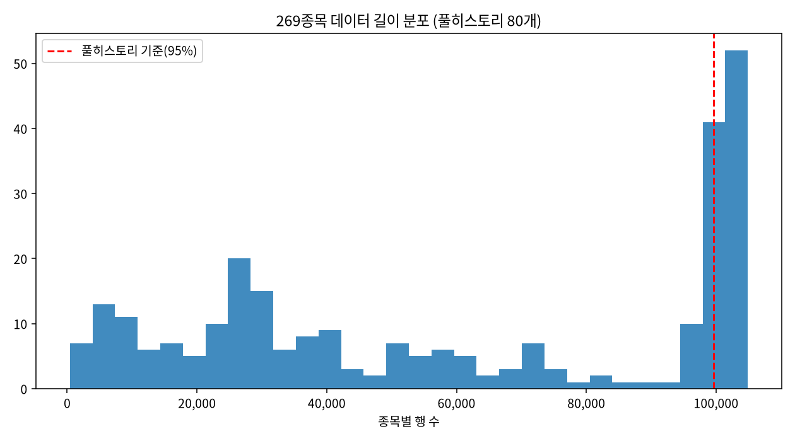
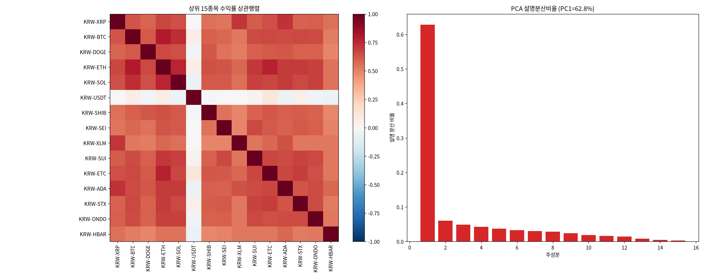
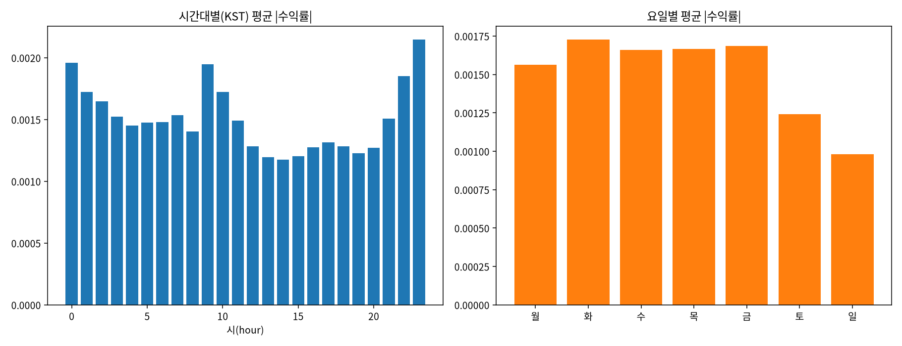
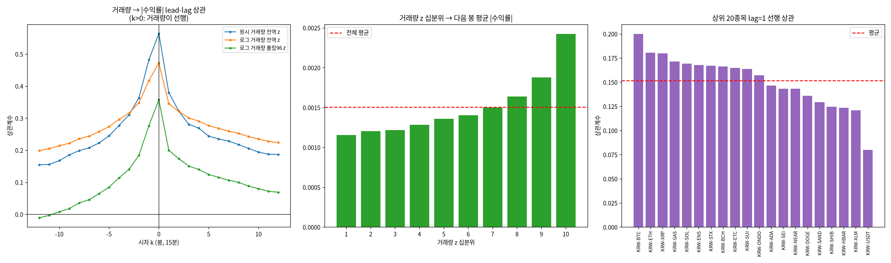

# 17번 준비작업 그림 보고서 — 데이터 감사·시장요인·계절성·거래량 선행성

작성일: 2026-08-10 · 브랜치: `stock` · 대상: `upbit_krw_candle` KRW 전 종목 269개 /
16,081,696행 (2023-07-18 ~ 2026-07-19), 단일종목 심층은 KRW-BTC 104,882봉
· 원시 수치: `test/results/17_eda_direction_signal_20260722/prep_figures_raw.md`
· 드라이버: `test/models/17_eda_prep_figures.py`
· 문헌 검증: arxiv MCP(`test/scripts/mcp_client.py arxiv ...`), 인용 9건 전부 초록 대조

> 이 문서는 `process.md` 2026-07-23 행의 미완 항목 두 개를 닫는다: **(1) s10~s12를 보고서로
> 정식 서술**(그동안 이미지만 커밋돼 있었다), **(2) 거래량 선행지표 시각화 생성**(미생성 상태였다).
>
> 서술에 앞서 s10~s12의 **생성 코드가 저장소에 없었다**는 문제를 먼저 해결했다. 2026-07-23에
> 임시 실행으로 그림만 만들고 코드를 남기지 않아, 그림 속 숫자를 보고서가 인용하면 검증 불가능한
> 인용이 된다 — `AGENTS.md`가 반복해서 경계하는 "서술만 쌓고 실행에 연결되지 않은" 상태다.
> 그래서 s10~s13을 하나의 재현 가능한 드라이버로 다시 만들고, 그 출력만 인용한다.

---

## 실험 설계

> 드라이버 서두 설계 셀 원문(`test/models/17_eda_prep_figures.py`). 실행 전에 적은 설계이며, 결과를 본 뒤 바꾼 내용은 결과 절에 따로 적는다.

### 17번 준비작업 그림 드라이버 — 데이터 감사·시장요인·계절성·거래량 선행성

헤드리스 `.py` 드라이버(`#%%` 셀 + 파일 내 마크다운, AGENTS.md 2.3). ipynb는 만들지 않는다.

#### 왜 (Why)
s10~s12 세 장은 2026-07-23에 임시 실행으로 만들어져 **이미지만 커밋되고 생성 코드가 남지
않았다**(process.md 2026-07-23 행: "준비작업 시각화 3장 git 커밋 완료(자산 보존)").
보고서로 정식 서술하려면 그림 속 숫자를 인용해야 하는데, 재현 코드가 없으면 그 숫자는
검증 불가능한 인용이 된다 — AGENTS.md가 금지하는 "서술만 쌓고 실행에 연결 안 된" 상태다.
같은 이유로 professor_brief 4.6절의 "거래량 lag=1 선행 +0.20"도 코드가 남아 있지 않다.

#### 무엇을 (What)
  S10 데이터 길이 감사 : 269종목 행수 분포 — 불균형 패널/상장시점 편의의 크기를 잰다
  S11 시장요인 PCA     : 상위 15종목 수익률 상관행렬 + 주성분 설명분산 — 공통요인의 지배력
  S12 계절성           : 시간대(KST)·요일별 평균 |수익률| — 결정적 주기 성분
  S13 거래량 선행성    : 거래량 z → 미래 |수익률| lead-lag(신규, process.md 미생성 항목)

#### 어떻게 (How)
데이터 축은 `upbit_krw_candle`(KRW 전 종목, 2026-07-18 데이터 축 교정 이후의 정본)로
통일한다. S12·S13의 단일종목 심층 분석은 KRW-BTC를 대표로 쓰되, S13은 상위 20종목으로
로버스트니스를 함께 본다. 모든 숫자는 과학적표기 없이 저장하고, 그림과 별개로
`prep_figures_raw.md`에 원시 수치를 남겨 보고서가 그 파일을 인용하게 한다.

#### 기대 결과 / 반영 (Expected)
s10~s12를 재현 가능한 상태로 되돌리고, B(변동성) 갈래의 핵심 입력인 거래량 선행신호를
그림·수치로 확정해 `17_eda_prep_figures_report`가 인용할 근거를 만든다.

---

## 기초통계량(describe 표)

> 2026-10-14 소급 추가(AGENTS.md 2.9.10). 실행 당시가 아니라 현재 DB를 같은 테이블·창으로 다시 조회해 계산했다(업비트 과거 캔들은 바뀌지 않으므로 같은 창이면 같은 값이다). 데이터 범위 근거: 본문 서두의 대상(`upbit_krw_candle` 269종목, 16,081,696행, 2023-07-18 ~ 2026-07-19)과 같다. 단일 종목 심층 분석의 KRW-BTC는 이 표의 KRW-BTC 행이다.

### KRW 마켓 전체 269종목(`upbit_krw_candle` 전체 이력)

- 출처: `data/upbit_data.db`의 `upbit_krw_candle`, 테이블 전체 이력, 269종목

#### describe 표(pandas `describe()` 그대로, 종목별)

> 숫자 형식: count는 정수, 나머지는 소수 둘째 자리(1 미만 값은 유효숫자 4자리). 로그수익률은 15분봉 기준 % 단위다. 행 단위 원자료라 무체결 구간(캔들 없음)은 포함되지 않는다.

**종가(KRW)**

| 종목 | count | mean | std | min | 25% | 50% | 75% | max |
| :--- | ---: | ---: | ---: | ---: | ---: | ---: | ---: | ---: |
| KRW-0G | 28,331 | 1,368.34 | 1,174.04 | 252.00 | 774.00 | 920.00 | 1,597.00 | 21,750.00 |
| KRW-1INCH | 98,296 | 398.05 | 175.89 | 99.00 | 283.00 | 362.00 | 529.60 | 989.90 |
| KRW-2Z | 25,068 | 182.77 | 114.17 | 91.40 | 115.00 | 152.00 | 189.00 | 1,515.00 |
| KRW-A | 103,665 | 753.09 | 393.35 | 88.50 | 571.00 | 782.90 | 1,000.00 | 2,147.00 |
| KRW-AAVE | 104,337 | 222,991.13 | 118,391.64 | 70,650.00 | 131,900.00 | 179,600.00 | 302,500.00 | 584,300.00 |
| KRW-ADA | 104,879 | 729.60 | 345.56 | 212.00 | 435.00 | 638.20 | 995.00 | 1,849.00 |
| KRW-AERGO | 102,358 | 148.67 | 60.09 | 30.10 | 106.00 | 142.00 | 183.50 | 891.00 |
| KRW-AERO | 27,650 | 927.80 | 431.46 | 407.00 | 582.00 | 747.00 | 1,276.00 | 2,273.00 |
| KRW-AGLD | 56,212 | 1,036.97 | 783.20 | 181.00 | 391.00 | 935.00 | 1,392.00 | 4,874.00 |
| KRW-AHT | 98,318 | 6.80 | 3.15 | 1.36 | 4.95 | 6.17 | 9.56 | 19.18 |
| KRW-AI | 1,720 | 40.79 | 5.45 | 33.70 | 36.58 | 39.80 | 42.50 | 61.60 |
| KRW-AKT | 77,144 | 2,510.39 | 1,863.44 | 389.00 | 955.00 | 1,780.00 | 3,680.00 | 9,405.00 |
| KRW-ALGO | 104,217 | 252.17 | 118.16 | 119.00 | 166.00 | 226.20 | 307.00 | 845.00 |
| KRW-ALT | 33,987 | 24.84 | 15.11 | 8.22 | 11.00 | 19.10 | 40.40 | 72.67 |
| KRW-ANIME | 50,540 | 19.01 | 13.78 | 3.66 | 7.47 | 14.80 | 26.01 | 124.20 |
| KRW-ANKR | 100,535 | 31.14 | 18.51 | 5.00 | 19.34 | 29.67 | 39.10 | 97.09 |
| KRW-API3 | 28,954 | 733.59 | 379.38 | 318.00 | 433.00 | 598.00 | 973.00 | 2,586.00 |
| KRW-APT | 104,734 | 8,364.06 | 4,996.74 | 849.00 | 5,345.00 | 8,010.00 | 11,660.00 | 27,420.00 |
| KRW-AQT | 100,547 | 1,456.84 | 555.74 | 268.00 | 1,093.00 | 1,407.00 | 1,843.00 | 5,929.00 |
| KRW-ARB | 104,369 | 938.14 | 698.65 | 108.00 | 432.60 | 726.80 | 1,344.00 | 3,290.00 |
| KRW-ARDR | 101,215 | 109.20 | 33.32 | 30.40 | 87.56 | 108.90 | 133.00 | 241.00 |
| KRW-ARK | 101,942 | 695.53 | 400.71 | 152.00 | 418.00 | 599.70 | 880.88 | 2,475.00 |
| KRW-ARKM | 42,833 | 492.85 | 275.63 | 140.00 | 197.00 | 520.00 | 745.80 | 1,165.00 |
| KRW-ARX | 2,410 | 329.80 | 77.54 | 219.00 | 266.25 | 324.00 | 387.00 | 676.00 |
| KRW-ASTR | 86,295 | 75.10 | 65.36 | 7.25 | 25.00 | 48.59 | 101.10 | 273.00 |
| KRW-ATH | 66,960 | 46.72 | 31.02 | 5.88 | 13.10 | 45.20 | 72.10 | 131.70 |
| KRW-ATOM | 104,489 | 7,866.45 | 4,014.72 | 2,200.00 | 4,979.00 | 6,693.00 | 10,980.00 | 20,350.00 |
| KRW-AUCTION | 72,130 | 15,696.96 | 8,362.63 | 4,667.00 | 8,140.00 | 14,690.00 | 20,130.00 | 97,180.00 |
| KRW-AVAX | 104,737 | 32,878.97 | 16,885.00 | 8,660.00 | 17,120.00 | 31,300.00 | 44,520.00 | 95,850.00 |
| KRW-AVNT | 28,775 | 510.89 | 510.73 | 129.00 | 210.00 | 292.00 | 585.00 | 3,604.00 |
| KRW-AWE | 102,427 | 82.14 | 21.25 | 45.60 | 69.79 | 78.80 | 89.10 | 222.40 |
| KRW-AXL | 36,970 | 231.27 | 174.58 | 58.50 | 82.70 | 120.00 | 428.00 | 900.50 |
| KRW-AXS | 104,572 | 6,038.67 | 3,715.12 | 1,158.00 | 2,957.00 | 6,090.00 | 8,665.00 | 19,410.00 |
| KRW-AZTEC | 12,511 | 30.26 | 5.59 | 18.90 | 27.80 | 31.10 | 33.40 | 58.10 |
| KRW-B3 | 6,751 | 1.09 | 0.4022 | 0.697 | 0.798 | 0.898 | 1.33 | 2.88 |
| KRW-BABY | 3,512 | 21.54 | 2.35 | 18.20 | 19.90 | 20.90 | 22.70 | 40.00 |
| KRW-BARD | 28,228 | 874.71 | 454.46 | 177.00 | 417.00 | 1,051.00 | 1,183.00 | 2,488.00 |
| KRW-BAT | 99,350 | 265.84 | 81.17 | 116.00 | 212.10 | 252.20 | 319.80 | 539.50 |
| KRW-BCH | 104,895 | 569,498.66 | 188,630.83 | 247,000.00 | 411,500.00 | 577,000.00 | 709,000.00 | 1,028,000.00 |
| KRW-BEAM | 71,207 | 14.15 | 11.33 | 1.86 | 4.73 | 10.40 | 21.29 | 57.05 |
| KRW-BERA | 50,276 | 2,969.67 | 2,929.08 | 266.00 | 791.00 | 2,356.00 | 3,706.00 | 18,130.00 |
| KRW-BIGTIME | 62,998 | 88.05 | 69.70 | 9.63 | 29.90 | 74.60 | 109.07 | 336.20 |
| KRW-BIO | 24,670 | 59.51 | 27.87 | 24.30 | 40.00 | 50.10 | 72.10 | 191.00 |
| KRW-BIRB | 14,490 | 194.60 | 70.55 | 80.60 | 130.00 | 201.00 | 223.00 | 710.00 |
| KRW-BLAST | 70,849 | 6.29 | 6.46 | 0.378 | 1.09 | 3.86 | 11.79 | 43.36 |
| KRW-BLEND | 7,332 | 124.06 | 39.62 | 78.20 | 91.40 | 102.00 | 157.00 | 333.00 |
| KRW-BLUR | 103,370 | 289.42 | 258.37 | 20.60 | 94.02 | 221.60 | 396.00 | 1,138.00 |
| KRW-BONK | 57,527 | 0.02273 | 0.01442 | 0.0046 | 0.00995 | 0.0191 | 0.0299 | 0.0829 |
| KRW-BORA | 102,321 | 140.44 | 60.59 | 35.10 | 108.60 | 135.00 | 189.50 | 342.50 |
| KRW-BOUNTY | 97,259 | 75.76 | 31.63 | 19.50 | 56.28 | 74.10 | 100.40 | 201.90 |
| KRW-BREV | 16,953 | 207.46 | 101.55 | 103.00 | 162.00 | 185.00 | 209.00 | 823.00 |
| KRW-BSV | 103,935 | 57,087.85 | 30,146.27 | 15,840.00 | 33,930.00 | 50,660.00 | 70,630.00 | 171,650.00 |
| KRW-BTC | 104,883 | 106,042,912.87 | 38,419,597.06 | 34,171,000.00 | 82,938,500.00 | 101,577,000.00 | 139,544,500.00 | 179,810,000.00 |
| KRW-BTT | 104,207 | 0.001036 | 0.0004874 | 0.000391 | 0.0006 | 0.000952 | 0.001314 | 0.003021 |
| KRW-CARV | 59,618 | 462.01 | 402.34 | 45.20 | 108.00 | 391.60 | 545.20 | 1,837.00 |
| KRW-CBK | 98,541 | 829.60 | 307.77 | 257.00 | 653.00 | 780.70 | 1,050.00 | 2,540.00 |
| KRW-CC | 8,598 | 225.42 | 14.90 | 184.00 | 219.00 | 226.00 | 233.00 | 268.00 |
| KRW-CELO | 102,272 | 642.79 | 392.66 | 86.10 | 378.00 | 593.65 | 902.00 | 2,505.00 |
| KRW-CFG | 13,468 | 306.68 | 76.69 | 146.00 | 248.00 | 304.00 | 359.00 | 515.00 |
| KRW-CHIP | 8,387 | 67.42 | 24.64 | 42.40 | 48.20 | 56.50 | 85.40 | 199.00 |
| KRW-CHZ | 104,132 | 89.95 | 44.38 | 23.00 | 56.80 | 77.29 | 107.50 | 238.50 |
| KRW-CKB | 60,334 | 8.18 | 6.33 | 1.30 | 3.61 | 6.31 | 9.59 | 57.55 |
| KRW-COMP | 40,869 | 47,463.16 | 16,234.19 | 22,390.00 | 31,680.00 | 50,100.00 | 61,650.00 | 111,600.00 |
| KRW-COW | 39,740 | 388.60 | 106.85 | 191.00 | 304.00 | 378.00 | 473.90 | 913.00 |
| KRW-CPOOL | 24,846 | 47.20 | 23.11 | 25.30 | 32.60 | 40.50 | 49.40 | 219.00 |
| KRW-CRO | 102,009 | 147.17 | 61.62 | 66.20 | 109.00 | 129.20 | 175.00 | 523.00 |
| KRW-CTC | 89,297 | 765.92 | 415.98 | 116.00 | 514.20 | 750.00 | 969.00 | 4,060.00 |
| KRW-CVC | 100,823 | 138.35 | 64.54 | 28.90 | 95.60 | 135.00 | 174.00 | 437.00 |
| KRW-CYBER | 29,179 | 1,293.94 | 757.33 | 487.00 | 781.00 | 1,051.00 | 1,529.00 | 6,230.00 |
| KRW-DATA | 32,930 | 4,060.72 | 4,317.13 | 388.00 | 765.00 | 2,206.00 | 6,520.00 | 20,560.00 |
| KRW-DEEP | 41,584 | 118.89 | 85.14 | 21.40 | 44.50 | 73.30 | 197.00 | 365.50 |
| KRW-DKA | 100,242 | 27.88 | 14.10 | 5.51 | 18.20 | 27.24 | 39.91 | 68.10 |
| KRW-DOGE | 104,863 | 219.64 | 121.09 | 78.80 | 133.70 | 192.00 | 271.00 | 674.00 |
| KRW-DOOD | 26,239 | 6.05 | 2.84 | 1.98 | 4.37 | 5.11 | 7.97 | 19.90 |
| KRW-DOT | 104,344 | 6,430.21 | 3,185.51 | 1,215.00 | 4,625.00 | 5,959.00 | 8,772.00 | 16,830.00 |
| KRW-DRV | 413 | 204.85 | 19.26 | 180.00 | 191.00 | 200.00 | 213.00 | 278.00 |
| KRW-EDGE | 11,886 | 150.75 | 39.43 | 85.80 | 114.00 | 157.00 | 174.00 | 380.00 |
| KRW-EGLD | 100,516 | 36,017.77 | 24,087.33 | 3,689.00 | 18,310.00 | 33,800.00 | 51,270.00 | 108,400.00 |
| KRW-ELF | 98,056 | 453.71 | 253.77 | 86.10 | 265.00 | 446.00 | 616.92 | 1,575.00 |
| KRW-ELSA | 16,150 | 103.87 | 32.22 | 58.50 | 85.43 | 103.00 | 112.00 | 393.00 |
| KRW-ENA | 35,521 | 408.70 | 307.21 | 107.00 | 152.00 | 302.00 | 668.00 | 1,187.00 |
| KRW-ENS | 70,607 | 25,033.52 | 13,184.20 | 5,980.00 | 13,990.00 | 24,550.00 | 32,240.00 | 71,370.00 |
| KRW-ENSO | 24,922 | 1,382.34 | 464.98 | 808.00 | 1,023.00 | 1,261.00 | 1,663.00 | 4,514.00 |
| KRW-ERA | 31,467 | 509.72 | 446.43 | 98.10 | 206.00 | 305.00 | 743.50 | 3,141.00 |
| KRW-ESP | 12,178 | 119.25 | 29.88 | 84.10 | 100.00 | 108.00 | 128.00 | 308.00 |
| KRW-ETC | 104,901 | 26,678.49 | 9,614.18 | 9,885.00 | 21,030.00 | 25,760.00 | 32,130.00 | 56,010.00 |
| KRW-ETH | 104,869 | 3,869,407.47 | 1,141,136.87 | 2,091,000.00 | 2,994,000.00 | 3,552,000.00 | 4,809,000.00 | 6,834,000.00 |
| KRW-ETHFI | 10,303 | 618.73 | 92.98 | 411.00 | 553.00 | 625.00 | 671.00 | 951.00 |
| KRW-F | 23,897 | 10.00 | 4.64 | 4.72 | 7.79 | 8.53 | 10.60 | 44.60 |
| KRW-FCT2 | 97,685 | 52.67 | 24.98 | 10.90 | 36.70 | 48.20 | 74.20 | 122.80 |
| KRW-FF | 26,233 | 141.99 | 46.95 | 85.50 | 108.00 | 128.00 | 170.00 | 1,080.00 |
| KRW-FIL | 44,444 | 2,469.83 | 1,013.76 | 1,038.00 | 1,417.75 | 2,318.00 | 3,420.00 | 5,675.00 |
| KRW-FLOCK | 28,884 | 163.96 | 125.28 | 45.20 | 83.40 | 102.00 | 203.00 | 738.00 |
| KRW-FLUID | 25,260 | 3,931.52 | 2,034.53 | 1,242.00 | 2,444.00 | 3,438.00 | 4,810.00 | 12,020.00 |
| KRW-G | 67,201 | 23.86 | 18.63 | 3.87 | 6.73 | 17.80 | 42.15 | 122.00 |
| KRW-GAME2 | 99,452 | 5.51 | 2.41 | 1.21 | 4.16 | 5.14 | 7.39 | 14.30 |
| KRW-GAS | 104,202 | 5,211.78 | 2,757.37 | 1,454.00 | 3,189.00 | 4,551.00 | 6,950.00 | 39,670.00 |
| KRW-GLM | 101,122 | 388.47 | 159.35 | 137.00 | 286.90 | 346.00 | 456.90 | 1,049.00 |
| KRW-GMT | 102,626 | 168.64 | 136.45 | 10.60 | 55.20 | 156.40 | 272.00 | 630.20 |
| KRW-GRT | 102,418 | 186.43 | 127.45 | 24.90 | 107.00 | 146.00 | 245.60 | 693.10 |
| KRW-HBAR | 104,749 | 181.35 | 108.28 | 58.37 | 97.35 | 143.00 | 254.00 | 588.40 |
| KRW-HIVE | 100,467 | 331.35 | 154.41 | 68.60 | 237.00 | 330.70 | 447.00 | 994.60 |
| KRW-HOLO | 28,554 | 144.28 | 104.63 | 73.90 | 92.30 | 106.00 | 139.00 | 1,157.00 |
| KRW-HP | 96,336 | 74.62 | 31.82 | 12.70 | 57.50 | 72.38 | 99.50 | 173.50 |
| KRW-HUNT | 96,607 | 393.70 | 145.39 | 116.00 | 327.00 | 391.00 | 501.10 | 934.70 |
| KRW-HYPER | 32,902 | 256.36 | 151.14 | 92.60 | 141.00 | 186.00 | 376.00 | 894.70 |
| KRW-ICP | 11,362 | 3,711.68 | 410.29 | 3,105.00 | 3,428.00 | 3,633.00 | 3,876.75 | 5,940.00 |
| KRW-ICX | 98,420 | 208.31 | 105.98 | 34.20 | 141.00 | 192.90 | 290.00 | 566.50 |
| KRW-ID | 83,878 | 432.76 | 395.83 | 35.30 | 118.00 | 292.60 | 623.68 | 2,610.00 |
| KRW-IMX | 101,198 | 1,464.01 | 1,142.10 | 172.00 | 636.00 | 960.10 | 2,116.00 | 5,239.00 |
| KRW-IN | 26,100 | 116.06 | 40.16 | 64.30 | 93.50 | 102.00 | 127.00 | 441.00 |
| KRW-INJ | 59,427 | 15,919.08 | 9,994.75 | 4,082.00 | 7,520.00 | 14,380.00 | 19,810.00 | 49,120.00 |
| KRW-IO | 3,910 | 257.00 | 21.41 | 200.00 | 248.00 | 260.00 | 270.00 | 325.00 |
| KRW-IOST | 100,003 | 7.55 | 4.31 | 0.965 | 4.38 | 6.98 | 11.26 | 20.51 |
| KRW-IOTA | 102,811 | 250.05 | 119.54 | 51.40 | 170.00 | 235.90 | 315.40 | 847.30 |
| KRW-IQ | 100,088 | 6.94 | 4.04 | 1.07 | 4.62 | 6.58 | 8.49 | 25.39 |
| KRW-IRYS | 6,049 | 31.52 | 14.29 | 18.00 | 22.50 | 26.60 | 35.50 | 139.00 |
| KRW-JST | 99,593 | 54.79 | 24.63 | 27.00 | 41.70 | 47.19 | 57.55 | 156.00 |
| KRW-JTO | 47,819 | 1,661.70 | 1,073.61 | 324.00 | 607.00 | 1,292.00 | 2,622.00 | 5,082.00 |
| KRW-JUP | 69,692 | 755.40 | 433.59 | 199.00 | 327.00 | 674.80 | 1,103.00 | 2,004.00 |
| KRW-KAITO | 46,975 | 1,288.33 | 650.46 | 409.00 | 703.00 | 1,175.00 | 1,741.00 | 3,390.00 |
| KRW-KAT | 10,723 | 11.85 | 4.17 | 6.71 | 8.14 | 12.10 | 14.00 | 42.30 |
| KRW-KAVA | 101,227 | 616.64 | 362.74 | 61.40 | 408.10 | 601.30 | 910.00 | 1,631.00 |
| KRW-KERNEL | 22,293 | 111.74 | 31.39 | 51.50 | 96.60 | 105.00 | 130.00 | 328.00 |
| KRW-KITE | 24,385 | 224.07 | 82.21 | 92.00 | 145.00 | 214.00 | 291.00 | 473.00 |
| KRW-KNC | 97,893 | 651.67 | 276.41 | 157.00 | 455.90 | 628.40 | 871.00 | 1,628.00 |
| KRW-LA | 28,244 | 363.16 | 176.64 | 74.50 | 219.00 | 345.00 | 512.00 | 853.00 |
| KRW-LAYER | 49,357 | 742.15 | 831.10 | 91.90 | 131.00 | 421.00 | 968.50 | 4,791.00 |
| KRW-LINEA | 27,943 | 12.04 | 10.88 | 3.33 | 4.76 | 6.01 | 15.60 | 49.20 |
| KRW-LINK | 104,888 | 20,069.67 | 7,075.32 | 7,880.00 | 14,410.00 | 19,490.00 | 24,402.50 | 44,210.00 |
| KRW-LPT | 35,747 | 6,106.89 | 2,866.27 | 2,176.00 | 3,320.00 | 5,565.00 | 8,805.00 | 19,010.00 |
| KRW-LSK | 100,845 | 1,051.61 | 710.88 | 120.00 | 442.00 | 1,028.00 | 1,460.00 | 4,825.00 |
| KRW-MANA | 102,230 | 449.33 | 211.26 | 93.10 | 354.00 | 420.10 | 585.00 | 1,191.00 |
| KRW-MANTRA | 38,415 | 44.36 | 32.97 | 9.05 | 16.60 | 28.25 | 72.80 | 154.25 |
| KRW-MASK | 100,389 | 3,046.04 | 1,732.00 | 508.00 | 1,630.00 | 3,213.00 | 4,530.00 | 9,198.00 |
| KRW-MBL | 98,135 | 3.94 | 1.87 | 0.976 | 3.01 | 3.61 | 5.15 | 9.75 |
| KRW-ME | 55,351 | 1,108.76 | 1,233.09 | 84.70 | 192.00 | 922.00 | 1,347.00 | 15,990.00 |
| KRW-MED | 100,347 | 10.94 | 5.33 | 2.03 | 6.91 | 11.21 | 15.20 | 27.39 |
| KRW-MEGA | 7,552 | 105.71 | 44.56 | 63.50 | 71.90 | 84.90 | 128.00 | 319.00 |
| KRW-MET2 | 19,112 | 303.12 | 106.14 | 144.00 | 222.00 | 262.00 | 374.00 | 980.00 |
| KRW-META | 96,461 | 36.09 | 15.51 | 11.00 | 27.75 | 33.83 | 47.30 | 84.18 |
| KRW-MEW | 59,799 | 4.07 | 3.70 | 0.491 | 1.03 | 3.50 | 4.60 | 18.10 |
| KRW-MINA | 92,854 | 631.76 | 528.65 | 56.10 | 193.00 | 512.00 | 935.00 | 3,845.00 |
| KRW-MIRA | 27,229 | 223.55 | 241.23 | 59.60 | 119.00 | 133.00 | 222.00 | 6,390.00 |
| KRW-MLK | 102,674 | 287.74 | 142.10 | 49.70 | 188.00 | 290.50 | 411.00 | 676.80 |
| KRW-MMT | 22,869 | 277.22 | 153.44 | 151.00 | 188.00 | 216.00 | 325.00 | 2,472.00 |
| KRW-MNT | 76,103 | 1,306.85 | 497.62 | 612.00 | 947.00 | 1,127.00 | 1,612.00 | 4,130.00 |
| KRW-MOC | 97,027 | 97.16 | 36.47 | 24.50 | 76.05 | 95.61 | 125.00 | 297.10 |
| KRW-MOCA | 52,894 | 101.44 | 96.47 | 12.10 | 24.80 | 95.80 | 123.10 | 700.30 |
| KRW-MON | 21,662 | 36.38 | 7.60 | 24.30 | 31.00 | 34.00 | 40.80 | 73.00 |
| KRW-MOODENG | 35,149 | 132.75 | 68.78 | 52.70 | 74.90 | 106.00 | 190.00 | 333.00 |
| KRW-MOVE | 55,754 | 288.68 | 376.05 | 15.50 | 33.30 | 162.00 | 306.50 | 3,733.00 |
| KRW-MTL | 99,437 | 1,412.65 | 711.19 | 322.00 | 931.10 | 1,336.00 | 1,900.00 | 4,999.00 |
| KRW-MVL | 96,008 | 4.89 | 1.94 | 1.25 | 3.93 | 4.79 | 5.83 | 11.99 |
| KRW-NEAR | 104,861 | 4,542.52 | 2,633.72 | 1,322.00 | 2,472.00 | 3,740.00 | 6,165.00 | 12,980.00 |
| KRW-NEO | 103,610 | 12,256.98 | 6,393.60 | 2,800.00 | 7,635.00 | 11,170.00 | 16,330.00 | 36,410.00 |
| KRW-NEWT | 34,331 | 218.71 | 147.41 | 63.00 | 106.00 | 153.00 | 327.50 | 954.10 |
| KRW-NXPC | 39,364 | 830.30 | 564.39 | 365.00 | 457.00 | 568.00 | 1,041.00 | 4,802.00 |
| KRW-ONDO | 73,173 | 1,097.80 | 535.31 | 310.00 | 592.00 | 1,085.00 | 1,380.00 | 3,048.00 |
| KRW-ONG | 100,620 | 344.36 | 182.12 | 63.30 | 219.00 | 320.60 | 471.00 | 1,181.00 |
| KRW-ONT | 101,752 | 241.25 | 119.62 | 57.80 | 161.50 | 229.00 | 310.60 | 724.00 |
| KRW-OP | 30,465 | 487.42 | 333.09 | 135.00 | 181.00 | 429.00 | 690.00 | 1,199.00 |
| KRW-OPEN | 28,901 | 378.27 | 245.49 | 206.00 | 242.00 | 283.00 | 373.00 | 1,814.00 |
| KRW-OPG | 1,069 | 171.88 | 12.82 | 151.00 | 163.00 | 168.00 | 180.00 | 232.00 |
| KRW-ORBS | 99,566 | 33.64 | 15.23 | 8.35 | 24.30 | 31.49 | 44.90 | 93.60 |
| KRW-ORCA | 44,961 | 2,454.07 | 918.18 | 1,001.00 | 1,657.00 | 2,236.00 | 3,189.00 | 8,170.00 |
| KRW-ORDER | 22,765 | 117.74 | 70.94 | 46.60 | 78.10 | 86.00 | 146.00 | 496.00 |
| KRW-PENDLE | 66,265 | 4,583.97 | 1,938.99 | 1,476.00 | 2,911.00 | 4,612.00 | 5,983.00 | 9,970.00 |
| KRW-PENGU | 41,571 | 21.55 | 13.93 | 8.18 | 10.80 | 15.20 | 30.80 | 62.47 |
| KRW-PEPE | 58,435 | 0.01239 | 0.007526 | 0.00344 | 0.00598 | 0.0107 | 0.0155 | 0.04176 |
| KRW-PIEVERSE | 8,390 | 1,103.87 | 148.59 | 862.00 | 1,012.00 | 1,067.00 | 1,140.00 | 1,762.00 |
| KRW-PLUME | 21,076 | 19.86 | 5.51 | 12.50 | 15.90 | 17.90 | 23.00 | 74.20 |
| KRW-POKT | 37,821 | 31.58 | 19.53 | 11.00 | 18.10 | 21.80 | 46.90 | 136.40 |
| KRW-POL | 104,461 | 577.46 | 384.04 | 104.00 | 263.00 | 500.00 | 855.00 | 1,831.00 |
| KRW-POLYX | 102,639 | 251.55 | 162.86 | 50.10 | 142.00 | 215.10 | 322.10 | 971.00 |
| KRW-POWR | 99,658 | 278.80 | 140.39 | 60.20 | 189.00 | 257.20 | 375.00 | 1,750.00 |
| KRW-PRL | 7,305 | 299.06 | 71.37 | 202.00 | 250.00 | 279.00 | 313.00 | 596.00 |
| KRW-PROS | 6,618 | 851.49 | 199.28 | 534.00 | 648.00 | 885.00 | 946.00 | 1,642.00 |
| KRW-PROVE | 30,572 | 709.26 | 421.59 | 262.00 | 374.00 | 553.00 | 1,044.00 | 2,386.00 |
| KRW-PUMP | 28,317 | 4.04 | 2.12 | 1.76 | 2.64 | 3.05 | 4.57 | 12.30 |
| KRW-PUNDIX | 99,671 | 521.96 | 197.92 | 113.00 | 414.00 | 511.20 | 635.95 | 1,388.00 |
| KRW-PYTH | 82,293 | 335.34 | 292.43 | 45.40 | 105.00 | 222.00 | 479.50 | 1,662.00 |
| KRW-QKC | 95,726 | 11.37 | 4.19 | 2.69 | 9.13 | 11.21 | 14.30 | 28.20 |
| KRW-QTUM | 102,996 | 3,390.89 | 1,368.41 | 978.00 | 2,783.00 | 3,212.00 | 4,225.00 | 8,677.00 |
| KRW-RAY | 34,747 | 2,195.41 | 1,385.79 | 771.00 | 992.00 | 1,605.00 | 3,349.00 | 5,960.00 |
| KRW-RE | 2,770 | 967.96 | 200.57 | 598.00 | 856.00 | 934.50 | 1,040.50 | 1,605.00 |
| KRW-RED | 27,324 | 347.76 | 199.10 | 133.00 | 194.00 | 305.00 | 427.00 | 1,325.00 |
| KRW-RENDER | 55,820 | 4,759.36 | 2,690.89 | 1,736.00 | 2,673.00 | 4,388.00 | 5,628.00 | 15,280.00 |
| KRW-RVN | 36,516 | 12.99 | 5.35 | 5.45 | 8.59 | 11.30 | 18.10 | 35.71 |
| KRW-SAFE | 56,700 | 635.15 | 494.01 | 116.00 | 218.00 | 585.15 | 755.73 | 2,670.00 |
| KRW-SAHARA | 36,691 | 68.77 | 42.26 | 13.10 | 34.00 | 48.60 | 116.00 | 219.60 |
| KRW-SAND | 104,628 | 443.62 | 241.49 | 68.90 | 320.00 | 409.00 | 585.00 | 1,479.00 |
| KRW-SC | 101,166 | 5.92 | 3.76 | 0.887 | 3.78 | 4.90 | 7.85 | 32.15 |
| KRW-SEI | 102,133 | 422.20 | 300.17 | 68.30 | 175.00 | 363.00 | 574.80 | 1,652.00 |
| KRW-SENT | 15,045 | 28.13 | 7.84 | 18.00 | 23.30 | 25.40 | 31.60 | 71.90 |
| KRW-SHIB | 104,868 | 0.01863 | 0.009567 | 0.00603 | 0.011 | 0.01707 | 0.0235 | 0.0634 |
| KRW-SIGN | 40,785 | 65.95 | 34.09 | 12.10 | 40.40 | 59.20 | 97.20 | 184.00 |
| KRW-SKR | 11,731 | 23.24 | 7.39 | 11.30 | 14.60 | 24.00 | 28.50 | 45.20 |
| KRW-SKY | 7,832 | 101.72 | 15.19 | 73.80 | 87.57 | 103.00 | 115.00 | 134.00 |
| KRW-SLX | 4,529 | 374.57 | 191.03 | 158.00 | 257.00 | 291.00 | 474.00 | 999.00 |
| KRW-SNT | 100,795 | 38.80 | 16.99 | 10.30 | 28.80 | 35.35 | 52.59 | 115.90 |
| KRW-SOL | 104,879 | 187,085.83 | 83,122.49 | 23,900.00 | 126,900.00 | 197,600.00 | 241,500.00 | 448,150.00 |
| KRW-SOMI | 24,939 | 375.90 | 228.53 | 141.00 | 250.00 | 295.00 | 402.00 | 1,562.00 |
| KRW-SONIC | 52,123 | 244.83 | 209.53 | 33.10 | 66.10 | 246.00 | 339.40 | 1,677.00 |
| KRW-SOON | 8,422 | 253.86 | 17.02 | 214.00 | 244.00 | 252.00 | 261.00 | 470.00 |
| KRW-SOPH | 38,325 | 28.89 | 18.59 | 6.62 | 13.00 | 21.50 | 43.30 | 200.00 |
| KRW-SPK | 7,911 | 37.93 | 12.52 | 24.40 | 27.10 | 31.30 | 50.00 | 94.10 |
| KRW-SPX | 2,784 | 555.27 | 40.46 | 470.00 | 523.00 | 555.00 | 575.00 | 740.00 |
| KRW-STEEM | 100,064 | 233.73 | 106.91 | 56.40 | 170.60 | 227.10 | 314.00 | 567.70 |
| KRW-STORJ | 100,555 | 515.77 | 285.21 | 105.00 | 321.00 | 468.50 | 721.35 | 1,665.00 |
| KRW-STRAX | 102,279 | 76.15 | 44.11 | 11.80 | 53.14 | 65.13 | 104.00 | 247.00 |
| KRW-STX | 104,797 | 1,500.27 | 1,134.80 | 241.00 | 631.00 | 985.00 | 2,313.00 | 5,465.00 |
| KRW-SUI | 104,876 | 2,615.08 | 1,758.19 | 496.00 | 1,185.00 | 2,090.00 | 3,967.25 | 7,877.00 |
| KRW-SUN | 20,629 | 29.52 | 4.20 | 21.70 | 26.20 | 28.90 | 32.10 | 54.70 |
| KRW-SUPER | 23,861 | 301.95 | 187.23 | 123.00 | 170.00 | 197.00 | 369.00 | 1,415.00 |
| KRW-SYRUP | 30,889 | 457.80 | 148.18 | 174.00 | 342.00 | 452.00 | 583.00 | 875.00 |
| KRW-T | 101,381 | 28.29 | 13.32 | 4.83 | 20.63 | 27.20 | 34.66 | 91.99 |
| KRW-TAIKO | 70,554 | 1,193.30 | 1,038.51 | 91.40 | 274.00 | 722.20 | 2,065.00 | 7,472.00 |
| KRW-TAO | 14,537 | 365,534.62 | 68,487.90 | 241,000.00 | 312,400.00 | 366,500.00 | 413,100.00 | 555,000.00 |
| KRW-TFUEL | 100,058 | 63.63 | 34.94 | 11.00 | 43.30 | 55.20 | 83.81 | 189.50 |
| KRW-THETA | 100,553 | 1,496.42 | 1,046.05 | 188.00 | 826.00 | 1,220.00 | 1,895.00 | 5,277.00 |
| KRW-TIA | 38,966 | 1,439.25 | 1,017.01 | 420.00 | 567.00 | 895.50 | 2,295.00 | 4,775.00 |
| KRW-TOKAMAK | 99,844 | 1,878.74 | 823.46 | 502.00 | 1,380.00 | 1,705.00 | 2,590.00 | 5,120.00 |
| KRW-TOSHI | 27,336 | 0.4938 | 0.324 | 0.158 | 0.27 | 0.326 | 0.6072 | 1.57 |
| KRW-TRAC | 5,293 | 507.37 | 87.97 | 379.00 | 415.00 | 517.00 | 562.00 | 864.00 |
| KRW-TREE | 29,261 | 175.28 | 117.98 | 54.60 | 96.60 | 111.00 | 223.00 | 760.00 |
| KRW-TRUMP | 49,734 | 10,001.06 | 5,528.15 | 2,239.00 | 4,892.00 | 10,480.00 | 13,000.00 | 35,580.00 |
| KRW-TRUST | 23,044 | 133.42 | 62.04 | 68.60 | 98.60 | 107.00 | 162.00 | 867.00 |
| KRW-TRX | 104,856 | 307.45 | 138.36 | 98.40 | 171.50 | 351.00 | 429.00 | 631.00 |
| KRW-TT | 97,821 | 4.40 | 1.89 | 0.872 | 3.58 | 4.47 | 5.79 | 10.35 |
| KRW-UNI | 60,302 | 10,187.58 | 4,803.57 | 3,553.00 | 5,830.00 | 9,220.00 | 12,880.00 | 27,110.00 |
| KRW-UP2 | 6,087 | 122.87 | 46.52 | 77.60 | 92.50 | 101.00 | 143.00 | 431.00 |
| KRW-USD1 | 24,936 | 1,478.95 | 53.43 | 1,379.00 | 1,471.00 | 1,485.00 | 1,496.00 | 7,375.00 |
| KRW-USDC | 63,462 | 1,447.01 | 56.05 | 1,304.00 | 1,394.00 | 1,469.00 | 1,491.00 | 1,632.00 |
| KRW-USDE | 7,684 | 1,482.73 | 17.46 | 1,434.00 | 1,472.00 | 1,480.00 | 1,490.00 | 1,533.00 |
| KRW-USDS | 4,023 | 1,493.57 | 17.10 | 1,453.00 | 1,481.00 | 1,489.00 | 1,508.00 | 1,757.00 |
| KRW-USDT | 73,834 | 1,442.25 | 54.78 | 1,201.00 | 1,396.00 | 1,454.00 | 1,489.00 | 1,630.00 |
| KRW-VANA | 53,926 | 6,508.35 | 5,408.29 | 1,530.00 | 2,395.00 | 5,695.00 | 8,270.00 | 40,740.00 |
| KRW-VET | 103,703 | 34.01 | 17.69 | 6.55 | 22.50 | 32.48 | 41.50 | 108.70 |
| KRW-VIRTUAL | 51,018 | 1,480.76 | 588.88 | 629.90 | 1,012.00 | 1,275.00 | 1,847.00 | 3,503.00 |
| KRW-VTHO | 49,201 | 2.34 | 1.69 | 0.521 | 0.898 | 2.28 | 3.03 | 16.91 |
| KRW-VVV | 6,382 | 21,920.65 | 3,690.48 | 14,620.00 | 19,690.00 | 21,790.00 | 24,757.50 | 31,550.00 |
| KRW-W | 61,389 | 147.10 | 136.47 | 12.80 | 39.30 | 109.20 | 165.00 | 581.40 |
| KRW-WAL | 41,425 | 378.14 | 264.99 | 43.10 | 117.00 | 326.00 | 598.00 | 1,085.00 |
| KRW-WAVES | 103,984 | 1,924.35 | 1,067.87 | 369.00 | 1,279.00 | 1,613.00 | 2,495.00 | 7,114.00 |
| KRW-WAXP | 100,864 | 49.03 | 31.53 | 5.60 | 25.60 | 45.25 | 71.00 | 170.20 |
| KRW-WCT | 42,167 | 280.97 | 238.85 | 60.00 | 91.50 | 171.00 | 435.00 | 1,932.00 |
| KRW-WET | 19,258 | 156.41 | 63.99 | 80.00 | 113.00 | 145.00 | 166.00 | 479.00 |
| KRW-WIF | 4,642 | 271.55 | 34.74 | 209.00 | 242.00 | 267.00 | 292.00 | 350.00 |
| KRW-WLD | 29,798 | 844.49 | 476.40 | 343.00 | 534.00 | 708.00 | 962.00 | 2,848.00 |
| KRW-WLFI | 30,200 | 177.08 | 69.04 | 76.80 | 110.00 | 173.00 | 228.00 | 442.00 |
| KRW-XAUT | 17,425 | 6,892,488.61 | 459,505.85 | 5,845,000.00 | 6,579,000.00 | 6,913,000.00 | 7,286,000.00 | 8,802,000.00 |
| KRW-XCN | 6,438 | 6.63 | 0.9237 | 5.27 | 5.80 | 6.46 | 7.49 | 12.40 |
| KRW-XEC | 102,798 | 0.0372 | 0.01985 | 0.00736 | 0.025 | 0.0344 | 0.04682 | 0.1223 |
| KRW-XLM | 104,901 | 296.14 | 162.09 | 110.20 | 158.20 | 240.00 | 399.00 | 866.50 |
| KRW-XPL | 28,269 | 286.64 | 319.05 | 91.10 | 139.00 | 169.00 | 272.00 | 2,424.00 |
| KRW-XRP | 104,876 | 2,049.32 | 1,307.19 | 564.60 | 779.00 | 1,973.00 | 3,214.00 | 4,973.00 |
| KRW-XTZ | 99,168 | 1,069.20 | 413.35 | 306.00 | 828.00 | 988.00 | 1,280.00 | 2,646.00 |
| KRW-YGG | 21,820 | 88.13 | 49.76 | 30.40 | 56.10 | 64.30 | 107.00 | 377.00 |
| KRW-ZAMA | 8,274 | 46.38 | 4.53 | 37.70 | 42.30 | 46.90 | 50.10 | 61.00 |
| KRW-ZBT | 25,629 | 183.57 | 77.48 | 87.40 | 132.00 | 172.00 | 211.00 | 1,114.00 |
| KRW-ZETA | 74,975 | 511.70 | 503.18 | 48.50 | 119.00 | 312.40 | 808.00 | 2,626.00 |
| KRW-ZIL | 101,022 | 21.02 | 11.05 | 4.23 | 14.74 | 19.88 | 28.38 | 62.73 |
| KRW-ZK | 17,597 | 27.44 | 13.20 | 13.50 | 21.50 | 26.00 | 29.60 | 302.00 |
| KRW-ZKC | 27,353 | 215.11 | 210.52 | 61.20 | 107.00 | 143.00 | 225.00 | 3,383.00 |
| KRW-ZKP | 18,236 | 124.60 | 40.50 | 63.30 | 103.00 | 119.00 | 136.00 | 349.00 |
| KRW-ZORA | 25,075 | 43.19 | 33.53 | 9.17 | 19.00 | 27.10 | 63.10 | 178.00 |
| KRW-ZRO | 71,595 | 3,736.11 | 1,808.57 | 1,118.00 | 2,462.00 | 3,105.00 | 4,821.00 | 11,060.00 |
| KRW-ZRX | 99,453 | 427.96 | 247.64 | 112.00 | 270.00 | 382.00 | 504.50 | 2,051.00 |

**거래량(코인 수)**

| 종목 | count | mean | std | min | 25% | 50% | 75% | max |
| :--- | ---: | ---: | ---: | ---: | ---: | ---: | ---: | ---: |
| KRW-0G | 28,331 | 139,649.51 | 548,236.57 | 0.007902 | 10,731.24 | 28,305.73 | 75,025.13 | 14,003,654.80 |
| KRW-1INCH | 98,296 | 107,531.60 | 642,833.18 | 0.00000035 | 7,391.08 | 27,998.94 | 81,246.27 | 75,848,963.28 |
| KRW-2Z | 25,068 | 173,881.04 | 1,133,064.00 | 0.00000001 | 9,339.38 | 41,861.57 | 126,897.34 | 60,875,954.41 |
| KRW-A | 103,665 | 96,685.62 | 300,248.27 | 0.00000066 | 15,135.33 | 38,996.43 | 92,591.69 | 19,538,085.59 |
| KRW-AAVE | 104,337 | 401.46 | 1,374.34 | 0.0002766 | 53.92 | 152.05 | 391.98 | 131,361.86 |
| KRW-ADA | 104,879 | 468,659.64 | 1,333,312.83 | 5.13 | 102,584.66 | 215,094.05 | 450,689.25 | 88,027,214.53 |
| KRW-AERGO | 102,358 | 920,891.74 | 4,870,029.30 | 0.00000011 | 33,124.22 | 120,117.26 | 377,906.51 | 407,000,980.08 |
| KRW-AERO | 27,650 | 28,034.44 | 246,746.51 | 0.00000939 | 778.99 | 4,072.77 | 14,343.28 | 22,395,375.18 |
| KRW-AGLD | 56,212 | 150,766.57 | 812,852.64 | 0.00000001 | 4,688.06 | 17,737.38 | 58,779.50 | 34,318,594.67 |
| KRW-AHT | 98,318 | 7,286,413.30 | 56,583,719.82 | 0.00000025 | 229,304.55 | 1,046,722.85 | 3,493,196.88 | 5,877,556,736.43 |
| KRW-AI | 1,720 | 3,420,341.30 | 10,770,870.61 | 378.60 | 384,084.45 | 1,023,905.45 | 2,468,168.61 | 178,416,377.02 |
| KRW-AKT | 77,144 | 50,400.94 | 271,543.24 | 0.00000001 | 3,485.07 | 10,072.68 | 27,094.27 | 17,183,388.83 |
| KRW-ALGO | 104,217 | 372,070.52 | 1,325,223.68 | 0.00000074 | 46,954.58 | 136,799.52 | 346,618.19 | 123,313,060.88 |
| KRW-ALT | 33,987 | 2,055,066.47 | 14,105,279.39 | 0.00000001 | 49,621.78 | 235,031.89 | 862,142.56 | 829,880,022.17 |
| KRW-ANIME | 50,540 | 6,152,639.40 | 27,266,306.13 | 0.00000019 | 447,561.18 | 1,417,080.13 | 3,856,837.55 | 1,643,907,308.09 |
| KRW-ANKR | 100,535 | 2,169,055.07 | 14,631,796.28 | 0.00000002 | 106,953.14 | 388,154.07 | 1,206,546.32 | 1,095,959,189.29 |
| KRW-API3 | 28,954 | 100,981.27 | 651,148.33 | 0.0000005 | 2,080.04 | 8,485.21 | 30,134.13 | 36,751,993.76 |
| KRW-APT | 104,734 | 14,001.99 | 43,420.09 | 0.006719 | 2,266.60 | 5,878.92 | 13,999.06 | 3,380,834.94 |
| KRW-AQT | 100,547 | 70,958.18 | 514,267.13 | 0.00000001 | 2,014.89 | 8,001.91 | 25,932.44 | 36,729,734.33 |
| KRW-ARB | 104,369 | 156,561.95 | 312,280.03 | 3.22 | 30,063.18 | 76,730.00 | 172,157.45 | 14,517,479.68 |
| KRW-ARDR | 101,215 | 804,559.39 | 5,245,164.06 | 0.00000001 | 23,526.35 | 88,487.38 | 296,768.72 | 313,391,274.97 |
| KRW-ARK | 101,942 | 319,474.04 | 1,449,187.03 | 0.00000001 | 13,879.35 | 46,286.54 | 148,790.07 | 58,717,627.02 |
| KRW-ARKM | 42,833 | 59,767.50 | 521,057.88 | 0.0000001 | 2,373.96 | 10,434.49 | 32,854.61 | 56,052,867.87 |
| KRW-ARX | 2,410 | 549,805.17 | 1,046,500.98 | 67.80 | 98,356.45 | 236,126.66 | 548,646.67 | 18,859,748.19 |
| KRW-ASTR | 86,295 | 1,198,358.57 | 6,942,946.68 | 0.00000001 | 82,491.24 | 273,364.70 | 791,276.07 | 616,189,770.15 |
| KRW-ATH | 66,960 | 3,165,807.87 | 14,787,600.32 | 0.00000001 | 347,263.82 | 920,579.89 | 2,351,882.02 | 1,078,893,520.17 |
| KRW-ATOM | 104,489 | 4,976.24 | 15,790.94 | 0.0002743 | 849.20 | 2,202.66 | 5,165.45 | 1,435,993.98 |
| KRW-AUCTION | 72,130 | 8,838.03 | 45,504.84 | 0.00000001 | 370.83 | 1,275.61 | 4,013.74 | 2,143,847.71 |
| KRW-AVAX | 104,737 | 4,828.61 | 12,595.20 | 0.2559 | 929.94 | 2,072.43 | 4,490.55 | 742,883.29 |
| KRW-AVNT | 28,775 | 389,614.56 | 1,200,451.11 | 2.16 | 40,485.49 | 112,921.43 | 287,548.35 | 44,050,358.83 |
| KRW-AWE | 102,427 | 1,754,684.91 | 7,578,766.77 | 0.00000001 | 70,314.96 | 271,505.91 | 945,703.77 | 381,728,282.79 |
| KRW-AXL | 36,970 | 427,791.35 | 2,508,172.62 | 0.00000054 | 10,437.99 | 42,737.80 | 182,410.64 | 100,846,357.57 |
| KRW-AXS | 104,572 | 34,124.03 | 208,484.72 | 0.0006011 | 1,954.35 | 5,334.34 | 14,324.12 | 12,715,262.03 |
| KRW-AZTEC | 12,511 | 1,960,392.43 | 12,724,915.64 | 63.91 | 54,047.00 | 242,514.04 | 832,654.79 | 616,884,763.49 |
| KRW-B3 | 6,751 | 85,558,292.45 | 285,515,660.92 | 1,358.97 | 5,042,539.67 | 15,701,978.29 | 46,757,575.12 | 7,904,003,319.20 |
| KRW-BABY | 3,512 | 1,812,538.95 | 10,295,679.03 | 0.00003456 | 66,673.02 | 339,564.35 | 1,184,772.02 | 455,441,427.44 |
| KRW-BARD | 28,228 | 137,392.78 | 552,383.40 | 0.0000597 | 6,469.46 | 25,733.33 | 93,718.49 | 31,005,777.29 |
| KRW-BAT | 99,350 | 117,422.22 | 773,016.15 | 0.00000002 | 7,199.81 | 28,216.94 | 88,878.14 | 133,813,019.30 |
| KRW-BCH | 104,895 | 480.27 | 1,619.00 | 0.007388 | 50.15 | 137.45 | 385.77 | 86,622.16 |
| KRW-BEAM | 71,207 | 3,988,231.91 | 22,882,496.76 | 0.00000003 | 443,889.95 | 1,335,112.64 | 3,365,362.34 | 4,086,885,598.16 |
| KRW-BERA | 50,276 | 100,565.12 | 514,789.29 | 1.40 | 8,200.42 | 21,489.28 | 55,993.24 | 28,947,018.28 |
| KRW-BIGTIME | 62,998 | 1,340,905.43 | 5,529,671.34 | 0.00000001 | 105,989.81 | 340,502.92 | 953,342.51 | 319,931,996.10 |
| KRW-BIO | 24,670 | 1,893,396.79 | 9,086,070.06 | 0.000119 | 40,211.46 | 173,661.79 | 713,365.59 | 284,036,302.90 |
| KRW-BIRB | 14,490 | 280,619.33 | 1,645,981.56 | 0.2127 | 9,333.50 | 39,161.07 | 127,224.13 | 62,598,914.30 |
| KRW-BLAST | 70,849 | 25,870,140.24 | 181,232,659.52 | 0.00000031 | 1,914,104.97 | 5,121,802.46 | 12,885,093.51 | 10,456,687,981.50 |
| KRW-BLEND | 7,332 | 541,398.69 | 1,892,815.92 | 6.72 | 27,331.92 | 97,584.43 | 299,277.92 | 52,767,758.46 |
| KRW-BLUR | 103,370 | 710,264.87 | 3,011,073.03 | 0.0000002 | 69,722.88 | 218,473.95 | 565,273.97 | 250,953,765.12 |
| KRW-BONK | 57,527 | 4,661,780,392.05 | 18,939,380,283.92 | 0.00000006 | 597,918,012.79 | 1,630,314,018.26 | 4,030,558,182.58 | 2,141,078,036,289.30 |
| KRW-BORA | 102,321 | 540,737.07 | 2,948,376.86 | 0.00000002 | 28,871.21 | 97,356.27 | 289,210.37 | 167,367,351.31 |
| KRW-BOUNTY | 97,259 | 1,111,381.75 | 7,345,472.28 | 0.00000008 | 29,011.41 | 123,137.83 | 412,585.32 | 570,717,812.35 |
| KRW-BREV | 16,953 | 284,249.38 | 1,232,698.21 | 0.0003535 | 15,685.21 | 65,389.93 | 203,417.25 | 51,055,512.17 |
| KRW-BSV | 103,935 | 2,405.92 | 11,699.09 | 0.00000001 | 169.34 | 499.75 | 1,376.45 | 753,411.25 |
| KRW-BTC | 104,883 | 32.32 | 54.96 | 0.0001955 | 9.18 | 17.87 | 35.36 | 2,856.91 |
| KRW-BTT | 104,207 | 84,826,266,708.91 | 470,217,786,802.45 | 943,464.83 | 5,049,986,457.83 | 15,719,673,442.94 | 45,505,247,227.46 | 41,267,635,401,715.23 |
| KRW-CARV | 59,618 | 253,726.60 | 1,360,600.33 | 0.00000012 | 16,086.48 | 52,666.03 | 146,271.91 | 98,002,781.32 |
| KRW-CBK | 98,541 | 105,793.55 | 723,970.87 | 0.00000008 | 2,645.61 | 10,816.94 | 35,911.80 | 48,804,958.79 |
| KRW-CC | 8,598 | 99,852.11 | 761,900.62 | 0.00002907 | 8,179.24 | 29,473.60 | 80,070.95 | 58,506,100.18 |
| KRW-CELO | 102,272 | 109,195.96 | 491,000.23 | 0.00000056 | 9,498.50 | 31,841.25 | 89,055.21 | 41,876,532.33 |
| KRW-CFG | 13,468 | 470,823.16 | 1,980,437.46 | 0.00000001 | 36,701.31 | 115,301.27 | 298,302.92 | 81,074,684.51 |
| KRW-CHIP | 8,387 | 3,149,737.26 | 11,249,396.94 | 104.15 | 271,389.91 | 727,215.59 | 1,890,632.45 | 303,983,865.66 |
| KRW-CHZ | 104,132 | 756,074.82 | 2,170,248.94 | 0.0000002 | 101,276.65 | 287,310.68 | 723,969.30 | 128,627,087.29 |
| KRW-CKB | 60,334 | 9,424,401.73 | 65,333,012.71 | 0.00000004 | 378,207.18 | 1,414,827.12 | 4,314,729.50 | 4,278,211,193.31 |
| KRW-COMP | 40,869 | 896.52 | 6,458.50 | 0.00000012 | 17.89 | 86.43 | 305.29 | 352,941.50 |
| KRW-COW | 39,740 | 116,109.53 | 1,366,717.39 | 0.00000022 | 1,399.36 | 8,999.85 | 35,530.08 | 150,733,918.25 |
| KRW-CPOOL | 24,846 | 1,705,339.98 | 7,979,373.33 | 0.00000001 | 91,300.70 | 283,022.31 | 783,844.74 | 445,264,520.91 |
| KRW-CRO | 102,009 | 444,118.14 | 3,335,454.81 | 0.00000006 | 19,606.36 | 73,004.51 | 214,114.06 | 341,763,659.99 |
| KRW-CTC | 89,297 | 237,241.13 | 1,774,496.87 | 0.00000018 | 9,731.05 | 30,521.72 | 96,997.65 | 187,483,793.03 |
| KRW-CVC | 100,823 | 605,632.85 | 3,242,622.76 | 0.00000001 | 24,886.08 | 94,961.96 | 311,055.62 | 231,813,767.20 |
| KRW-CYBER | 29,179 | 45,879.89 | 348,758.13 | 0.00000007 | 884.09 | 4,131.04 | 14,874.92 | 19,254,603.56 |
| KRW-DATA | 32,930 | 107,701.53 | 308,307.26 | 0.006844 | 9,499.06 | 37,735.60 | 103,950.42 | 12,919,570.05 |
| KRW-DEEP | 41,584 | 734,369.82 | 5,107,969.13 | 0.0000001 | 27,727.36 | 97,376.72 | 312,885.98 | 274,190,301.85 |
| KRW-DKA | 100,242 | 2,476,621.32 | 18,241,614.79 | 0.00000001 | 82,981.76 | 324,881.47 | 1,041,916.97 | 1,518,511,799.73 |
| KRW-DOGE | 104,863 | 5,851,580.12 | 15,264,510.88 | 382.30 | 983,126.51 | 2,269,513.36 | 5,389,642.66 | 835,077,981.93 |
| KRW-DOOD | 26,239 | 10,622,020.23 | 48,575,514.35 | 0.00002895 | 647,911.96 | 2,231,233.24 | 6,526,703.47 | 2,450,088,046.94 |
| KRW-DOT | 104,344 | 12,799.61 | 43,885.45 | 0.00000092 | 1,968.69 | 5,230.91 | 12,713.38 | 5,471,269.36 |
| KRW-DRV | 413 | 1,021,743.36 | 3,674,683.47 | 25.00 | 55,199.89 | 145,012.04 | 517,214.21 | 42,479,595.29 |
| KRW-EDGE | 11,886 | 395,504.57 | 2,048,773.54 | 0.006948 | 12,240.89 | 49,830.86 | 158,443.58 | 79,827,733.54 |
| KRW-EGLD | 100,516 | 1,763.07 | 14,239.74 | 0.00000003 | 74.75 | 288.41 | 903.23 | 1,214,286.88 |
| KRW-ELF | 98,056 | 162,126.17 | 1,054,594.40 | 0.00000001 | 6,378.93 | 24,605.77 | 77,249.03 | 70,993,110.57 |
| KRW-ELSA | 16,150 | 647,153.96 | 2,764,812.77 | 8.47 | 29,441.65 | 115,298.91 | 386,015.43 | 112,171,131.80 |
| KRW-ENA | 35,521 | 571,174.45 | 1,913,478.26 | 16.23 | 117,092.60 | 285,798.78 | 627,153.20 | 280,345,034.39 |
| KRW-ENS | 70,607 | 10,235.73 | 48,357.72 | 0.2178 | 1,232.63 | 3,035.49 | 7,233.91 | 2,449,207.68 |
| KRW-ENSO | 24,922 | 169,966.99 | 682,612.54 | 0.6267 | 9,458.52 | 27,140.33 | 83,027.74 | 23,352,141.57 |
| KRW-ERA | 31,467 | 118,145.59 | 636,142.78 | 0.01569 | 5,811.88 | 22,477.77 | 68,488.64 | 42,648,892.85 |
| KRW-ESP | 12,178 | 316,944.64 | 1,670,546.07 | 0.07538 | 11,996.48 | 56,481.11 | 210,989.99 | 107,864,460.92 |
| KRW-ETC | 104,901 | 12,509.97 | 45,351.15 | 0.00001135 | 1,463.33 | 3,562.33 | 9,614.34 | 3,461,797.22 |
| KRW-ETH | 104,869 | 413.39 | 708.16 | 0.002118 | 104.37 | 219.04 | 452.77 | 37,880.48 |
| KRW-ETHFI | 10,303 | 30,641.90 | 240,596.77 | 0.0000056 | 1,048.21 | 5,331.61 | 18,943.19 | 19,065,006.78 |
| KRW-F | 23,897 | 6,926,796.92 | 35,605,167.93 | 0.00000013 | 196,603.86 | 827,768.98 | 2,773,209.43 | 1,575,116,008.09 |
| KRW-FCT2 | 97,685 | 1,219,615.96 | 8,094,279.76 | 0.00000001 | 38,226.89 | 161,770.24 | 530,923.55 | 615,158,370.50 |
| KRW-FF | 26,233 | 521,774.65 | 1,936,280.20 | 0.00000039 | 29,670.03 | 116,788.77 | 373,295.28 | 79,901,301.59 |
| KRW-FIL | 44,444 | 22,091.87 | 131,334.64 | 0.0001872 | 1,524.38 | 4,652.55 | 12,769.46 | 10,121,133.98 |
| KRW-FLOCK | 28,884 | 408,015.87 | 1,681,466.54 | 0.00000005 | 26,323.27 | 93,349.24 | 271,056.37 | 55,157,750.99 |
| KRW-FLUID | 25,260 | 13,347.62 | 109,887.54 | 0.00000001 | 237.89 | 1,094.92 | 3,779.33 | 7,139,490.70 |
| KRW-G | 67,201 | 4,113,620.95 | 30,150,956.80 | 0.00000018 | 136,009.29 | 515,896.78 | 1,617,277.86 | 1,764,525,158.19 |
| KRW-GAME2 | 99,452 | 16,449,360.87 | 106,208,991.79 | 0.00001621 | 553,337.90 | 2,193,191.72 | 6,900,330.26 | 7,513,108,307.60 |
| KRW-GAS | 104,202 | 35,161.35 | 176,599.96 | 0.00000062 | 2,035.65 | 5,768.99 | 16,210.86 | 12,554,860.01 |
| KRW-GLM | 101,122 | 301,778.68 | 1,778,840.39 | 0.00000058 | 12,409.31 | 44,162.20 | 133,278.59 | 147,489,624.67 |
| KRW-GMT | 102,626 | 813,097.78 | 4,960,246.05 | 0.00009756 | 72,534.00 | 220,608.85 | 574,042.12 | 430,406,839.89 |
| KRW-GRT | 102,418 | 372,616.47 | 1,269,907.30 | 0.00000248 | 44,971.69 | 144,004.36 | 361,481.07 | 114,614,454.19 |
| KRW-HBAR | 104,749 | 1,354,674.78 | 6,360,989.32 | 0.00000002 | 112,078.99 | 311,637.24 | 815,842.16 | 409,047,638.22 |
| KRW-HIVE | 100,467 | 331,570.37 | 2,608,968.22 | 0.00000003 | 9,881.83 | 34,635.81 | 106,824.27 | 139,550,579.00 |
| KRW-HOLO | 28,554 | 428,321.68 | 1,856,598.28 | 0.00000012 | 30,537.70 | 107,300.81 | 299,902.70 | 89,926,201.58 |
| KRW-HP | 96,336 | 606,503.72 | 4,608,335.00 | 0.00000001 | 17,627.29 | 79,583.35 | 270,180.39 | 316,297,348.21 |
| KRW-HUNT | 96,607 | 162,546.45 | 1,089,504.78 | 0.00000009 | 5,084.34 | 21,344.08 | 72,482.81 | 76,824,856.57 |
| KRW-HYPER | 32,902 | 467,870.47 | 4,491,957.03 | 0.2833 | 9,111.14 | 37,793.62 | 127,265.32 | 361,235,489.27 |
| KRW-ICP | 11,362 | 10,035.92 | 97,337.59 | 0.1586 | 359.13 | 1,717.23 | 6,290.79 | 6,549,496.46 |
| KRW-ICX | 98,420 | 184,525.05 | 1,189,454.53 | 0.00000021 | 10,505.24 | 42,833.79 | 130,550.67 | 114,725,645.83 |
| KRW-ID | 83,878 | 596,322.93 | 3,766,428.34 | 0.00000018 | 22,686.18 | 71,298.51 | 230,009.97 | 209,209,315.72 |
| KRW-IMX | 101,198 | 64,701.47 | 460,608.71 | 0.00000032 | 5,338.12 | 15,814.42 | 42,076.83 | 64,224,503.44 |
| KRW-IN | 26,100 | 832,041.37 | 3,862,712.18 | 0.00000079 | 42,758.11 | 149,349.65 | 447,043.88 | 157,037,723.24 |
| KRW-INJ | 59,427 | 3,082.48 | 21,618.40 | 0.00000039 | 286.49 | 883.99 | 2,208.34 | 1,943,885.84 |
| KRW-IO | 3,910 | 123,322.38 | 902,562.63 | 0.4397 | 3,715.54 | 16,225.98 | 53,074.40 | 33,553,570.47 |
| KRW-IOST | 100,003 | 4,911,967.23 | 41,648,812.27 | 0.00000001 | 238,370.41 | 939,605.65 | 2,916,656.87 | 3,979,848,473.64 |
| KRW-IOTA | 102,811 | 318,234.17 | 2,028,987.62 | 0.00000012 | 20,771.37 | 69,759.58 | 198,111.07 | 148,945,099.55 |
| KRW-IQ | 100,088 | 13,570,540.02 | 78,701,986.23 | 0.00000035 | 695,874.72 | 2,352,940.02 | 6,965,393.54 | 6,851,782,899.54 |
| KRW-IRYS | 6,049 | 2,590,639.77 | 7,181,635.33 | 0.03891 | 294,142.71 | 814,448.62 | 2,107,484.85 | 166,154,891.53 |
| KRW-JST | 99,593 | 1,007,836.56 | 8,798,667.24 | 0.00000013 | 31,790.14 | 125,780.68 | 418,676.29 | 817,870,914.62 |
| KRW-JTO | 47,819 | 66,951.89 | 454,485.95 | 0.00000028 | 1,729.81 | 6,780.03 | 26,606.94 | 37,051,076.62 |
| KRW-JUP | 69,692 | 116,473.26 | 646,458.33 | 0.0001563 | 12,023.32 | 35,111.41 | 88,396.77 | 49,363,920.09 |
| KRW-KAITO | 46,975 | 83,568.04 | 388,097.49 | 0.00003797 | 4,571.35 | 15,362.24 | 46,562.57 | 23,915,135.55 |
| KRW-KAT | 10,723 | 7,858,117.36 | 29,400,694.36 | 1.56 | 476,250.85 | 1,668,267.57 | 4,744,490.12 | 842,019,803.76 |
| KRW-KAVA | 101,227 | 128,822.61 | 1,012,216.63 | 0.00000003 | 8,923.68 | 28,089.41 | 76,337.61 | 105,696,578.42 |
| KRW-KERNEL | 22,293 | 353,204.23 | 1,587,705.95 | 0.0001 | 16,471.66 | 71,070.41 | 223,808.29 | 90,693,383.62 |
| KRW-KITE | 24,385 | 801,470.19 | 3,286,274.50 | 0.5072 | 78,381.18 | 254,209.24 | 705,168.75 | 196,640,035.45 |
| KRW-KNC | 97,893 | 106,847.07 | 879,817.72 | 0.00000056 | 3,376.05 | 14,177.92 | 47,702.98 | 66,156,885.21 |
| KRW-LA | 28,244 | 231,579.08 | 1,058,196.65 | 0.00006772 | 14,601.36 | 50,805.58 | 150,695.47 | 58,545,088.93 |
| KRW-LAYER | 49,357 | 343,742.83 | 1,537,938.94 | 0.05421 | 32,084.94 | 92,699.52 | 250,397.37 | 91,556,417.10 |
| KRW-LINEA | 27,943 | 5,570,400.47 | 29,166,049.59 | 0.00000088 | 404,615.36 | 1,433,595.98 | 3,970,753.31 | 1,775,521,934.49 |
| KRW-LINK | 104,888 | 9,475.56 | 22,320.77 | 0.0005998 | 1,900.89 | 4,329.34 | 9,600.21 | 1,752,148.80 |
| KRW-LPT | 35,747 | 11,294.98 | 87,961.13 | 0.00000004 | 166.53 | 856.76 | 3,259.53 | 5,406,466.90 |
| KRW-LSK | 100,845 | 103,174.36 | 669,132.36 | 0.00000044 | 4,189.16 | 15,119.31 | 47,365.75 | 39,327,417.38 |
| KRW-MANA | 102,230 | 101,677.88 | 478,324.71 | 0.00000013 | 10,809.71 | 33,030.26 | 86,355.44 | 48,426,442.53 |
| KRW-MANTRA | 38,415 | 1,824,540.58 | 11,325,871.70 | 0.00000008 | 76,080.39 | 289,935.55 | 967,164.57 | 617,923,678.77 |
| KRW-MASK | 100,389 | 34,994.33 | 185,979.08 | 0.00000001 | 1,607.72 | 6,321.74 | 21,450.46 | 12,250,965.67 |
| KRW-MBL | 98,135 | 16,180,597.83 | 95,620,092.40 | 0.00000007 | 631,621.72 | 2,487,475.34 | 7,929,855.35 | 4,999,263,277.29 |
| KRW-ME | 55,351 | 177,026.16 | 861,293.32 | 0.0000578 | 15,463.28 | 42,850.45 | 117,748.18 | 50,121,147.59 |
| KRW-MED | 100,347 | 3,819,045.77 | 27,475,045.88 | 0.00000001 | 180,664.75 | 665,526.28 | 2,038,241.09 | 2,641,610,675.28 |
| KRW-MEGA | 7,552 | 1,021,886.17 | 2,643,879.58 | 39.29 | 157,745.59 | 390,399.81 | 876,044.64 | 105,358,193.01 |
| KRW-MET2 | 19,112 | 132,714.53 | 808,176.28 | 0.04027 | 2,846.06 | 13,859.06 | 48,484.48 | 43,597,118.76 |
| KRW-META | 96,461 | 1,846,102.60 | 11,001,766.83 | 0.00000005 | 45,711.93 | 206,729.57 | 732,515.65 | 690,739,454.10 |
| KRW-MEW | 59,799 | 27,869,682.01 | 93,243,380.04 | 0.00000006 | 3,287,931.55 | 9,452,249.51 | 24,051,933.69 | 4,503,481,899.62 |
| KRW-MINA | 92,854 | 176,609.57 | 925,437.33 | 0.00000005 | 12,205.12 | 38,951.04 | 117,416.45 | 81,665,062.67 |
| KRW-MIRA | 27,229 | 345,245.43 | 1,657,333.94 | 20.00 | 25,046.46 | 85,115.73 | 223,823.90 | 50,263,760.00 |
| KRW-MLK | 102,674 | 243,910.39 | 1,456,628.35 | 0.00000002 | 13,416.55 | 47,760.48 | 137,806.66 | 108,799,929.18 |
| KRW-MMT | 22,869 | 276,032.06 | 1,389,403.34 | 0.0003913 | 10,967.93 | 44,206.76 | 141,826.08 | 43,213,917.36 |
| KRW-MNT | 76,103 | 57,991.38 | 651,398.41 | 0.00000001 | 2,080.51 | 8,696.93 | 29,939.98 | 122,085,735.04 |
| KRW-MOC | 97,027 | 745,068.35 | 5,772,099.31 | 0.00000001 | 20,488.30 | 88,441.64 | 298,691.59 | 460,490,485.32 |
| KRW-MOCA | 52,894 | 1,263,602.33 | 7,375,594.39 | 0.00000073 | 67,723.51 | 221,971.73 | 629,615.87 | 512,459,551.66 |
| KRW-MON | 21,662 | 2,593,871.73 | 12,107,500.56 | 0.00000932 | 143,809.10 | 530,078.50 | 1,617,928.95 | 522,245,826.18 |
| KRW-MOODENG | 35,149 | 523,904.41 | 2,837,459.12 | 0.00000017 | 35,763.54 | 121,874.67 | 343,536.87 | 185,886,780.07 |
| KRW-MOVE | 55,754 | 1,520,027.92 | 7,569,930.52 | 33.70 | 172,013.41 | 420,732.79 | 1,039,035.11 | 669,714,383.02 |
| KRW-MTL | 99,437 | 51,055.18 | 226,932.60 | 0.00000019 | 2,941.12 | 11,618.05 | 35,286.00 | 11,813,923.51 |
| KRW-MVL | 96,008 | 11,039,893.96 | 88,380,512.08 | 0.00000001 | 304,926.03 | 1,393,483.98 | 4,835,304.93 | 8,549,502,784.39 |
| KRW-NEAR | 104,861 | 46,274.32 | 99,124.07 | 0.00000034 | 10,148.72 | 22,596.22 | 48,165.36 | 8,437,285.01 |
| KRW-NEO | 103,610 | 9,378.61 | 39,447.83 | 0.00000001 | 874.27 | 2,473.89 | 6,423.26 | 2,020,624.40 |
| KRW-NEWT | 34,331 | 267,736.62 | 1,726,609.53 | 0.00000024 | 11,144.38 | 45,971.62 | 141,116.74 | 96,957,682.73 |
| KRW-NXPC | 39,364 | 82,279.60 | 319,844.39 | 0.00000061 | 5,386.64 | 18,843.94 | 57,369.05 | 19,618,978.13 |
| KRW-ONDO | 73,173 | 377,681.10 | 679,454.85 | 15.00 | 96,329.54 | 196,219.79 | 408,027.77 | 30,985,797.53 |
| KRW-ONG | 100,620 | 286,111.44 | 1,444,968.33 | 0.00000036 | 10,411.13 | 38,938.31 | 121,371.16 | 81,936,410.23 |
| KRW-ONT | 101,752 | 343,945.74 | 2,059,131.94 | 0.00000009 | 12,985.78 | 47,776.09 | 145,556.40 | 129,084,587.80 |
| KRW-OP | 30,465 | 54,737.89 | 520,102.03 | 0.0007501 | 2,161.70 | 10,049.43 | 35,088.34 | 69,917,103.66 |
| KRW-OPEN | 28,901 | 175,367.68 | 699,142.15 | 0.007924 | 13,909.28 | 46,128.26 | 124,701.10 | 37,785,658.18 |
| KRW-OPG | 1,069 | 741,424.70 | 1,959,182.97 | 31.24 | 28,909.07 | 96,915.15 | 448,453.93 | 26,832,543.85 |
| KRW-ORBS | 99,566 | 3,020,354.25 | 15,373,345.27 | 0.00000001 | 90,073.81 | 376,747.33 | 1,349,693.85 | 732,993,434.28 |
| KRW-ORCA | 44,961 | 65,739.91 | 361,099.68 | 0.00000002 | 1,324.35 | 5,215.15 | 18,641.44 | 20,136,389.78 |
| KRW-ORDER | 22,765 | 389,637.11 | 2,411,586.15 | 0.00000001 | 10,000.00 | 44,623.71 | 154,143.61 | 114,277,933.00 |
| KRW-PENDLE | 66,265 | 11,029.58 | 91,047.59 | 0.00000054 | 969.26 | 3,183.25 | 8,715.91 | 15,823,757.57 |
| KRW-PENGU | 41,571 | 9,676,804.79 | 26,078,193.05 | 127.58 | 1,674,735.69 | 4,019,027.58 | 9,137,918.74 | 2,486,151,980.71 |
| KRW-PEPE | 58,435 | 15,143,710,187.97 | 49,699,708,548.91 | 0.001 | 2,338,002,858.55 | 6,114,053,829.90 | 14,200,345,682.11 | 6,401,352,852,785.14 |
| KRW-PIEVERSE | 8,390 | 139,665.37 | 593,263.79 | 4.27 | 5,321.69 | 19,324.64 | 64,578.51 | 13,649,376.27 |
| KRW-PLUME | 21,076 | 1,751,086.59 | 8,554,901.44 | 47.86 | 143,720.68 | 500,787.52 | 1,416,814.47 | 692,260,024.99 |
| KRW-POKT | 37,821 | 3,633,378.06 | 24,229,197.26 | 0.002021 | 120,621.74 | 440,038.05 | 1,407,871.64 | 1,532,073,742.49 |
| KRW-POL | 104,461 | 193,262.69 | 425,030.52 | 0.001 | 37,753.11 | 92,637.80 | 206,919.98 | 29,740,215.91 |
| KRW-POLYX | 102,639 | 629,871.53 | 3,161,462.32 | 0.00000001 | 34,663.43 | 116,600.50 | 343,103.41 | 168,387,101.40 |
| KRW-POWR | 99,658 | 387,361.73 | 2,047,909.26 | 0.00000001 | 13,412.86 | 54,632.52 | 188,641.06 | 98,468,439.62 |
| KRW-PRL | 7,305 | 311,514.25 | 1,524,381.24 | 15.06 | 11,554.46 | 41,106.15 | 130,871.69 | 53,588,944.48 |
| KRW-PROS | 6,618 | 152,856.46 | 698,370.30 | 0.0003758 | 4,251.27 | 15,917.39 | 51,924.82 | 15,818,546.44 |
| KRW-PROVE | 30,572 | 126,776.94 | 659,676.63 | 0.00005572 | 3,901.63 | 17,545.90 | 60,207.94 | 26,074,148.73 |
| KRW-PUMP | 28,317 | 12,104,220.76 | 40,542,982.66 | 557.43 | 1,197,853.26 | 4,564,886.32 | 12,715,911.70 | 4,699,420,502.57 |
| KRW-PUNDIX | 99,671 | 169,299.76 | 983,509.05 | 0.00000006 | 5,581.35 | 21,356.20 | 68,733.22 | 55,891,650.40 |
| KRW-PYTH | 82,293 | 411,691.96 | 2,407,282.97 | 0.00000014 | 45,265.99 | 126,925.66 | 315,696.11 | 246,704,093.71 |
| KRW-QKC | 95,726 | 5,002,590.15 | 37,559,382.16 | 0.00000002 | 146,900.21 | 631,264.54 | 2,122,462.70 | 3,177,103,817.88 |
| KRW-QTUM | 102,996 | 27,202.68 | 162,439.46 | 0.00000001 | 1,517.17 | 4,776.51 | 13,971.86 | 10,896,385.62 |
| KRW-RAY | 34,747 | 27,875.96 | 200,385.85 | 0.00000065 | 646.40 | 2,768.24 | 9,677.66 | 9,362,850.44 |
| KRW-RE | 2,770 | 397,485.17 | 801,897.56 | 160.67 | 57,309.03 | 152,516.86 | 410,427.08 | 15,477,340.53 |
| KRW-RED | 27,324 | 181,258.47 | 1,248,134.59 | 0.001462 | 3,736.60 | 15,833.16 | 56,542.73 | 57,407,654.58 |
| KRW-RENDER | 55,820 | 8,864.52 | 69,695.06 | 0.00000001 | 980.61 | 2,948.27 | 7,572.17 | 13,234,806.33 |
| KRW-RVN | 36,516 | 3,369,853.97 | 22,202,792.30 | 0.00000015 | 110,381.54 | 461,945.88 | 1,442,020.63 | 1,404,739,057.13 |
| KRW-SAFE | 56,700 | 143,679.54 | 858,070.20 | 0.00000001 | 4,945.44 | 19,285.35 | 61,828.40 | 58,084,312.41 |
| KRW-SAHARA | 36,691 | 4,230,018.63 | 16,356,731.12 | 0.00000086 | 256,871.76 | 956,227.82 | 2,884,822.66 | 722,651,325.06 |
| KRW-SAND | 104,628 | 396,255.40 | 1,845,325.49 | 12.16 | 54,354.60 | 132,142.12 | 311,525.31 | 177,561,869.52 |
| KRW-SC | 101,166 | 13,877,088.44 | 67,055,001.78 | 0.00000011 | 726,621.31 | 2,555,694.07 | 7,741,446.82 | 3,772,245,004.41 |
| KRW-SEI | 102,133 | 1,062,546.51 | 2,975,898.62 | 0.04303 | 181,524.11 | 415,899.66 | 959,713.86 | 197,777,066.46 |
| KRW-SENT | 15,045 | 2,559,063.05 | 14,840,763.99 | 0.00001319 | 84,264.67 | 379,225.73 | 1,279,588.69 | 882,285,667.32 |
| KRW-SHIB | 104,868 | 23,735,935,356.77 | 82,840,081,115.57 | 499,504.95 | 3,213,886,706.93 | 8,017,330,519.46 | 19,054,822,518.12 | 3,894,289,351,125.85 |
| KRW-SIGN | 40,785 | 1,264,257.03 | 5,849,215.89 | 0.00000086 | 55,900.00 | 229,689.63 | 828,774.06 | 320,282,010.48 |
| KRW-SKR | 11,731 | 1,647,729.14 | 10,508,141.73 | 0.00000041 | 27,179.87 | 151,686.42 | 550,565.93 | 527,785,994.21 |
| KRW-SKY | 7,832 | 108,169.92 | 1,338,307.38 | 0.001 | 1,806.83 | 12,555.54 | 56,521.58 | 76,631,804.88 |
| KRW-SLX | 4,529 | 1,260,224.75 | 1,952,925.26 | 15.00 | 234,401.09 | 642,983.24 | 1,480,879.94 | 34,369,984.24 |
| KRW-SNT | 100,795 | 2,890,305.72 | 16,727,779.77 | 0.00000001 | 104,895.76 | 377,527.82 | 1,232,766.22 | 1,220,336,031.38 |
| KRW-SOL | 104,879 | 7,138.95 | 12,888.72 | 0.07987 | 1,887.83 | 3,688.95 | 7,497.68 | 497,384.26 |
| KRW-SOMI | 24,939 | 233,620.98 | 1,360,716.45 | 0.009107 | 4,903.20 | 20,352.04 | 74,996.90 | 47,064,352.73 |
| KRW-SONIC | 52,123 | 560,765.26 | 3,243,816.64 | 0.00000001 | 34,373.74 | 114,578.21 | 326,553.67 | 205,529,186.17 |
| KRW-SOON | 8,422 | 372,566.47 | 1,645,084.78 | 1.61 | 11,896.99 | 45,604.90 | 148,350.46 | 52,700,372.43 |
| KRW-SOPH | 38,325 | 2,595,741.07 | 11,408,646.74 | 0.00000066 | 154,343.52 | 563,824.38 | 1,699,966.73 | 571,623,616.01 |
| KRW-SPK | 7,911 | 2,157,797.27 | 10,558,973.70 | 0.0006749 | 123,052.49 | 441,817.94 | 1,274,636.70 | 332,451,276.01 |
| KRW-SPX | 2,784 | 119,405.04 | 735,051.19 | 6.42 | 2,333.08 | 9,446.08 | 36,396.29 | 25,940,156.81 |
| KRW-STEEM | 100,064 | 404,907.48 | 2,861,673.93 | 0.002381 | 12,016.83 | 46,529.71 | 146,812.92 | 185,916,466.32 |
| KRW-STORJ | 100,555 | 207,316.94 | 807,138.95 | 0.0000001 | 10,054.33 | 39,376.01 | 136,105.30 | 40,284,363.31 |
| KRW-STRAX | 102,279 | 2,169,304.59 | 10,244,524.70 | 0.0000009 | 102,447.56 | 339,040.30 | 1,044,843.59 | 619,715,276.89 |
| KRW-STX | 104,797 | 210,482.00 | 490,243.87 | 0.06539 | 42,119.41 | 95,982.28 | 211,498.19 | 22,705,372.43 |
| KRW-SUI | 104,876 | 207,610.74 | 449,294.50 | 4.49 | 41,595.95 | 93,693.22 | 211,351.57 | 39,433,535.30 |
| KRW-SUN | 20,629 | 1,176,760.16 | 19,769,599.78 | 0.005862 | 6,844.40 | 47,262.34 | 196,566.57 | 1,677,440,630.93 |
| KRW-SUPER | 23,861 | 179,356.67 | 1,245,531.09 | 1.19 | 3,552.75 | 16,624.14 | 59,308.81 | 71,684,898.95 |
| KRW-SYRUP | 30,889 | 81,682.61 | 1,042,239.11 | 0.00000032 | 3,217.42 | 14,294.08 | 47,119.06 | 137,465,335.72 |
| KRW-T | 101,381 | 3,887,303.66 | 18,942,645.39 | 0.00000019 | 215,612.16 | 716,967.54 | 2,084,588.24 | 1,031,045,353.29 |
| KRW-TAIKO | 70,554 | 104,527.18 | 652,172.87 | 0.00000001 | 9,013.66 | 26,081.16 | 64,865.30 | 43,942,231.22 |
| KRW-TAO | 14,537 | 228.25 | 974.68 | 0.01595 | 32.90 | 84.37 | 207.46 | 84,305.29 |
| KRW-TFUEL | 100,058 | 1,194,213.51 | 7,594,592.78 | 0.00000001 | 56,744.43 | 195,169.99 | 575,765.64 | 609,364,678.35 |
| KRW-THETA | 100,553 | 32,593.72 | 214,893.28 | 0.00000001 | 2,377.76 | 8,097.04 | 23,068.32 | 19,184,907.97 |
| KRW-TIA | 38,966 | 16,687.79 | 139,938.24 | 0.00000003 | 829.86 | 3,299.69 | 10,448.79 | 16,530,441.80 |
| KRW-TOKAMAK | 99,844 | 60,237.77 | 397,506.70 | 0.00000003 | 1,688.71 | 6,578.40 | 21,392.30 | 23,862,239.06 |
| KRW-TOSHI | 27,336 | 98,368,759.03 | 688,160,478.65 | 0.00000099 | 5,832,788.54 | 19,919,593.72 | 53,966,056.03 | 38,103,240,964.53 |
| KRW-TRAC | 5,293 | 165,983.05 | 619,690.71 | 8.43 | 3,731.37 | 14,936.21 | 57,635.80 | 17,066,301.49 |
| KRW-TREE | 29,261 | 283,077.12 | 1,405,292.61 | 0.00000001 | 19,266.22 | 68,570.58 | 192,997.04 | 77,802,640.49 |
| KRW-TRUMP | 49,734 | 29,493.59 | 108,834.53 | 0.6704 | 3,207.00 | 8,689.20 | 21,611.82 | 5,192,552.07 |
| KRW-TRUST | 23,044 | 534,289.11 | 2,546,273.58 | 0.00001 | 23,430.10 | 96,344.78 | 281,990.63 | 97,607,794.03 |
| KRW-TRX | 104,856 | 532,662.17 | 2,141,899.87 | 25.20 | 88,101.91 | 239,912.66 | 586,532.54 | 185,420,115.23 |
| KRW-TT | 97,821 | 13,563,455.50 | 87,138,127.54 | 0.00000001 | 506,004.46 | 2,053,892.82 | 6,665,888.70 | 6,420,439,187.91 |
| KRW-UNI | 60,302 | 7,436.15 | 30,922.72 | 0.00000035 | 954.39 | 2,621.25 | 6,641.44 | 3,155,014.95 |
| KRW-UP2 | 6,087 | 438,124.10 | 1,934,970.67 | 0.009505 | 25,010.03 | 83,032.20 | 246,637.68 | 59,754,180.31 |
| KRW-USD1 | 24,936 | 12,657.90 | 203,670.81 | 0.00002518 | 81.69 | 515.85 | 2,589.41 | 18,292,332.37 |
| KRW-USDC | 63,462 | 14,432.58 | 71,944.63 | 0.00000297 | 1,161.18 | 4,496.62 | 13,808.36 | 14,549,306.11 |
| KRW-USDE | 7,684 | 52,554.63 | 1,634,386.51 | 0.00008357 | 30.62 | 206.10 | 1,714.64 | 126,686,409.45 |
| KRW-USDS | 4,023 | 6,198.26 | 128,533.47 | 0.001969 | 14.09 | 80.52 | 568.60 | 6,910,557.29 |
| KRW-USDT | 73,834 | 1,007,937.74 | 1,487,188.25 | 118.39 | 256,796.07 | 553,041.90 | 1,194,781.29 | 66,922,576.98 |
| KRW-VANA | 53,926 | 19,285.30 | 93,483.09 | 0.00000001 | 1,399.19 | 4,467.40 | 12,233.40 | 7,622,454.70 |
| KRW-VET | 103,703 | 1,852,473.26 | 7,786,933.32 | 0.00000089 | 236,658.62 | 649,360.97 | 1,588,051.02 | 619,872,372.83 |
| KRW-VIRTUAL | 51,018 | 168,480.11 | 398,678.65 | 0.00000001 | 33,508.37 | 74,490.16 | 165,066.84 | 30,837,126.63 |
| KRW-VTHO | 49,201 | 27,429,460.82 | 232,025,089.19 | 0.00000001 | 424,025.60 | 1,858,551.36 | 6,443,023.30 | 14,653,160,826.65 |
| KRW-VVV | 6,382 | 3,133.49 | 10,715.09 | 0.2331 | 419.31 | 1,116.72 | 2,726.18 | 573,504.68 |
| KRW-W | 61,389 | 690,843.16 | 2,514,753.23 | 0.00000014 | 65,568.94 | 212,236.42 | 589,055.70 | 181,028,956.75 |
| KRW-WAL | 41,425 | 177,595.05 | 1,086,220.86 | 0.00000006 | 5,265.45 | 25,164.27 | 92,926.04 | 102,489,808.67 |
| KRW-WAVES | 103,984 | 86,501.56 | 392,955.69 | 0.00000047 | 7,239.18 | 20,045.61 | 53,210.09 | 26,035,447.01 |
| KRW-WAXP | 100,864 | 1,295,626.37 | 6,983,577.04 | 0.00000005 | 91,979.04 | 299,342.92 | 834,734.88 | 635,595,512.48 |
| KRW-WCT | 42,167 | 416,545.20 | 1,673,973.16 | 0.00000037 | 21,486.27 | 81,792.89 | 261,135.60 | 100,900,776.57 |
| KRW-WET | 19,258 | 372,530.04 | 1,418,327.27 | 0.000217 | 24,082.57 | 92,857.55 | 266,147.40 | 54,213,414.72 |
| KRW-WIF | 4,642 | 63,485.78 | 738,742.49 | 0.08937 | 436.47 | 3,935.26 | 20,466.24 | 43,022,529.13 |
| KRW-WLD | 29,798 | 300,039.15 | 872,129.75 | 0.00008108 | 17,531.48 | 50,277.32 | 182,407.73 | 22,726,258.36 |
| KRW-WLFI | 30,200 | 941,229.67 | 3,182,464.02 | 0.00000018 | 61,959.64 | 226,678.31 | 708,894.68 | 166,912,729.93 |
| KRW-XAUT | 17,425 | 6.10 | 42.98 | 0.00000011 | 0.1471 | 0.9841 | 4.47 | 4,065.01 |
| KRW-XCN | 6,438 | 5,117,803.84 | 38,386,272.50 | 0.2142 | 98,629.02 | 449,132.47 | 1,497,230.46 | 1,986,247,301.32 |
| KRW-XEC | 102,798 | 2,711,967,153.85 | 13,416,214,161.42 | 0.00000001 | 155,970,493.96 | 530,763,405.62 | 1,583,532,765.41 | 957,826,995,380.06 |
| KRW-XLM | 104,901 | 1,021,570.16 | 4,613,689.87 | 30.80 | 109,888.11 | 265,025.57 | 652,980.11 | 271,434,126.42 |
| KRW-XPL | 28,269 | 736,887.57 | 1,695,631.41 | 34.72 | 154,058.62 | 373,752.80 | 805,993.90 | 86,150,405.28 |
| KRW-XRP | 104,876 | 2,309,150.95 | 5,162,464.10 | 3.18 | 568,449.07 | 1,093,042.50 | 2,221,517.06 | 337,332,265.08 |
| KRW-XTZ | 99,168 | 34,753.72 | 305,346.07 | 0.00000006 | 1,359.27 | 5,747.85 | 19,296.00 | 27,039,837.88 |
| KRW-YGG | 21,820 | 327,353.94 | 3,366,260.97 | 0.00000786 | 4,103.39 | 24,533.97 | 91,773.46 | 241,443,186.18 |
| KRW-ZAMA | 8,274 | 1,261,538.88 | 9,620,910.34 | 0.0000003 | 29,435.13 | 134,583.83 | 502,123.56 | 456,556,922.32 |
| KRW-ZBT | 25,629 | 650,083.14 | 2,358,541.52 | 0.00006396 | 42,066.38 | 140,371.19 | 407,914.92 | 49,682,688.64 |
| KRW-ZETA | 74,975 | 306,507.24 | 1,664,990.72 | 0.00000005 | 19,981.92 | 63,498.05 | 186,920.56 | 99,457,012.27 |
| KRW-ZIL | 101,022 | 2,334,158.68 | 20,375,601.93 | 0.00000014 | 145,131.89 | 492,780.94 | 1,373,639.65 | 2,052,239,702.77 |
| KRW-ZK | 17,597 | 2,252,917.69 | 15,004,268.31 | 0.00002496 | 106,535.55 | 374,882.71 | 1,053,704.15 | 904,565,356.60 |
| KRW-ZKC | 27,353 | 411,954.87 | 1,885,735.05 | 0.00000011 | 19,550.69 | 72,471.09 | 217,640.61 | 77,091,731.39 |
| KRW-ZKP | 18,236 | 747,208.78 | 3,915,332.01 | 0.01111 | 27,674.80 | 117,790.33 | 392,884.85 | 141,686,311.52 |
| KRW-ZORA | 25,075 | 1,440,579.82 | 9,426,472.75 | 0.0002639 | 74,951.86 | 275,113.14 | 871,604.19 | 746,449,304.27 |
| KRW-ZRO | 71,595 | 33,568.14 | 126,102.17 | 0.00000011 | 2,288.44 | 7,440.63 | 22,266.94 | 6,206,297.77 |
| KRW-ZRX | 99,453 | 211,398.10 | 1,103,952.88 | 0.00000014 | 8,982.01 | 34,416.10 | 114,300.01 | 60,119,595.19 |

**거래대금(KRW)**

| 종목 | count | mean | std | min | 25% | 50% | 75% | max |
| :--- | ---: | ---: | ---: | ---: | ---: | ---: | ---: | ---: |
| KRW-0G | 28,331 | 304,675,484.78 | 2,383,623,502.28 | 6.25 | 9,321,719.92 | 29,149,070.92 | 90,091,241.90 | 194,473,057,062.60 |
| KRW-1INCH | 98,296 | 53,676,300.94 | 362,094,327.10 | 0.0001119 | 2,213,173.78 | 10,260,515.11 | 34,836,137.18 | 40,275,756,549.58 |
| KRW-2Z | 25,068 | 72,973,186.99 | 1,029,641,256.79 | 0.00000164 | 1,258,401.89 | 6,356,266.35 | 22,467,443.52 | 80,136,969,484.93 |
| KRW-A | 103,665 | 89,097,898.41 | 364,204,603.45 | 0.00006442 | 7,439,198.67 | 24,994,997.24 | 72,516,490.91 | 29,917,812,307.13 |
| KRW-AAVE | 104,337 | 92,043,840.52 | 303,659,467.84 | 23.45 | 9,794,718.88 | 30,000,543.76 | 83,091,386.88 | 20,470,904,456.59 |
| KRW-ADA | 104,879 | 425,170,062.33 | 1,702,278,567.83 | 5,000.00 | 56,722,406.80 | 139,196,184.13 | 339,852,782.01 | 146,698,668,110.55 |
| KRW-AERGO | 102,358 | 203,983,989.06 | 1,458,985,913.85 | 0.00001287 | 4,005,857.81 | 15,666,171.65 | 57,022,288.81 | 110,652,893,534.42 |
| KRW-AERO | 27,650 | 31,213,567.30 | 412,227,232.69 | 0.006423 | 597,280.89 | 3,402,219.71 | 12,757,745.14 | 45,314,197,206.76 |
| KRW-AGLD | 56,212 | 304,475,986.73 | 2,324,537,548.48 | 0.00001032 | 2,829,992.83 | 12,734,230.04 | 60,365,283.64 | 148,145,967,280.65 |
| KRW-AHT | 98,318 | 69,436,469.36 | 775,162,458.54 | 0.00000223 | 1,130,592.40 | 6,250,075.01 | 25,527,870.88 | 102,867,755,063.95 |
| KRW-AI | 1,720 | 163,861,215.25 | 586,834,881.75 | 14,878.98 | 14,300,839.18 | 39,032,509.43 | 102,500,671.87 | 10,082,888,476.41 |
| KRW-AKT | 77,144 | 119,010,161.27 | 777,161,221.93 | 0.00001804 | 6,031,245.70 | 19,556,991.90 | 57,518,426.21 | 97,871,722,760.73 |
| KRW-ALGO | 104,217 | 132,009,083.69 | 712,660,811.76 | 0.0001196 | 9,182,559.54 | 30,322,031.45 | 90,091,751.47 | 54,466,856,132.27 |
| KRW-ALT | 33,987 | 66,067,979.10 | 734,627,554.20 | 0.0000001 | 1,000,000.00 | 4,826,131.21 | 18,077,165.16 | 55,013,793,096.88 |
| KRW-ANIME | 50,540 | 170,780,005.07 | 1,281,101,210.43 | 0.00000125 | 5,023,417.37 | 19,585,667.84 | 72,290,566.42 | 200,289,216,053.58 |
| KRW-ANKR | 100,535 | 72,550,056.84 | 533,602,065.90 | 0.00000011 | 2,277,337.42 | 10,052,915.41 | 36,780,110.33 | 44,654,038,041.37 |
| KRW-API3 | 28,954 | 109,678,993.95 | 925,954,993.25 | 0.0001938 | 1,115,914.57 | 5,355,519.65 | 22,098,522.32 | 94,761,571,703.75 |
| KRW-APT | 104,734 | 125,963,845.71 | 497,090,456.61 | 74.64 | 12,929,566.78 | 36,580,176.39 | 101,747,833.29 | 37,392,464,761.03 |
| KRW-AQT | 100,547 | 142,483,606.03 | 1,754,846,926.55 | 0.00000871 | 2,464,489.64 | 10,635,390.14 | 38,204,857.63 | 191,151,893,950.35 |
| KRW-ARB | 104,369 | 163,822,092.91 | 479,375,213.27 | 1,194.07 | 16,448,772.20 | 50,944,796.44 | 144,960,271.41 | 38,771,033,825.44 |
| KRW-ARDR | 101,215 | 107,680,207.07 | 818,924,409.32 | 0.0000009 | 2,234,715.98 | 8,935,944.63 | 33,404,221.85 | 50,390,364,774.02 |
| KRW-ARK | 101,942 | 244,083,391.20 | 1,104,984,237.33 | 0.00000493 | 6,950,424.99 | 28,834,300.91 | 109,712,064.04 | 54,471,832,365.84 |
| KRW-ARKM | 42,833 | 30,024,146.29 | 376,966,658.27 | 0.0000445 | 1,004,400.00 | 4,329,959.04 | 13,636,920.48 | 53,694,494,488.86 |
| KRW-ARX | 2,410 | 223,062,224.83 | 549,862,784.21 | 16,000.00 | 28,647,879.63 | 72,649,050.07 | 195,105,553.15 | 12,792,809,703.96 |
| KRW-ASTR | 86,295 | 149,292,384.51 | 943,205,021.27 | 0.00000015 | 2,626,359.55 | 12,267,200.38 | 56,897,707.36 | 112,515,125,510.44 |
| KRW-ATH | 66,960 | 117,036,742.37 | 519,447,061.84 | 0.0000001 | 11,609,937.89 | 32,393,645.83 | 82,452,435.21 | 61,366,585,618.09 |
| KRW-ATOM | 104,489 | 46,262,104.70 | 201,076,891.28 | 2.36 | 4,995,796.71 | 14,656,688.59 | 40,103,026.20 | 20,868,979,492.15 |
| KRW-AUCTION | 72,130 | 200,674,373.07 | 1,144,759,685.77 | 0.0000748 | 4,253,559.67 | 17,605,832.80 | 66,796,357.67 | 48,126,690,043.24 |
| KRW-AVAX | 104,737 | 198,997,236.35 | 620,458,696.56 | 3,640.00 | 21,781,079.05 | 60,129,214.36 | 156,325,463.87 | 41,275,161,193.42 |
| KRW-AVNT | 28,775 | 417,981,725.23 | 2,355,482,105.14 | 354.15 | 10,531,096.68 | 36,985,937.54 | 138,411,688.15 | 105,429,998,567.80 |
| KRW-AWE | 102,427 | 166,394,176.70 | 837,089,096.08 | 0.00000081 | 5,261,761.10 | 21,028,876.01 | 78,981,841.95 | 61,465,677,142.10 |
| KRW-AXL | 36,970 | 66,743,983.18 | 611,989,291.75 | 0.00003451 | 2,041,621.34 | 7,855,976.21 | 26,756,730.97 | 69,791,511,015.53 |
| KRW-AXS | 104,572 | 155,812,870.86 | 778,979,616.89 | 1.81 | 8,574,224.31 | 25,814,816.44 | 79,892,808.42 | 49,288,509,752.57 |
| KRW-AZTEC | 12,511 | 81,174,459.63 | 639,017,393.71 | 1,910.90 | 1,529,201.62 | 7,115,757.12 | 25,513,382.60 | 31,997,288,181.02 |
| KRW-B3 | 6,751 | 106,868,084.87 | 478,224,003.20 | 1,685.12 | 4,719,479.37 | 16,245,886.67 | 54,460,669.21 | 19,765,376,621.61 |
| KRW-BABY | 3,512 | 48,450,077.61 | 367,007,778.33 | 0.0007258 | 1,365,286.78 | 7,060,853.24 | 26,801,573.95 | 17,217,668,289.25 |
| KRW-BARD | 28,228 | 142,359,740.14 | 718,031,331.58 | 0.06889 | 4,561,920.85 | 17,241,631.10 | 62,798,300.55 | 52,007,415,298.19 |
| KRW-BAT | 99,350 | 38,384,875.78 | 324,760,272.89 | 0.00000538 | 1,625,200.10 | 7,010,345.59 | 25,183,456.22 | 67,617,260,111.42 |
| KRW-BCH | 104,895 | 255,612,988.69 | 925,110,658.60 | 4,999.99 | 28,443,389.00 | 73,257,153.20 | 193,347,999.46 | 59,942,004,663.80 |
| KRW-BEAM | 71,207 | 56,796,209.07 | 338,653,530.79 | 0.00000011 | 3,685,313.61 | 15,193,583.87 | 45,012,389.96 | 54,425,928,122.60 |
| KRW-BERA | 50,276 | 209,302,753.87 | 1,015,790,399.72 | 5,001.00 | 13,734,294.13 | 39,919,769.99 | 113,970,903.58 | 73,639,188,104.79 |
| KRW-BIGTIME | 62,998 | 174,526,782.83 | 829,690,647.40 | 0.00000038 | 4,469,999.43 | 19,997,072.51 | 90,917,571.74 | 81,460,811,746.98 |
| KRW-BIO | 24,670 | 112,593,366.26 | 584,246,516.24 | 0.003226 | 2,119,530.30 | 9,320,350.31 | 36,236,695.01 | 32,405,198,935.28 |
| KRW-BIRB | 14,490 | 70,525,390.98 | 627,551,365.97 | 45.73 | 1,610,487.29 | 6,969,332.13 | 23,169,783.77 | 41,475,587,489.43 |
| KRW-BLAST | 70,849 | 96,953,188.46 | 476,058,625.47 | 0.00000021 | 5,185,486.18 | 18,369,656.00 | 60,942,979.17 | 36,258,253,285.87 |
| KRW-BLEND | 7,332 | 82,259,659.89 | 400,884,640.25 | 616.07 | 3,031,474.94 | 11,369,127.39 | 38,342,742.27 | 18,227,180,448.39 |
| KRW-BLUR | 103,370 | 226,840,414.76 | 841,879,404.80 | 0.00000677 | 8,540,243.07 | 41,927,047.97 | 154,365,168.28 | 53,445,370,392.31 |
| KRW-BONK | 57,527 | 150,495,795.30 | 998,620,885.81 | 0 | 8,230,315.83 | 30,041,053.45 | 97,804,289.70 | 170,852,872,421.07 |
| KRW-BORA | 102,321 | 90,771,642.40 | 552,710,730.41 | 0.00000275 | 3,113,641.62 | 12,032,123.81 | 42,685,662.54 | 39,516,388,986.48 |
| KRW-BOUNTY | 97,259 | 100,332,388.09 | 840,341,670.79 | 0.00000247 | 1,741,614.15 | 8,409,880.73 | 32,049,676.23 | 81,151,336,799.05 |
| KRW-BREV | 16,953 | 87,726,419.56 | 563,899,318.14 | 0.06222 | 2,505,154.91 | 11,533,468.00 | 44,241,517.04 | 41,741,613,516.90 |
| KRW-BSV | 103,935 | 180,736,095.98 | 1,002,564,875.39 | 0.0001791 | 6,868,584.59 | 24,199,824.69 | 83,671,365.11 | 73,459,470,478.17 |
| KRW-BTC | 104,883 | 3,172,491,762.68 | 5,428,471,142.82 | 19,979.49 | 904,263,990.73 | 1,717,315,381.02 | 3,393,464,709.24 | 317,019,670,845.50 |
| KRW-BTT | 104,207 | 129,146,519.49 | 822,962,031.13 | 456.64 | 3,628,774.45 | 13,992,748.48 | 53,183,801.03 | 60,354,867,797.54 |
| KRW-CARV | 59,618 | 129,419,265.14 | 837,109,392.17 | 0.00000906 | 3,765,018.72 | 15,251,404.07 | 57,327,195.21 | 73,065,195,123.69 |
| KRW-CBK | 98,541 | 111,952,845.67 | 1,050,336,708.40 | 0.0000399 | 1,789,177.15 | 8,233,811.07 | 31,526,177.80 | 111,482,198,978.71 |
| KRW-CC | 8,598 | 22,761,959.30 | 174,642,141.23 | 0.005843 | 1,819,871.42 | 6,634,554.22 | 18,009,478.60 | 13,433,962,702.58 |
| KRW-CELO | 102,272 | 82,169,925.44 | 655,344,552.48 | 0.0000523 | 4,173,891.42 | 15,715,239.83 | 52,171,232.93 | 103,538,177,664.12 |
| KRW-CFG | 13,468 | 134,034,938.73 | 581,431,068.56 | 0.00000276 | 10,774,388.39 | 34,642,729.95 | 92,386,040.11 | 27,076,947,110.69 |
| KRW-CHIP | 8,387 | 332,667,470.85 | 1,560,998,079.70 | 4,987.33 | 14,731,326.16 | 44,914,037.89 | 133,734,710.57 | 34,316,457,779.50 |
| KRW-CHZ | 104,132 | 79,208,151.31 | 271,248,529.88 | 0.00001184 | 6,983,743.83 | 22,787,996.15 | 67,652,565.87 | 21,336,218,682.98 |
| KRW-CKB | 60,334 | 120,098,496.49 | 860,932,978.94 | 0.00000016 | 1,560,782.00 | 7,785,337.41 | 37,885,872.85 | 67,956,637,209.55 |
| KRW-COMP | 40,869 | 48,727,453.49 | 418,834,716.03 | 0.003167 | 786,443.02 | 3,821,579.46 | 13,886,293.63 | 31,929,061,332.17 |
| KRW-COW | 39,740 | 59,979,999.67 | 947,915,268.25 | 0.00006226 | 493,440.26 | 3,329,177.28 | 14,568,239.97 | 110,728,176,995.93 |
| KRW-CPOOL | 24,846 | 86,009,707.52 | 431,657,022.40 | 0.00000029 | 3,849,751.63 | 12,185,220.62 | 35,539,986.86 | 24,903,421,653.09 |
| KRW-CRO | 102,009 | 95,345,260.41 | 979,235,178.43 | 0.00000666 | 2,400,646.69 | 9,566,606.44 | 31,159,328.11 | 111,467,374,766.81 |
| KRW-CTC | 89,297 | 244,898,544.67 | 1,899,640,314.12 | 0.0001107 | 5,322,171.97 | 19,040,314.45 | 74,045,487.20 | 199,565,642,301.28 |
| KRW-CVC | 100,823 | 121,223,229.62 | 897,777,379.32 | 0.00000068 | 2,512,851.25 | 10,995,633.06 | 45,174,789.92 | 89,771,971,796.54 |
| KRW-CYBER | 29,179 | 94,290,032.99 | 1,158,501,582.28 | 0.00005551 | 887,733.59 | 4,528,596.64 | 18,390,497.32 | 115,095,746,746.31 |
| KRW-DATA | 32,930 | 247,894,567.17 | 881,864,480.81 | 14.45 | 27,045,044.68 | 68,376,382.79 | 173,344,451.11 | 45,472,075,995.13 |
| KRW-DEEP | 41,584 | 97,366,094.88 | 998,963,623.93 | 0.00000494 | 2,451,365.75 | 8,789,364.66 | 26,258,008.62 | 72,312,368,629.69 |
| KRW-DKA | 100,242 | 57,706,258.14 | 372,870,317.75 | 0.00000006 | 1,755,865.70 | 7,663,240.60 | 27,412,574.38 | 37,896,242,694.52 |
| KRW-DOGE | 104,863 | 1,753,905,055.58 | 6,796,023,323.31 | 107,890.86 | 150,526,946.78 | 430,379,211.54 | 1,240,322,348.39 | 443,105,525,919.79 |
| KRW-DOOD | 26,239 | 83,387,006.13 | 555,196,078.58 | 0.0001372 | 3,027,426.79 | 11,758,149.12 | 40,192,245.94 | 50,544,987,345.43 |
| KRW-DOT | 104,344 | 97,323,157.87 | 489,120,218.89 | 0.001704 | 9,487,926.12 | 29,094,386.40 | 80,967,263.64 | 77,236,476,106.41 |
| KRW-DRV | 413 | 245,699,299.39 | 965,367,916.06 | 5,001.00 | 10,753,833.27 | 28,579,239.71 | 107,448,889.93 | 11,618,278,951.68 |
| KRW-EDGE | 11,886 | 72,370,188.27 | 459,680,706.86 | 0.77 | 1,684,679.10 | 7,241,284.55 | 24,769,223.20 | 22,813,536,134.63 |
| KRW-EGLD | 100,516 | 73,296,905.49 | 696,982,447.10 | 0.0005892 | 1,712,325.05 | 7,442,541.47 | 28,300,658.77 | 96,055,257,857.38 |
| KRW-ELF | 98,056 | 95,323,290.17 | 751,085,761.17 | 0.0000026 | 1,955,895.20 | 9,231,762.91 | 35,841,417.15 | 57,296,428,198.89 |
| KRW-ELSA | 16,150 | 102,734,425.98 | 700,548,256.63 | 546.98 | 2,663,335.16 | 11,069,031.53 | 39,888,790.31 | 42,267,840,201.60 |
| KRW-ENA | 35,521 | 308,857,811.11 | 1,154,349,621.72 | 5,000.00 | 25,493,812.03 | 82,419,927.30 | 269,209,563.77 | 141,945,816,096.42 |
| KRW-ENS | 70,607 | 410,266,635.47 | 2,591,625,327.82 | 3,181.71 | 19,962,037.95 | 62,433,687.88 | 199,007,155.69 | 135,045,091,393.60 |
| KRW-ENSO | 24,922 | 338,810,134.14 | 1,630,510,376.64 | 730.07 | 10,761,148.61 | 34,228,468.83 | 121,623,204.47 | 75,756,175,204.69 |
| KRW-ERA | 31,467 | 108,457,918.35 | 1,159,586,866.51 | 2.92 | 1,673,408.99 | 7,900,646.21 | 30,590,450.04 | 133,123,432,346.31 |
| KRW-ESP | 12,178 | 52,504,229.67 | 401,137,916.67 | 7.50 | 1,274,852.45 | 6,286,880.99 | 25,782,920.21 | 33,875,943,878.30 |
| KRW-ETC | 104,901 | 439,671,304.00 | 1,822,559,780.71 | 0.2228 | 30,030,512.92 | 87,349,092.63 | 290,195,704.84 | 132,774,330,908.11 |
| KRW-ETH | 104,869 | 1,743,694,621.68 | 3,386,838,618.04 | 7,026.73 | 356,546,139.23 | 822,328,646.41 | 1,876,216,569.86 | 238,020,674,251.36 |
| KRW-ETHFI | 10,303 | 23,210,060.15 | 213,418,011.94 | 0.003534 | 612,352.08 | 3,168,779.29 | 11,723,513.17 | 16,993,388,911.99 |
| KRW-F | 23,897 | 120,034,869.62 | 795,547,449.16 | 0.00000111 | 1,578,991.25 | 7,050,534.23 | 28,018,698.68 | 30,343,578,707.05 |
| KRW-FCT2 | 97,685 | 78,288,665.30 | 600,738,212.52 | 0.00000039 | 1,476,914.01 | 7,392,642.05 | 29,537,491.40 | 61,950,314,811.67 |
| KRW-FF | 26,233 | 115,389,372.88 | 1,085,259,031.10 | 0.0000351 | 3,538,151.93 | 14,739,245.73 | 55,788,227.21 | 129,024,381,969.99 |
| KRW-FIL | 44,444 | 64,537,207.54 | 561,849,736.85 | 0.3996 | 3,501,153.89 | 10,544,265.73 | 27,901,058.82 | 51,321,637,465.86 |
| KRW-FLOCK | 28,884 | 67,040,469.63 | 480,274,576.33 | 0.00000304 | 3,402,342.27 | 12,030,037.04 | 34,539,144.12 | 42,405,497,623.73 |
| KRW-FLUID | 25,260 | 71,571,786.41 | 912,373,156.62 | 0.00002354 | 807,298.56 | 3,774,513.89 | 13,294,375.02 | 90,095,620,322.89 |
| KRW-G | 67,201 | 91,459,766.36 | 676,261,592.39 | 0.00000099 | 1,849,720.23 | 8,516,666.21 | 34,840,512.62 | 47,741,262,657.94 |
| KRW-GAME2 | 99,452 | 117,103,807.04 | 894,520,127.45 | 0.00002269 | 2,297,195.64 | 11,178,100.53 | 41,972,200.53 | 85,806,307,292.49 |
| KRW-GAS | 104,202 | 272,530,631.23 | 1,735,790,011.78 | 0.001065 | 7,665,791.68 | 25,413,595.46 | 92,147,437.03 | 88,392,319,003.94 |
| KRW-GLM | 101,122 | 170,810,875.98 | 1,211,742,083.23 | 0.000175 | 3,859,075.71 | 15,454,362.61 | 54,147,425.35 | 115,208,178,542.88 |
| KRW-GMT | 102,626 | 135,382,445.52 | 793,340,814.35 | 0.0016 | 6,055,299.42 | 22,451,267.18 | 78,263,850.79 | 69,494,523,326.39 |
| KRW-GRT | 102,418 | 103,142,347.92 | 536,215,639.10 | 0.00007167 | 4,530,831.27 | 20,464,149.71 | 70,497,729.79 | 77,162,443,330.10 |
| KRW-HBAR | 104,749 | 310,957,798.64 | 1,728,865,446.61 | 0.00000253 | 14,486,950.29 | 45,754,139.47 | 142,167,937.25 | 106,688,351,884.41 |
| KRW-HIVE | 100,467 | 163,180,204.49 | 1,662,182,225.41 | 0.00000725 | 2,416,242.32 | 9,941,132.50 | 35,856,309.53 | 105,437,191,031.52 |
| KRW-HOLO | 28,554 | 86,025,248.99 | 539,631,312.40 | 0.0000111 | 3,243,803.68 | 12,164,894.49 | 40,073,311.77 | 54,685,468,469.07 |
| KRW-HP | 96,336 | 49,146,872.93 | 420,871,199.37 | 0.0000004 | 1,032,533.58 | 5,306,337.03 | 20,470,335.45 | 35,881,914,536.98 |
| KRW-HUNT | 96,607 | 84,918,403.60 | 690,245,387.32 | 0.00003659 | 1,542,394.92 | 7,687,627.97 | 30,872,049.64 | 56,647,985,097.29 |
| KRW-HYPER | 32,902 | 243,210,646.65 | 2,933,228,397.64 | 73.09 | 1,670,300.14 | 7,618,924.85 | 30,434,385.43 | 277,765,068,990.81 |
| KRW-ICP | 11,362 | 40,695,989.28 | 396,385,078.02 | 578.07 | 1,272,130.68 | 6,281,918.73 | 24,152,781.96 | 27,424,581,207.61 |
| KRW-ICX | 98,420 | 44,077,006.79 | 288,590,379.49 | 0.00001155 | 1,529,023.88 | 7,550,443.35 | 27,933,072.55 | 31,274,161,387.89 |
| KRW-ID | 83,878 | 245,155,400.79 | 1,426,367,122.75 | 0.00002493 | 5,101,627.64 | 19,603,985.08 | 77,638,401.44 | 70,857,026,980.01 |
| KRW-IMX | 101,198 | 87,855,509.98 | 564,366,950.42 | 0.0001238 | 4,774,221.62 | 17,397,968.84 | 54,967,376.72 | 100,350,738,844.77 |
| KRW-IN | 26,100 | 137,254,400.44 | 1,152,888,615.58 | 0.00006794 | 4,413,199.00 | 16,031,984.82 | 51,776,039.02 | 66,737,654,662.53 |
| KRW-INJ | 59,427 | 40,610,552.10 | 269,007,139.90 | 0.001723 | 3,396,445.02 | 12,214,934.96 | 33,482,508.63 | 39,784,385,319.46 |
| KRW-IO | 3,910 | 34,334,447.30 | 275,247,724.82 | 95.41 | 958,964.82 | 4,082,539.45 | 13,874,434.87 | 10,490,495,080.47 |
| KRW-IOST | 100,003 | 40,490,168.74 | 380,245,688.75 | 0.00000011 | 1,253,663.22 | 5,770,394.46 | 20,662,507.63 | 45,843,752,772.70 |
| KRW-IOTA | 102,811 | 125,350,565.30 | 1,161,561,826.41 | 0.00000938 | 3,769,101.75 | 14,265,634.50 | 49,750,503.36 | 126,253,089,541.18 |
| KRW-IQ | 100,088 | 141,574,449.14 | 1,159,885,641.73 | 0.00000175 | 3,020,264.44 | 13,678,643.19 | 52,752,757.50 | 107,412,970,804.81 |
| KRW-IRYS | 6,049 | 131,890,580.36 | 569,763,402.37 | 0.8988 | 7,013,531.44 | 22,654,454.58 | 69,496,808.40 | 20,344,436,651.32 |
| KRW-JST | 99,593 | 53,669,887.50 | 567,333,766.14 | 0.00000633 | 1,645,957.26 | 6,331,142.34 | 20,645,731.50 | 83,871,784,527.73 |
| KRW-JTO | 47,819 | 65,751,424.43 | 506,529,675.74 | 0.0002719 | 2,627,593.74 | 9,419,562.63 | 29,737,038.23 | 59,643,649,443.11 |
| KRW-JUP | 69,692 | 131,577,144.49 | 1,041,056,745.43 | 0.03813 | 5,995,496.13 | 22,533,062.31 | 70,051,812.30 | 81,737,510,612.37 |
| KRW-KAITO | 46,975 | 143,906,578.24 | 834,343,642.76 | 0.02198 | 4,585,368.18 | 16,792,827.43 | 56,726,888.41 | 80,424,043,300.51 |
| KRW-KAT | 10,723 | 136,700,018.15 | 702,337,299.16 | 11.58 | 4,632,583.88 | 18,132,648.79 | 58,203,986.38 | 19,749,923,002.75 |
| KRW-KAVA | 101,227 | 59,598,504.82 | 326,365,769.45 | 0.00001632 | 3,451,345.11 | 13,500,292.16 | 44,013,094.78 | 57,166,318,412.74 |
| KRW-KERNEL | 22,293 | 46,925,266.12 | 317,635,285.99 | 0.0079 | 1,667,927.69 | 7,553,687.15 | 25,267,019.96 | 29,626,293,532.58 |
| KRW-KITE | 24,385 | 162,842,753.19 | 565,576,007.14 | 68.47 | 15,538,953.96 | 53,614,702.34 | 162,923,489.39 | 40,326,236,017.50 |
| KRW-KNC | 97,893 | 81,708,428.15 | 701,171,299.74 | 0.0002397 | 1,644,273.22 | 8,049,536.63 | 33,477,599.84 | 59,611,419,444.87 |
| KRW-LA | 28,244 | 95,944,129.98 | 558,089,299.16 | 0.03 | 4,315,355.91 | 14,690,389.96 | 46,548,987.08 | 43,217,596,309.51 |
| KRW-LAYER | 49,357 | 325,432,726.68 | 1,755,907,256.77 | 23.26 | 9,618,831.67 | 34,695,967.12 | 156,855,619.36 | 189,670,088,160.45 |
| KRW-LINEA | 27,943 | 80,828,009.52 | 407,502,559.95 | 0.00000397 | 2,986,706.66 | 12,482,837.91 | 38,963,972.31 | 30,682,911,055.41 |
| KRW-LINK | 104,888 | 225,405,731.38 | 625,783,623.32 | 4.90 | 31,136,793.97 | 81,072,691.03 | 207,176,371.98 | 34,652,537,471.49 |
| KRW-LPT | 35,747 | 101,107,137.92 | 1,112,019,124.95 | 0.0001178 | 820,044.80 | 4,535,916.07 | 18,923,206.02 | 103,764,609,001.83 |
| KRW-LSK | 100,845 | 123,903,340.22 | 860,615,913.11 | 0.0004696 | 2,660,470.16 | 11,859,530.69 | 46,973,828.31 | 57,748,498,557.00 |
| KRW-MANA | 102,230 | 58,961,200.58 | 369,607,387.70 | 0.00001279 | 3,621,215.03 | 13,171,690.65 | 40,882,391.46 | 29,605,234,775.02 |
| KRW-MANTRA | 38,415 | 67,711,868.60 | 467,490,381.54 | 0.00000188 | 2,571,361.24 | 10,264,840.86 | 32,046,827.64 | 33,765,909,005.12 |
| KRW-MASK | 100,389 | 131,628,394.89 | 752,144,276.84 | 0.00001792 | 3,022,005.31 | 16,310,863.82 | 74,403,506.75 | 60,427,769,661.18 |
| KRW-MBL | 98,135 | 85,022,562.43 | 595,811,142.89 | 0.00000029 | 1,815,648.29 | 8,577,387.41 | 33,914,783.28 | 39,880,649,064.21 |
| KRW-ME | 55,351 | 254,128,044.40 | 2,854,528,845.34 | 0.00867 | 8,001,886.11 | 25,806,351.02 | 81,455,835.70 | 419,992,269,346.07 |
| KRW-MED | 100,347 | 44,613,425.31 | 310,966,883.43 | 0.00000003 | 1,427,602.55 | 6,165,182.70 | 23,050,652.27 | 31,404,170,029.36 |
| KRW-MEGA | 7,552 | 123,690,555.42 | 555,455,358.62 | 5,000.00 | 13,916,086.63 | 38,009,755.51 | 99,704,457.33 | 34,205,207,806.35 |
| KRW-MET2 | 19,112 | 53,254,870.94 | 426,197,561.12 | 9.58 | 791,459.15 | 3,825,115.14 | 14,321,205.98 | 29,149,072,681.04 |
| KRW-META | 96,461 | 86,896,515.51 | 586,293,938.94 | 0.00000172 | 1,252,496.95 | 6,532,217.41 | 28,368,172.28 | 47,223,852,235.85 |
| KRW-MEW | 59,799 | 169,021,903.45 | 667,031,001.67 | 0.00000003 | 5,800,918.21 | 24,848,113.51 | 98,763,343.55 | 39,879,769,578.68 |
| KRW-MINA | 92,854 | 148,845,815.52 | 1,449,228,471.90 | 0.00000493 | 3,660,773.46 | 14,617,809.47 | 64,960,543.76 | 211,929,837,624.02 |
| KRW-MIRA | 27,229 | 126,579,050.64 | 1,457,916,579.12 | 3,530.12 | 3,541,123.56 | 13,219,134.75 | 40,535,472.11 | 151,869,629,362.61 |
| KRW-MLK | 102,674 | 86,768,509.34 | 557,739,803.23 | 0.00000198 | 2,615,278.88 | 11,867,317.75 | 43,246,031.83 | 46,461,663,416.22 |
| KRW-MMT | 22,869 | 144,341,267.55 | 1,047,323,445.34 | 0.072 | 2,332,356.51 | 10,406,787.09 | 39,380,377.20 | 60,552,334,238.13 |
| KRW-MNT | 76,103 | 101,560,853.73 | 1,213,316,359.66 | 0.00000758 | 2,190,353.88 | 10,178,998.71 | 41,293,251.04 | 226,799,840,025.77 |
| KRW-MOC | 97,027 | 100,178,586.37 | 1,105,541,751.24 | 0.00000041 | 1,603,065.11 | 7,883,480.80 | 30,330,751.52 | 111,569,942,556.14 |
| KRW-MOCA | 52,894 | 309,527,378.12 | 2,889,960,406.77 | 0.00001781 | 3,350,167.43 | 13,572,595.91 | 51,130,072.50 | 286,105,774,522.20 |
| KRW-MON | 21,662 | 116,783,753.43 | 642,535,941.54 | 0.000288 | 4,992,422.96 | 18,570,651.68 | 58,118,621.18 | 21,517,823,830.02 |
| KRW-MOODENG | 35,149 | 78,778,022.66 | 447,346,775.54 | 0.0000125 | 3,764,182.54 | 13,953,568.37 | 44,290,073.58 | 43,053,713,400.35 |
| KRW-MOVE | 55,754 | 469,952,869.27 | 4,057,990,023.75 | 899.84 | 14,357,713.14 | 50,788,770.25 | 200,816,646.34 | 477,581,211,353.06 |
| KRW-MTL | 99,437 | 102,916,490.10 | 608,685,139.55 | 0.00007068 | 2,586,045.68 | 14,410,658.47 | 59,879,132.10 | 55,051,096,322.62 |
| KRW-MVL | 96,008 | 75,738,169.28 | 731,398,016.75 | 0.00000003 | 1,112,276.56 | 6,226,749.37 | 25,801,806.32 | 75,375,946,377.88 |
| KRW-NEAR | 104,861 | 257,094,611.26 | 716,348,979.20 | 0.001048 | 31,285,071.57 | 88,132,161.02 | 235,605,092.05 | 74,987,168,668.52 |
| KRW-NEO | 103,610 | 159,184,141.52 | 875,149,361.20 | 0.00003872 | 7,658,848.21 | 26,498,917.92 | 83,530,404.61 | 47,988,367,850.39 |
| KRW-NEWT | 34,331 | 118,472,829.03 | 1,232,175,687.19 | 0.0000191 | 1,509,503.16 | 7,399,373.16 | 30,771,697.58 | 76,841,058,257.82 |
| KRW-NXPC | 39,364 | 128,293,135.21 | 816,432,832.77 | 0.0002306 | 2,956,514.88 | 12,183,684.40 | 46,646,033.62 | 91,172,345,541.60 |
| KRW-ONDO | 73,173 | 474,014,615.32 | 1,179,012,173.89 | 5,730.00 | 80,795,216.58 | 191,221,613.77 | 452,566,894.58 | 63,266,502,691.35 |
| KRW-ONG | 100,620 | 139,125,421.93 | 883,590,742.04 | 0.00003262 | 2,482,734.49 | 11,125,365.10 | 43,745,865.05 | 48,830,496,742.10 |
| KRW-ONT | 101,752 | 94,661,721.27 | 635,554,726.48 | 0.00001814 | 2,458,480.22 | 9,974,377.24 | 33,786,687.94 | 41,719,742,264.41 |
| KRW-OP | 30,465 | 29,788,868.24 | 570,359,538.40 | 0.1719 | 779,465.39 | 3,962,383.50 | 14,171,538.01 | 79,634,291,366.46 |
| KRW-OPEN | 28,901 | 97,071,106.64 | 540,953,210.40 | 2.49 | 3,909,819.19 | 14,334,335.37 | 46,559,702.72 | 43,859,838,914.92 |
| KRW-OPG | 1,069 | 140,835,842.44 | 391,064,460.90 | 5,000.00 | 4,717,003.07 | 16,087,603.55 | 78,735,386.72 | 6,158,737,230.37 |
| KRW-ORBS | 99,566 | 138,855,537.97 | 873,135,740.44 | 0.00000044 | 2,223,025.01 | 10,970,913.40 | 48,300,815.14 | 48,959,151,286.26 |
| KRW-ORCA | 44,961 | 205,751,499.95 | 1,506,589,930.86 | 0.00003262 | 2,726,919.33 | 11,593,983.18 | 46,970,811.79 | 151,587,208,100.79 |
| KRW-ORDER | 22,765 | 49,589,327.49 | 420,014,099.24 | 0.00000076 | 995,623.28 | 4,626,266.26 | 16,538,948.47 | 38,044,662,297.66 |
| KRW-PENDLE | 66,265 | 52,980,637.39 | 446,552,419.05 | 0.0009418 | 3,696,371.92 | 13,081,209.06 | 39,209,208.14 | 67,796,245,526.17 |
| KRW-PENGU | 41,571 | 267,529,706.05 | 916,046,090.37 | 1,684.01 | 24,289,148.01 | 70,880,159.47 | 193,962,723.15 | 54,163,757,369.54 |
| KRW-PEPE | 58,435 | 287,361,177.23 | 1,723,748,223.95 | 0.0000036 | 18,410,128.83 | 60,797,914.57 | 187,595,288.95 | 281,241,856,027.41 |
| KRW-PIEVERSE | 8,390 | 189,362,904.41 | 882,215,628.80 | 5,001.00 | 5,446,827.99 | 20,348,430.95 | 70,974,083.83 | 22,442,330,822.75 |
| KRW-PLUME | 21,076 | 45,332,489.71 | 474,162,213.32 | 880.66 | 2,579,680.80 | 9,579,603.31 | 28,739,083.90 | 49,321,446,163.77 |
| KRW-POKT | 37,821 | 186,003,219.59 | 1,981,519,798.54 | 0.03538 | 2,684,931.17 | 11,118,946.02 | 43,823,565.36 | 200,012,839,132.29 |
| KRW-POL | 104,461 | 117,970,090.33 | 308,119,302.68 | 0.141 | 14,765,057.80 | 42,029,536.42 | 110,785,814.07 | 19,202,760,686.47 |
| KRW-POLYX | 102,639 | 233,347,752.63 | 1,410,326,213.04 | 0.0000006 | 5,382,236.68 | 22,677,911.55 | 88,817,471.66 | 122,610,840,881.14 |
| KRW-POWR | 99,658 | 169,513,789.27 | 1,224,278,087.72 | 0.00000243 | 2,520,825.22 | 12,924,289.47 | 58,372,568.08 | 80,291,217,370.73 |
| KRW-PRL | 7,305 | 125,519,687.54 | 721,222,951.35 | 3,841.18 | 3,114,444.64 | 11,749,558.56 | 38,933,998.57 | 25,541,100,473.24 |
| KRW-PROS | 6,618 | 187,158,492.34 | 990,584,268.06 | 0.3138 | 3,228,945.44 | 12,874,320.96 | 46,248,247.57 | 22,575,869,088.86 |
| KRW-PROVE | 30,572 | 155,163,340.00 | 984,412,403.92 | 0.01638 | 1,835,193.16 | 9,374,958.15 | 46,449,827.66 | 53,770,859,481.49 |
| KRW-PUMP | 28,317 | 69,621,584.17 | 331,285,353.42 | 1,733.62 | 3,416,225.46 | 15,461,549.97 | 54,219,334.42 | 40,691,148,687.56 |
| KRW-PUNDIX | 99,671 | 119,563,078.11 | 815,293,494.19 | 0.00003107 | 2,333,972.77 | 10,202,993.21 | 37,645,985.10 | 59,032,758,787.48 |
| KRW-PYTH | 82,293 | 191,492,134.84 | 1,041,441,185.45 | 0.00000956 | 7,222,021.63 | 28,963,838.29 | 107,318,119.19 | 102,977,891,939.78 |
| KRW-QKC | 95,726 | 70,716,120.18 | 606,198,154.20 | 0.00000013 | 1,324,066.34 | 6,637,911.65 | 25,912,545.99 | 68,816,232,203.39 |
| KRW-QTUM | 102,996 | 123,345,817.61 | 880,848,748.14 | 0.00001305 | 4,012,061.15 | 14,420,796.24 | 50,065,250.86 | 63,271,860,317.73 |
| KRW-RAY | 34,747 | 61,647,855.50 | 442,387,158.31 | 0.0006123 | 1,064,591.36 | 4,975,832.40 | 18,780,028.22 | 38,411,859,777.79 |
| KRW-RE | 2,770 | 458,447,090.85 | 1,042,049,235.25 | 137,379.00 | 49,532,833.79 | 136,884,804.55 | 417,169,843.95 | 18,634,541,913.69 |
| KRW-RED | 27,324 | 79,464,019.22 | 629,591,591.37 | 0.5226 | 1,059,982.72 | 4,707,715.35 | 17,312,652.63 | 45,088,236,727.98 |
| KRW-RENDER | 55,820 | 48,024,127.56 | 1,011,474,610.39 | 0.00002127 | 4,000,000.00 | 12,443,980.91 | 32,804,728.40 | 208,305,193,751.84 |
| KRW-RVN | 36,516 | 68,800,025.58 | 592,097,021.33 | 0.00000127 | 1,140,741.38 | 5,284,618.27 | 18,220,429.15 | 52,322,094,336.42 |
| KRW-SAFE | 56,700 | 113,743,105.35 | 755,801,188.77 | 0.0000061 | 1,839,407.55 | 8,638,646.44 | 35,790,800.19 | 67,621,107,839.69 |
| KRW-SAHARA | 36,691 | 254,656,820.52 | 1,674,534,049.29 | 0.00002012 | 13,817,060.24 | 48,029,454.49 | 153,543,710.16 | 130,218,249,119.20 |
| KRW-SAND | 104,628 | 252,281,387.50 | 1,820,094,902.33 | 1,800.00 | 17,284,537.16 | 47,993,298.44 | 132,878,233.67 | 195,310,418,287.59 |
| KRW-SC | 101,166 | 137,306,448.95 | 844,572,683.31 | 0.0000001 | 2,502,572.52 | 12,099,592.47 | 50,290,901.07 | 56,038,002,302.93 |
| KRW-SEI | 102,133 | 499,795,791.06 | 1,544,271,910.69 | 3.70 | 45,592,344.23 | 137,964,213.65 | 412,609,361.42 | 139,569,640,025.00 |
| KRW-SENT | 15,045 | 108,363,186.33 | 792,763,444.01 | 0.0002585 | 2,042,973.45 | 9,973,535.63 | 38,084,999.90 | 42,675,755,836.13 |
| KRW-SHIB | 104,868 | 701,838,480.78 | 3,391,564,998.28 | 5,000.00 | 39,608,434.16 | 125,644,556.11 | 405,156,674.92 | 187,518,505,514.42 |
| KRW-SIGN | 40,785 | 89,466,513.64 | 595,590,436.26 | 0.0000467 | 3,029,761.86 | 12,187,153.97 | 43,382,805.47 | 55,253,446,295.83 |
| KRW-SKR | 11,731 | 49,842,915.51 | 385,552,537.94 | 0.00001074 | 557,120.69 | 3,204,457.15 | 12,398,205.59 | 24,197,175,689.50 |
| KRW-SKY | 7,832 | 11,913,008.76 | 158,780,353.78 | 0.0917 | 172,487.50 | 1,268,580.83 | 5,844,849.88 | 9,091,471,614.42 |
| KRW-SLX | 4,529 | 543,191,751.56 | 1,011,171,282.50 | 5,400.00 | 65,160,122.98 | 205,427,443.03 | 599,114,844.82 | 22,570,634,565.13 |
| KRW-SNT | 100,795 | 152,551,498.93 | 1,049,421,587.83 | 0.00000011 | 3,072,866.01 | 13,176,619.18 | 51,924,297.93 | 69,651,380,497.43 |
| KRW-SOL | 104,879 | 1,291,844,505.12 | 2,536,720,178.92 | 15,000.00 | 282,656,270.77 | 650,113,050.98 | 1,404,564,577.67 | 119,787,582,503.81 |
| KRW-SOMI | 24,939 | 146,417,063.00 | 1,116,647,768.08 | 2.50 | 1,481,372.69 | 6,625,546.56 | 25,443,095.94 | 54,742,184,610.51 |
| KRW-SONIC | 52,123 | 156,964,021.47 | 1,630,102,581.15 | 0.00000277 | 4,680,181.83 | 17,706,727.07 | 67,482,575.26 | 254,342,345,650.56 |
| KRW-SOON | 8,422 | 105,222,403.09 | 544,618,456.54 | 400.00 | 2,963,461.13 | 11,364,410.34 | 37,549,179.00 | 24,312,934,716.43 |
| KRW-SOPH | 38,325 | 119,829,797.21 | 732,535,879.00 | 0.00000542 | 2,958,135.51 | 12,076,425.99 | 45,393,915.55 | 47,172,869,674.14 |
| KRW-SPK | 7,911 | 129,962,329.15 | 817,874,951.22 | 0.01755 | 3,720,385.85 | 15,163,234.79 | 51,685,994.02 | 26,209,209,442.94 |
| KRW-SPX | 2,784 | 74,772,128.63 | 465,398,760.29 | 3,729.30 | 1,262,534.07 | 5,112,954.71 | 20,081,509.96 | 15,455,114,301.47 |
| KRW-STEEM | 100,064 | 117,684,025.88 | 1,079,865,671.02 | 0.2136 | 2,136,099.60 | 9,440,250.45 | 35,211,266.91 | 95,509,694,209.62 |
| KRW-STORJ | 100,555 | 141,009,378.40 | 592,693,253.33 | 0.00004838 | 3,354,441.24 | 16,009,852.61 | 78,251,091.90 | 43,557,691,710.81 |
| KRW-STRAX | 102,279 | 202,390,829.34 | 1,036,814,917.46 | 0.00004675 | 5,206,126.35 | 21,046,165.14 | 86,620,242.08 | 58,888,538,983.16 |
| KRW-STX | 104,797 | 393,012,948.76 | 1,060,871,536.52 | 16.61 | 31,452,899.14 | 113,333,103.78 | 369,520,974.72 | 55,618,909,303.37 |
| KRW-SUI | 104,876 | 449,592,553.01 | 885,090,612.08 | 6,029.00 | 83,569,600.84 | 202,319,431.18 | 478,744,327.76 | 44,936,055,583.62 |
| KRW-SUN | 20,629 | 46,920,680.23 | 975,415,866.09 | 0.204 | 199,298.25 | 1,358,448.26 | 5,753,329.34 | 99,103,390,394.69 |
| KRW-SUPER | 23,861 | 69,400,421.17 | 865,329,682.93 | 260.83 | 904,313.99 | 4,254,300.00 | 15,904,165.83 | 96,126,017,863.72 |
| KRW-SYRUP | 30,889 | 51,249,406.70 | 891,192,411.15 | 0.00009664 | 1,212,625.98 | 5,970,814.63 | 22,220,087.55 | 119,620,385,322.41 |
| KRW-T | 101,381 | 141,919,432.15 | 911,782,541.84 | 0.00000108 | 4,373,144.41 | 18,065,948.24 | 64,582,934.90 | 91,919,464,077.20 |
| KRW-TAIKO | 70,554 | 118,287,352.49 | 621,597,669.23 | 0.0000017 | 4,736,468.62 | 20,459,801.33 | 72,112,018.15 | 49,116,460,337.17 |
| KRW-TAO | 14,537 | 88,290,456.84 | 317,184,705.91 | 5,000.00 | 11,026,186.88 | 29,877,845.63 | 78,233,415.80 | 25,176,860,943.81 |
| KRW-TFUEL | 100,058 | 103,066,496.95 | 771,487,502.30 | 0.00000049 | 2,509,925.18 | 10,728,337.47 | 38,077,887.10 | 70,708,612,397.17 |
| KRW-THETA | 100,553 | 59,384,707.40 | 448,207,103.57 | 0.00000323 | 2,290,563.56 | 9,197,284.93 | 30,739,715.74 | 40,686,291,032.67 |
| KRW-TIA | 38,966 | 20,137,895.06 | 225,564,417.29 | 0.00001509 | 940,511.41 | 3,734,375.21 | 11,897,388.35 | 33,920,166,021.55 |
| KRW-TOKAMAK | 99,844 | 148,430,526.27 | 1,160,060,406.44 | 0.00004392 | 2,401,751.89 | 11,016,765.46 | 43,674,617.18 | 67,362,017,784.77 |
| KRW-TOSHI | 27,336 | 59,543,701.24 | 578,572,000.23 | 0.00000017 | 2,047,060.91 | 8,162,942.93 | 25,533,882.32 | 47,677,839,288.67 |
| KRW-TRAC | 5,293 | 104,521,771.75 | 449,165,547.98 | 3,371.30 | 1,724,277.91 | 7,292,259.17 | 30,381,976.82 | 14,933,442,523.78 |
| KRW-TREE | 29,261 | 59,597,535.64 | 542,707,219.13 | 0.00000099 | 2,507,019.62 | 9,612,714.17 | 30,192,455.52 | 59,692,529,182.87 |
| KRW-TRUMP | 49,734 | 377,218,036.45 | 1,727,140,330.50 | 5,001.00 | 20,847,556.59 | 70,320,276.52 | 228,399,421.34 | 108,004,473,875.97 |
| KRW-TRUST | 23,044 | 127,586,409.06 | 1,025,585,286.24 | 0.000997 | 2,442,757.59 | 10,848,910.37 | 39,228,870.77 | 66,249,473,450.52 |
| KRW-TRX | 104,856 | 135,147,078.99 | 1,038,102,111.20 | 11,086.80 | 30,190,690.00 | 62,847,632.29 | 124,482,771.90 | 110,736,777,867.59 |
| KRW-TT | 97,821 | 73,081,872.56 | 540,134,785.10 | 0.00000004 | 1,639,047.42 | 8,017,296.62 | 31,469,877.71 | 55,032,826,089.31 |
| KRW-UNI | 60,302 | 83,256,335.22 | 382,727,611.03 | 0.001654 | 7,765,964.08 | 24,083,488.16 | 69,270,568.79 | 51,386,427,812.84 |
| KRW-UP2 | 6,087 | 80,935,923.76 | 641,590,472.85 | 0.8459 | 2,602,926.51 | 9,619,819.49 | 29,414,867.11 | 25,363,509,418.20 |
| KRW-USD1 | 24,936 | 20,517,711.65 | 371,100,111.33 | 0.0379 | 121,234.18 | 760,860.62 | 3,820,858.57 | 36,006,198,438.46 |
| KRW-USDC | 63,462 | 20,778,059.78 | 99,652,608.96 | 0.004407 | 1,679,866.50 | 6,469,815.42 | 19,989,457.71 | 19,816,457,948.25 |
| KRW-USDE | 7,684 | 77,817,931.47 | 2,423,556,702.16 | 0.1233 | 45,405.90 | 306,205.48 | 2,531,467.77 | 187,963,639,579.57 |
| KRW-USDS | 4,023 | 9,866,025.13 | 214,731,634.92 | 3.00 | 21,000.00 | 119,653.71 | 844,919.89 | 11,455,641,692.23 |
| KRW-USDT | 73,834 | 1,463,192,023.05 | 2,174,242,443.93 | 176,466.26 | 368,113,555.38 | 796,767,540.49 | 1,729,418,952.75 | 91,844,349,551.32 |
| KRW-VANA | 53,926 | 186,242,124.62 | 1,733,770,967.05 | 0.00003505 | 5,191,797.50 | 21,103,424.42 | 84,233,292.78 | 323,503,937,873.50 |
| KRW-VET | 103,703 | 88,321,299.85 | 530,474,619.84 | 0.00002461 | 5,913,245.96 | 18,530,775.82 | 53,230,528.62 | 40,765,016,370.62 |
| KRW-VIRTUAL | 51,018 | 286,083,437.44 | 912,363,826.57 | 0.00001081 | 41,672,131.52 | 100,228,858.89 | 246,513,521.46 | 108,884,635,954.81 |
| KRW-VTHO | 49,201 | 168,925,802.10 | 2,317,557,166.94 | 0.00000001 | 647,873.01 | 3,288,537.42 | 13,340,023.25 | 207,309,421,905.56 |
| KRW-VVV | 6,382 | 74,686,769.37 | 278,802,487.87 | 5,001.00 | 8,735,276.79 | 23,981,395.66 | 62,292,002.99 | 15,360,014,596.58 |
| KRW-W | 61,389 | 83,359,498.27 | 479,381,193.17 | 0.00001169 | 5,738,197.02 | 20,539,272.47 | 60,644,211.34 | 68,555,254,588.54 |
| KRW-WAL | 41,425 | 66,531,273.68 | 639,558,632.00 | 0.00000523 | 1,387,437.53 | 6,708,254.76 | 25,466,587.96 | 94,859,304,299.14 |
| KRW-WAVES | 103,984 | 201,646,187.69 | 1,161,307,187.10 | 0.0003295 | 9,873,851.82 | 33,418,613.31 | 109,469,577.05 | 84,165,356,882.14 |
| KRW-WAXP | 100,864 | 82,894,586.33 | 481,995,317.09 | 0.00000047 | 2,636,297.98 | 11,360,563.97 | 42,451,293.18 | 32,837,737,147.95 |
| KRW-WCT | 42,167 | 188,315,272.49 | 1,128,130,053.73 | 0.0000309 | 3,497,382.16 | 14,395,727.54 | 59,174,354.41 | 78,703,503,822.69 |
| KRW-WET | 19,258 | 76,635,242.01 | 385,435,042.31 | 0.01966 | 3,058,659.24 | 13,266,720.56 | 43,505,676.18 | 22,477,564,700.38 |
| KRW-WIF | 4,642 | 20,201,715.62 | 255,680,188.16 | 20.38 | 111,517.63 | 1,025,408.39 | 5,631,534.25 | 15,066,155,695.56 |
| KRW-WLD | 29,798 | 237,666,014.57 | 832,892,293.97 | 0.07176 | 12,942,213.98 | 37,848,381.27 | 130,683,726.02 | 60,195,764,411.69 |
| KRW-WLFI | 30,200 | 229,397,406.12 | 1,020,361,189.03 | 0.00001584 | 8,544,640.55 | 34,841,094.19 | 130,437,392.78 | 74,683,285,486.84 |
| KRW-XAUT | 17,425 | 43,928,988.09 | 335,083,830.23 | 0.7355 | 999,499.97 | 6,675,085.43 | 31,426,428.94 | 34,687,688,434.91 |
| KRW-XCN | 6,438 | 44,423,689.84 | 404,188,856.25 | 1.27 | 613,750.79 | 2,881,095.33 | 10,265,954.70 | 23,066,070,847.41 |
| KRW-XEC | 102,798 | 146,166,898.33 | 981,535,556.46 | 0 | 3,805,778.23 | 17,180,130.93 | 66,631,779.76 | 93,819,550,733.91 |
| KRW-XLM | 104,901 | 455,150,019.15 | 2,944,758,280.24 | 5,000.00 | 23,510,330.57 | 67,212,469.71 | 194,409,958.45 | 176,131,184,868.69 |
| KRW-XPL | 28,269 | 362,926,288.72 | 1,966,508,250.81 | 5,000.00 | 25,041,985.09 | 71,871,511.11 | 205,633,196.37 | 95,669,989,177.47 |
| KRW-XRP | 104,876 | 4,685,050,065.41 | 12,732,702,803.15 | 10,000.00 | 795,184,925.94 | 1,696,783,415.19 | 4,078,852,670.09 | 946,388,756,068.87 |
| KRW-XTZ | 99,168 | 48,653,504.11 | 494,274,189.20 | 0.00004632 | 1,185,692.82 | 5,536,293.80 | 21,465,480.32 | 54,580,016,596.87 |
| KRW-YGG | 21,820 | 32,564,235.50 | 448,217,253.51 | 0.0004724 | 301,415.35 | 1,921,453.19 | 7,645,581.45 | 33,917,001,032.57 |
| KRW-ZAMA | 8,274 | 60,785,897.20 | 518,169,993.28 | 0.00001506 | 1,392,401.56 | 6,284,301.12 | 22,776,592.26 | 26,223,883,516.12 |
| KRW-ZBT | 25,629 | 179,298,775.47 | 994,447,080.16 | 0.01004 | 6,410,319.69 | 23,055,388.54 | 75,610,404.67 | 49,682,438,273.11 |
| KRW-ZETA | 74,975 | 150,069,161.36 | 693,738,106.32 | 0.00000271 | 4,780,988.94 | 20,037,318.54 | 81,304,469.64 | 59,892,726,289.00 |
| KRW-ZIL | 101,022 | 46,809,373.42 | 309,984,616.35 | 0.00000081 | 2,196,870.42 | 8,665,786.79 | 28,888,027.94 | 29,677,007,939.06 |
| KRW-ZK | 17,597 | 112,344,042.23 | 1,363,692,898.41 | 0.0005965 | 2,575,800.00 | 9,327,861.82 | 27,593,424.17 | 76,431,879,972.86 |
| KRW-ZKC | 27,353 | 158,299,221.13 | 992,716,057.88 | 0.00001036 | 2,445,576.28 | 10,547,443.18 | 39,714,164.74 | 87,132,764,758.96 |
| KRW-ZKP | 18,236 | 129,114,841.73 | 885,641,167.42 | 0.9422 | 2,832,539.10 | 13,403,179.80 | 51,780,402.52 | 44,659,278,169.27 |
| KRW-ZORA | 25,075 | 63,025,534.33 | 639,933,170.96 | 0.02389 | 2,589,019.55 | 9,007,340.02 | 25,916,633.97 | 56,032,746,221.13 |
| KRW-ZRO | 71,595 | 163,272,922.64 | 733,729,482.85 | 0.0002021 | 6,322,875.62 | 24,246,137.29 | 89,940,504.35 | 39,352,406,351.31 |
| KRW-ZRX | 99,453 | 138,857,896.07 | 836,722,703.19 | 0.00005232 | 2,673,865.97 | 12,287,510.34 | 51,454,140.97 | 68,365,633,854.14 |

**로그수익률(%)**

| 종목 | count | mean | std | min | 25% | 50% | 75% | max |
| :--- | ---: | ---: | ---: | ---: | ---: | ---: | ---: | ---: |
| KRW-0G | 28,330 | -0.0138 | 0.9502 | -51.82 | -0.3153 | 0 | 0.2768 | 33.16 |
| KRW-1INCH | 98,295 | -0.001578 | 0.5812 | -45.44 | -0.2751 | 0 | 0.2751 | 36.07 |
| KRW-2Z | 25,067 | -0.01101 | 0.8604 | -30.75 | -0.5128 | 0 | 0.4283 | 35.77 |
| KRW-A | 103,664 | -0.002173 | 0.5373 | -32.98 | -0.225 | 0 | 0.223 | 24.35 |
| KRW-AAVE | 104,336 | 0.0003337 | 0.5282 | -34.17 | -0.2497 | 0 | 0.2415 | 22.06 |
| KRW-ADA | 104,878 | -0.0004808 | 0.4763 | -18.59 | -0.2472 | 0 | 0.2451 | 13.38 |
| KRW-AERGO | 102,357 | -0.00139 | 0.7281 | -20.21 | -0.2488 | 0 | 0.246 | 20.48 |
| KRW-AERO | 27,649 | -0.003877 | 0.6951 | -18.14 | -0.3454 | 0 | 0.304 | 20.38 |
| KRW-AGLD | 56,211 | -0.005364 | 0.7613 | -36.86 | -0.3082 | 0 | 0.2981 | 29.06 |
| KRW-AHT | 98,317 | -0.001785 | 0.6411 | -32.72 | -0.2144 | 0 | 0.2086 | 29.50 |
| KRW-AI | 1,719 | -0.02608 | 1.04 | -7.81 | -0.4963 | 0 | 0.2933 | 9.14 |
| KRW-AKT | 77,143 | -0.003216 | 0.6901 | -22.79 | -0.3078 | 0 | 0.2915 | 27.32 |
| KRW-ALGO | 104,216 | -0.0001802 | 0.6021 | -23.74 | -0.3339 | 0 | 0.3273 | 16.25 |
| KRW-ALT | 33,986 | -0.005977 | 0.8659 | -34.29 | -0.3739 | 0 | 0.3361 | 45.59 |
| KRW-ANIME | 50,539 | -0.006843 | 0.7347 | -26.24 | -0.3075 | 0 | 0.2859 | 22.21 |
| KRW-ANKR | 100,534 | -0.001832 | 0.5979 | -46.94 | -0.2867 | 0 | 0.2845 | 40.24 |
| KRW-API3 | 28,953 | -0.007159 | 0.7297 | -22.62 | -0.2608 | 0 | 0.2448 | 25.66 |
| KRW-APT | 104,733 | -0.002321 | 0.5705 | -51.22 | -0.2541 | 0 | 0.2463 | 44.94 |
| KRW-AQT | 100,546 | -0.001469 | 0.7531 | -39.01 | -0.2574 | 0 | 0.2584 | 30.41 |
| KRW-ARB | 104,368 | -0.002392 | 0.5803 | -47.01 | -0.3008 | 0 | 0.2953 | 40.30 |
| KRW-ARDR | 101,214 | -0.001097 | 0.7407 | -28.50 | -0.2311 | 0 | 0.2317 | 28.20 |
| KRW-ARK | 101,941 | -0.0008267 | 0.7251 | -48.14 | -0.292 | 0 | 0.2796 | 37.67 |
| KRW-ARKM | 42,832 | -0.004047 | 0.6968 | -18.92 | -0.3868 | 0 | 0.3724 | 19.73 |
| KRW-ARX | 2,409 | -0.04567 | 1.01 | -6.33 | -0.4773 | 0 | 0.4158 | 5.49 |
| KRW-ASTR | 86,294 | -0.003741 | 0.6056 | -34.62 | -0.2773 | 0 | 0.2692 | 27.65 |
| KRW-ATH | 66,959 | -0.004205 | 0.7249 | -38.50 | -0.3316 | 0 | 0.3086 | 33.07 |
| KRW-ATOM | 104,488 | -0.001604 | 0.4554 | -41.75 | -0.2042 | 0 | 0.2015 | 36.09 |
| KRW-AUCTION | 72,129 | -0.003085 | 0.6716 | -23.20 | -0.2592 | 0 | 0.2543 | 19.36 |
| KRW-AVAX | 104,736 | -0.0005895 | 0.5158 | -46.67 | -0.2271 | 0 | 0.2226 | 39.29 |
| KRW-AVNT | 28,774 | -0.008478 | 0.8661 | -23.06 | -0.4415 | 0 | 0.4158 | 15.14 |
| KRW-AWE | 102,426 | 0.0004 | 0.6998 | -24.33 | -0.2433 | 0 | 0.2421 | 18.04 |
| KRW-AXL | 36,969 | -0.007318 | 0.7202 | -12.26 | -0.3182 | 0 | 0.2911 | 14.31 |
| KRW-AXS | 104,571 | -0.001704 | 0.5598 | -41.79 | -0.2384 | 0 | 0.2323 | 31.34 |
| KRW-AZTEC | 12,510 | -0.008545 | 0.7432 | -6.72 | -0.3442 | 0 | 0.3339 | 11.99 |
| KRW-B3 | 6,750 | -0.01888 | 0.9985 | -9.91 | -0.3636 | 0 | 0.2669 | 13.38 |
| KRW-BABY | 3,511 | -0.02166 | 0.8422 | -8.34 | -0.4773 | 0 | 0.4728 | 4.81 |
| KRW-BARD | 28,227 | -0.007963 | 0.7946 | -28.69 | -0.2944 | 0 | 0.2656 | 28.00 |
| KRW-BAT | 99,349 | -0.0007763 | 0.5618 | -34.08 | -0.2993 | 0 | 0.2973 | 26.02 |
| KRW-BCH | 104,894 | 0.00005089 | 0.4421 | -23.25 | -0.1846 | 0 | 0.1799 | 17.09 |
| KRW-BEAM | 71,206 | -0.004215 | 0.6829 | -34.71 | -0.3591 | 0 | 0.3478 | 28.23 |
| KRW-BERA | 50,275 | -0.008353 | 0.7479 | -26.70 | -0.3328 | 0 | 0.3136 | 21.36 |
| KRW-BIGTIME | 62,997 | -0.003842 | 0.7283 | -45.92 | -0.3368 | 0 | 0.3207 | 39.35 |
| KRW-BIO | 24,669 | -0.006545 | 0.8285 | -12.01 | -0.3839 | 0 | 0.3306 | 13.85 |
| KRW-BIRB | 14,489 | -0.01478 | 0.911 | -14.19 | -0.4619 | 0 | 0.4415 | 22.17 |
| KRW-BLAST | 70,848 | -0.006321 | 0.712 | -29.71 | -0.2967 | 0 | 0.292 | 22.71 |
| KRW-BLEND | 7,331 | -0.01736 | 0.9826 | -9.07 | -0.5126 | 0 | 0.4566 | 16.10 |
| KRW-BLUR | 103,369 | -0.002839 | 0.6871 | -38.92 | -0.338 | 0 | 0.3273 | 31.72 |
| KRW-BONK | 57,526 | -0.004023 | 0.7219 | -19.02 | -0.354 | 0 | 0.3373 | 38.50 |
| KRW-BORA | 102,320 | -0.001647 | 0.5991 | -36.66 | -0.2151 | 0 | 0.2135 | 26.02 |
| KRW-BOUNTY | 97,258 | -0.001222 | 0.7438 | -33.11 | -0.2781 | 0 | 0.2756 | 27.58 |
| KRW-BREV | 16,952 | -0.01187 | 0.7853 | -14.99 | -0.4963 | 0 | 0.4728 | 15.66 |
| KRW-BSV | 103,934 | -0.0007985 | 0.5605 | -34.58 | -0.2212 | 0 | 0.213 | 27.24 |
| KRW-BTC | 104,882 | 0.0008566 | 0.2386 | -11.24 | -0.09803 | 0 | 0.0994 | 10.99 |
| KRW-BTT | 104,206 | -0.0003819 | 4.15 | -26.83 | -0.1741 | 0 | 0.1688 | 26.83 |
| KRW-CARV | 59,617 | -0.006013 | 0.7665 | -38.50 | -0.3127 | 0 | 0.2892 | 33.94 |
| KRW-CBK | 98,540 | -0.001049 | 0.7097 | -36.65 | -0.2514 | 0 | 0.2553 | 28.72 |
| KRW-CC | 8,597 | -0.002696 | 0.5171 | -5.78 | -0.4141 | 0 | 0.4124 | 9.42 |
| KRW-CELO | 102,271 | -0.001864 | 0.6264 | -41.21 | -0.2829 | 0 | 0.2759 | 35.69 |
| KRW-CFG | 13,467 | -0.00104 | 1.00 | -13.01 | -0.4499 | 0 | 0.4283 | 37.68 |
| KRW-CHIP | 8,386 | -0.00847 | 0.9685 | -10.76 | -0.4301 | 0 | 0.4132 | 11.71 |
| KRW-CHZ | 104,131 | -0.001422 | 0.5509 | -38.83 | -0.2395 | 0 | 0.2369 | 31.05 |
| KRW-CKB | 60,333 | -0.006232 | 0.6833 | -33.08 | -0.2915 | 0 | 0.2853 | 30.78 |
| KRW-COMP | 40,868 | -0.003043 | 0.6891 | -37.41 | -0.2539 | 0 | 0.2452 | 32.93 |
| KRW-COW | 39,739 | -0.003859 | 0.6936 | -22.33 | -0.3361 | 0 | 0.3306 | 28.06 |
| KRW-CPOOL | 24,845 | -0.008151 | 0.9644 | -15.62 | -0.3317 | 0 | 0.3295 | 20.51 |
| KRW-CRO | 102,008 | 0.000155 | 0.6314 | -42.05 | -0.2298 | 0 | 0.2294 | 31.35 |
| KRW-CTC | 89,296 | -0.002404 | 0.7083 | -32.60 | -0.2721 | 0 | 0.261 | 25.67 |
| KRW-CVC | 100,822 | -0.001351 | 0.6447 | -28.59 | -0.2406 | 0 | 0.2356 | 17.86 |
| KRW-CYBER | 29,178 | -0.007964 | 0.6904 | -14.40 | -0.274 | 0 | 0.2614 | 24.61 |
| KRW-DATA | 32,929 | -0.009498 | 0.7643 | -37.43 | -0.311 | 0 | 0.2635 | 17.17 |
| KRW-DEEP | 41,583 | -0.004732 | 0.7824 | -25.18 | -0.3929 | 0 | 0.373 | 25.42 |
| KRW-DKA | 100,241 | -0.001951 | 0.6383 | -27.79 | -0.2339 | 0 | 0.2372 | 24.43 |
| KRW-DOGE | 104,862 | 0.0001731 | 0.5603 | -23.07 | -0.2424 | 0 | 0.2398 | 18.98 |
| KRW-DOOD | 26,238 | -0.008499 | 0.8313 | -15.67 | -0.3795 | 0 | 0.3203 | 15.09 |
| KRW-DOT | 104,343 | -0.001624 | 0.476 | -41.90 | -0.2097 | 0 | 0.2049 | 33.85 |
| KRW-DRV | 412 | -0.07766 | 1.51 | -10.06 | -0.5013 | 0 | 0.4773 | 9.82 |
| KRW-EDGE | 11,885 | -0.01184 | 1.16 | -32.76 | -0.5277 | 0 | 0.4988 | 20.02 |
| KRW-EGLD | 100,515 | -0.00227 | 0.5952 | -32.00 | -0.245 | 0 | 0.2403 | 48.30 |
| KRW-ELF | 98,055 | -0.001399 | 0.6751 | -46.82 | -0.224 | 0 | 0.2222 | 40.55 |
| KRW-ELSA | 16,149 | -0.01003 | 0.8887 | -13.60 | -0.3313 | 0 | 0.3053 | 14.89 |
| KRW-ENA | 35,520 | -0.004137 | 0.6869 | -8.05 | -0.4008 | 0 | 0.3552 | 9.00 |
| KRW-ENS | 70,606 | -0.002482 | 0.5484 | -18.55 | -0.2587 | 0 | 0.2403 | 14.41 |
| KRW-ENSO | 24,921 | -0.004786 | 0.914 | -24.47 | -0.3078 | 0 | 0.2903 | 17.26 |
| KRW-ERA | 31,466 | -0.01101 | 0.6971 | -16.17 | -0.3353 | 0 | 0.3072 | 16.01 |
| KRW-ESP | 12,177 | -0.00853 | 0.7611 | -9.53 | -0.3156 | 0 | 0.2252 | 9.13 |
| KRW-ETC | 104,900 | -0.0008022 | 0.4365 | -36.69 | -0.1811 | 0 | 0.1751 | 30.22 |
| KRW-ETH | 104,868 | 0.0001004 | 0.3388 | -25.10 | -0.1388 | 0 | 0.1405 | 22.25 |
| KRW-ETHFI | 10,302 | -0.002645 | 0.5884 | -5.63 | -0.3119 | 0 | 0.2997 | 5.73 |
| KRW-F | 23,896 | -0.006628 | 0.8507 | -13.70 | -0.2841 | 0 | 0.2497 | 26.05 |
| KRW-FCT2 | 97,684 | -0.001792 | 0.6811 | -29.89 | -0.2497 | 0 | 0.2541 | 24.57 |
| KRW-FF | 26,232 | -0.009473 | 0.8843 | -29.90 | -0.4684 | 0 | 0.3481 | 32.85 |
| KRW-FIL | 44,443 | -0.002996 | 0.5761 | -31.54 | -0.2446 | 0 | 0.2321 | 25.94 |
| KRW-FLOCK | 28,883 | -0.009564 | 0.8688 | -27.63 | -0.3836 | 0 | 0.3478 | 19.28 |
| KRW-FLUID | 25,259 | -0.008098 | 0.8064 | -26.85 | -0.2929 | 0 | 0.2666 | 45.43 |
| KRW-G | 67,200 | -0.003893 | 0.6872 | -36.79 | -0.2516 | 0 | 0.2407 | 34.37 |
| KRW-GAME2 | 99,451 | -0.001279 | 0.7061 | -37.81 | -0.2367 | 0 | 0.2345 | 32.45 |
| KRW-GAS | 104,201 | -0.0007113 | 0.6126 | -33.03 | -0.2016 | 0 | 0.1995 | 24.75 |
| KRW-GLM | 101,121 | -0.0005563 | 0.6542 | -45.60 | -0.2987 | 0 | 0.2963 | 37.89 |
| KRW-GMT | 102,625 | -0.003347 | 0.6092 | -31.87 | -0.2979 | 0 | 0.2903 | 22.84 |
| KRW-GRT | 102,417 | -0.001743 | 0.6134 | -28.69 | -0.3221 | 0 | 0.3082 | 23.04 |
| KRW-HBAR | 104,748 | 0.0003759 | 0.5935 | -14.79 | -0.2782 | 0 | 0.2651 | 15.08 |
| KRW-HIVE | 100,466 | -0.001857 | 0.6204 | -27.76 | -0.2257 | 0 | 0.226 | 28.18 |
| KRW-HOLO | 28,553 | -0.0087 | 0.7869 | -16.68 | -0.3419 | 0 | 0.3252 | 15.74 |
| KRW-HP | 96,335 | -0.002087 | 0.6785 | -31.56 | -0.2401 | 0 | 0.2457 | 28.95 |
| KRW-HUNT | 96,606 | -0.00133 | 0.6287 | -25.95 | -0.2319 | 0 | 0.2329 | 18.45 |
| KRW-HYPER | 32,901 | -0.003731 | 0.9012 | -27.02 | -0.4274 | 0 | 0.3868 | 28.97 |
| KRW-ICP | 11,361 | -0.00205 | 0.5183 | -4.90 | -0.2443 | 0 | 0.2363 | 5.95 |
| KRW-ICX | 98,419 | -0.00219 | 0.5988 | -53.47 | -0.292 | 0 | 0.2933 | 42.85 |
| KRW-ID | 83,877 | -0.003484 | 0.6509 | -30.32 | -0.2903 | 0 | 0.2771 | 24.91 |
| KRW-IMX | 101,197 | -0.001813 | 0.6659 | -48.61 | -0.3281 | 0 | 0.3103 | 47.39 |
| KRW-IN | 26,099 | -0.006261 | 1.03 | -18.50 | -0.413 | 0 | 0.3436 | 18.23 |
| KRW-INJ | 59,426 | -0.002317 | 0.6468 | -21.03 | -0.319 | 0 | 0.3035 | 37.88 |
| KRW-IO | 3,909 | -0.009007 | 0.8595 | -4.73 | -0.4073 | 0 | 0.396 | 5.46 |
| KRW-IOST | 100,002 | -0.002415 | 0.5831 | -20.90 | -0.2442 | 0 | 0.2421 | 24.91 |
| KRW-IOTA | 102,810 | -0.001471 | 0.5928 | -24.51 | -0.2998 | 0 | 0.2911 | 21.04 |
| KRW-IQ | 100,087 | -0.001722 | 0.6233 | -35.37 | -0.2405 | 0 | 0.2325 | 30.84 |
| KRW-IRYS | 6,048 | -0.0311 | 0.7534 | -8.28 | -0.3899 | 0 | 0.3766 | 11.78 |
| KRW-JST | 99,592 | 0.001596 | 0.4602 | -30.03 | -0.182 | 0 | 0.1892 | 21.73 |
| KRW-JTO | 47,818 | -0.00367 | 0.7177 | -14.77 | -0.3289 | 0 | 0.3071 | 23.72 |
| KRW-JUP | 69,691 | -0.001965 | 0.6507 | -41.31 | -0.341 | 0 | 0.3348 | 34.05 |
| KRW-KAITO | 46,974 | -0.002165 | 0.6924 | -11.43 | -0.3154 | 0 | 0.3035 | 26.52 |
| KRW-KAT | 10,722 | -0.0114 | 0.9365 | -11.45 | -0.4659 | 0 | 0.3914 | 21.84 |
| KRW-KAVA | 101,226 | -0.00284 | 0.5817 | -43.38 | -0.232 | 0 | 0.2333 | 34.37 |
| KRW-KERNEL | 22,292 | -0.008255 | 0.9123 | -13.22 | -0.5013 | 0 | 0.391 | 17.40 |
| KRW-KITE | 24,384 | -0.001851 | 0.9612 | -54.12 | -0.4866 | 0 | 0.4646 | 24.71 |
| KRW-KNC | 97,892 | -0.001576 | 0.5734 | -26.76 | -0.2477 | 0 | 0.2454 | 19.41 |
| KRW-LA | 28,243 | -0.00784 | 0.8403 | -34.12 | -0.3622 | 0 | 0.3323 | 23.20 |
| KRW-LAYER | 49,356 | -0.005682 | 0.7468 | -18.44 | -0.3101 | 0 | 0.2928 | 16.07 |
| KRW-LINEA | 27,942 | -0.009041 | 0.7103 | -18.01 | -0.3591 | 0 | 0.318 | 14.66 |
| KRW-LINK | 104,887 | 0.0003079 | 0.4887 | -39.02 | -0.2236 | 0 | 0.2198 | 31.87 |
| KRW-LPT | 35,746 | -0.004646 | 0.711 | -29.71 | -0.2671 | 0 | 0.2557 | 26.91 |
| KRW-LSK | 100,844 | -0.002138 | 0.6273 | -38.34 | -0.2847 | 0 | 0.2782 | 27.43 |
| KRW-MANA | 102,229 | -0.001571 | 0.5685 | -36.44 | -0.2528 | 0 | 0.2509 | 28.61 |
| KRW-MANTRA | 38,414 | -0.007308 | 0.7871 | -9.94 | -0.3495 | 0 | 0.3306 | 34.01 |
| KRW-MASK | 100,388 | -0.002097 | 0.5835 | -37.26 | -0.2413 | 0 | 0.2441 | 31.89 |
| KRW-MBL | 98,134 | -0.001319 | 0.6512 | -35.01 | -0.2389 | 0 | 0.2378 | 27.53 |
| KRW-ME | 55,350 | -0.009291 | 0.6794 | -28.29 | -0.3129 | 0 | 0.3001 | 16.57 |
| KRW-MED | 100,346 | -0.002021 | 0.6195 | -36.84 | -0.2389 | 0 | 0.2347 | 29.73 |
| KRW-MEGA | 7,551 | -0.02065 | 0.7955 | -10.57 | -0.4622 | 0 | 0.4261 | 4.43 |
| KRW-MET2 | 19,111 | -0.006122 | 0.8551 | -12.50 | -0.4246 | 0 | 0.4073 | 23.29 |
| KRW-META | 96,460 | -0.001069 | 0.6965 | -29.69 | -0.2706 | 0 | 0.2645 | 22.92 |
| KRW-MEW | 59,798 | -0.005415 | 0.6601 | -26.84 | -0.3419 | 0 | 0.3176 | 17.62 |
| KRW-MINA | 92,853 | -0.003577 | 0.6876 | -32.16 | -0.318 | 0 | 0.3079 | 43.83 |
| KRW-MIRA | 27,228 | -0.01717 | 0.8547 | -33.38 | -0.4415 | 0 | 0.3786 | 12.90 |
| KRW-MLK | 102,673 | -0.00207 | 0.5667 | -32.07 | -0.2172 | 0 | 0.2167 | 22.68 |
| KRW-MMT | 22,868 | -0.008941 | 0.9252 | -17.20 | -0.4773 | 0 | 0.4598 | 19.92 |
| KRW-MNT | 76,102 | -0.001489 | 0.5365 | -32.01 | -0.2281 | 0 | 0.2241 | 24.28 |
| KRW-MOC | 97,026 | -0.00137 | 0.732 | -40.20 | -0.2381 | 0 | 0.238 | 33.55 |
| KRW-MOCA | 52,893 | -0.007019 | 0.7405 | -19.49 | -0.3328 | 0 | 0.3156 | 27.87 |
| KRW-MON | 21,661 | -0.001105 | 0.8094 | -10.38 | -0.3527 | 0 | 0.3339 | 21.09 |
| KRW-MOODENG | 35,148 | -0.004545 | 0.7605 | -13.84 | -0.4024 | 0 | 0.3604 | 15.54 |
| KRW-MOVE | 55,753 | -0.008645 | 0.8016 | -52.18 | -0.3642 | 0 | 0.3424 | 41.45 |
| KRW-MTL | 99,436 | -0.001721 | 0.5499 | -38.03 | -0.243 | 0 | 0.2424 | 27.73 |
| KRW-MVL | 96,007 | -0.001257 | 0.643 | -26.79 | -0.2446 | 0 | 0.2431 | 33.65 |
| KRW-NEAR | 104,860 | 0.0003666 | 0.5799 | -36.01 | -0.2887 | 0 | 0.2813 | 29.05 |
| KRW-NEO | 103,609 | -0.001328 | 0.5215 | -39.04 | -0.2212 | 0 | 0.2181 | 32.75 |
| KRW-NEWT | 34,330 | -0.007786 | 0.7283 | -9.36 | -0.3339 | 0 | 0.3046 | 11.51 |
| KRW-NXPC | 39,363 | -0.006519 | 0.5626 | -11.96 | -0.2466 | 0 | 0.2401 | 11.73 |
| KRW-ONDO | 73,172 | -0.001756 | 0.588 | -20.69 | -0.2795 | 0 | 0.2694 | 15.68 |
| KRW-ONG | 100,619 | -0.001519 | 0.6446 | -41.23 | -0.2557 | 0 | 0.2497 | 30.54 |
| KRW-ONT | 101,751 | -0.00134 | 0.6315 | -39.77 | -0.2838 | 0 | 0.2761 | 29.67 |
| KRW-OP | 30,464 | -0.006843 | 0.6333 | -21.56 | -0.349 | 0 | 0.3101 | 19.55 |
| KRW-OPEN | 28,900 | -0.007191 | 0.8041 | -20.05 | -0.4024 | 0 | 0.3945 | 17.88 |
| KRW-OPG | 1,068 | -0.03959 | 0.7601 | -3.87 | -0.5634 | 0 | 0.5571 | 2.79 |
| KRW-ORBS | 99,565 | -0.001344 | 0.6493 | -35.19 | -0.2538 | 0 | 0.2507 | 28.89 |
| KRW-ORCA | 44,960 | -0.00289 | 0.8113 | -22.33 | -0.2871 | 0 | 0.2668 | 26.77 |
| KRW-ORDER | 22,764 | -0.01032 | 0.7834 | -19.16 | -0.3626 | 0 | 0.3231 | 25.68 |
| KRW-PENDLE | 66,264 | -0.001006 | 0.6684 | -46.67 | -0.3219 | 0 | 0.3087 | 38.00 |
| KRW-PENGU | 41,570 | -0.002096 | 0.74 | -10.86 | -0.4287 | 0 | 0.4057 | 8.70 |
| KRW-PEPE | 58,434 | -0.004001 | 0.6567 | -36.41 | -0.3163 | 0 | 0.3017 | 28.98 |
| KRW-PIEVERSE | 8,389 | -0.005584 | 0.9022 | -9.79 | -0.3839 | 0 | 0.3714 | 8.71 |
| KRW-PLUME | 21,075 | -0.007461 | 0.7854 | -11.42 | -0.5222 | 0 | 0.4988 | 8.96 |
| KRW-POKT | 37,820 | -0.004476 | 1.04 | -23.99 | -0.4101 | 0 | 0.3683 | 34.75 |
| KRW-POL | 104,460 | -0.00198 | 0.5405 | -47.33 | -0.2699 | 0 | 0.2685 | 38.41 |
| KRW-POLYX | 102,638 | -0.001173 | 0.6687 | -38.30 | -0.2956 | 0 | 0.2857 | 29.57 |
| KRW-POWR | 99,657 | -0.001164 | 0.6338 | -41.53 | -0.2562 | 0 | 0.2581 | 31.48 |
| KRW-PRL | 7,304 | -0.007981 | 1.01 | -11.26 | -0.3992 | 0 | 0.3945 | 15.97 |
| KRW-PROS | 6,617 | -0.01396 | 0.8105 | -9.72 | -0.3376 | 0 | 0.3263 | 7.31 |
| KRW-PROVE | 30,571 | -0.006341 | 0.6692 | -15.52 | -0.2954 | 0 | 0.2774 | 25.88 |
| KRW-PUMP | 28,316 | -0.004276 | 0.7545 | -9.82 | -0.3854 | 0 | 0.3766 | 7.35 |
| KRW-PUNDIX | 99,670 | -0.001471 | 0.6385 | -39.83 | -0.2387 | 0 | 0.2342 | 33.23 |
| KRW-PYTH | 82,292 | -0.00328 | 0.6586 | -34.03 | -0.3356 | 0 | 0.3175 | 30.12 |
| KRW-QKC | 95,725 | -0.001513 | 0.7025 | -26.56 | -0.2238 | 0 | 0.2275 | 51.35 |
| KRW-QTUM | 102,995 | -0.001175 | 0.5221 | -29.74 | -0.2191 | 0 | 0.2148 | 18.41 |
| KRW-RAY | 34,746 | -0.003374 | 0.7423 | -23.63 | -0.2908 | 0 | 0.2758 | 33.79 |
| KRW-RE | 2,769 | -0.02521 | 1.19 | -6.35 | -0.5768 | 0 | 0.4813 | 9.71 |
| KRW-RED | 27,323 | -0.008047 | 0.727 | -19.33 | -0.3617 | 0 | 0.314 | 17.65 |
| KRW-RENDER | 55,819 | -0.00346 | 0.5942 | -15.61 | -0.304 | 0 | 0.2923 | 7.59 |
| KRW-RVN | 36,515 | -0.005074 | 0.6392 | -16.81 | -0.243 | 0 | 0.2307 | 26.14 |
| KRW-SAFE | 56,699 | -0.005095 | 0.7624 | -27.40 | -0.3486 | 0 | 0.3353 | 34.95 |
| KRW-SAHARA | 36,690 | -0.007257 | 0.8722 | -42.60 | -0.3493 | 0 | 0.3063 | 18.09 |
| KRW-SAND | 104,627 | -0.001993 | 0.5448 | -18.60 | -0.2516 | 0 | 0.2491 | 12.33 |
| KRW-SC | 101,165 | -0.001555 | 0.5974 | -41.04 | -0.2367 | 0 | 0.2329 | 31.64 |
| KRW-SEI | 102,132 | -0.001613 | 0.6709 | -28.40 | -0.3361 | 0 | 0.3233 | 38.00 |
| KRW-SENT | 15,044 | -0.006151 | 0.8589 | -13.85 | -0.4008 | 0 | 0.3929 | 20.41 |
| KRW-SHIB | 104,867 | -0.0004555 | 0.5935 | -22.91 | -0.2301 | 0 | 0.2257 | 18.67 |
| KRW-SIGN | 40,784 | -0.006516 | 0.7474 | -16.04 | -0.3005 | 0 | 0.2903 | 31.26 |
| KRW-SKR | 11,730 | -0.01117 | 0.7557 | -13.95 | -0.404 | 0 | 0.3795 | 15.15 |
| KRW-SKY | 7,831 | -0.003985 | 0.545 | -3.22 | -0.2065 | 0 | 0.1345 | 3.54 |
| KRW-SLX | 4,528 | -0.02871 | 1.57 | -15.80 | -0.6969 | 0 | 0.6734 | 23.03 |
| KRW-SNT | 100,794 | -0.001118 | 0.6852 | -12.91 | -0.2693 | 0 | 0.2648 | 23.66 |
| KRW-SOL | 104,878 | 0.001128 | 0.4522 | -14.54 | -0.2114 | 0 | 0.2088 | 9.62 |
| KRW-SOMI | 24,938 | -0.008205 | 0.8404 | -31.48 | -0.3824 | 0 | 0.3628 | 20.40 |
| KRW-SONIC | 52,122 | -0.007468 | 0.6847 | -18.92 | -0.3309 | 0 | 0.315 | 13.24 |
| KRW-SOON | 8,421 | -0.007981 | 0.7816 | -21.78 | -0.396 | 0 | 0.3945 | 10.77 |
| KRW-SOPH | 38,324 | -0.008874 | 0.7167 | -19.89 | -0.2901 | 0 | 0.2628 | 18.00 |
| KRW-SPK | 7,910 | -0.01528 | 0.6105 | -6.34 | -0.3527 | 0 | 0.3317 | 7.12 |
| KRW-SPX | 2,783 | -0.006516 | 0.7358 | -5.61 | -0.3676 | 0 | 0.3571 | 6.65 |
| KRW-STEEM | 100,063 | -0.001395 | 0.6174 | -33.78 | -0.2401 | 0 | 0.2403 | 27.19 |
| KRW-STORJ | 100,554 | -0.00129 | 0.6411 | -36.08 | -0.2861 | 0 | 0.2789 | 27.52 |
| KRW-STRAX | 102,278 | -0.001437 | 0.7567 | -26.94 | -0.2819 | 0 | 0.2731 | 29.07 |
| KRW-STX | 104,796 | -0.001149 | 0.5877 | -40.67 | -0.2813 | 0 | 0.2709 | 33.12 |
| KRW-SUI | 104,875 | 0.0001458 | 0.5934 | -40.32 | -0.2771 | 0 | 0.2673 | 35.18 |
| KRW-SUN | 20,628 | -0.002653 | 0.4585 | -9.46 | -0.299 | 0 | 0.2937 | 20.50 |
| KRW-SUPER | 23,860 | -0.0102 | 0.9074 | -30.65 | -0.3604 | 0 | 0.3221 | 34.29 |
| KRW-SYRUP | 30,888 | -0.003915 | 0.6035 | -11.75 | -0.3205 | 0 | 0.3091 | 10.44 |
| KRW-T | 101,380 | -0.001612 | 0.5965 | -34.08 | -0.2724 | 0 | 0.2656 | 26.32 |
| KRW-TAIKO | 70,553 | -0.005868 | 0.7309 | -38.79 | -0.3241 | 0 | 0.3085 | 30.86 |
| KRW-TAO | 14,536 | -0.0002425 | 0.5492 | -6.22 | -0.2847 | 0 | 0.2766 | 6.22 |
| KRW-TFUEL | 100,057 | -0.00148 | 0.6351 | -39.64 | -0.2341 | 0 | 0.2319 | 31.31 |
| KRW-THETA | 100,552 | -0.001546 | 0.5999 | -35.07 | -0.3072 | 0 | 0.2999 | 34.23 |
| KRW-TIA | 38,965 | -0.005061 | 0.6933 | -35.02 | -0.3205 | 0 | 0.3041 | 37.76 |
| KRW-TOKAMAK | 99,843 | -0.001303 | 0.7177 | -39.06 | -0.2483 | 0 | 0.2489 | 30.14 |
| KRW-TOSHI | 27,335 | -0.007525 | 0.8722 | -16.94 | -0.3656 | 0 | 0.3515 | 46.24 |
| KRW-TRAC | 5,292 | -0.01415 | 1.03 | -10.30 | -0.3876 | 0 | 0.3731 | 13.25 |
| KRW-TREE | 29,260 | -0.008931 | 0.7416 | -11.89 | -0.3507 | 0 | 0.3101 | 12.75 |
| KRW-TRUMP | 49,733 | -0.004702 | 0.5331 | -23.37 | -0.2181 | 0 | 0.2065 | 19.11 |
| KRW-TRUST | 23,043 | -0.01091 | 1.02 | -33.01 | -0.3995 | 0 | 0.3407 | 30.23 |
| KRW-TRX | 104,855 | 0.001471 | 0.4073 | -41.65 | -0.1678 | 0 | 0.1791 | 36.52 |
| KRW-TT | 97,820 | -0.001657 | 0.6462 | -25.09 | -0.2356 | 0 | 0.2351 | 20.68 |
| KRW-UNI | 60,301 | -0.001287 | 0.5955 | -34.12 | -0.2722 | 0 | 0.2618 | 26.97 |
| KRW-UP2 | 6,086 | -0.02377 | 1.12 | -17.28 | -0.5249 | 0 | 0.4456 | 14.09 |
| KRW-USD1 | 24,935 | 0.0002489 | 1.09 | -75.60 | -0.06741 | 0 | 0.06736 | 137.06 |
| KRW-USDC | 63,461 | 0.0001332 | 0.1216 | -2.54 | -0.06796 | 0 | 0.06791 | 2.58 |
| KRW-USDE | 7,683 | 0.0001234 | 0.2265 | -0.9466 | -0.06764 | 0 | 0.06759 | 1.15 |
| KRW-USDS | 4,022 | -0.0008795 | 0.4195 | -14.03 | -0.06696 | 0 | 0.06695 | 14.36 |
| KRW-USDT | 73,833 | 0.00008509 | 0.1131 | -14.54 | -0.067 | 0 | 0.06691 | 9.75 |
| KRW-VANA | 53,925 | -0.005918 | 0.7063 | -12.23 | -0.2903 | 0 | 0.2715 | 46.59 |
| KRW-VET | 103,702 | -0.001231 | 0.585 | -57.31 | -0.2809 | 0 | 0.2734 | 48.73 |
| KRW-VIRTUAL | 51,017 | -0.002651 | 0.7246 | -13.60 | -0.3631 | 0 | 0.3354 | 14.01 |
| KRW-VTHO | 49,200 | -0.006003 | 0.6966 | -27.07 | -0.2725 | 0 | 0.2445 | 48.32 |
| KRW-VVV | 6,381 | -0.007006 | 0.9003 | -5.97 | -0.4659 | -0.04271 | 0.4328 | 10.19 |
| KRW-W | 61,388 | -0.005902 | 0.7065 | -31.97 | -0.3795 | 0 | 0.3617 | 26.18 |
| KRW-WAL | 41,424 | -0.007305 | 0.7686 | -17.84 | -0.349 | 0 | 0.3289 | 28.93 |
| KRW-WAVES | 103,983 | -0.0018 | 0.6464 | -46.43 | -0.2384 | 0 | 0.2354 | 36.86 |
| KRW-WAXP | 100,863 | -0.002404 | 0.569 | -37.67 | -0.2304 | 0 | 0.2294 | 31.08 |
| KRW-WCT | 42,166 | -0.005876 | 0.7572 | -19.48 | -0.3162 | 0 | 0.2954 | 21.46 |
| KRW-WET | 19,257 | -0.007275 | 0.8478 | -15.10 | -0.5157 | 0 | 0.4577 | 9.37 |
| KRW-WIF | 4,641 | -0.009177 | 0.7031 | -5.58 | -0.3839 | 0 | 0.363 | 4.67 |
| KRW-WLD | 29,797 | -0.005179 | 0.6477 | -9.06 | -0.2805 | 0 | 0.2692 | 14.77 |
| KRW-WLFI | 30,199 | -0.00544 | 0.6622 | -13.86 | -0.3854 | 0 | 0.3523 | 9.73 |
| KRW-XAUT | 17,424 | -0.0003871 | 0.3505 | -26.71 | -0.09189 | 0 | 0.09431 | 27.29 |
| KRW-XCN | 6,437 | -0.01318 | 0.6429 | -11.47 | -0.2571 | 0 | 0.1753 | 17.56 |
| KRW-XEC | 102,797 | -0.0009871 | 0.6127 | -49.22 | -0.2526 | 0 | 0.2466 | 39.81 |
| KRW-XLM | 104,900 | 0.0004742 | 0.5228 | -25.01 | -0.2356 | 0 | 0.2283 | 20.09 |
| KRW-XPL | 28,268 | -0.007637 | 0.8883 | -20.50 | -0.5571 | 0 | 0.5305 | 11.28 |
| KRW-XRP | 104,875 | 0.0004422 | 0.4155 | -22.95 | -0.1498 | 0 | 0.1475 | 17.20 |
| KRW-XTZ | 99,167 | -0.001209 | 0.493 | -14.61 | -0.2308 | 0 | 0.224 | 13.99 |
| KRW-YGG | 21,819 | -0.01112 | 0.7061 | -19.89 | -0.3344 | 0 | 0.315 | 19.30 |
| KRW-ZAMA | 8,273 | -0.0004605 | 0.6251 | -7.49 | -0.2509 | 0 | 0.2491 | 13.12 |
| KRW-ZBT | 25,628 | -0.007963 | 0.961 | -11.63 | -0.5479 | 0 | 0.5277 | 13.35 |
| KRW-ZETA | 74,974 | -0.005144 | 0.6813 | -39.40 | -0.3464 | 0 | 0.3255 | 32.63 |
| KRW-ZIL | 101,021 | -0.001881 | 0.5523 | -34.65 | -0.2692 | 0 | 0.2634 | 25.85 |
| KRW-ZK | 17,596 | -0.008543 | 1.35 | -111.21 | -0.3724 | 0 | 0.3617 | 58.64 |
| KRW-ZKC | 27,352 | -0.01464 | 0.9816 | -38.13 | -0.4283 | 0 | 0.335 | 20.76 |
| KRW-ZKP | 18,235 | -0.008531 | 1.02 | -19.73 | -0.4563 | 0 | 0.3058 | 24.34 |
| KRW-ZORA | 25,074 | -0.01129 | 1.01 | -35.39 | -0.3882 | 0 | 0.3425 | 77.50 |
| KRW-ZRO | 71,594 | -0.002252 | 0.702 | -49.04 | -0.3339 | 0 | 0.3121 | 40.98 |
| KRW-ZRX | 99,452 | -0.0007621 | 0.632 | -36.13 | -0.2956 | 0 | 0.2928 | 33.09 |


---


## 0. 한 줄 결론

**네 장의 그림은 모두 "전종목·방향" 쪽으로 확장하려는 유혹을 꺾고 "소수 유동종목·크기(변동성)"
쪽으로 설계를 좁히라고 말한다.** 전 종목은 사실상 하나의 시장요인이라 종목 수를 늘려도 독립
정보가 늘지 않고(S11, PC1 62.8%), 데이터 길이는 절반이 반토막이며(S10, 48.0%), 변동성에는
달력이 설명하는 결정적 주기가 섞여 있고(S12, 시간대 1.82배), 거래량은 방향에는 무의미하지만
크기에는 지속성을 통제한 뒤에도 유효한 증분 입력이다(S13, ΔR² 0.0182, HAC t=14.37).

**부수적으로 중요한 교정 1건**: `professor_brief_publication_case_20260722.md` 4.6절의
"거래량이 미래 변동을 **선행 예고**한다"는 표현은 과장이다. 같은 데이터에서 동시상관(0.357)과
역방향 상관(0.276)이 순방향(0.200)보다 크다 — 자세한 내용은 4.2절.

---

## 1. 무엇을 어떻게 봤나 (방법론)

| 그림 | 방법 | 무엇을 답하나 | 상태 |
|---|---|---|---|
| S10 | 종목별 행수 분포 + 풀히스토리 임계(최장의 95%) | 패널이 얼마나 불균형한가 | 재현 코드 복원 |
| S11 | 상위 15종목 수익률 상관행렬 + PCA 설명분산 | 종목마다 다른 정보가 있는가 | 재현 코드 복원 |
| S12 | 시간대(KST)·요일별 평균 \|수익률\| + eta² | 변동성 중 달력이 설명하는 몫 | 재현 코드 복원 |
| S13 | 거래량 z → 미래 \|수익률\| lead-lag·십분위·증분회귀 | 거래량을 모델 입력으로 쓸 수 있나 | **신규 생성** |

데이터 축은 `upbit_krw_candle`(2026-07-18 데이터 축 교정 이후의 정본)로 통일했다. 모든 수치는
과학적표기 없이 냈고, 그림과 별도로 원시 수치 파일에 남겨 이 보고서가 그것을 인용한다.

---

## 2. S10 — 데이터 길이 감사: 패널의 절반은 반토막이다



| 항목 | 값 |
|---|---|
| 종목 수 / 총 행수 | 269개 / 16,081,696행 |
| 최장 종목 행수 | 104,901행 (풀히스토리 기준 95% = 99,656행) |
| 풀히스토리 종목 | **80개 (29.7%)** |
| 풀히스토리 종목의 행 비중 | 51.1% |
| 행수 사분위 | 25% 26,100 / 중앙값 56,212 / 75% 100,535 |
| 최단 종목 | 413행 |
| 최장의 절반 미만인 종목 | **48.0%** |

분포는 뚜렷한 이봉(bimodal)이다. 처음부터 상장돼 있던 80개가 오른쪽 끝에 몰려 있고, 나머지
189개는 상장 시점이 흩어져 왼쪽에 길게 퍼져 있다. 절반(48.0%)은 최장 종목의 절반도 안 되는
길이다.

**설계에 미치는 영향 세 가지.**

1. **전종목 학습은 자동으로 "긴 종목 편중"이 된다.** 행 단위로 섞어 학습하면 풀히스토리 80개가
   전체 행의 51.1%를 차지해, 명목상 269종목이어도 실질은 상위 30% 종목의 모델이 된다. 종목
   단위 가중이나 최소 길이 컷을 명시적으로 정해야 한다.
2. **짧은 종목을 버리는 순간 편의가 들어온다.** 오래 살아남은 종목만 고르는 것은 정확히
   생존편의(survivorship bias)의 정의다. Ranse(2026)는 인도 소형주 지수에서 생존 종목만으로
   백테스트하면 연 수익률이 4.94%p(23.3%), 샤프가 0.097(9.1%) 과대평가된다는 것을 1,437종목
   9년치로 정량화했다 — 신흥·소형 자산군일수록 편의가 커진다는 결론은 암호화폐 KRW 마켓에
   그대로 적용될 소지가 크다.
3. **아직 확인하지 못한 것 — 상장폐지 종목의 부재.** 이 마트는 수집 시점에 업비트에 상장돼
   있던 269종목으로 만들어졌다. 그 사이 상장폐지된 종목이 애초에 수집 대상에서 빠졌다면,
   짧은 종목을 버리지 않더라도 **표본 자체가 이미 생존자만 담고 있다.** 이건 이번 감사로
   답할 수 없다(수집 파이프라인이 현재 마켓 목록을 조회하는 구조다). Ranse(2026)가 상장폐지
   종목을 포함한 원시 시세(bhavcopy)로 지수를 재구성해 편의를 측정한 것과 같은 접근이
   필요하다 — **후속 확인 항목으로 남긴다.**

---

## 3. S11 — 시장요인 PCA: 전 종목은 사실상 한 종목이다



| 항목 | 값 |
|---|---|
| 대상 / 공통 구간 | 누적 거래대금 상위 15종목 / 2024-06-14 ~ 2026-07-18 (72,154봉) |
| **PC1 설명분산** | **62.8%** (PC2 6.1%, PC3 4.9%, 상위 3개 누적 73.7%) |
| 평균 쌍별 상관 (15종목 전체) | 0.531 |
| 평균 쌍별 상관 (스테이블 KRW-USDT 제외) | **0.612** (최소 0.478 ~ 최대 0.793) |
| KRW-USDT 평균 상관 | 0.005 |

상관행렬에서 KRW-USDT만 흰 십자로 뚫려 있다(평균 상관 0.005). 원화 스테이블코인이므로 당연하고,
동시에 이 그림이 계산 오류가 아니라는 좋은 새니티 체크다. **그 한 줄을 빼면 15종목 중 어떤 쌍을
집어도 상관이 0.478 밑으로 내려가지 않는다.**

Burnie(2018)는 14개 암호화폐 상관 네트워크에서 "USD Tether를 제외하면 서로 다른 암호화폐
사이에 통계적으로 유의한 양의 연관이 있다"는 같은 구조를 보고했고, 토큰의 기능이나 발행
메커니즘이 가격 전개의 지배적 결정요인이라는 증거는 찾지 못했다. 우리 데이터도 동일하다 —
섹터·기능이 아니라 **하나의 공통 요인**이 분산의 62.8%를 설명한다.

**설계에 미치는 영향.**

- **"전종목으로 늘리면 표본이 269배"라는 가정은 틀렸다.** 횡단면 상관이 0.6대면 유효
  독립 표본 수는 종목 수보다 훨씬 작다. 종목을 늘려 얻는 것은 주로 **잡음 평균화**이지 새로운
  정보가 아니다. 16번(비정상·횡단면) 실험을 전 종목으로 확장할 때 "표본이 커졌으니 통계적
  검정력이 올라갔다"고 읽으면 안 된다 — 유효 표본은 그만큼 늘지 않는다.
- **historical_flow 마트의 `--liquid-only`(상위 50종목) 선택이 사후적으로 정당화된다.**
  2026-07-23에는 속도·메모리 때문에 219개 비유동 종목을 뺐는데, 정보 측면에서도 그 219개가
  독립적으로 기여할 몫이 크지 않았다는 뜻이다.
- **BTC 변동성 하나로 전종목 위험을 전이시킨다는 B 갈래 설계에 힘을 싣는다.** 공통 요인이
  지배적이라면 대표 종목의 변동성 예측을 전이하는 편이 종목별 개별 모델보다 효율적이다.

---

## 4. S12 — 계절성: 변동성의 2%는 모델이 아니라 달력이 안다



| 항목 | 값 |
|---|---|
| 전체 평균 \|수익률\| | 0.001505 |
| 시간대 최대 / 최소 | 23시 0.002148 / 14시 0.001178 → **1.824배** |
| 요일 최대 / 최소 | 화 0.001732 / 일 0.000982 → **1.764배** |
| 평일 vs 주말 | 0.001663 vs 0.001111 (주말이 33.2% 낮음) |
| \|수익률\| 분산 중 시간대 고정효과(eta²) | 2.06% |
| \|수익률\| 분산 중 요일 고정효과(eta²) | 2.01% |

시간대 프로파일은 단순한 U자가 아니라 **국소 봉우리 세 개**를 갖는다: 23~0시(최고),
9~10시, 그리고 완만한 22시. 골은 13~15시(KST)다.

시각을 UTC로 옮기면 해석이 붙는다.

| KST | UTC | 평균 \|수익률\| | 겹치는 사건 |
|---|---|---|---|
| 23시 | 14시 | 0.002148 (최고) | 미국 주식시장 개장 전후 |
| 0시 | 15시 | 0.001963 | 미국 장중 |
| 9시 | 0시 | 0.001949 | UTC 일 경계 + 무기한선물 펀딩 시각 |
| 1시 | 16시 | 0.001725 | 무기한선물 펀딩 시각 |
| 14시 | 5시 | 0.001178 (최저) | 아시아 오후·유럽 개장 전 |

Hansen 외(2021)는 Coinbase Pro·Binance·Uniswap V2 데이터로 BTC·ETH의 변동성과 거래량에
**요일·시간대·시간 내(within-hour)** 세 층위의 체계적 패턴이 있으며, 이 패턴이 해가 갈수록
**강해지고** 있고 알고리즘 트레이딩 및 **선물시장 펀딩 시각**과 관련된다고 보고했다. 우리
데이터의 9시(UTC 0시)·1시(UTC 16시) 봉우리는 펀딩 시각과 정합적이다. 다만 세 번째 펀딩
시각인 UTC 8시(KST 17시)에서는 뚜렷한 봉우리가 보이지 않는다 — **부분 정합으로만 적어둔다.**
Petukhina 외(2020)도 유럽 암호화폐 시장 고빈도 데이터에서 변동성 주기성을 보고했고,
Kim & Hansen(2026)은 더 미세한 시계(1분·5분·15분 경계)에서 알고리즘 참여로 인한 주기적
변동성·거래량 폭발을 보였다.

**설계에 미치는 영향 — B 갈래에 대한 구체적 처방.**

주기 성분은 각각 분산의 2%씩으로 크지 않다. 하지만 **작다는 것과 무시해도 된다는 것은 다르다.**
GARCH류는 조건부 분산의 시변을 확률적 성분으로 모델링하는데, 결정적 주기를 제거하지 않으면
모델이 달력이 설명하는 변동을 "변동성 충격"으로 잘못 읽고 지속성 파라미터가 위쪽으로 편향된다.
17번 EDA가 이미 지속성 α+β=0.98, 반감기 8.6시간을 얻었는데, 그 값 자체가 미제거 주기 성분을
일부 흡수했을 가능성이 있다.

Yan(2021)은 이 문제의 표준 해법인 **곱셈 성분 일중 변동성 모델**을 제시한다 — 일중 조건부
변동성을 `일중 주기 성분 × 일중 확률적 변동성 성분 × 일별 조건부 변동성 성분`의 곱으로
분해하는 방식이며, Engle(2012)과 Andersen & Bollerslev(1998)의 모델을 거래 간 duration까지
포함하도록 확장하고 주기성의 비모수 추정법을 함께 제공한다. B 갈래 실험은 **(a) 주기 성분을
먼저 제거한 뒤 GARCH를 적합하거나, (b) 곱셈 성분 모델을 그대로 채택**해야 하며, 어느 쪽이든
"주기 제거 전/후" 두 버전을 비교해 반감기 추정이 얼마나 바뀌는지 보고해야 한다.

> 주: Engle(2012), Andersen & Bollerslev(1998)는 arxiv에 없어 직접 대조하지 못했다.
> 여기서는 Yan(2021) 초록이 자신의 확장 대상으로 **명시한 범위**까지만 인용한다.

---

## 5. S13 — 거래량 선행성 (신규): 방향엔 0, 크기엔 유효



### 5.1 잃어버린 정의를 복원했다

`professor_brief_publication_case_20260722.md` 4.6절은 "거래량 z-score(과거)와 미래 |수익률|의
상관은 lag=1봉에서 +0.20, lag=4봉 +0.14"라고 인용하지만, 그 계산 코드는 저장소에 없었고
"z-score"가 어떤 정의인지도 적혀 있지 않았다. 세 가지 정의를 모두 계산해 대조했다.

| 거래량 정의 | lag=1 | lag=2 | lag=4 | lag=8 | 동시(k=0) | 역방향(k=−1) |
| :--- | ---: | ---: | ---: | ---: | ---: | ---: |
| 원시 거래량 전역 z | 0.379 | 0.322 | 0.269 | 0.217 | 0.564 | 0.482 |
| 로그 거래량 전역 z | 0.345 | 0.321 | 0.291 | 0.253 | 0.473 | 0.417 |
| **로그 거래량 롤링96 z** | **0.200** | 0.173 | **0.140** | 0.100 | 0.357 | 0.276 |

세 번째 정의(로그 거래량의 직전 1일=96봉 롤링 z-score)가 lag=1에서 0.200, lag=4에서 0.140으로
브리프의 "+0.20 / +0.14"와 정확히 일치한다. **인용 수치의 출처 정의가 확정됐고, 이제 재현
가능하다.** 이 정의는 통계적으로도 가장 방어 가능하다 — 거래량은 심하게 우편향이고 수준 자체가
비정상이라, 로그 변환과 롤링 표준화 없이는 상관계수가 소수의 거래량 폭발에 끌려간다(그래서
원시 전역 z의 0.379가 더 커 보이는 것이다).

### 5.2 교정: "선행 예고"는 과장이다

lead-lag 프로파일(왼쪽 패널)의 정점은 **k=0**이다. 그리고 역방향(k=−1, |수익률|이 거래량을
선행) 0.276이 순방향(k=+1, 거래량이 |수익률|을 선행) 0.200보다 **크다**. 세 정의 모두에서
동일한 비대칭이 나타난다.

즉 거래량과 변동성은 압도적으로 **동시에** 움직이며, 굳이 방향을 따지면 **|수익률| → 거래량**
쪽이 더 강하다. "거래량 급증이 다음 15분~1시간의 큰 변동을 선행 예고한다"는 브리프의 서술은
데이터가 지지하는 것보다 강하다. 정확한 서술은 **"거래량과 변동성은 같은 정보 도착에 함께
반응하며, 그 공통 성분이 한 봉 뒤까지 남아 0.200의 상관으로 관측된다"**이다.

이 구조 자체는 잘 알려진 것이다. Barjašić & Antulov-Fantulin(2020)은 분 단위 BTC 데이터에서
GARCH 계열 모델에 **혼합분포가설(Mixture of Distributions Hypothesis)** — 수익률의 동학이
시장에 도착하는 **정보 흐름**에 지배된다는 가설 — 을 결합해, 트윗 시계열과 거래량을 외부
정보로 넣었을 때 변동성 예측이 개선되는지 검정했다(가장 단순한 GARCH(1,1)이 외부 신호 추가에
가장 잘 반응). MDH 아래에서 거래량과 변동성이 동시에 움직이는 것은 인과가 아니라 **공통 원인**
때문이며, 우리가 관측한 비대칭은 정확히 그 예측과 부합한다.

### 5.3 그래도 모델 입력으로는 유효하다 — 증분 검정

lead-lag 상관만으로는 "동시성분에 속은 것"인지 알 수 없다. 실제 판정 기준은 **|수익률| 자신의
과거(자기상관 0.36)를 이미 넣은 뒤에도 거래량이 정보를 더하는가**다. HAC(Newey-West,
maxlags=96) 표준오차로 OLS를 적합했다(표본 104,786행).

| 모형 | R² |
|---|---|
| 지속성만 — \|r\|(t−1) + 직전 1일 평균 \|r\| | 0.1866 |
| 거래량만 — 거래량 z(t−1) | 0.0399 |
| **둘 다** | **0.2048** |
| **거래량의 증분 R²** | **0.0182 (지속성 대비 +9.8%)** |

거래량 계수 0.000256, **HAC t = 14.37, p < 0.0001**. 지속성을 통제한 뒤에도 거래량은 유의한
증분 설명력을 갖는다. **B 갈래 모델의 입력으로 쓰는 결정은 유지된다 — 다만 근거는 "선행성"이
아니라 "증분 설명력"이다.**

### 5.4 경제적 크기와 로버스트니스

거래량 z 십분위별 **다음 봉** 평균 |수익률|(가운데 패널)은 1분위 0.001155에서 10분위 0.002422로
**단조 증가**하며, 최상위 10%는 최하위 10%의 **2.10배**다. 단조성은 이 관계가 소수 이상치에서
나온 인공물이 아님을 보인다.

상위 20종목(오른쪽 패널)에서 lag=1 상관은 평균 0.152, 중앙값 0.160, 범위 0.080~0.200이며
**20종목 전부 양(+)**이다. 최저값 0.080은 KRW-USDT로, 스테이블코인이라 변동 자체가 거의 없는
종목이니 오히려 예상대로다. BTC 특정 현상이 아니다.

### 5.5 방향에는 여전히 아무것도 없다

| 거래량 정의 | 부호(방향)와의 lag=1 상관 |
|---|---|
| 원시 거래량 전역 z | 0.0121 |
| 로그 거래량 전역 z | 0.0084 |
| 로그 거래량 롤링96 z | **0.0002** |

크기에는 0.200, 방향에는 0.0002. 이것은 이 연구가 17번 EDA 이후 세 번째로 확인하는 구조이며,
문헌의 최근 결과와 정확히 같다. Singha(2025)는 SPY 3,850만 건 체결 데이터에서 주문흐름
엔트로피가 **다음 5분 절대수익률을 2.89배(t = 12.41)로 예측**하면서도 **방향 정확도는
45.0%로 우연 수준과 구별되지 않는다**는 것을 보였고, 그 원인을 "엔트로피는 부호 치환에
불변이므로 정보거래의 **존재**는 탐지하지만 그 **방향**은 드러내지 않는다"는 대칭성으로
설명한다. 거래량도 부호에 불변인 양(量)이라는 점에서 정확히 같은 구조다 — **우리 결과는
BTC 특유의 실패가 아니라 부호-불변 지표가 갖는 일반적 성질이다.**

한편 Chi 외(2024)는 온체인 순유입(net flow)처럼 **부호를 갖는** 흐름 변수는 자산별로
수익률의 방향까지 예측할 수 있음을 보고했다(단 ETH 순유입은 ETH 수익률·변동성을 **음(−)**으로
예측하는 등 부호가 자산마다 다르다). 방향 신호를 원한다면 거래량 같은 부호-불변 양이 아니라
**부호를 가진 외생 채널**로 가야 한다는 뜻이며, 이는 `exogenous_data_collection_plan_20260722.md`
의 외생변수 도입 계획에 직접적인 근거가 된다.

---

## 6. 종합 — 결정 대기 항목에 대한 데이터의 답

`process.md`에 사용자 결정 대기로 남아 있는 항목들에 대해, 이번 네 장이 실제로 좁혀준 것.

| 대기 중인 결정 | 이번 그림이 말하는 것 |
|---|---|
| 다음 축: 변동성 vs 외생변수 vs 전종목 EDA 확장 | **전종목 확장의 우선순위는 낮다**(S11: PC1 62.8%, 새 정보 아님). 변동성이 먼저이고, 외생변수는 "방향"을 원할 때만 의미가 있다(S13.5) |
| B(변동성) 실험 설계 | **주기 성분 제거를 실험 설계에 넣어야 한다**(S12). 거래량 z(롤링96)를 입력으로 확정하되 근거는 증분 R²(S13.3) |
| 외생변수 채널 우선순위 | 방향이 목표라면 **부호를 가진 채널**(순유입류)이 부호-불변 채널(거래량류)보다 우선(S13.5, Chi 2024) |
| historical_flow `--liquid-only` 유지 여부 | **유지가 정보 측면에서도 타당**(S11) |
| 전종목 학습 시 표본 처리 | 종목 단위 가중 또는 최소 길이 컷을 **명시적으로** 정해야 함(S10). 상장폐지 종목 누락 여부는 **미확인 — 후속 확인 필요** |

여전히 사용자·교수님 결정이 필요한 것(이 그림들이 답하지 못하는 것): A/B/C 갈래 최종 선택,
진폭보존 DTW vs z정규화, LB_Keogh 색인 교체, 구간정의 change-point/HMM 확장.

---

## 7. 참고문헌

전 항목 arxiv MCP(`search_papers` → `get_abstract`)로 초록까지 대조했다. BibTeX는
`export_citations`로 생성했다.

1. **Singha, M. (2025).** *Hidden Order in Trades Predicts the Size of Price Moves.*
   arXiv:2512.15720 [q-fin.TR] — 5.5절(크기는 예측, 방향은 우연 수준)
2. **Hansen, P. R., Kim, C., & Kimbrough, W. (2021).** *Periodicity in Cryptocurrency
   Volatility and Liquidity.* arXiv:2109.12142 [q-fin.TR] — 4절(요일·시간대 주기, 펀딩 시각)
3. **Kim, C., & Hansen, P. R. (2026).** *The Quarter-Hour Effect: Periodic Algorithmic Trading
   and Return Predictability in Cryptocurrency Futures.* arXiv:2607.09426 [q-fin.TR] — 4절
4. **Petukhina, A. A., Reule, R. C. G., & Härdle, W. K. (2020).** *Rise of the Machines?
   Intraday High-Frequency Trading Patterns of Cryptocurrencies.* arXiv:2009.04200 [q-fin.TR] — 4절
5. **Yan, X. (2021).** *Multiplicative Component GARCH Model of Intraday Volatility.*
   arXiv:2111.02376 [econ.EM] — 4절(주기 성분 분해, B 갈래 처방)
6. **Burnie, A. (2018).** *Exploring the Interconnectedness of Cryptocurrencies using
   Correlation Networks.* arXiv:1806.06632 [q-fin.CP] — 3절(공통 요인, USDT 예외)
7. **Ranse, H. S. (2026).** *Survivorship Bias in Emerging Market Small-Cap Indices: Evidence
   from India's NIFTY Smallcap 250.* arXiv:2603.19380 [q-fin.ST] — 2절(생존편의 정량)
8. **Barjašić, I., & Antulov-Fantulin, N. (2020).** *Time-varying volatility in Bitcoin market
   and information flow at minute-level frequency.* arXiv:2004.00550 [q-fin.ST] — 5.2절(MDH)
9. **Chi, Y., Chu, Q., & Hao, W. (2024).** *Return and Volatility Forecasting Using On-Chain
   Flows in Cryptocurrency Markets.* arXiv:2411.06327 [econ.EM] — 5.5절(부호 있는 채널)

**미검증 인용(직접 대조 못 함)**: Engle(2012), Andersen & Bollerslev(1998) — arxiv에 없어
Yan(2021) 초록이 명시한 범위 안에서만 언급했다.

---

## 8. 재현

```bash
# 그림 4장 + 원시 수치
uv run test/models/17_eda_prep_figures.py
uv run test/models/17_eda_prep_figures.py --skip s10 s11 s12   # s13만 재생성

# 문헌 검증에 쓴 MCP 호출 (Claude Code/Codex 세션 밖에서도 동작)
python test/scripts/mcp_client.py arxiv tools
python test/scripts/mcp_client.py arxiv search_papers '{"query": "...", "max_results": 6}'
python test/scripts/mcp_client.py arxiv get_abstract '{"paper_id": "2109.12142v2"}'
```

산출물:

- `test/images/17_eda_direction_signal_20260722/s10_data_length_audit.png` (재생성)
- `test/images/17_eda_direction_signal_20260722/s11_market_factor_pca.png` (재생성)
- `test/images/17_eda_direction_signal_20260722/s12_seasonality.png` (재생성)
- `test/images/17_eda_direction_signal_20260722/s13_volume_lead_volatility.png` (**신규**)
- `test/results/17_eda_direction_signal_20260722/prep_figures_raw.md` (원시 수치)

재생성된 s10~s12는 2026-07-23 원본과 동일한 결론을 준다(예: 풀히스토리 80개, PC1 62.8% vs
원본 62.7%, 시간대 최고 23시·최저 14시). 원본은 git 이력에 그대로 남아 있다.
