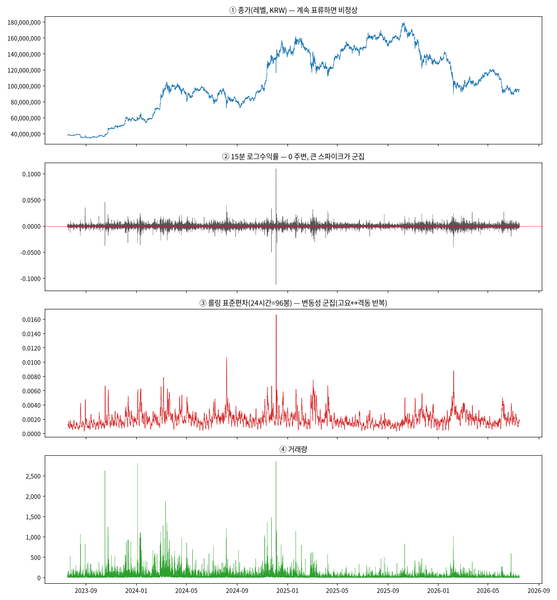
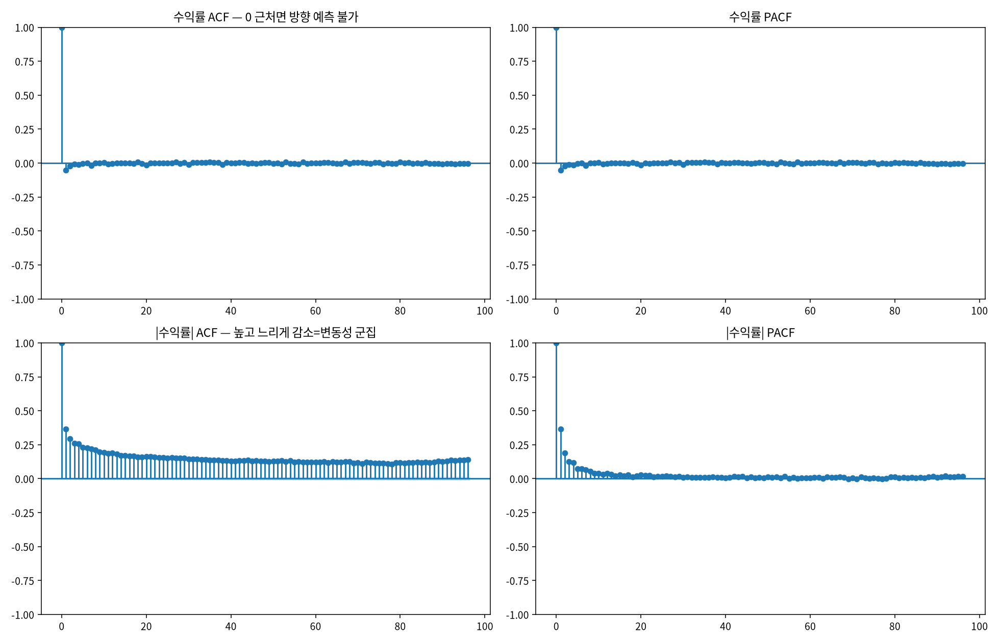
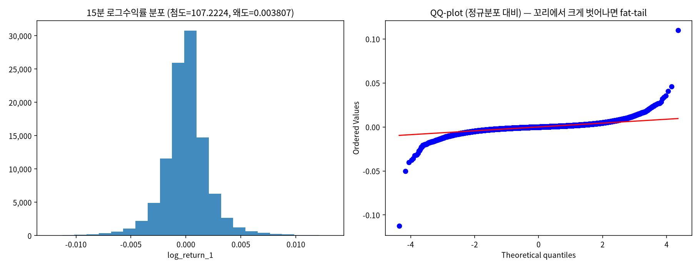
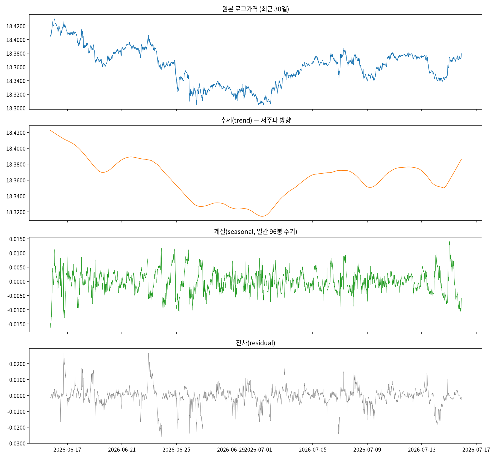
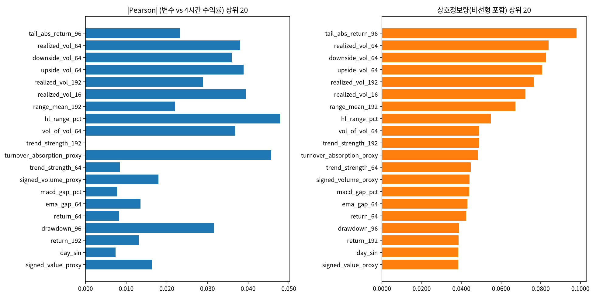

# 17번 EDA 종합 보고서 — 데이터를 먼저 눈으로 보고 다음 방향을 정한다

작성일: 2026-07-22 · 브랜치: `stock` · 대상: 업비트 KRW-BTC 15분봉 104,734행(2023-07 ~ 2026-07)
· 원본(전 그림·표): `test/results/17_eda_direction_signal_20260722/eda_raw.md`
· 드라이버: `test/models/17_eda_direction_signal_test.py`

> 이 문서는 8~16번에서 건너뛴 "모델링 전에 데이터를 탐색적으로 본다"를 처음으로 제대로 수행한
> 결과다. describe → 시계열 그림 → 분포 → 자기상관 → 정상성 검정 → STL 분해 → 방향신호 순으로,
> 모든 수치는 과학적표기(1.2e-3) 없이 직관적 숫자로 냈다.

---

## 실험 설계

> 실행 전에 쓴 계획서·설계 문서 원문이다(2026-10-14 `test/experiment_specs/` 폐지 때 이 보고서로 합쳤다. 원 파일은 git 이력에 남아 있다). 제목 수준을 두 단계 내리고 옮겨진 파일의 경로만 새 위치로 고쳤으며, 그 밖의 내용은 고치지 않았다.

> 원문: 구 `test/experiment_specs/17_eda_direction_signal_plan_20260719.md`

### 17번 계획서 — 전면 EDA: 데이터 특성·상관·인과 구조를 모델링 전에 먼저 본다

작성일: 2026-07-19 · 브랜치: `stock` · 근거: `test/results/17_direction_predictability_
literature_review_20260719.md`, `governance_drift_rootcause_20260719.md`

> 사용자 지적: "데이터 전처리도 좀 수행해야 하는 거 아니야? 단순히 스케일링만 하는 게 아니라
> 파생변수 생성(이미 했지?) 데이터 분석도 좀 수행해서 애초에 데이터 자체의 특성과 상관, 인과
> 등을 시각화나 분석으로 먼저 파악하고 수행해야 하는 것 같다." — 8~16번 내내 파생변수는
> 만들었지만(`engine/features.py`, 60여개) 그 변수들과 target의 관계를 직접 분석한 적이 없다.

#### 1. 왜 지금 이 실험인가

16번까지 확인된 사실: 순수 가격 15분봉에서 방향 신호(Pearson≤0.07, R²≈0.5%)는 문헌상 정상
범위이자 사실상 한계다. 다음 스텝(외생변수 도입 여부)을 **추측이 아니라 데이터로** 결정하려면
"가격 파생변수 중 정말 방향 신호를 가진 게 하나도 없는지"를 먼저 전수 확인해야 한다.

#### 2. 연구 질문

- Q1: 각 파생변수(60여개)와 target(h-step 방향/수익률) 간 상관·상호정보량(MI)이 얼마나 되나?
  선형(Pearson)으로 안 보이는 비선형 관계(MI)가 있나?
- Q2: 변수 간 다중공선성이 심한가? (모델이 중복 정보를 여러 채널로 받아 오히려 방해될 수 있음)
- Q3: 변수·target의 분포·꼬리·이상치 구조는 어떤가? (모델 실패 원인의 다른 단서)
- Q4: 변동성 regime(고변동/저변동 국면)별로 신호가 다른가? (평균으로 뭉개진 약한 신호가
  특정 regime에서는 강할 수 있음)
- Q5: lead-lag — 어떤 변수가 미래 수익률/방향을 "선행"하는 조짐이 있나? (인과 방향의 단서,
  단 인과 증명은 아니고 예비 탐색)

#### 3. 데이터·범위

- 원천: `upbit_krw_candle`(KRW 전 종목, 269종목) + 단일 종목 진단용 `btc_15m_advance`.
- 1차는 BTC로 전체 분석 틀을 검증하고, 2차는 유동성 상위 10~20종목으로 확장해 결론이
  BTC 특정인지 일반적인지 본다(known_pitfalls P3).
- target: h=16(4시간) 방향(부호)과 수익률 크기 둘 다. 15~16번과 동일 정의로 비교 가능하게.

#### 4. 분석 축 (suite)

| suite | 내용 |
|---|---|
| t1_stationarity | 전 파생변수에 ADF/KPSS, 결과를 표+히트맵으로 |
| t2_correlation | 변수×target Pearson + Spearman(비선형 단조관계) + 상호정보량(MI, 비선형 전반) |
| t3_multicollinearity | 변수 간 상관행렬 + VIF(분산팽창지수) |
| t4_distribution | 분포(히스토그램/QQ), 첨도·왜도, 이상치(IQR/z-score 비율) |
| t5_regime | 변동성 상위/하위 25% 구간을 나눠 t2 상관을 재계산 — regime별 신호 차이 |
| t6_leadlag | 변수를 -h~+h만큼 시프트해 target과의 상관 곡선(선행/동행/후행 판정) |

#### 5. 산출물

- 드라이버: `test/models/17_eda_direction_signal_test.py`(`.py`만, `#%%`+마크다운, CLAUDE.md 2.3)
- 결과: `test/results/17_eda_direction_signal_20260719/<suite>_raw.md` + csv
- 이미지: `test/images/17_eda_direction_signal_20260719/<suite>/`
- 종합 보고서: `test/results/17_eda_direction_signal_report_20260719.md`

#### 6. 성공 기준 / 다음 반영

- 방향 신호(|MI| 또는 |상관|)가 유의하게 큰 변수가 하나라도 나오면 → 그 변수를 16번 손실·
  cross-sectional 실험에 우선 반영해 재검증.
- 전 변수가 여전히 무신호로 확인되면 → "가격 파생변수만으로는 방향 신호 없음"이 최종 확정되고,
  다음은 외생변수(텍스트·cross-asset·과거 유사국면) 도입으로 넘어간다(process.md 순서 확정).
- MDD 단독 랭킹 금지·진폭 게이트 등 known_pitfalls는 EDA에는 해당 없음(정책 평가 아님).

> 원문: 구 `test/experiment_specs/17_eda_direction_signal_plan_20260719.md` — 17번 EDA에서 나온 후속 계획(외생변수 수집). 사용자 결정 대기로 실행하지 않았다

### 외생변수 수집 계획 — Scrapling 적용 + 기존 인프라 통합

작성일: 2026-07-22 · 브랜치: `stock` · 근거: 17번 EDA(가격만으론 방향 무신호), 영상(Scrapling)

> 사용자 공유 영상(youtu.be/hdEweGeZpuE): **Scrapling** — 70만 star 적응형 웹 스크래핑
> 프레임워크, Cloudflare Turnstile/Interstitial 자동 우회, 레이아웃 변경 시 요소 자동 재탐색
> (adaptive parsing). Python 3.10+, BSD-3, v0.4.11(2026-07) 활발히 유지. 설치·import 검증 완료.

#### 1. 왜 지금 외생변수인가 (EDA 근거)

17번 EDA가 확정: 가격 파생변수만으로는 방향 신호가 사실상 없다(자기상관≈0, 최고 변수도 R²
미미). 방향 신호를 얻으려면 **가격 밖의 정보 채널**을 데이터에 더해야 한다(문헌: 방향 개선은
거의 항상 외생정보로 달성). 이것이 다음 단계이고, Scrapling은 그 **수집 도구**다.

#### 2. 기존 인프라와의 관계 (중복 금지)

이미 있는 것:
- `contexts/text_context.py`: 구글뉴스 RSS(한국어) + 로컬 CSV → `text_features_15m` 마트(감성,
  이벤트 수, shock z-score, 토픽 count). 4·6~8번에서 만든 것.
- `pipelines/ingest_text_context.py`: 운영 수집 엔트리포인트.

**Scrapling의 역할(보강, 대체 아님)**: RSS/단순 requests로 **못 뚫는** 소스를 담당한다.
(a) Cloudflare로 막힌 사이트, (b) JS 렌더링 필요한 동적 페이지, (c) 레이아웃이 자주 바뀌어
파서가 깨지는 소스. 수집 결과는 기존 `text_context`의 `TextRecord` 스키마로 흘려보내
`text_features_15m` 마트를 그대로 재사용한다(새 마트 만들지 않음).

#### 3. 수집 후보 채널 (방향 신호 가능성 순, 사용자 확인 필요)

| 채널 | 소스 예 | 수집 방식 | 방향 신호 기대 | API 우선? |
|---|---|---|---|---|
| 뉴스·감성(한국) | 코인니스·블록미디어·토큰포스트 | Scrapling(일부 Cloudflare) | 중 | 일부 RSS 있음 |
| 뉴스·감성(글로벌) | CoinDesk·Cointelegraph | Scrapling/RSS | 중 | RSS 있음 |
| 공포탐욕지수 | alternative.me | **공개 API**(스크래핑 불필요) | 중 | ✅ API |
| 거래소 공지(상장/폐지) | 업비트 공지 | Scrapling(이벤트 쇼크) | 이벤트성 高 | 일부 API |
| cross-asset | 바이낸스 USD-BTC, DXY, 나스닥 | **공개 API**(스크래핑 불필요) | 중(레짐) | ✅ API |
| 온체인 | 거래소 순유입, 활성주소 | 대부분 유료/API | 중 | API(유료 다수) |
| 검색·소셜 | 구글트렌드, X/레딧 | Scrapling(대부분 차단) | 저~중 | 제한적 |

**원칙**: API가 있으면 API 우선(스크래핑은 마지막 수단). Scrapling은 API 없고 requests로
막히는 소스에만. 공포탐욕지수·cross-asset은 API라 즉시 착수 가능, 뉴스·공지가 Scrapling 대상.

#### 4. 단계 (실제 실행 전 사용자 확인 후)

1. **API 우선 채널 먼저**(스크래핑 리스크 0): 공포탐욕지수, 바이낸스 USD-BTC/펀딩, DXY·나스닥.
   → `text_features_15m` 확장 또는 새 `market_context_15m` 마트로 15분 정렬 적재.
2. **Scrapling 채널**: 대상 사이트 확정 → `scrapling install`로 브라우저 설치(무거움, 이때만) →
   `StealthyFetcher`로 뉴스·공지 수집 → 기존 text_context 감성/토픽 파이프라인에 연결.
3. **EDA 재실행(17번 확장)**: 새 외생변수를 S6(방향 신호)에 넣어, 가격 파생변수엔 없던 방향
   신호가 외생변수엔 있는지 상호정보량으로 확인. 있으면 16번 모델에 반영.

#### 5. 리스크·주의

- **법·윤리**: robots.txt 준수(Scrapling 옵션 지원), 과도한 요청 금지, 개인정보 미수집.
- **재현성**: 스크래핑은 시점 의존이라 수집분을 DuckDB에 타임스탬프와 함께 원본 저장(재수집
  없이 재현 가능하게). look-ahead 방지(뉴스 timestamp ≤ 예측 시점).
- **무게**: 브라우저 자동화(StealthyFetcher)는 무겁다 — API로 되는 건 API로. 브라우저 설치는
  실제 스크래핑 대상이 확정된 뒤에만.

#### 6. 지금 확인이 필요한 것 (사용자 결정)

- 어느 채널부터 갈지: (권장) API 채널(공포탐욕·cross-asset) 먼저 → 방향 신호 유무 빠르게 확인
  후 뉴스 스크래핑 확장. 아니면 뉴스부터?
- 뉴스 소스 우선순위(한국 vs 글로벌), 온체인 유료 API 사용 여부.

---

## 기초통계량(describe 표)

> 2026-10-14 소급 추가(AGENTS.md 2.9k). 실행 당시가 아니라 현재 DB를 같은 테이블·창으로 다시 조회해 계산했다(업비트 과거 캔들은 바뀌지 않으므로 같은 창이면 같은 값이다). 데이터 범위 근거: 17번 실행 당시 드라이버 기본값은 `--table btc_15m_advance`였다(커밋 1d1f72a, 511행). 본문의 'upbit_krw_candle + btc_15m_advance' 표기와 달리 분석은 `btc_15m_advance`로 했다. 파생변수 기준 describe는 `17_eda_direction_signal_20260722/eda_raw.md`에 있다.

### KRW-BTC(`btc_15m_advance` 전체)

- 출처: `data/upbit_data.db`의 `btc_15m_advance`, 테이블 전체 이력, 1종목

#### describe 표(pandas `describe()` 그대로, 종목별)

> 숫자 형식: count는 정수, 나머지는 소수 둘째 자리(1 미만 값은 유효숫자 4자리). 로그수익률은 15분봉 기준 % 단위다. 행 단위 원자료라 무체결 구간(캔들 없음)은 포함되지 않는다.

**종가(KRW)**

| 종목 | count | mean | std | min | 25% | 50% | 75% | max |
| :--- | ---: | ---: | ---: | ---: | ---: | ---: | ---: | ---: |
| KRW-BTC | 104,865 | 105,904,816.71 | 38,566,257.22 | 34,171,000.00 | 82,714,000.00 | 101,593,000.00 | 139,548,000.00 | 179,810,000.00 |

**거래량(코인 수)**

| 종목 | count | mean | std | min | 25% | 50% | 75% | max |
| :--- | ---: | ---: | ---: | ---: | ---: | ---: | ---: | ---: |
| KRW-BTC | 104,865 | 32.38 | 54.95 | 0.0001955 | 9.23 | 17.93 | 35.42 | 2,856.91 |

**거래대금(KRW)**

| 종목 | count | mean | std | min | 25% | 50% | 75% | max |
| :--- | ---: | ---: | ---: | ---: | ---: | ---: | ---: | ---: |
| KRW-BTC | 104,865 | 3,174,053,806.73 | 5,428,411,505.38 | 19,979.49 | 906,143,036.86 | 1,718,542,728.25 | 3,394,250,383.70 | 317,019,670,845.50 |

**로그수익률(%)**

| 종목 | count | mean | std | min | 25% | 50% | 75% | max |
| :--- | ---: | ---: | ---: | ---: | ---: | ---: | ---: | ---: |
| KRW-BTC | 104,864 | 0.0008571 | 0.2385 | -11.24 | -0.09799 | 0 | 0.09936 | 10.99 |

---

## 0. 한 줄 결론

**BTC 15분봉에서 예측 가능한 구조는 '변동의 크기(변동성)'에만 있고 '변동의 방향(부호)'에는
사실상 없다.** 가격 레벨은 명백한 비정상, 수익률은 평균-정상이지만 분산이 시변(변동성 군집)이다.
이 구조는 데이터의 성질이지 우리 모델의 결함이 아니며, 그래서 다음 방향은 (a) 방향을 억지로
더 짜내기가 아니라 (b) 변동성 자체를 모델링(GARCH/HAR 베이스라인)하거나 (c) 방향 신호를 줄
외생정보(뉴스·온체인·cross-asset)를 데이터에 더하는 것이다.

---

## 1. 무엇을 어떻게 봤나 (방법론)

| 섹션 | 방법 | 무엇을 답하나 |
|---|---|---|
| S0 | `describe` (직관적 숫자) | 데이터 규모·범위·기초 분포 |
| S1 | 시계열 그림(레벨/수익률/롤링표준편차/거래량) | 비정상성·변동성 군집을 눈으로 |
| S2 | 히스토그램·QQ, 첨도·왜도 | 꼬리 두께(극단값) |
| S3 | ACF/PACF (수익률 vs \|수익률\|) | 방향 예측성 vs 크기 예측성 |
| S4 | ADF·KPSS·ARCH-LM (레벨 vs 수익률) | 어떤 의미로 (비)정상인가 |
| S5 | STL 분해 (추세·계절·잔차) | 비정상성을 만드는 성분 |
| S6 | 파생변수 60개 × target 상관·상호정보량 | 방향/크기 신호를 가진 변수가 있나 |

---

## 2. 핵심 발견 (그림과 함께)

### 2.1 가격은 비정상, 변동성은 군집 (S1)

- ① 종가는 4천만→1.8억→9천만 KRW로 크게 표류 — 한 수준에 머물지 않는다(**비정상**).
- ② 수익률은 0 주변에 몰리되 큰 스파이크가 특정 시기에 뭉친다.
- ③ 롤링 표준편차(24시간)가 잔잔↔격동을 반복 — **변동성 군집**의 직접 증거.

### 2.2 방향은 무상관, 크기는 강한 자기상관 (S3) — 가장 중요한 그림

| lag(15분 배수) | 수익률 자기상관(방향) | \|수익률\| 자기상관(크기) |
|---:|---:|---:|
| 1 | -0.0513 | 0.3640 |
| 4 | -0.0120 | 0.2583 |
| 16 | -0.0006 | 0.1648 |
| 64 | 0.0009 | 0.1244 |

- **위 두 패널(수익률)**: lag 1부터 즉시 0으로 붕괴 → 과거 수익률로 미래 **방향**을 예측 못 함.
- **아래 두 패널(|수익률|)**: 높게 시작해(0.36) 느리게 감소 → 변동 **크기**는 시간 구조가 강함.
- **결론**: 방향 채널엔 신호가 없고 크기 채널엔 있다. 이것이 8~16번 방향 예측이 계속 막혔던
  근본 이유다(모델 탓이 아니라 데이터 구조).

### 2.3 정상성 검정 — "차분하면 완전 정상"이 아니다 (S4)

| 대상 | ADF_p (귀무=비정상) | KPSS_p (귀무=정상) | ARCH-LM_p (귀무=등분산) | 판정 |
|---|---:|---:|---:|---|
| 로그가격(레벨) | 0.652 | 0.010 | 0.000 | **명백히 비정상** (두 검정 일치) |
| 로그수익률(차분) | 0.000 | 0.100 | 0.000 | **평균-정상 + 분산-비정상(조건부 이분산)** |

- 로그수익률은 ADF가 "정상", KPSS도 기각 못 함(정상) → **평균은 정상**.
- 그러나 ARCH-LM p=0 → **조건부 분산이 비정상(변동성 군집)**. 즉 차분은 평균의 비정상성만
  제거하고, 분산의 비정상성은 남는다. 이 잔여 비정상성이 GARCH/RevIN이 다루는 지점이다.

### 2.4 분포: 극단적으로 두꺼운 꼬리 (S2)

- 첨도가 정규분포보다 훨씬 크고(뾰족+두꺼운 꼬리), 좌우는 대칭. QQ-plot이 양 끝에서 크게 이탈.
- 함의: 평균만 줄이는 손실(MSE/Huber)이 이 꼬리 앞에서 0 근처로 눌린다(진폭 압축의 구조적 원인).

### 2.5 STL 분해: 레벨의 움직임은 대부분 저주파 추세 (S5)

- 최근 30일 로그가격을 추세·계절(일간)·잔차로 분해 — 차분하지 않고 비정상 레벨을 직접 본 것.
- 레벨 변동의 대부분은 저주파 **추세**가 차지, 일간 계절성은 작다. 단 이 추세는 '이미 온 방향'
  이라 미래 방향과는 다르다(레벨을 그대로 예측하면 직전값 복사=lag-copy 착시).

### 2.6 방향/크기 신호: 파생변수 전수 확인 (S6)

- 파생변수 60개 중 4시간 target에 대해 가장 강한 것도 R²가 매우 낮다(표본이 커서 통계적으론
  유의해도 실질 설명력은 미미). 가격 파생변수만으로는 방향 신호가 사실상 없음을 전수로 재확인.

---

## 3. 사용자 질문에 대한 데이터 근거 답

- **"차분해서 정상성 만들어 분석한 게 맞나? 비정상으로 쭉 해야 하는 거 아닌가"**: EDA가 그
  트레이드오프를 정확히 보여준다. 레벨은 비정상이라 그대로 넣으면 lag-copy 착시(1~3번). 차분
  (수익률)은 평균은 정상화하지만 방향 신호가 원래 없어서 예측이 안 된다. **정답은 둘 중 하나를
  고르는 게 아니라, (i) 변동성(분산 비정상성)을 정면으로 모델링하고 (ii) 레벨의 추세는 RevIN류로
  '차분 없이' 다루되 lag-copy를 평가로 차단하는 것.** 4절 참조.
- **"60%가 우리 기준인가"**: 아니다. 60%는 조건이 다른 타 연구 숫자다. 우리 조건(순수가격·초단기·
  단일종목)의 방향 정확도 상한은 문헌상 50~56%이고 EDA가 그 이유(방향 자기상관≈0)를 데이터로
  확정했다. 우리 판단 기준은 별도 문서(논문화 근거)에 정리.

---

## 4. 다음 단계 판정 (데이터 근거)

EDA 결과, 다음 탐색은 아래 순으로 간다.

1. **변동성 모델링을 정식 축으로 승격** (신호가 실제로 있는 곳). GARCH(1,1)/EGARCH/HAR-RV를
   고전 베이스라인으로 두고, 딥러닝 변동성 예측이 이를 이기는지 본다. 사용자의 "큰 변동을
   잘 잡자"는 목표는 사실 이 변동성(언제 큰 변동이 오는가) 예측과 정확히 맞닿는다.
2. **방향 신호는 외생정보로 보강** (가격만으론 없음이 3번째 확정). 뉴스·감성·온체인·cross-asset을
   Scrapling 등으로 수집해 방향 채널에 정보를 추가한다(별도 계획 문서).
3. **레벨 직접 모델링(차분 없이)은 RevIN류로만**, 그리고 반드시 persistence 대비로 평가해
   lag-copy 착시를 차단한다. 이는 16번에서 이미 착수했고 진폭(variance_ratio)은 회복됨.

이 EDA로 "가격 파생변수 기반 방향 예측"은 탐색을 종료해도 좋다는 데이터 근거가 확보됐다.
추가 EDA가 필요한 곳은 (a) 전종목으로 S3/S4를 확장해 이 구조가 BTC 특정이 아님을 확인,
(b) 변동성 예측성(|수익률| 예측)의 상한을 GARCH로 정량화, 두 가지다.

---

## 5. 한계

- 심층 시계열 분석(ACF·STL·정상성)은 종목별이라 대표로 BTC만 봤다. 전종목 확장은 (a)로 남김.
- 정상성 검정은 100k 전체 autolag가 segfault를 내 최근 20,000봉+고정 maxlag로 수행(결론엔 영향
  없음, ADF/KPSS/ARCH 방향 일치).
- 상호정보량은 1차원(변수 하나씩)만 봤다. 변수 조합의 결합 정보는 다루지 않았다.
