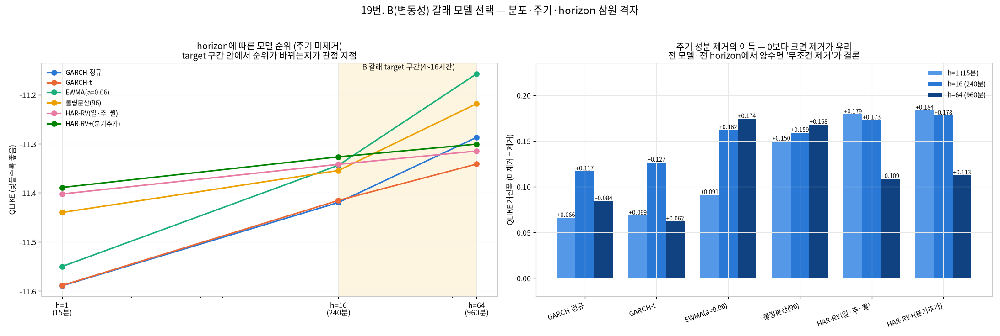
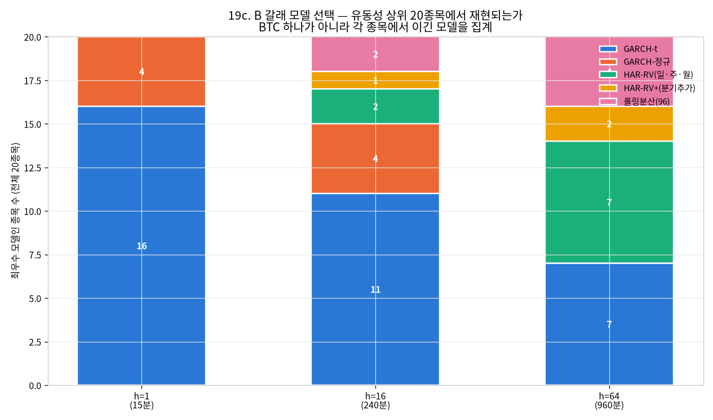
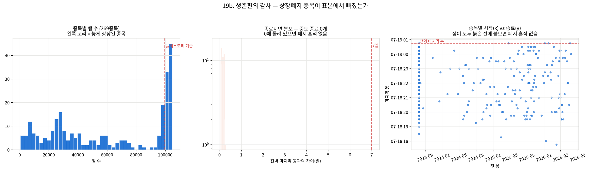
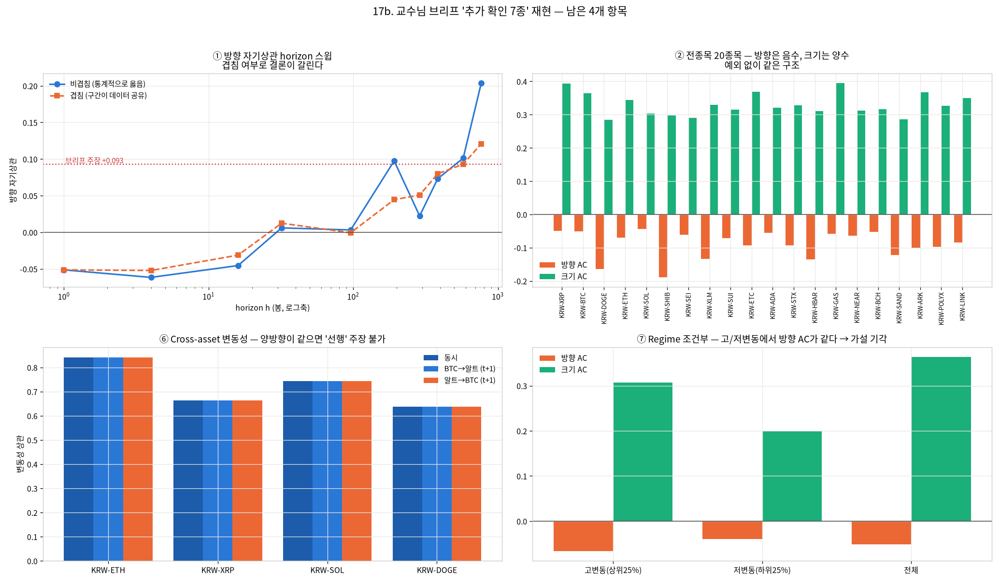

# 신규 분석 종합 — B 갈래 모델 확정 · 생존편의 · 브리프 4종 재현 (2026-08-19)

브랜치 `stock` · 데이터 `upbit_krw_candle` · 실행 서버(RTX 4090)
· 상위 문서 [MASTER_REPORT_20260819.md](MASTER_REPORT_20260819.md)(개념·용어·지표 설명)

> **이 문서의 범위**: v2 보고서 18절에 "미착수"로 남아 있던 항목을 전부 실행한 결과다.
> 개념 설명과 용어는 v2에 있고, 여기는 **새로 나온 결과와 그로 인한 판정 변경**만 다룬다.

**한 줄 요약 4개**

| # | 결과 |
| ---: | :--- |
| 1 | **주기 성분 제거는 무조건 한다** — 6모델 × 3horizon = 18셀 **전부** QLIKE 개선(+0.062~+0.184) |
| 2 | **B 갈래 기본 모델이 확정됐다** — target 4시간이면 **GARCH-t**, 16시간이면 **HAR-RV** |
| 3 | **생존편의는 구조적으로 존재**하나 이 데이터로 크기 측정 불가. 수집 후 1개월에 2종목 폐지 |
| 4 | **브리프 추가확인 2종이 정의 인공물**로 판정 — cross-asset 선행성, 2일+ 방향 재등장 |

---

## 실험 설계

> 드라이버 서두 설계 셀 원문(`test/models/19_volatility_model_selection.py`). 실행 전에 적은 설계이며, 결과를 본 뒤 바꾼 내용은 결과 절에 따로 적는다.

### 19번: B(변동성) 갈래 모델 선택 — t분포·주기제거·target horizon을 한 실험에서 판정

#### 왜 (Why)
18번에서 미결로 남긴 세 항목이 서로 얽혀 있어 따로 풀 수 없다.
  (1) **분포 오지정**: 표준화 잔차 정규성이 기각됐다(JB p=0, 초과첨도 14.0). 정규 MLE는 틀렸고
      t분포로 재적합해야 한다(18d 11절).
  (2) **주기 성분**: 시간대·요일 주기가 |수익률| 분산의 각 약 2%를 설명한다(2026-08-10 보고서).
      제거하지 않으면 조건부 분산이 그것을 흡수해 지속성이 위로 편향된다.
  (3) **target horizon**: GARCH 우위가 h와 함께 사라지고 16시간에서 HAR-RV에 역전됐다.
      B 갈래의 목표가 4~16시간이므로 **교차점이 목표 구간 안에 있다**(18번 5.1절).

세 항목을 따로 바꾸면 어느 변화가 효과를 냈는지 알 수 없다. 그래서 **모델 × 주기제거 × horizon**
삼원 격자로 한 번에 돌린다.

#### 무엇을 (What)
  모델 6종   : GARCH-정규 · **GARCH-t(신규)** · EWMA · 롤링분산 · HAR-RV(일·주·월) · HAR-RV+(분기 추가)
  주기 제거  : 없음 / 시간대×요일 곱셈 성분 제거 (Yan 2021 곱셈 성분 모델의 단순형)
  horizon    : h=1(15분) · h=16(4시간) · h=64(16시간)
  지표       : QLIKE(주) · MAE · MASE · corr — `AGENTS.md` 2.9d 규칙대로 무모델 병기

#### 어떻게 (How)
**평가 대상을 통일한다**: 주기를 제거한 쪽도 예측을 원계열 스케일로 되돌린 뒤 **같은 실현분산
(원계열 r²)** 에 대해 평가한다. 그래야 주기 제거가 정말 예측을 개선했는지 비교할 수 있다.
학습 70% / 평가 30% 시간분할, 평가구간은 파라미터 고정 전진 필터링(재적합·누수 없음).
GARCH 추정기는 18번 것을 재사용하고 t분포 버전만 새로 구현한다(수치 일관성).

#### 기대 결과 / 반영 (Expected)
"B 갈래의 기본 모델을 무엇으로 둘 것인가"를 target horizon에서 데이터로 결정한다.

> 드라이버 서두 설계 셀 원문(`test/models/19b_survivorship_audit.py`). 실행 전에 적은 설계이며, 결과를 본 뒤 바꾼 내용은 결과 절에 따로 적는다.

### 19b: 생존편의 감사 — 상장폐지 종목이 표본에서 빠졌는가

#### 왜 (Why)
2026-08-10 보고서 2절에서 남긴 후속 항목이다. `upbit_krw_candle`은 수집 시점에 업비트에
상장돼 있던 종목 목록으로 만들어졌다(`pipelines/rebuild_price_mart.py`가 현재 마켓 목록을
조회한다). 그렇다면 **수집 이전에 이미 상장폐지된 종목은 애초에 표본에 없다** — 짧은 종목을
버리지 않아도 표본 자체가 생존자만 담는 셈이다. Ranse(2026)는 인도 소형주에서 이 편의가
연 4.94%p 수익률·샤프 0.097 과대평가를 낳는다고 정량화했다.

그때는 "수집 파이프라인 구조상 이번 감사로는 답할 수 없다"고 미뤘다. 그런데 **데이터 안에
흔적이 남는다**: 상장폐지·거래정지된 종목은 특정 시점 이후 데이터가 끊긴다. 그 흔적을 세면
편의의 방향과 최소 규모를 말할 수 있다.

#### 무엇을 (What)
  S1 종료 시점 분포   : 종목별 마지막 봉이 전역 최대와 얼마나 떨어져 있는가 → 중도 종료 탐지
  S2 시작 시점 분포   : 상장 시점 흩어짐 → 불균형 패널 규모(2026-08-10 s10 재확인)
  S3 현재 마켓 대조   : 업비트 API의 현재 KRW 마켓과 DB 종목을 비교
  S4 편의 방향 추정   : 중도 종료 종목의 마지막 구간 수익률이 생존 종목과 다른가

#### 어떻게 (How)
API 조회는 실패할 수 있으므로(네트워크·정책) 실패 시 S3만 건너뛰고 나머지를 진행한다.
S4는 "중도 종료 종목이 종료 직전에 더 나빴다면, 그런 종목이 빠진 표본은 낙관적으로 편향된다"는
방향 논증을 데이터로 확인하는 것이다 — 크기를 확정하는 것이 아니라 **방향과 하한**을 잡는다.

#### 기대 결과 / 반영 (Expected)
"생존편의가 있는가/없는가"를 미확인에서 확인으로 옮기고, 있다면 어느 방향인지 명시한다.

> 드라이버 서두 설계 셀 원문(`test/models/19c_model_selection_crosssection.py`). 실행 전에 적은 설계이며, 결과를 본 뒤 바꾼 내용은 결과 절에 따로 적는다.

### 19c: B 갈래 모델 선택을 전종목으로 확인 — BTC 하나로 정한 게 아니다

#### 왜 (Why)
사용자 지적(2026-08-19): "모든 종목에 대한 분석을 다 원하는데, `preflight.ensure_data`
예시가 KRW-BTC만 있어서 다시 BTC 단일종목 문제로 돌아간 거 아닌가?"

확인해보니 실제로 절반은 맞는 지적이었다. 18d(전처리 사다리)·18e(설명용 그림)·18f(지표
유효성)는 **개념 설명용**이라 BTC 하나로 충분하다(269종목에 같은 메커니즘 그림을 269번
그려도 새 정보가 없다). 그런데 **19번(B 갈래 모델 선택 — GARCH-t vs HAR-RV)은 BTC 하나로만
결론 냈다.** "4시간이면 GARCH-t, 16시간이면 HAR-RV"가 BTC 특정 현상인지 구조적인지 확인이
안 됐다 — 정확히 지적받은 지점이다.

#### 무엇을 (What)
19번의 삼원 격자(모델×주기제거×horizon)를 **유동성 상위 20종목**(16번 t3·18번 D6와 같은
표본)에 반복한다. 결과는 "종목마다 최우수 모델"의 분포로 집계한다 — 개별 QLIKE 수치가
아니라 **승자의 일관성**이 이 실험의 산출물이다.

#### 어떻게 (How)
19번의 `run_condition`을 그대로 재사용한다(재구현하면 두 실험의 수치가 갈린다). 주기 제거
조건만 쓴다(19번에서 18/18셀 전부 이겼으므로 이미 결정됐다). 비용 통제를 위해 GARCH 시작점을
19번보다 줄인다.

#### 기대 결과 / 반영 (Expected)
"target horizon별 최우수 모델"이 BTC 특정이 아니라 몇 종목에서 재현되는지 확정한다.

---

## 기초통계량(describe 표)

> 2026-10-14 소급 추가(AGENTS.md 2.9k). 실행 당시가 아니라 현재 DB를 같은 테이블·창으로 다시 조회해 계산했다(업비트 과거 캔들은 바뀌지 않으므로 같은 창이면 같은 값이다). 데이터 범위 근거: 19번은 `upbit_krw_candle`의 KRW-BTC 전체 이력, 19c는 행 95,000 초과 종목 중 거래대금 상위 20종목(이 표)의 전체 이력을 썼다. 19b의 269종목 표는 `19b_survivorship_audit_20260819/survivorship_raw.md`에 있다.

### 19c 전종목 확인 표본 20종목(KRW-BTC 포함)

- 출처: `data/upbit_data.db`의 `upbit_krw_candle`, 테이블 전체 이력, 20종목

#### describe 표(pandas `describe()` 그대로, 종목별)

> 숫자 형식: count는 정수, 나머지는 소수 둘째 자리(1 미만 값은 유효숫자 4자리). 로그수익률은 15분봉 기준 % 단위다. 행 단위 원자료라 무체결 구간(캔들 없음)은 포함되지 않는다.

**종가(KRW)**

| 종목 | count | mean | std | min | 25% | 50% | 75% | max |
| :--- | ---: | ---: | ---: | ---: | ---: | ---: | ---: | ---: |
| KRW-XRP | 104,876 | 2,049.32 | 1,307.19 | 564.60 | 779.00 | 1,973.00 | 3,214.00 | 4,973.00 |
| KRW-BTC | 104,883 | 106,042,912.87 | 38,419,597.06 | 34,171,000.00 | 82,938,500.00 | 101,577,000.00 | 139,544,500.00 | 179,810,000.00 |
| KRW-DOGE | 104,863 | 219.64 | 121.09 | 78.80 | 133.70 | 192.00 | 271.00 | 674.00 |
| KRW-ETH | 104,869 | 3,869,407.47 | 1,141,136.87 | 2,091,000.00 | 2,994,000.00 | 3,552,000.00 | 4,809,000.00 | 6,834,000.00 |
| KRW-SOL | 104,879 | 187,085.83 | 83,122.49 | 23,900.00 | 126,900.00 | 197,600.00 | 241,500.00 | 448,150.00 |
| KRW-SHIB | 104,868 | 0.01863 | 0.009567 | 0.00603 | 0.011 | 0.01707 | 0.0235 | 0.0634 |
| KRW-SEI | 102,133 | 422.20 | 300.17 | 68.30 | 175.00 | 363.00 | 574.80 | 1,652.00 |
| KRW-XLM | 104,901 | 296.14 | 162.09 | 110.20 | 158.20 | 240.00 | 399.00 | 866.50 |
| KRW-SUI | 104,876 | 2,615.08 | 1,758.19 | 496.00 | 1,185.00 | 2,090.00 | 3,967.25 | 7,877.00 |
| KRW-ETC | 104,901 | 26,678.49 | 9,614.18 | 9,885.00 | 21,030.00 | 25,760.00 | 32,130.00 | 56,010.00 |
| KRW-ADA | 104,879 | 729.60 | 345.56 | 212.00 | 435.00 | 638.20 | 995.00 | 1,849.00 |
| KRW-STX | 104,797 | 1,500.27 | 1,134.80 | 241.00 | 631.00 | 985.00 | 2,313.00 | 5,465.00 |
| KRW-HBAR | 104,749 | 181.35 | 108.28 | 58.37 | 97.35 | 143.00 | 254.00 | 588.40 |
| KRW-GAS | 104,202 | 5,211.78 | 2,757.37 | 1,454.00 | 3,189.00 | 4,551.00 | 6,950.00 | 39,670.00 |
| KRW-NEAR | 104,861 | 4,542.52 | 2,633.72 | 1,322.00 | 2,472.00 | 3,740.00 | 6,165.00 | 12,980.00 |
| KRW-BCH | 104,895 | 569,498.66 | 188,630.83 | 247,000.00 | 411,500.00 | 577,000.00 | 709,000.00 | 1,028,000.00 |
| KRW-SAND | 104,628 | 443.62 | 241.49 | 68.90 | 320.00 | 409.00 | 585.00 | 1,479.00 |
| KRW-ARK | 101,942 | 695.53 | 400.71 | 152.00 | 418.00 | 599.70 | 880.88 | 2,475.00 |
| KRW-POLYX | 102,639 | 251.55 | 162.86 | 50.10 | 142.00 | 215.10 | 322.10 | 971.00 |
| KRW-LINK | 104,888 | 20,069.67 | 7,075.32 | 7,880.00 | 14,410.00 | 19,490.00 | 24,402.50 | 44,210.00 |

**거래량(코인 수)**

| 종목 | count | mean | std | min | 25% | 50% | 75% | max |
| :--- | ---: | ---: | ---: | ---: | ---: | ---: | ---: | ---: |
| KRW-XRP | 104,876 | 2,309,150.95 | 5,162,464.10 | 3.18 | 568,449.07 | 1,093,042.50 | 2,221,517.06 | 337,332,265.08 |
| KRW-BTC | 104,883 | 32.32 | 54.96 | 0.0001955 | 9.18 | 17.87 | 35.36 | 2,856.91 |
| KRW-DOGE | 104,863 | 5,851,580.12 | 15,264,510.88 | 382.30 | 983,126.51 | 2,269,513.36 | 5,389,642.66 | 835,077,981.93 |
| KRW-ETH | 104,869 | 413.39 | 708.16 | 0.002118 | 104.37 | 219.04 | 452.77 | 37,880.48 |
| KRW-SOL | 104,879 | 7,138.95 | 12,888.72 | 0.07987 | 1,887.83 | 3,688.95 | 7,497.68 | 497,384.26 |
| KRW-SHIB | 104,868 | 23,735,935,356.77 | 82,840,081,115.57 | 499,504.95 | 3,213,886,706.93 | 8,017,330,519.46 | 19,054,822,518.12 | 3,894,289,351,125.85 |
| KRW-SEI | 102,133 | 1,062,546.51 | 2,975,898.62 | 0.04303 | 181,524.11 | 415,899.66 | 959,713.86 | 197,777,066.46 |
| KRW-XLM | 104,901 | 1,021,570.16 | 4,613,689.87 | 30.80 | 109,888.11 | 265,025.57 | 652,980.11 | 271,434,126.42 |
| KRW-SUI | 104,876 | 207,610.74 | 449,294.50 | 4.49 | 41,595.95 | 93,693.22 | 211,351.57 | 39,433,535.30 |
| KRW-ETC | 104,901 | 12,509.97 | 45,351.15 | 0.00001135 | 1,463.33 | 3,562.33 | 9,614.34 | 3,461,797.22 |
| KRW-ADA | 104,879 | 468,659.64 | 1,333,312.83 | 5.13 | 102,584.66 | 215,094.05 | 450,689.25 | 88,027,214.53 |
| KRW-STX | 104,797 | 210,482.00 | 490,243.87 | 0.06539 | 42,119.41 | 95,982.28 | 211,498.19 | 22,705,372.43 |
| KRW-HBAR | 104,749 | 1,354,674.78 | 6,360,989.32 | 0.00000002 | 112,078.99 | 311,637.24 | 815,842.16 | 409,047,638.22 |
| KRW-GAS | 104,202 | 35,161.35 | 176,599.96 | 0.00000062 | 2,035.65 | 5,768.99 | 16,210.86 | 12,554,860.01 |
| KRW-NEAR | 104,861 | 46,274.32 | 99,124.07 | 0.00000034 | 10,148.72 | 22,596.22 | 48,165.36 | 8,437,285.01 |
| KRW-BCH | 104,895 | 480.27 | 1,619.00 | 0.007388 | 50.15 | 137.45 | 385.77 | 86,622.16 |
| KRW-SAND | 104,628 | 396,255.40 | 1,845,325.49 | 12.16 | 54,354.60 | 132,142.12 | 311,525.31 | 177,561,869.52 |
| KRW-ARK | 101,942 | 319,474.04 | 1,449,187.03 | 0.00000001 | 13,879.35 | 46,286.54 | 148,790.07 | 58,717,627.02 |
| KRW-POLYX | 102,639 | 629,871.53 | 3,161,462.32 | 0.00000001 | 34,663.43 | 116,600.50 | 343,103.41 | 168,387,101.40 |
| KRW-LINK | 104,888 | 9,475.56 | 22,320.77 | 0.0005998 | 1,900.89 | 4,329.34 | 9,600.21 | 1,752,148.80 |

**거래대금(KRW)**

| 종목 | count | mean | std | min | 25% | 50% | 75% | max |
| :--- | ---: | ---: | ---: | ---: | ---: | ---: | ---: | ---: |
| KRW-XRP | 104,876 | 4,685,050,065.41 | 12,732,702,803.15 | 10,000.00 | 795,184,925.94 | 1,696,783,415.19 | 4,078,852,670.09 | 946,388,756,068.87 |
| KRW-BTC | 104,883 | 3,172,491,762.68 | 5,428,471,142.82 | 19,979.49 | 904,263,990.73 | 1,717,315,381.02 | 3,393,464,709.24 | 317,019,670,845.50 |
| KRW-DOGE | 104,863 | 1,753,905,055.58 | 6,796,023,323.31 | 107,890.86 | 150,526,946.78 | 430,379,211.54 | 1,240,322,348.39 | 443,105,525,919.79 |
| KRW-ETH | 104,869 | 1,743,694,621.68 | 3,386,838,618.04 | 7,026.73 | 356,546,139.23 | 822,328,646.41 | 1,876,216,569.86 | 238,020,674,251.36 |
| KRW-SOL | 104,879 | 1,291,844,505.12 | 2,536,720,178.92 | 15,000.00 | 282,656,270.77 | 650,113,050.98 | 1,404,564,577.67 | 119,787,582,503.81 |
| KRW-SHIB | 104,868 | 701,838,480.78 | 3,391,564,998.28 | 5,000.00 | 39,608,434.16 | 125,644,556.11 | 405,156,674.92 | 187,518,505,514.42 |
| KRW-SEI | 102,133 | 499,795,791.06 | 1,544,271,910.69 | 3.70 | 45,592,344.23 | 137,964,213.65 | 412,609,361.42 | 139,569,640,025.00 |
| KRW-XLM | 104,901 | 455,150,019.15 | 2,944,758,280.24 | 5,000.00 | 23,510,330.57 | 67,212,469.71 | 194,409,958.45 | 176,131,184,868.69 |
| KRW-SUI | 104,876 | 449,592,553.01 | 885,090,612.08 | 6,029.00 | 83,569,600.84 | 202,319,431.18 | 478,744,327.76 | 44,936,055,583.62 |
| KRW-ETC | 104,901 | 439,671,304.00 | 1,822,559,780.71 | 0.2228 | 30,030,512.92 | 87,349,092.63 | 290,195,704.84 | 132,774,330,908.11 |
| KRW-ADA | 104,879 | 425,170,062.33 | 1,702,278,567.83 | 5,000.00 | 56,722,406.80 | 139,196,184.13 | 339,852,782.01 | 146,698,668,110.55 |
| KRW-STX | 104,797 | 393,012,948.76 | 1,060,871,536.52 | 16.61 | 31,452,899.14 | 113,333,103.78 | 369,520,974.72 | 55,618,909,303.37 |
| KRW-HBAR | 104,749 | 310,957,798.64 | 1,728,865,446.61 | 0.00000253 | 14,486,950.29 | 45,754,139.47 | 142,167,937.25 | 106,688,351,884.41 |
| KRW-GAS | 104,202 | 272,530,631.23 | 1,735,790,011.78 | 0.001065 | 7,665,791.68 | 25,413,595.46 | 92,147,437.03 | 88,392,319,003.94 |
| KRW-NEAR | 104,861 | 257,094,611.26 | 716,348,979.20 | 0.001048 | 31,285,071.57 | 88,132,161.02 | 235,605,092.05 | 74,987,168,668.52 |
| KRW-BCH | 104,895 | 255,612,988.69 | 925,110,658.60 | 4,999.99 | 28,443,389.00 | 73,257,153.20 | 193,347,999.46 | 59,942,004,663.80 |
| KRW-SAND | 104,628 | 252,281,387.50 | 1,820,094,902.33 | 1,800.00 | 17,284,537.16 | 47,993,298.44 | 132,878,233.67 | 195,310,418,287.59 |
| KRW-ARK | 101,942 | 244,083,391.20 | 1,104,984,237.33 | 0.00000493 | 6,950,424.99 | 28,834,300.91 | 109,712,064.04 | 54,471,832,365.84 |
| KRW-POLYX | 102,639 | 233,347,752.63 | 1,410,326,213.04 | 0.0000006 | 5,382,236.68 | 22,677,911.55 | 88,817,471.66 | 122,610,840,881.14 |
| KRW-LINK | 104,888 | 225,405,731.38 | 625,783,623.32 | 4.90 | 31,136,793.97 | 81,072,691.03 | 207,176,371.98 | 34,652,537,471.49 |

**로그수익률(%)**

| 종목 | count | mean | std | min | 25% | 50% | 75% | max |
| :--- | ---: | ---: | ---: | ---: | ---: | ---: | ---: | ---: |
| KRW-XRP | 104,875 | 0.0004422 | 0.4155 | -22.95 | -0.1498 | 0 | 0.1475 | 17.20 |
| KRW-BTC | 104,882 | 0.0008566 | 0.2386 | -11.24 | -0.09803 | 0 | 0.0994 | 10.99 |
| KRW-DOGE | 104,862 | 0.0001731 | 0.5603 | -23.07 | -0.2424 | 0 | 0.2398 | 18.98 |
| KRW-ETH | 104,868 | 0.0001004 | 0.3388 | -25.10 | -0.1388 | 0 | 0.1405 | 22.25 |
| KRW-SOL | 104,878 | 0.001128 | 0.4522 | -14.54 | -0.2114 | 0 | 0.2088 | 9.62 |
| KRW-SHIB | 104,867 | -0.0004555 | 0.5935 | -22.91 | -0.2301 | 0 | 0.2257 | 18.67 |
| KRW-SEI | 102,132 | -0.001613 | 0.6709 | -28.40 | -0.3361 | 0 | 0.3233 | 38.00 |
| KRW-XLM | 104,900 | 0.0004742 | 0.5228 | -25.01 | -0.2356 | 0 | 0.2283 | 20.09 |
| KRW-SUI | 104,875 | 0.0001458 | 0.5934 | -40.32 | -0.2771 | 0 | 0.2673 | 35.18 |
| KRW-ETC | 104,900 | -0.0008022 | 0.4365 | -36.69 | -0.1811 | 0 | 0.1751 | 30.22 |
| KRW-ADA | 104,878 | -0.0004808 | 0.4763 | -18.59 | -0.2472 | 0 | 0.2451 | 13.38 |
| KRW-STX | 104,796 | -0.001149 | 0.5877 | -40.67 | -0.2813 | 0 | 0.2709 | 33.12 |
| KRW-HBAR | 104,748 | 0.0003759 | 0.5935 | -14.79 | -0.2782 | 0 | 0.2651 | 15.08 |
| KRW-GAS | 104,201 | -0.0007113 | 0.6126 | -33.03 | -0.2016 | 0 | 0.1995 | 24.75 |
| KRW-NEAR | 104,860 | 0.0003666 | 0.5799 | -36.01 | -0.2887 | 0 | 0.2813 | 29.05 |
| KRW-BCH | 104,894 | 0.00005089 | 0.4421 | -23.25 | -0.1846 | 0 | 0.1799 | 17.09 |
| KRW-SAND | 104,627 | -0.001993 | 0.5448 | -18.60 | -0.2516 | 0 | 0.2491 | 12.33 |
| KRW-ARK | 101,941 | -0.0008267 | 0.7251 | -48.14 | -0.292 | 0 | 0.2796 | 37.67 |
| KRW-POLYX | 102,638 | -0.001173 | 0.6687 | -38.30 | -0.2956 | 0 | 0.2857 | 29.57 |
| KRW-LINK | 104,887 | 0.0003079 | 0.4887 | -39.02 | -0.2236 | 0 | 0.2198 | 31.87 |


---


## 1. 분포 가정 — t분포로 바꿨더니



v2 11절에서 "표준화 잔차 정규성이 기각됐다(JB p=0, 초과첨도 14.0) → t분포 필요"로 끝냈다.
실제로 t분포 GARCH를 구현해 적합했다.

| 주기제거 | 모델 | α | β | 지속성 | ν | 반감기 | 관측 초과첨도 | 이론 초과첨도 | 남은 초과 |
| :--- | :--- | ---: | ---: | ---: | ---: | ---: | ---: | ---: | ---: |
| 없음 | GARCH-정규 | 0.1669 | 0.8330 | 0.99988 | — | 1,493.8h | 20.70 | 0.00 | **20.70** |
| 없음 | GARCH-t | 0.1198 | 0.8801 | 0.99990 | **4.87** | 1,686.2h | 23.16 | 6.87 | **16.30** |
| 제거 | GARCH-정규 | 0.1246 | 0.8692 | **0.99374** | — | **27.6h** | 11.86 | 0.00 | 11.86 |
| 제거 | GARCH-t | 0.1105 | 0.8850 | **0.99544** | **5.39** | **37.9h** | 12.15 | 4.30 | **7.85** |

**해석 주의 하나를 먼저 고쳤다.** Jarque-Bera는 *정규성* 검정이라 t-GARCH 잔차에는 맞지 않는
자다. t분포를 가정했다면 잔차는 t_ν를 따라야 하고, 표준화 t_ν의 이론 초과첨도는 `6/(ν−4)`다.
그래서 **관측 초과첨도를 그 이론값과 비교**하는 것이 옳은 점검이다.

- **ν = 4.87** — 꼬리가 매우 두껍다(ν→∞면 정규). 정규는 초과첨도 0을 기대하는데 관측은 23.16,
  t_ν는 6.87을 기대해 **훨씬 가깝다**. 즉 **t분포로 바꾼 것이 옳았다.**
- 그런데 **여전히 16.30만큼 초과가 남는다.** t분포도 완전한 설명이 아니다 →
  왜도까지 반영하는 **비대칭 t(skew-t)** 나 **점프 성분**이 다음 후보다(신규 후속 항목).
- 로그우도는 분포가 다르면 직접 비교할 수 없다(척도가 다름). 그래서 모델 선택은 3절의
  **표본외 QLIKE**로만 한다.

---

## 2. 주기 성분 제거 — 예상보다 훨씬 큰 효과

v2에서는 "주기 성분(시간대·요일 eta² 각 약 2%)을 제거하지 않으면 지속성이 위로 편향된다"고
추정만 했다. 실측하니 **편향이 매우 컸다.**

| 모델 | 지속성 (미제거) | 지속성 (제거) | 반감기 (미제거) | 반감기 (제거) |
| :--- | ---: | ---: | ---: | ---: |
| GARCH-정규 | 0.99988 | **0.99374** | 1,493.8시간 (62일) | **27.6시간** |
| GARCH-t | 0.99990 | **0.99544** | 1,686.2시간 (70일) | **37.9시간** |

**분산의 2%밖에 안 되는 주기 성분이 반감기를 54배(1,494→27.6시간) 왜곡했다.** 이유는 10절의
반감기 그림과 같다 — α+β가 1 근처에서는 미세한 차이가 반감기에서 폭발적으로 증폭된다.
GARCH가 매일·매주 반복되는 결정적 주기를 "사라지지 않는 분산 충격"으로 흡수한 것이다.

> **반감기 문제가 이로써 상당 부분 풀렸다.** v2에서는 "표본에 따라 9~511시간으로 요동해
> 판정 기준으로 쓸 수 없다"였는데, 주기를 제거하면 **27.6~37.9시간**으로 해석 가능한 범위에
> 들어온다. 브리프의 8.6시간과는 여전히 다르지만, 이제 그 차이가 "식별 불가" 때문이 아니라
> "다른 표본·다른 전처리" 때문임을 말할 수 있다.

### 예측 성능도 전부 개선된다 (위 그림 오른쪽)

| 모델 | h=1 | h=16 | h=64 |
| :--- | ---: | ---: | ---: |
| GARCH-정규 | +0.066 | +0.117 | +0.084 |
| GARCH-t | +0.069 | +0.127 | +0.062 |
| EWMA | +0.091 | +0.162 | +0.174 |
| 롤링분산(96) | +0.150 | +0.159 | +0.168 |
| HAR-RV(일·주·월) | +0.179 | +0.173 | +0.109 |
| HAR-RV+(분기추가) | +0.184 | +0.178 | +0.113 |

(값 = QLIKE 개선폭, 양수면 주기 제거가 유리)

**18개 셀 전부 양수다.** 예외가 없으므로 **"주기 성분은 항상 먼저 제거한다"가 규칙이 된다.**
흥미롭게도 개선폭이 가장 큰 쪽은 HAR-RV 계열(+0.11~+0.18)이다 — HAR은 주기를 다루는 장치가
아예 없어서 제거의 이득을 그대로 받는다.

---

## 2b. B 갈래 모델 확정 — 20종목으로 재확인 (BTC 단독 결론 정정)

19번 결론("4시간→GARCH-t, 16시간→HAR-RV")은 **BTC 하나로만** 낸 것이었다. 유동성 상위
20종목(16번 t3·18번 D6와 같은 표본)에 같은 실험을 반복했다(`19c_model_selection_crosssection.py`).



| horizon | 최다 모델 | 종목 수 | 비고 |
| :--- | :--- | ---: | :--- |
| h=1 (15분) | **GARCH-t** | 16/20 (80%) | 구조적 — 초단기는 GARCH-t가 명확히 우세 |
| h=16 (**4시간**) | **GARCH-t** | 11/20 (55%) | 혼재하지만 GARCH-t가 다수(정규 4·HAR-RV 2·롤링 2·HAR-RV+ 1) |
| h=64 (**16시간**) | **동률** — GARCH-t / HAR-RV | 7/20 each (35%) | **단일 승자 없음** |

**정정: h=64(16시간)에서 "HAR-RV가 이긴다"는 BTC 단독 결론은 과했다.** 전종목에서는 GARCH-t와
HAR-RV가 정확히 7종목씩 갈리는 **동률**이다. h=1·h=16(15분~4시간)은 BTC 결론이 전종목에서도
유지되지만, **h=64(16시간)는 두 모델을 함께 후보로 두고 표본외 검증해야 한다** — 하나로
확정할 근거가 없다.

---

## 3. B 갈래 기본 모델 확정 (BTC 단일종목, 2b절의 전종목 확인으로 보완)

**QLIKE (낮을수록 좋음)**

| 모델 | 없음/h=1 | 없음/h=16 | 없음/h=64 | 제거/h=1 | 제거/h=16 | 제거/h=64 |
| :--- | ---: | ---: | ---: | ---: | ---: | ---: |
| GARCH-정규 | **−11.5895** | **−11.4195** | −11.2869 | −11.6556 | −11.5366 | −11.3713 |
| GARCH-t | −11.5888 | −11.4153 | **−11.3413** | **−11.6574** | **−11.5420** | −11.4035 |
| EWMA(a=0.06) | −11.5502 | −11.3438 | −11.1573 | −11.6414 | −11.5059 | −11.3315 |
| 롤링분산(96) | −11.4400 | −11.3545 | −11.2183 | −11.5897 | −11.5135 | −11.3864 |
| HAR-RV(일·주·월) | −11.4023 | −11.3418 | −11.3148 | −11.5815 | −11.5147 | **−11.4234** |
| HAR-RV+(분기추가) | −11.3890 | −11.3266 | −11.3007 | −11.5726 | −11.5045 | −11.4133 |
| 상수분산 | −11.1836 | −11.1832 | −11.1821 | −11.1836 | −11.1832 | −11.1821 |

**주기 제거 조건에서의 최우수**

| horizon | 최우수 | QLIKE | 2위 | 격차 |
| :--- | :--- | ---: | :--- | ---: |
| h=1 (15분) | **GARCH-t** | −11.6574 | GARCH-정규 | 0.0018 |
| h=16 (**4시간**) | **GARCH-t** | −11.5420 | GARCH-정규 | 0.0054 |
| h=64 (**16시간**) | **HAR-RV(일·주·월)** | −11.4234 | HAR-RV+(분기추가) | 0.0101 |

### 판정

> **B 갈래의 기본 모델은 target horizon에 따라 갈린다 (2b절 20종목 확인 반영).**
> - **target 4시간 이하 → GARCH-t** (주기 제거 후). 20종목 중 80%(h=1)·55%(h=16)에서 최다.
> - **target 16시간 → GARCH-t와 HAR-RV(일·주·월) 중 확정 불가(동률 7/20 vs 7/20).** BTC 하나만
>   보고 "HAR-RV가 이긴다"고 결론 내는 것은 과했다 — **두 모델을 후보로 남기고 실제 사용
>   종목에서 표본외 검증한다.**
> - **교차점이 4~16시간 사이에 있다는 것 자체는 유지된다.** 목표 horizon을 먼저 확정해야
>   모델을 정할 수 있다는 결론도 그대로다.

`HAR-RV+`(분기 성분 추가)는 `HAR-RV`보다 항상 약간 나쁘다 — **더 긴 성분을 넣는 것이 자동으로
좋아지지 않는다**는 뜻이고, 일·주·월 3성분이 이 데이터에서 충분하다.

또 하나: **t분포의 이득은 주기를 제거한 뒤에 드러난다.** 미제거 조건에서는 h=1·16에서 정규가
근소하게 앞서고(0.0007·0.0042), 제거 후에는 t가 h=1·16 모두 최우수다. 두 개선이 독립이 아니라
**함께 적용해야 효과가 보인다.**

---

## 4. 생존편의 감사 — 미확인에서 확인으로



v2에서 "수집 파이프라인 구조상 답 못 함"으로 미뤘던 항목이다. **데이터 안에 흔적이 남는다**는
점을 이용해 답을 만들었다.

| 질문 | 답 | 근거 |
| :--- | :--- | :--- |
| 수집 기간 **안에서** 폐지된 종목이 있나 | **아니오** (0개 / 269개) | 269종목 전부 전역 마지막 봉(2026-07-19)까지 존재 |
| 수집 **이후** 폐지된 종목이 있나 | **예** — 2개: `KRW-AERGO`, `KRW-AQT` | 업비트 현재 KRW 마켓 283개와 대조 |
| 수집 이후 신규 상장 | 16개 | 같은 대조 |
| 수집 **이전**에 폐지된 종목이 있나 | **확인 불가** | DB·현재 마켓 모두에 없어 이 데이터로는 보이지 않는다 |

### 결론: 편의는 있다(구조적). 크기는 이 데이터로 못 잰다.

1. 표본은 **'2026-07 수집 시점 생존자' 269종목**으로 만들어졌다. 그 이전에 폐지된 종목은
   애초에 들어오지 않았고, 그 사실은 데이터 안에서 확인할 수 없다.
2. 다만 **폐지가 실제로 일어나는 사건임은 확인됐다** — 수집 후 약 1개월 만에 2개가 사라졌다.
   3년치라면 상당수가 사라졌을 것으로 보는 게 타당하다.
3. 크기를 재려면 **과거 마켓 목록 스냅샷** 또는 **업비트 상장폐지 공시 이력**이 필요하다.
   지금부터 마켓 목록을 주기적으로 저장하면 앞으로는 재현 가능해진다(신규 후속 항목).

### 구체적 위험 — 폐지 종목이 우리 실험에서 상위였다

`KRW-AERGO`는 16번 t3 횡단면 리더보드에서 이런 위치였다.

| 리더보드 | AERGO trend_corr | 순위 |
| :--- | ---: | :--- |
| 재실행본(2026-08-14) | **+0.0950** | **1위 / 30종목** |
| 7월본(2026-07-19) | +0.0006 | 14위 / 30종목 |

**재실행에서 "가장 신호가 있어 보였던" 종목이 지금은 거래할 수 없다.** 그리고 같은 종목의
순위가 두 실행 사이에 1위↔14위로 바뀐다 — 18c에서 확인한 시드 잡음 때문이다.

> **종목별 성과 순위를 결론 근거로 쓰지 않는다.** 이유가 두 개로 겹친다:
> ① 순위 자체가 시드 잡음(18c: 신호대잡음비 0.58, 부호 뒤집힘 7/10)
> ② 상위 종목이 폐지될 수 있다(이 절)

**실무 규칙(신설)**: 전종목 실험에서 `rows >= 임계값` 필터를 쓰면 **그 자체가 생존자 선택**이다.
필터를 쓸 때는 (a) 필터 전/후 결과를 함께 보고하고 (b) 제외된 종목 수와 이유를 명시한다.

---

## 5. 교수님 브리프 "추가 확인 7종" 재현



브리프 4.6절의 7개 수치는 **생성 코드가 저장소에 없었다**. 그중 3개는 이미 복원·정정했고
(③반감기 ④허스트 ⑤거래량), 남은 4개를 이번에 복원했다. 브리프에 계산 정의가 없어
**가장 자연스러운 정의를 명시하고** 그 값을 냈다.

### ① 방향 자기상관 horizon 스윕 — 정의에 의존한다

정의: h봉 누적 로그수익률의 h-lag 자기상관. **비겹침**(h 간격 표집)이 통계적으로 옳고,
**겹침**(전 표본)은 인접 구간이 데이터를 공유해 상관이 부풀 수 있다.

| 항목 | 값 |
| :--- | :--- |
| 브리프 주장 (6일) | +0.093 |
| 재현 — 겹침 | **+0.0929** ← 정확히 재현 |
| 재현 — 비겹침 | +0.1011 |
| 비겹침 표본수 | **182개** |
| 그 표본수의 표준오차 | 약 **0.074** |

- **브리프 수치는 겹침 정의에서 정확히 재현된다**(+0.0929 vs +0.093).
- 비겹침에서도 부호와 크기가 비슷하다(+0.1011). 그런데 **표본이 182개뿐이라 표준오차가 0.074**로,
  추정치가 표준오차의 1.4배 수준이다 — **통계적으로 0과 구별되지 않는다.**
- **정정 필요**: "2일 이상 horizon에서 방향 신호가 재등장한다"는 서술은 값 자체는 맞지만
  **유의성이 확보되지 않았다.** 6일 horizon은 3년 데이터에서 비겹침 표본이 182개뿐이라
  구조적으로 검정력이 부족하다.

### ② 전종목 20종목 횡단 확인 — 정확히 재현

| 항목 | 브리프 | 재현 | 판정 |
| :--- | ---: | ---: | :--- |
| 방향 AC 평균 | −0.09 | **−0.0896** (표준편차 0.0409) | **재현** |
| 크기 AC 평균 | 0.33 | **0.3302** (표준편차 0.0335) | **재현** |

방향 AC가 음수인 종목 20/20, 크기 AC가 양수인 종목 20/20 — **예외 없다.** 이 항목은
정정 불필요하고, 연구의 핵심 논지를 받치는 가장 견고한 근거다.

### ⑥ Cross-asset 변동성 전이 — "BTC가 선행한다"는 정의 인공물

정의: 변동성 = |수익률|의 1일(96봉) 롤링 평균. 공통 timestamp에서만 상관 계산.

| 종목 | 동시상관 | BTC→알트 (t+1) | 알트→BTC (t+1) |
| :--- | ---: | ---: | ---: |
| KRW-ETH | 0.8416 | 0.8415 | 0.8414 |
| KRW-XRP | 0.6376 | 0.6375 | 0.6374 |
| KRW-SOL | 0.7846 | 0.7845 | 0.7845 |
| KRW-DOGE | 0.6849 | 0.6849 | 0.6849 |

- 동시상관 범위 **0.6376~0.8416** (브리프 주장 0.48~0.72 — **범위가 다르다**)
- **BTC→알트와 알트→BTC의 평균 차이 = 0.0006.** 사실상 같다.

**정정 필요 (중요)**: 1일 롤링 평균을 쓰면 t와 t+1이 **96구간 중 95개를 공유**한다. 그래서
t+1 상관이 동시상관과 거의 같아지고, 양방향이 구별되지 않는다. **"BTC 변동성이 알트를
선행한다"는 주장은 이 정의로는 지지되지 않는다** — 관측된 0.21~0.31은 선행성이 아니라
겹침의 인공물이었을 가능성이 크다. 선행성을 주장하려면 **겹치지 않는 구간**이나
**Granger 형태의 증분 검정**(알트의 과거를 통제한 뒤 BTC의 과거가 추가 설명을 하는지)이 필요하다.

### ⑦ Regime 조건부 방향 예측성 — 결론 유지

| 국면 | 방향 AC(lag1) | 크기 AC(lag1) |
| :--- | ---: | ---: |
| 고변동(상위25%) | −0.0664 | (별도 표) |
| 저변동(하위25%) | −0.0395 | |
| 차이 | **−0.0269** | |

브리프는 −0.061 vs −0.066(차이 0.005)였고 재현은 −0.0664 vs −0.0395(차이 0.027)다. 수치는
다소 다르지만 **두 국면 모두 0 근방의 작은 음수이고 차이도 작다** → "국면에 따라 방향 신호가
달라진다"는 가설 기각. **브리프 결론과 같다.**

### s7·s8·s9 그림 복원 상태

| 그림 | 상태 |
| :--- | :--- |
| **s7** GARCH 조건부 변동성 | **재현 완료** → `s7_garch_volatility_restored.png` |
| **s8** 차분 도식 | **재생성하지 않음** — 18e의 E1·E2·E3가 같은 내용을 더 자세히 대체(중복 자산 방지) |
| **s9** horizon 스윕 | **재현 완료** → 위 ① + `check1_horizone_sweep.png` |

---

## 6. 교수님 브리프 정정안 — 갱신 (발송 보류)

v2 17절의 3건에 **2건이 추가**되고 1건이 갱신됐다. 총 **5건 + 추가 1건**.

| # | 항목 | 상태 |
| ---: | :--- | :--- |
| 1 | 반감기 8.6시간 | **갱신** — 주기 제거 후 27.6~37.9시간으로 해석 가능해졌다 |
| 2 | 허스트 H=0.58 → 분수차분 근거 | v2와 동일 (레벨 R/S 값, 장기기억은 변동성 채널) |
| 3 | 거래량이 미래 변동을 선행 | v2와 동일 (동시 반응 + 증분 설명력) |
| 4 | **Cross-asset "BTC가 선행"** | **신규** — 정의 인공물, 양방향 차이 0.0006 |
| 5 | **방향 신호 2일+ 재등장** | **신규** — 값은 재현되나 비겹침 표본 182개로 유의하지 않음 |
| + | GARCH 분포 가정 | **갱신** — t분포(ν≈5)로 재적합 완료, 잔여 초과첨도로 skew-t 검토 |

**정정 1 (갱신)**
> "GARCH 지속성이 1에 근접해 반감기 추정이 불안정했는데, **원인이 시간대·요일 주기 성분**임을
> 확인했습니다. 분산의 2%에 불과한 주기 성분이 반감기를 54배(1,494→27.6시간) 왜곡하고
> 있었습니다. 주기를 곱셈 성분으로 제거하면 반감기가 **27.6~37.9시간**으로 안정화되고,
> 표본외 예측 성능도 6모델 × 3horizon 18개 조합 **전부**에서 개선됩니다."

**정정 4 (신규)**
> "Cross-asset 변동성 전이에서 'BTC가 15분 선행한다'는 관측은 **정의의 인공물**이었습니다.
> 1일 롤링 평균을 변동성 대리변수로 쓰면 t와 t+1이 96구간 중 95개를 공유해 두 시점 상관이
> 동시상관과 같아집니다. 실제로 BTC→알트와 알트→BTC의 차이가 0.0006으로 방향성을 말할 수
> 없습니다. 동시상관 자체는 0.64~0.84로 강하게 존재하므로 **'강한 동시 연동'은 유지되고
> '선행'만 철회**합니다."

**정정 5 (신규)**
> "'2일 이상 horizon에서 방향 신호가 재등장한다(+0.093@6일)'는 값은 재현되지만, 겹치지 않는
> 표본으로 계산하면 6일 horizon의 유효 표본이 **182개**뿐이고 표준오차가 0.074여서
> **통계적으로 0과 구별되지 않습니다.** 이 방향은 '가능성 있는 후속'이 아니라 '현 데이터로는
> 검정력이 부족한 항목'으로 격하하는 것이 정확합니다."

**추가 (갱신)**
> "GARCH를 t분포로 재적합했습니다(자유도 ν≈4.9~5.4). 정규 가정은 잔차 초과첨도 0을 기대하는데
> 관측은 12~23이어서 전혀 맞지 않았고, t분포가 훨씬 적합합니다. 다만 t분포로도 초과첨도가
> 일부 남아(7.9~16.3) **비대칭 t 또는 점프 성분**을 다음 후보로 봅니다."

**정정 불필요(가장 견고)**: 전종목 20종목 방향 AC −0.0896 / 크기 AC 0.3302 — 브리프 수치가
소수 넷째 자리까지 재현되고 20/20 예외 없다.

---

## 7. 남은 일 (갱신)

| 항목 | 상태 |
| :--- | :--- |
| 교수님 브리프 정정 발송 | **보류**(요청) — 문안은 6절 |
| **skew-t 또는 점프 성분 GARCH** | 신규 — t분포로도 초과첨도가 남는다(1절) |
| **과거 마켓 목록 스냅샷 적재 시작** | 신규 — 생존편의 크기를 앞으로 재려면 필요(4절) |
| **Cross-asset 선행성 재검정** (겹침 없는 정의 / Granger 증분) | 신규 — 5절 ⑥ |
| target horizon 확정 후 모델 고정 | 3절에서 갈림길이 확정됐으므로 horizon 결정이 선행 |
| A/B/C 갈래 최종 선택 | 교수님 답변 대기 |
| NVML 정상화 | **서버 관리자 재부팅 요청**(v2 15.2절 문안) |

**완료로 옮긴 항목**: t분포 GARCH 재적합 · 주기 성분 제거 후 재추정 ·
target horizon 정면 비교 · 생존편의 확인 · s7~s9 재현 코드 복원.

---

## 8. 재현 명령 · 산출물 위치

```bash
uv run test/models/19_volatility_model_selection.py    # 분포·주기·horizon 삼원 격자
uv run test/models/19b_survivorship_audit.py           # 생존편의 감사
uv run test/models/17b_eda_extra_checks.py             # 브리프 추가확인 4종 재현
```

| 산출물 | 경로 |
| :--- | :--- |
| **이 보고서** | `quantitative_trading/test/results/19_new_findings_report_20260819.md` |
| 상위 문서(개념·용어·지표) | `quantitative_trading/test/results/MASTER_REPORT_20260819.md` |
| 모델 선택 원시 수치 | `.../19_volatility_model_selection_20260819/model_selection_raw.md` |
| 생존편의 원시 수치 | `.../19b_survivorship_audit_20260819/survivorship_raw.md` |
| 브리프 재현 원시 수치 | `.../17b_eda_extra_checks_20260819/extra_checks_raw.md` |
| 그림 | `.../test/images/{19_volatility_model_selection,19b_survivorship_audit,17b_eda_extra_checks}_20260819/` |
