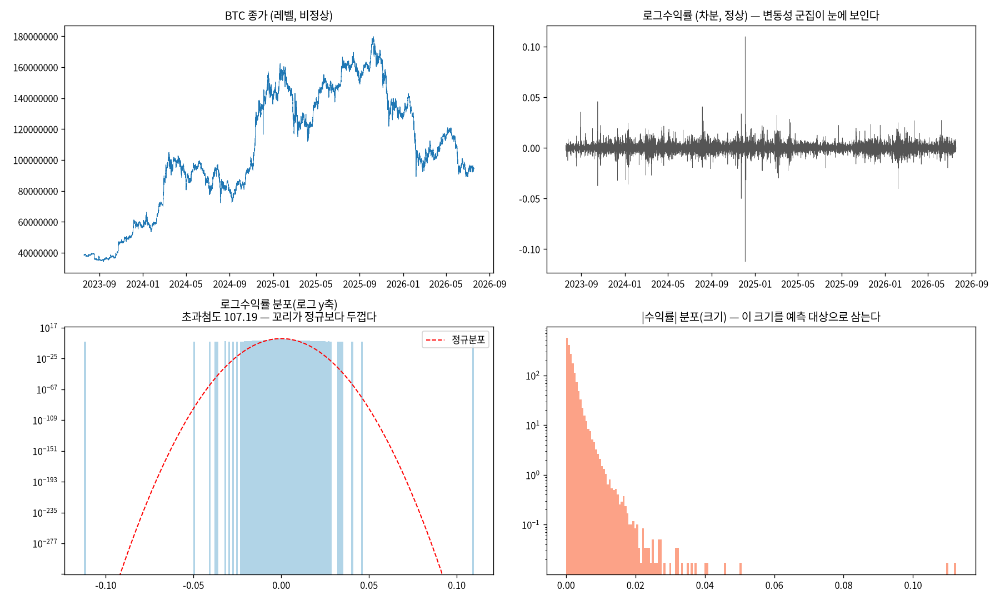
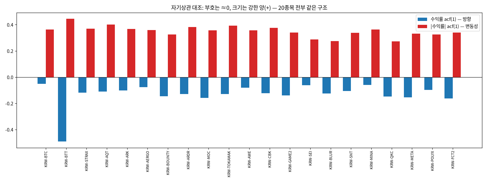
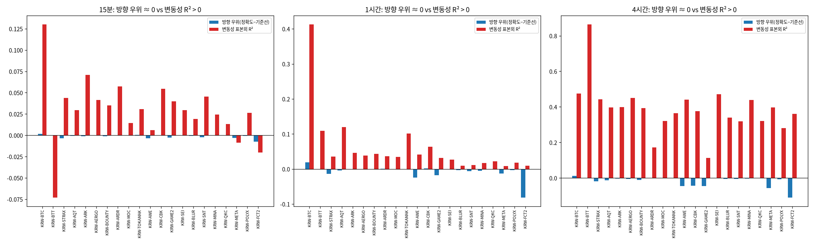

# 20번 보고서 — 방향(부호)이 아니라 변동성(크기)을 먼저 하는 이유

작성일 2026-09-03 · 브랜치 `stock`
· 원시 수치: [`20_.../predictability_raw.md`](20_direction_vs_volatility_predictability_20260903/predictability_raw.md)
· 지표 원본: [`predictability_metrics.csv`](20_direction_vs_volatility_predictability_20260903/predictability_metrics.csv)
· 재현: `uv run test/models/20_direction_vs_volatility_predictability_test.py`

---

## 실험 설계

> 드라이버 서두 설계 셀 원문(`test/models/20_direction_vs_volatility_predictability_test.py`). 실행 전에 적은 설계이며, 결과를 본 뒤 바꾼 내용은 결과 절에 따로 적는다.

### 20번: 방향(부호) 대 변동성(크기) 예측 가능성 대조 + 데이터 EDA

헤드리스 `.py` 드라이버(`#%%` 셀 + 파일 내 마크다운, AGENTS.md 2.3). ipynb는 만들지 않는다.

#### 왜 (Why)
A/B/C 갈래에서 **B(변동성)를 먼저 주력으로 확정**하기로 했다. 다만 프레이밍은 "방향이 안 되니까
변동성으로 간다"가 아니라 **"방향을 지금 같이 고려하기엔 이런 문제가 있고, 그래서 변동성을 먼저
하고 방향은 그 뒤에 이어간다"**이다. 이 판단을 같은 데이터·같은 방식으로 나란히 재확인해,
교수님 보고와 논문 서두 논리의 실증 근거를 만든다.

#### 무엇을 (What)
  E0 종목 선정 : 변동성 × 거래대금 점수로 상위 20종목을 뽑는다(Dynamic Volatility Ticker Filter).
  E1 EDA       : 대표 종목(BTC) 기술통계(describe, 지수표기 없이)와 분포·꼬리·거래량 시각화.
  E2 전처리 계보: 원본레벨 → 로그 → 차분 d → 타깃 → 스케일링 → 파생 (AGENTS.md 2.9b 표).
  E3 자기상관   : 수익률 acf(방향 신호) vs |수익률| acf(변동성 신호) — 20종목 재현.
  E4 방향       : 로지스틱 회귀 정확도·DA·DA(큰변동) vs 기준선 — 20종목, horizon 3개.
  E5 변동성     : 선형 회귀로 미래 실현변동성 예측, R²·MASE·QLIKE·corr vs 나이브 — 20종목, horizon 3개.
  E6 종합       : 방향 우위(≈0) vs 변동성 R²(+) 대조표·그림·결론.

#### 어떻게 (How)
데이터 축은 `upbit_krw_candle`(2026-07-18 교정 이후 정본). 종목 선정은 DuckDB 윈도우 함수로
종목별 로그수익률 표준편차와 거래대금을 한 번에 집계한다. look-ahead 방지: feature는 시점 t까지,
타깃은 t→t+h. 표준화·평균은 학습 구간(앞 70%)에서만 fit 한다. 모든 수치는 과학적표기 없이
저장하고 원시 수치를 `*_raw.md`로 분리한다(2.9b/2.9d). 지표는 축·나이브와 함께 보고한다(2.9d).

#### 기대 결과 / 반영 (Expected)
같은 데이터·같은 방식에서 방향은 학습해도 기준선을 못 넘고(정확도 우위 ≈ 0), 변동성은 표본외로
명확히 예측됨(R² > 0, corr 높음)을 20종목 전부에서 재현한다. 이로써 "변동성 우선, 방향 후속"의
순서 결정을 데이터로 뒷받침한다.

---

## 기초통계량(describe 표)

> 2026-10-14 소급 추가(AGENTS.md 2.9k). 실행 당시가 아니라 현재 DB를 같은 테이블·창으로 다시 조회해 계산했다(업비트 과거 캔들은 바뀌지 않으므로 같은 창이면 같은 값이다). 데이터 범위 근거: 20번은 `upbit_krw_candle`에서 수익률 90,000개 이상 종목 중 점수(로그수익률 표준편차 × ln 총 거래대금) 상위 20개와 BTC, 21종목의 전체 이력을 썼다. 현재 DB로 다시 선정해도 목록이 같다.

### 변동성×거래대금 점수 상위 20종목 + BTC

- 출처: `data/upbit_data.db`의 `upbit_krw_candle`, 테이블 전체 이력, 21종목

#### describe 표(pandas `describe()` 그대로, 종목별)

> 숫자 형식: count는 정수, 나머지는 소수 둘째 자리(1 미만 값은 유효숫자 4자리). 로그수익률은 15분봉 기준 % 단위다. 행 단위 원자료라 무체결 구간(캔들 없음)은 포함되지 않는다.

**종가(KRW)**

| 종목 | count | mean | std | min | 25% | 50% | 75% | max |
| :--- | ---: | ---: | ---: | ---: | ---: | ---: | ---: | ---: |
| KRW-BTT | 104,207 | 0.001036 | 0.0004874 | 0.000391 | 0.0006 | 0.000952 | 0.001314 | 0.003021 |
| KRW-STRAX | 102,279 | 76.15 | 44.11 | 11.80 | 53.14 | 65.13 | 104.00 | 247.00 |
| KRW-AQT | 100,547 | 1,456.84 | 555.74 | 268.00 | 1,093.00 | 1,407.00 | 1,843.00 | 5,929.00 |
| KRW-ARK | 101,942 | 695.53 | 400.71 | 152.00 | 418.00 | 599.70 | 880.88 | 2,475.00 |
| KRW-AERGO | 102,358 | 148.67 | 60.09 | 30.10 | 106.00 | 142.00 | 183.50 | 891.00 |
| KRW-BOUNTY | 97,259 | 75.76 | 31.63 | 19.50 | 56.28 | 74.10 | 100.40 | 201.90 |
| KRW-ARDR | 101,215 | 109.20 | 33.32 | 30.40 | 87.56 | 108.90 | 133.00 | 241.00 |
| KRW-MOC | 97,027 | 97.16 | 36.47 | 24.50 | 76.05 | 95.61 | 125.00 | 297.10 |
| KRW-TOKAMAK | 99,844 | 1,878.74 | 823.46 | 502.00 | 1,380.00 | 1,705.00 | 2,590.00 | 5,120.00 |
| KRW-AWE | 102,427 | 82.14 | 21.25 | 45.60 | 69.79 | 78.80 | 89.10 | 222.40 |
| KRW-CBK | 98,541 | 829.60 | 307.77 | 257.00 | 653.00 | 780.70 | 1,050.00 | 2,540.00 |
| KRW-GAME2 | 99,452 | 5.51 | 2.41 | 1.21 | 4.16 | 5.14 | 7.39 | 14.30 |
| KRW-SEI | 102,133 | 422.20 | 300.17 | 68.30 | 175.00 | 363.00 | 574.80 | 1,652.00 |
| KRW-BLUR | 103,370 | 289.42 | 258.37 | 20.60 | 94.02 | 221.60 | 396.00 | 1,138.00 |
| KRW-SNT | 100,795 | 38.80 | 16.99 | 10.30 | 28.80 | 35.35 | 52.59 | 115.90 |
| KRW-MINA | 92,854 | 631.76 | 528.65 | 56.10 | 193.00 | 512.00 | 935.00 | 3,845.00 |
| KRW-QKC | 95,726 | 11.37 | 4.19 | 2.69 | 9.13 | 11.21 | 14.30 | 28.20 |
| KRW-META | 96,461 | 36.09 | 15.51 | 11.00 | 27.75 | 33.83 | 47.30 | 84.18 |
| KRW-POLYX | 102,639 | 251.55 | 162.86 | 50.10 | 142.00 | 215.10 | 322.10 | 971.00 |
| KRW-FCT2 | 97,685 | 52.67 | 24.98 | 10.90 | 36.70 | 48.20 | 74.20 | 122.80 |
| KRW-BTC | 104,883 | 106,042,912.87 | 38,419,597.06 | 34,171,000.00 | 82,938,500.00 | 101,577,000.00 | 139,544,500.00 | 179,810,000.00 |

**거래량(코인 수)**

| 종목 | count | mean | std | min | 25% | 50% | 75% | max |
| :--- | ---: | ---: | ---: | ---: | ---: | ---: | ---: | ---: |
| KRW-BTT | 104,207 | 84,826,266,708.91 | 470,217,786,802.45 | 943,464.83 | 5,049,986,457.83 | 15,719,673,442.94 | 45,505,247,227.46 | 41,267,635,401,715.23 |
| KRW-STRAX | 102,279 | 2,169,304.59 | 10,244,524.70 | 0.0000009 | 102,447.56 | 339,040.30 | 1,044,843.59 | 619,715,276.89 |
| KRW-AQT | 100,547 | 70,958.18 | 514,267.13 | 0.00000001 | 2,014.89 | 8,001.91 | 25,932.44 | 36,729,734.33 |
| KRW-ARK | 101,942 | 319,474.04 | 1,449,187.03 | 0.00000001 | 13,879.35 | 46,286.54 | 148,790.07 | 58,717,627.02 |
| KRW-AERGO | 102,358 | 920,891.74 | 4,870,029.30 | 0.00000011 | 33,124.22 | 120,117.26 | 377,906.51 | 407,000,980.08 |
| KRW-BOUNTY | 97,259 | 1,111,381.75 | 7,345,472.28 | 0.00000008 | 29,011.41 | 123,137.83 | 412,585.32 | 570,717,812.35 |
| KRW-ARDR | 101,215 | 804,559.39 | 5,245,164.06 | 0.00000001 | 23,526.35 | 88,487.38 | 296,768.72 | 313,391,274.97 |
| KRW-MOC | 97,027 | 745,068.35 | 5,772,099.31 | 0.00000001 | 20,488.30 | 88,441.64 | 298,691.59 | 460,490,485.32 |
| KRW-TOKAMAK | 99,844 | 60,237.77 | 397,506.70 | 0.00000003 | 1,688.71 | 6,578.40 | 21,392.30 | 23,862,239.06 |
| KRW-AWE | 102,427 | 1,754,684.91 | 7,578,766.77 | 0.00000001 | 70,314.96 | 271,505.91 | 945,703.77 | 381,728,282.79 |
| KRW-CBK | 98,541 | 105,793.55 | 723,970.87 | 0.00000008 | 2,645.61 | 10,816.94 | 35,911.80 | 48,804,958.79 |
| KRW-GAME2 | 99,452 | 16,449,360.87 | 106,208,991.79 | 0.00001621 | 553,337.90 | 2,193,191.72 | 6,900,330.26 | 7,513,108,307.60 |
| KRW-SEI | 102,133 | 1,062,546.51 | 2,975,898.62 | 0.04303 | 181,524.11 | 415,899.66 | 959,713.86 | 197,777,066.46 |
| KRW-BLUR | 103,370 | 710,264.87 | 3,011,073.03 | 0.0000002 | 69,722.88 | 218,473.95 | 565,273.97 | 250,953,765.12 |
| KRW-SNT | 100,795 | 2,890,305.72 | 16,727,779.77 | 0.00000001 | 104,895.76 | 377,527.82 | 1,232,766.22 | 1,220,336,031.38 |
| KRW-MINA | 92,854 | 176,609.57 | 925,437.33 | 0.00000005 | 12,205.12 | 38,951.04 | 117,416.45 | 81,665,062.67 |
| KRW-QKC | 95,726 | 5,002,590.15 | 37,559,382.16 | 0.00000002 | 146,900.21 | 631,264.54 | 2,122,462.70 | 3,177,103,817.88 |
| KRW-META | 96,461 | 1,846,102.60 | 11,001,766.83 | 0.00000005 | 45,711.93 | 206,729.57 | 732,515.65 | 690,739,454.10 |
| KRW-POLYX | 102,639 | 629,871.53 | 3,161,462.32 | 0.00000001 | 34,663.43 | 116,600.50 | 343,103.41 | 168,387,101.40 |
| KRW-FCT2 | 97,685 | 1,219,615.96 | 8,094,279.76 | 0.00000001 | 38,226.89 | 161,770.24 | 530,923.55 | 615,158,370.50 |
| KRW-BTC | 104,883 | 32.32 | 54.96 | 0.0001955 | 9.18 | 17.87 | 35.36 | 2,856.91 |

**거래대금(KRW)**

| 종목 | count | mean | std | min | 25% | 50% | 75% | max |
| :--- | ---: | ---: | ---: | ---: | ---: | ---: | ---: | ---: |
| KRW-BTT | 104,207 | 129,146,519.49 | 822,962,031.13 | 456.64 | 3,628,774.45 | 13,992,748.48 | 53,183,801.03 | 60,354,867,797.54 |
| KRW-STRAX | 102,279 | 202,390,829.34 | 1,036,814,917.46 | 0.00004675 | 5,206,126.35 | 21,046,165.14 | 86,620,242.08 | 58,888,538,983.16 |
| KRW-AQT | 100,547 | 142,483,606.03 | 1,754,846,926.55 | 0.00000871 | 2,464,489.64 | 10,635,390.14 | 38,204,857.63 | 191,151,893,950.35 |
| KRW-ARK | 101,942 | 244,083,391.20 | 1,104,984,237.33 | 0.00000493 | 6,950,424.99 | 28,834,300.91 | 109,712,064.04 | 54,471,832,365.84 |
| KRW-AERGO | 102,358 | 203,983,989.06 | 1,458,985,913.85 | 0.00001287 | 4,005,857.81 | 15,666,171.65 | 57,022,288.81 | 110,652,893,534.42 |
| KRW-BOUNTY | 97,259 | 100,332,388.09 | 840,341,670.79 | 0.00000247 | 1,741,614.15 | 8,409,880.73 | 32,049,676.23 | 81,151,336,799.05 |
| KRW-ARDR | 101,215 | 107,680,207.07 | 818,924,409.32 | 0.0000009 | 2,234,715.98 | 8,935,944.63 | 33,404,221.85 | 50,390,364,774.02 |
| KRW-MOC | 97,027 | 100,178,586.37 | 1,105,541,751.24 | 0.00000041 | 1,603,065.11 | 7,883,480.80 | 30,330,751.52 | 111,569,942,556.14 |
| KRW-TOKAMAK | 99,844 | 148,430,526.27 | 1,160,060,406.44 | 0.00004392 | 2,401,751.89 | 11,016,765.46 | 43,674,617.18 | 67,362,017,784.77 |
| KRW-AWE | 102,427 | 166,394,176.70 | 837,089,096.08 | 0.00000081 | 5,261,761.10 | 21,028,876.01 | 78,981,841.95 | 61,465,677,142.10 |
| KRW-CBK | 98,541 | 111,952,845.67 | 1,050,336,708.40 | 0.0000399 | 1,789,177.15 | 8,233,811.07 | 31,526,177.80 | 111,482,198,978.71 |
| KRW-GAME2 | 99,452 | 117,103,807.04 | 894,520,127.45 | 0.00002269 | 2,297,195.64 | 11,178,100.53 | 41,972,200.53 | 85,806,307,292.49 |
| KRW-SEI | 102,133 | 499,795,791.06 | 1,544,271,910.69 | 3.70 | 45,592,344.23 | 137,964,213.65 | 412,609,361.42 | 139,569,640,025.00 |
| KRW-BLUR | 103,370 | 226,840,414.76 | 841,879,404.80 | 0.00000677 | 8,540,243.07 | 41,927,047.97 | 154,365,168.28 | 53,445,370,392.31 |
| KRW-SNT | 100,795 | 152,551,498.93 | 1,049,421,587.83 | 0.00000011 | 3,072,866.01 | 13,176,619.18 | 51,924,297.93 | 69,651,380,497.43 |
| KRW-MINA | 92,854 | 148,845,815.52 | 1,449,228,471.90 | 0.00000493 | 3,660,773.46 | 14,617,809.47 | 64,960,543.76 | 211,929,837,624.02 |
| KRW-QKC | 95,726 | 70,716,120.18 | 606,198,154.20 | 0.00000013 | 1,324,066.34 | 6,637,911.65 | 25,912,545.99 | 68,816,232,203.39 |
| KRW-META | 96,461 | 86,896,515.51 | 586,293,938.94 | 0.00000172 | 1,252,496.95 | 6,532,217.41 | 28,368,172.28 | 47,223,852,235.85 |
| KRW-POLYX | 102,639 | 233,347,752.63 | 1,410,326,213.04 | 0.0000006 | 5,382,236.68 | 22,677,911.55 | 88,817,471.66 | 122,610,840,881.14 |
| KRW-FCT2 | 97,685 | 78,288,665.30 | 600,738,212.52 | 0.00000039 | 1,476,914.01 | 7,392,642.05 | 29,537,491.40 | 61,950,314,811.67 |
| KRW-BTC | 104,883 | 3,172,491,762.68 | 5,428,471,142.82 | 19,979.49 | 904,263,990.73 | 1,717,315,381.02 | 3,393,464,709.24 | 317,019,670,845.50 |

**로그수익률(%)**

| 종목 | count | mean | std | min | 25% | 50% | 75% | max |
| :--- | ---: | ---: | ---: | ---: | ---: | ---: | ---: | ---: |
| KRW-BTT | 104,206 | -0.0003819 | 4.15 | -26.83 | -0.1741 | 0 | 0.1688 | 26.83 |
| KRW-STRAX | 102,278 | -0.001437 | 0.7567 | -26.94 | -0.2819 | 0 | 0.2731 | 29.07 |
| KRW-AQT | 100,546 | -0.001469 | 0.7531 | -39.01 | -0.2574 | 0 | 0.2584 | 30.41 |
| KRW-ARK | 101,941 | -0.0008267 | 0.7251 | -48.14 | -0.292 | 0 | 0.2796 | 37.67 |
| KRW-AERGO | 102,357 | -0.00139 | 0.7281 | -20.21 | -0.2488 | 0 | 0.246 | 20.48 |
| KRW-BOUNTY | 97,258 | -0.001222 | 0.7438 | -33.11 | -0.2781 | 0 | 0.2756 | 27.58 |
| KRW-ARDR | 101,214 | -0.001097 | 0.7407 | -28.50 | -0.2311 | 0 | 0.2317 | 28.20 |
| KRW-MOC | 97,026 | -0.00137 | 0.732 | -40.20 | -0.2381 | 0 | 0.238 | 33.55 |
| KRW-TOKAMAK | 99,843 | -0.001303 | 0.7177 | -39.06 | -0.2483 | 0 | 0.2489 | 30.14 |
| KRW-AWE | 102,426 | 0.0004 | 0.6998 | -24.33 | -0.2433 | 0 | 0.2421 | 18.04 |
| KRW-CBK | 98,540 | -0.001049 | 0.7097 | -36.65 | -0.2514 | 0 | 0.2553 | 28.72 |
| KRW-GAME2 | 99,451 | -0.001279 | 0.7061 | -37.81 | -0.2367 | 0 | 0.2345 | 32.45 |
| KRW-SEI | 102,132 | -0.001613 | 0.6709 | -28.40 | -0.3361 | 0 | 0.3233 | 38.00 |
| KRW-BLUR | 103,369 | -0.002839 | 0.6871 | -38.92 | -0.338 | 0 | 0.3273 | 31.72 |
| KRW-SNT | 100,794 | -0.001118 | 0.6852 | -12.91 | -0.2693 | 0 | 0.2648 | 23.66 |
| KRW-MINA | 92,853 | -0.003577 | 0.6876 | -32.16 | -0.318 | 0 | 0.3079 | 43.83 |
| KRW-QKC | 95,725 | -0.001513 | 0.7025 | -26.56 | -0.2238 | 0 | 0.2275 | 51.35 |
| KRW-META | 96,460 | -0.001069 | 0.6965 | -29.69 | -0.2706 | 0 | 0.2645 | 22.92 |
| KRW-POLYX | 102,638 | -0.001173 | 0.6687 | -38.30 | -0.2956 | 0 | 0.2857 | 29.57 |
| KRW-FCT2 | 97,684 | -0.001792 | 0.6811 | -29.89 | -0.2497 | 0 | 0.2541 | 24.57 |
| KRW-BTC | 104,882 | 0.0008566 | 0.2386 | -11.24 | -0.09803 | 0 | 0.0994 | 10.99 |

---

## 0. 한 장 요약 — 이번에 정한 것

A/B/C 갈래에서 **B(변동성)를 먼저 주력으로 확정**한다. 다만 프레이밍은 "방향이 안 되니까
변동성으로 도망간다"가 아니다. 정확히는 이렇다.

> 방향은 결국 **수익률의 부호**다. 그런데 부호를 지금 같이 예측 대상에 넣으면 아래 3절의
> 문제가 생긴다. 반면 변동성(부호를 뺀 움직임의 크기)은 같은 데이터에서 실제로 예측된다.
> 그래서 **변동성을 먼저 확립하고, 방향은 그 위에서 이후 단계로 이어간다.**

이 판단을 BTC와 상위 20종목에서 같은 데이터·같은 방식으로 재확인했고, 결과는 예외 없이
한 방향이었다.

---

## 1. 방향이란 무엇인가 — 용어부터 맞춘다

- **방향(direction)** = 다음 시점 수익률의 **부호**. 오르면 +, 내리면 −. 즉 `sign(다음 수익률)`.
- **변동성(volatility)** = 그 부호를 떼어낸 **움직임의 크기**. 절댓값 수익률이나 실현변동성
  `√(Σ 수익률²)`으로 잰다.

두 대상은 예측 문제의 종류부터 다르다. 방향은 오름/내림 **분류(classification)** 문제이고,
변동성은 크기를 맞추는 **회귀(regression)** 문제다. 그래서 성적표의 지표도 다르다(방향은
정확도, 변동성은 R²·상관계수).

---

## 2. 데이터와 전처리 — 무엇을 어떻게 다뤘는가

### 2.1 분석 대상 종목 (E0)

`upbit_krw_candle`(15분봉, 269종목)에서 **이력 9만 행(약 2.5년) 이상**인 종목으로 좁힌 뒤,
**점수 = 로그수익률 표준편차 × log(총 거래대금)** 상위 20종목을 선정했다. 이력 하한선은
신규 상장 잡코인과 생존편의(지금 살아남은 종목만 뽑히는 편향)를 배제하기 위한 것이다.
BTC는 대형 저변동 종목이라 변동성 순위에는 들지 않지만, 기존 연구와의 연결을 위해 **대표
기준 종목으로 별도 추가**했다(총 21종목 분석). 선정 목록과 점수는 원시 수치 E0 표에 있다.

### 2.2 대표 종목(BTC) EDA (E1)

- 기간 약 2.7년, 104,883봉, 결측 없음. 종가는 비정상(추세·수준 이동), 로그수익률은 정상이며
  **변동성 군집**(큰 변동이 몰려 있는 구간)이 눈으로 보인다.
- 로그수익률 **초과첨도 13.98**(정규분포면 0). 급변이 정규 가정보다 훨씬 잦은 **두꺼운 꼬리**다.
- |수익률| 자기상관 lag1 = **0.36** vs 수익률 자기상관 lag1 = **−0.05**. 크기에는 구조가 있고
  부호에는 없다는 이후 결과의 전조다.
- `describe()`는 지수표기 없이 정수/실수로 원시 수치 E1 표에 실었다.

### 2.3 전처리 계보 (E2, AGENTS.md 2.9b)

예측 대상이 "차분값(로그수익률)에서 파생된 부호/크기"임을 먼저 밝힌다.

| 단계 | 처리 | 근거 |
| :--- | :--- | :--- |
| 원본 레벨 | 종가 close | 비정상(단위근) |
| 변환 | log(close) | 배율 효과 제거. 로그 레벨도 여전히 비정상 |
| 차분 d=1 | log_return = Δlog(close) | 여기서 정상성을 얻는다 |
| 타깃(방향) | sign(Σ 미래수익률) | 분류 라벨 |
| 타깃(변동성) | √(Σ 미래수익률²) | 회귀 타깃(로그 스케일) |
| 스케일링 | 학습구간 StandardScaler | 누설 방지(학습통계로만 fit) |

look-ahead(미래 정보 누설)를 막기 위해 feature는 시점 t까지만 쓰고, 학습/테스트는 시간순
70/30으로 나눴다.

---

## 3. 방향을 지금 같이 고려할 때의 문제점 (E3·E4)

### 3.1 부호에는 예측할 신호가 거의 없다

- 수익률 자기상관 lag1 평균 **−0.13**(0 근처), |수익률| 자기상관 lag1 평균 **0.35**로 완전히
  갈린다. 부호는 과거로 미래를 설명하지 못하고, 크기는 설명한다. 20종목 전부 같은 구조다.
- 이는 효율적 시장 가설(정보가 이미 가격에 반영되어 다음 부호를 알기 어렵다)과 일치한다.

### 3.2 분류기를 학습시켜도 기준선을 못 넘는다

단순 로지스틱 회귀로 방향을 분류한 결과, **정확도 자체는 0.51~0.72로 높아 보이지만 실제
예측력은 없다.** 높은 정확도는 대부분 **상승/하락 클래스 쏠림** 때문이다(예: 상승비율 0.28인
종목은 무조건 "하락"만 찍어도 0.72가 나온다). 그래서 다수 클래스만 찍는 기준선과 비교한
**우위(edge)**로 판단해야 한다.

| 예측 구간 | 방향 우위(정확도−기준선) 평균 | 큰 변동 구간 방향 정확도 |
| :--- | ---: | ---: |
| 15분 | −0.0012 | 0.509 |
| 1시간 | −0.0074 | 0.527 |
| 4시간 | −0.0174 | 0.544 |

- 우위는 20종목·3구간 어디서도 0 근처이거나 오히려 음수다. 큰 변동 구간만 따로 봐도 개선되지
  않는다(0.5 근처).
- **결론(방향)**: 지금 방향을 주력에 넣으면, 이렇게 신호가 없는 대상을 억지로 모델링하면서
  **잡음을 신호로 착각(과적합)**하거나, 라벨 정의(무변동 구간)·거래비용 때문에 결론이 흔들려
  프로젝트 전체의 신뢰도를 떨어뜨릴 위험이 크다.

---

## 4. 변동성은 같은 데이터에서 실제로 예측된다 (E5·E6)

같은 데이터·같은 방식으로 미래 실현변동성을 회귀로 예측한 결과다. 지표는 축·나이브와 함께
보고한다(AGENTS.md 2.9d).

**대표 종목 BTC**

| 예측 구간 | 표본외 R² | 예측·실제 상관 | MASE (나이브 대비) |
| :--- | ---: | ---: | ---: |
| 15분 | 0.130 | 0.226 | 0.728 |
| 1시간 | 0.413 | 0.440 | 0.814 |
| 4시간 | 0.476 | 0.624 | 0.855 |

- 표본외 R²가 양으로 크고, 예측·실제 상관이 0.62까지 오른다. MASE가 1보다 작으므로 학습
  모델이 나이브 지속성보다 낫다.
- 20종목 평균에서도 구간이 길어질수록 R²가 커진다(4시간 평균 **0.38**). 15분 한 봉짜리
  실현변동성은 잡음이 커서 R²가 작지만, 이는 "변동성이 안 된다"가 아니라 **단순 지속성 대신
  GARCH·HAR 같은 평활 모델이 필요한 이유**다.
- **결론(변동성)**: 예측이 되는 대상이므로 여기에 집중한다.

> 방향(우위 ≈ 0)과 변동성(R² 0.13~0.48)의 이 대비가, "방향이 아니라 변동성을 먼저 한다"는
> 순서 결정의 실증 근거다.

---

## 5. 기대 효과와 설계 근거 — 문헌 (관련 보고서 [`professor_direction_recommendation_20260821.md`](professor_direction_recommendation_20260821.md))

이번 실측은 금융계량경제학의 **정형화된 사실(stylized facts)**과 정확히 일치한다. 즉 우리
데이터·모델의 결함이 아니라 알려진 구조다.

- 방향 예측 불가: **Fama(1970)** 효율적 시장 가설, **Cont(2001)** "수익률에는 선형 상관이
  거의 없다", 암호화폐 실증 **Yi et al.(2023, *Sci. Rep.*)** "비트코인 시장은 약형 효율에 가깝다",
  **Singha(2025, arXiv:2512.15720)** "방향 정확도 45%, 우연과 구별 불가(p=0.12)".
- 변동성 예측 가능: **Mandelbrot(1963)** 변동성 군집 최초 관측, **Engle(1982)** ARCH(노벨상),
  **Barjašić·Antulov-Fantulin(2020)** "GARCH(1,1)이 분 단위 변동성 예측에 가장 잘 반응",
  **Hansen et al.(2021)** 암호화폐 변동성의 시간대·요일 주기, **Hassler·Pohle(2019)** 장기기억
  하에서 분수적분 기반 방법의 우수성.

**기대 효과**: "변동성 예측"으로 목표를 잡으면 두 활용처를 하나로 묶을 수 있다.
(a) 연구 목적으로는 "변동의 크기가 시간에 따라 변한다"는 비정상성의 구체적 형태를 다루는 것
자체가 연구가 되고, (b) 실용 목적으로는 변동성 예측이 그대로 리스크 관리 신호가 된다.

---

## 6. 다음 단계 — 순서

1. **변동성 모델 확립(먼저)**: 주기 성분 제거 후, 구간별 후보(4시간 GARCH-t / 16시간 GARCH-t·
   HAR-RV 동률)를 표본외 성능으로 확정한다(19번 결과 이어받기).
2. **방향은 이후 단계**: 변동성을 확립한 위에서, 변동성에 조건부인 방향이나 외생 정보 결합
   같은 후속 연구로 이어간다. 기대치는 낮게 잡고 부가 실험으로 둔다.

---

## 부록 — 한계와 유의점

- **BTT는 예외**: 초저가 코인이라 호가 튐(bid-ask bounce)으로 수익률 자기상관이 −0.49로 크게
  음수다. 미시구조 아티팩트이며 20종목 종합 결론에는 영향이 없다.
- **15분 변동성 R²가 작은 것**은 단일 봉 실현변동성의 잡음 때문이며, 평활·집계 모델의
  필요성을 가리킨다(변동성 자체의 예측 불가가 아니다).
- 모든 수치는 시간순 70/30 분할·표본외 기준이며, 과학적표기 없이 원시 수치 파일에 보존했다.
