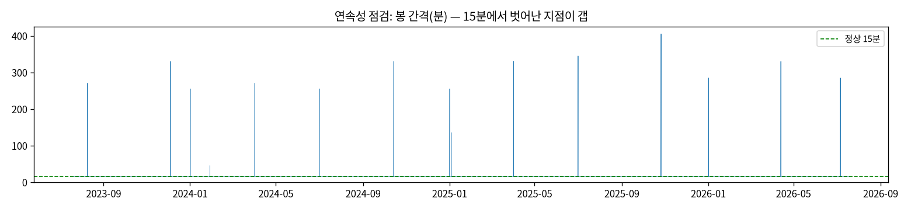
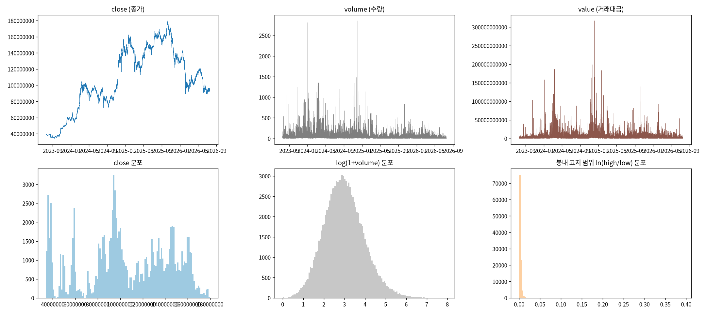
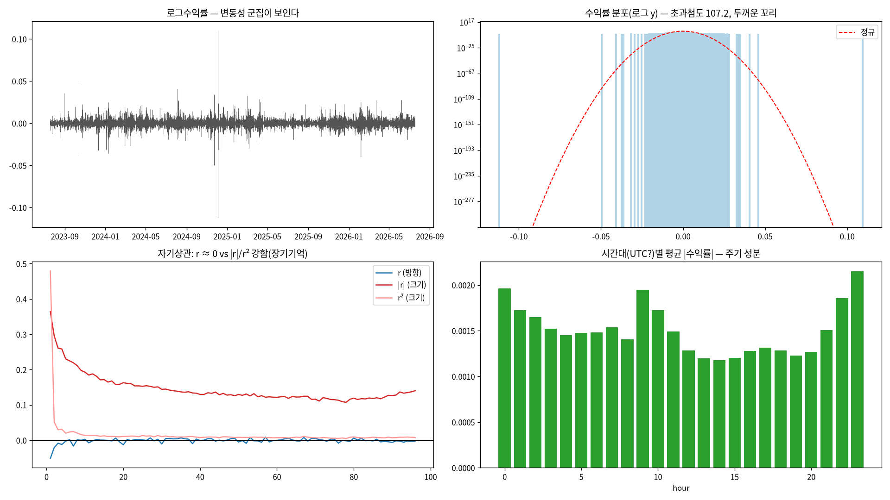
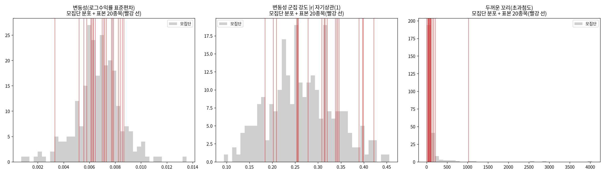

# 21번 보고서 — 변동성 예측을 위한 EDA (처음부터 다시)

작성일 2026-09-04 · 브랜치 `stock`
· 원시 수치: [`21_.../volatility_eda_raw.md`](21_volatility_eda_20260904/volatility_eda_raw.md)
· 데이터 사전: [`DATA_DICTIONARY.md`](DATA_DICTIONARY.md)
· 재현: `uv run test/models/21_volatility_eda_test.py`

---

## 실험 설계

> 드라이버 서두 설계 셀 원문(`test/models/21_volatility_eda_test.py`). 실행 전에 적은 설계이며, 결과를 본 뒤 바꾼 내용은 결과 절에 따로 적는다.

### 21번: 변동성 예측을 위한 EDA (처음부터 다시)

헤드리스 `.py` 드라이버(`#%%` 셀 + 파일 내 마크다운, AGENTS.md 2.3). ipynb는 만들지 않는다.

#### 왜 (Why)
방향성(예측 대상 = 변동성)만 확정하고, 모델·전처리·feature는 **전부 EDA부터 다시 시작**한다.
이전에 적합한 모델(GARCH-t·HAR-RV 등)은 결정으로 가져가지 않는다. 이 EDA가 이후 전처리·모델
선택의 유일한 근거가 된다. 모든 변수는 `DATA_DICTIONARY.md`에 raw부터 파생까지 누적 정의한다.

#### 무엇을 (What)
  B  연구 배경 : 코인 24시간 연속 거래의 성질과 변동성 예측 연구 배경.
  Q  데이터 품질: 15분 연속성·갭·결측·중복·OHLC 정합성.
  R  RAW EDA   : open/high/low/close/volume/value 6개 열 전부(변환 전).
  V  변동성 EDA: 로그수익률 분포·정규성·정상성(ADF/KPSS)·자기상관(r vs |r| vs r²)·
                 변동성 군집·ARCH-LM·Ljung-Box·시간대/요일 계절성·범위변동성·거래량 관계.
  S  표본 타당성: 모집단(전 종목) 성질 분포에서 상위 20종목의 위치 + 정형화 사실 보편성.
  D  데이터 사전: raw + 이번 EDA에서 생긴 파생변수를 근거 유형과 함께 등록(v1).

#### 어떻게 (How)
대표 종목 심층은 BTC. 표본 타당성은 전 종목(이력 하한 이상)을 스캔한다. 통계 검정은
statsmodels(ADF/KPSS/Ljung-Box/ARCH-LM). 모든 수치는 과학적표기 없이 저장한다(2.9b/2.9d).
이 단계에서는 **모델을 적합하지 않는다** — 오직 데이터의 성질만 본다.

#### 기대 결과 (Expected)
"변동성 예측이 왜 가능한가(변동성 군집·조건부 이분산·두꺼운 꼬리)"를 데이터로 확인하고,
이후 전처리·모델 결정의 가정을 세운다. 표본 20종목이 모집단 현상을 대표함을 입증한다.

---

## 기초통계량(describe 표)

> 2026-10-14 소급 추가(AGENTS.md 2.9k). 실행 당시가 아니라 현재 DB를 같은 테이블·창으로 다시 조회해 계산했다(업비트 과거 캔들은 바뀌지 않으므로 같은 창이면 같은 값이다). 데이터 범위 근거: 21번은 `upbit_krw_candle` 전체 이력으로 KRW-BTC를 심층 분석하고, 20번과 같은 표본 20종목을 봤다. 모집단 스캔(행 5,000 이상 258종목, 종목별 최근 20,000봉)은 종목이 많아 여기 싣지 않는다.

### KRW-BTC와 표본 20종목(20번과 같은 목록)

- 출처: `data/upbit_data.db`의 `upbit_krw_candle`, 테이블 전체 이력, 21종목

#### describe 표(pandas `describe()` 그대로, 종목별)

> 숫자 형식: count는 정수, 나머지는 소수 둘째 자리(1 미만 값은 유효숫자 4자리). 로그수익률은 15분봉 기준 % 단위다. 행 단위 원자료라 무체결 구간(캔들 없음)은 포함되지 않는다.

**종가(KRW)**

| 종목 | count | mean | std | min | 25% | 50% | 75% | max |
| :--- | ---: | ---: | ---: | ---: | ---: | ---: | ---: | ---: |
| KRW-BTT | 104,207 | 0.001036 | 0.0004874 | 0.000391 | 0.0006 | 0.000952 | 0.001314 | 0.003021 |
| KRW-STRAX | 102,279 | 76.15 | 44.11 | 11.80 | 53.14 | 65.13 | 104.00 | 247.00 |
| KRW-AQT | 100,547 | 1,456.84 | 555.74 | 268.00 | 1,093.00 | 1,407.00 | 1,843.00 | 5,929.00 |
| KRW-ARK | 101,942 | 695.53 | 400.71 | 152.00 | 418.00 | 599.70 | 880.88 | 2,475.00 |
| KRW-AERGO | 102,358 | 148.67 | 60.09 | 30.10 | 106.00 | 142.00 | 183.50 | 891.00 |
| KRW-BOUNTY | 97,259 | 75.76 | 31.63 | 19.50 | 56.28 | 74.10 | 100.40 | 201.90 |
| KRW-ARDR | 101,215 | 109.20 | 33.32 | 30.40 | 87.56 | 108.90 | 133.00 | 241.00 |
| KRW-MOC | 97,027 | 97.16 | 36.47 | 24.50 | 76.05 | 95.61 | 125.00 | 297.10 |
| KRW-TOKAMAK | 99,844 | 1,878.74 | 823.46 | 502.00 | 1,380.00 | 1,705.00 | 2,590.00 | 5,120.00 |
| KRW-AWE | 102,427 | 82.14 | 21.25 | 45.60 | 69.79 | 78.80 | 89.10 | 222.40 |
| KRW-CBK | 98,541 | 829.60 | 307.77 | 257.00 | 653.00 | 780.70 | 1,050.00 | 2,540.00 |
| KRW-GAME2 | 99,452 | 5.51 | 2.41 | 1.21 | 4.16 | 5.14 | 7.39 | 14.30 |
| KRW-SEI | 102,133 | 422.20 | 300.17 | 68.30 | 175.00 | 363.00 | 574.80 | 1,652.00 |
| KRW-BLUR | 103,370 | 289.42 | 258.37 | 20.60 | 94.02 | 221.60 | 396.00 | 1,138.00 |
| KRW-SNT | 100,795 | 38.80 | 16.99 | 10.30 | 28.80 | 35.35 | 52.59 | 115.90 |
| KRW-MINA | 92,854 | 631.76 | 528.65 | 56.10 | 193.00 | 512.00 | 935.00 | 3,845.00 |
| KRW-QKC | 95,726 | 11.37 | 4.19 | 2.69 | 9.13 | 11.21 | 14.30 | 28.20 |
| KRW-META | 96,461 | 36.09 | 15.51 | 11.00 | 27.75 | 33.83 | 47.30 | 84.18 |
| KRW-POLYX | 102,639 | 251.55 | 162.86 | 50.10 | 142.00 | 215.10 | 322.10 | 971.00 |
| KRW-FCT2 | 97,685 | 52.67 | 24.98 | 10.90 | 36.70 | 48.20 | 74.20 | 122.80 |
| KRW-BTC | 104,883 | 106,042,912.87 | 38,419,597.06 | 34,171,000.00 | 82,938,500.00 | 101,577,000.00 | 139,544,500.00 | 179,810,000.00 |

**거래량(코인 수)**

| 종목 | count | mean | std | min | 25% | 50% | 75% | max |
| :--- | ---: | ---: | ---: | ---: | ---: | ---: | ---: | ---: |
| KRW-BTT | 104,207 | 84,826,266,708.91 | 470,217,786,802.45 | 943,464.83 | 5,049,986,457.83 | 15,719,673,442.94 | 45,505,247,227.46 | 41,267,635,401,715.23 |
| KRW-STRAX | 102,279 | 2,169,304.59 | 10,244,524.70 | 0.0000009 | 102,447.56 | 339,040.30 | 1,044,843.59 | 619,715,276.89 |
| KRW-AQT | 100,547 | 70,958.18 | 514,267.13 | 0.00000001 | 2,014.89 | 8,001.91 | 25,932.44 | 36,729,734.33 |
| KRW-ARK | 101,942 | 319,474.04 | 1,449,187.03 | 0.00000001 | 13,879.35 | 46,286.54 | 148,790.07 | 58,717,627.02 |
| KRW-AERGO | 102,358 | 920,891.74 | 4,870,029.30 | 0.00000011 | 33,124.22 | 120,117.26 | 377,906.51 | 407,000,980.08 |
| KRW-BOUNTY | 97,259 | 1,111,381.75 | 7,345,472.28 | 0.00000008 | 29,011.41 | 123,137.83 | 412,585.32 | 570,717,812.35 |
| KRW-ARDR | 101,215 | 804,559.39 | 5,245,164.06 | 0.00000001 | 23,526.35 | 88,487.38 | 296,768.72 | 313,391,274.97 |
| KRW-MOC | 97,027 | 745,068.35 | 5,772,099.31 | 0.00000001 | 20,488.30 | 88,441.64 | 298,691.59 | 460,490,485.32 |
| KRW-TOKAMAK | 99,844 | 60,237.77 | 397,506.70 | 0.00000003 | 1,688.71 | 6,578.40 | 21,392.30 | 23,862,239.06 |
| KRW-AWE | 102,427 | 1,754,684.91 | 7,578,766.77 | 0.00000001 | 70,314.96 | 271,505.91 | 945,703.77 | 381,728,282.79 |
| KRW-CBK | 98,541 | 105,793.55 | 723,970.87 | 0.00000008 | 2,645.61 | 10,816.94 | 35,911.80 | 48,804,958.79 |
| KRW-GAME2 | 99,452 | 16,449,360.87 | 106,208,991.79 | 0.00001621 | 553,337.90 | 2,193,191.72 | 6,900,330.26 | 7,513,108,307.60 |
| KRW-SEI | 102,133 | 1,062,546.51 | 2,975,898.62 | 0.04303 | 181,524.11 | 415,899.66 | 959,713.86 | 197,777,066.46 |
| KRW-BLUR | 103,370 | 710,264.87 | 3,011,073.03 | 0.0000002 | 69,722.88 | 218,473.95 | 565,273.97 | 250,953,765.12 |
| KRW-SNT | 100,795 | 2,890,305.72 | 16,727,779.77 | 0.00000001 | 104,895.76 | 377,527.82 | 1,232,766.22 | 1,220,336,031.38 |
| KRW-MINA | 92,854 | 176,609.57 | 925,437.33 | 0.00000005 | 12,205.12 | 38,951.04 | 117,416.45 | 81,665,062.67 |
| KRW-QKC | 95,726 | 5,002,590.15 | 37,559,382.16 | 0.00000002 | 146,900.21 | 631,264.54 | 2,122,462.70 | 3,177,103,817.88 |
| KRW-META | 96,461 | 1,846,102.60 | 11,001,766.83 | 0.00000005 | 45,711.93 | 206,729.57 | 732,515.65 | 690,739,454.10 |
| KRW-POLYX | 102,639 | 629,871.53 | 3,161,462.32 | 0.00000001 | 34,663.43 | 116,600.50 | 343,103.41 | 168,387,101.40 |
| KRW-FCT2 | 97,685 | 1,219,615.96 | 8,094,279.76 | 0.00000001 | 38,226.89 | 161,770.24 | 530,923.55 | 615,158,370.50 |
| KRW-BTC | 104,883 | 32.32 | 54.96 | 0.0001955 | 9.18 | 17.87 | 35.36 | 2,856.91 |

**거래대금(KRW)**

| 종목 | count | mean | std | min | 25% | 50% | 75% | max |
| :--- | ---: | ---: | ---: | ---: | ---: | ---: | ---: | ---: |
| KRW-BTT | 104,207 | 129,146,519.49 | 822,962,031.13 | 456.64 | 3,628,774.45 | 13,992,748.48 | 53,183,801.03 | 60,354,867,797.54 |
| KRW-STRAX | 102,279 | 202,390,829.34 | 1,036,814,917.46 | 0.00004675 | 5,206,126.35 | 21,046,165.14 | 86,620,242.08 | 58,888,538,983.16 |
| KRW-AQT | 100,547 | 142,483,606.03 | 1,754,846,926.55 | 0.00000871 | 2,464,489.64 | 10,635,390.14 | 38,204,857.63 | 191,151,893,950.35 |
| KRW-ARK | 101,942 | 244,083,391.20 | 1,104,984,237.33 | 0.00000493 | 6,950,424.99 | 28,834,300.91 | 109,712,064.04 | 54,471,832,365.84 |
| KRW-AERGO | 102,358 | 203,983,989.06 | 1,458,985,913.85 | 0.00001287 | 4,005,857.81 | 15,666,171.65 | 57,022,288.81 | 110,652,893,534.42 |
| KRW-BOUNTY | 97,259 | 100,332,388.09 | 840,341,670.79 | 0.00000247 | 1,741,614.15 | 8,409,880.73 | 32,049,676.23 | 81,151,336,799.05 |
| KRW-ARDR | 101,215 | 107,680,207.07 | 818,924,409.32 | 0.0000009 | 2,234,715.98 | 8,935,944.63 | 33,404,221.85 | 50,390,364,774.02 |
| KRW-MOC | 97,027 | 100,178,586.37 | 1,105,541,751.24 | 0.00000041 | 1,603,065.11 | 7,883,480.80 | 30,330,751.52 | 111,569,942,556.14 |
| KRW-TOKAMAK | 99,844 | 148,430,526.27 | 1,160,060,406.44 | 0.00004392 | 2,401,751.89 | 11,016,765.46 | 43,674,617.18 | 67,362,017,784.77 |
| KRW-AWE | 102,427 | 166,394,176.70 | 837,089,096.08 | 0.00000081 | 5,261,761.10 | 21,028,876.01 | 78,981,841.95 | 61,465,677,142.10 |
| KRW-CBK | 98,541 | 111,952,845.67 | 1,050,336,708.40 | 0.0000399 | 1,789,177.15 | 8,233,811.07 | 31,526,177.80 | 111,482,198,978.71 |
| KRW-GAME2 | 99,452 | 117,103,807.04 | 894,520,127.45 | 0.00002269 | 2,297,195.64 | 11,178,100.53 | 41,972,200.53 | 85,806,307,292.49 |
| KRW-SEI | 102,133 | 499,795,791.06 | 1,544,271,910.69 | 3.70 | 45,592,344.23 | 137,964,213.65 | 412,609,361.42 | 139,569,640,025.00 |
| KRW-BLUR | 103,370 | 226,840,414.76 | 841,879,404.80 | 0.00000677 | 8,540,243.07 | 41,927,047.97 | 154,365,168.28 | 53,445,370,392.31 |
| KRW-SNT | 100,795 | 152,551,498.93 | 1,049,421,587.83 | 0.00000011 | 3,072,866.01 | 13,176,619.18 | 51,924,297.93 | 69,651,380,497.43 |
| KRW-MINA | 92,854 | 148,845,815.52 | 1,449,228,471.90 | 0.00000493 | 3,660,773.46 | 14,617,809.47 | 64,960,543.76 | 211,929,837,624.02 |
| KRW-QKC | 95,726 | 70,716,120.18 | 606,198,154.20 | 0.00000013 | 1,324,066.34 | 6,637,911.65 | 25,912,545.99 | 68,816,232,203.39 |
| KRW-META | 96,461 | 86,896,515.51 | 586,293,938.94 | 0.00000172 | 1,252,496.95 | 6,532,217.41 | 28,368,172.28 | 47,223,852,235.85 |
| KRW-POLYX | 102,639 | 233,347,752.63 | 1,410,326,213.04 | 0.0000006 | 5,382,236.68 | 22,677,911.55 | 88,817,471.66 | 122,610,840,881.14 |
| KRW-FCT2 | 97,685 | 78,288,665.30 | 600,738,212.52 | 0.00000039 | 1,476,914.01 | 7,392,642.05 | 29,537,491.40 | 61,950,314,811.67 |
| KRW-BTC | 104,883 | 3,172,491,762.68 | 5,428,471,142.82 | 19,979.49 | 904,263,990.73 | 1,717,315,381.02 | 3,393,464,709.24 | 317,019,670,845.50 |

**로그수익률(%)**

| 종목 | count | mean | std | min | 25% | 50% | 75% | max |
| :--- | ---: | ---: | ---: | ---: | ---: | ---: | ---: | ---: |
| KRW-BTT | 104,206 | -0.0003819 | 4.15 | -26.83 | -0.1741 | 0 | 0.1688 | 26.83 |
| KRW-STRAX | 102,278 | -0.001437 | 0.7567 | -26.94 | -0.2819 | 0 | 0.2731 | 29.07 |
| KRW-AQT | 100,546 | -0.001469 | 0.7531 | -39.01 | -0.2574 | 0 | 0.2584 | 30.41 |
| KRW-ARK | 101,941 | -0.0008267 | 0.7251 | -48.14 | -0.292 | 0 | 0.2796 | 37.67 |
| KRW-AERGO | 102,357 | -0.00139 | 0.7281 | -20.21 | -0.2488 | 0 | 0.246 | 20.48 |
| KRW-BOUNTY | 97,258 | -0.001222 | 0.7438 | -33.11 | -0.2781 | 0 | 0.2756 | 27.58 |
| KRW-ARDR | 101,214 | -0.001097 | 0.7407 | -28.50 | -0.2311 | 0 | 0.2317 | 28.20 |
| KRW-MOC | 97,026 | -0.00137 | 0.732 | -40.20 | -0.2381 | 0 | 0.238 | 33.55 |
| KRW-TOKAMAK | 99,843 | -0.001303 | 0.7177 | -39.06 | -0.2483 | 0 | 0.2489 | 30.14 |
| KRW-AWE | 102,426 | 0.0004 | 0.6998 | -24.33 | -0.2433 | 0 | 0.2421 | 18.04 |
| KRW-CBK | 98,540 | -0.001049 | 0.7097 | -36.65 | -0.2514 | 0 | 0.2553 | 28.72 |
| KRW-GAME2 | 99,451 | -0.001279 | 0.7061 | -37.81 | -0.2367 | 0 | 0.2345 | 32.45 |
| KRW-SEI | 102,132 | -0.001613 | 0.6709 | -28.40 | -0.3361 | 0 | 0.3233 | 38.00 |
| KRW-BLUR | 103,369 | -0.002839 | 0.6871 | -38.92 | -0.338 | 0 | 0.3273 | 31.72 |
| KRW-SNT | 100,794 | -0.001118 | 0.6852 | -12.91 | -0.2693 | 0 | 0.2648 | 23.66 |
| KRW-MINA | 92,853 | -0.003577 | 0.6876 | -32.16 | -0.318 | 0 | 0.3079 | 43.83 |
| KRW-QKC | 95,725 | -0.001513 | 0.7025 | -26.56 | -0.2238 | 0 | 0.2275 | 51.35 |
| KRW-META | 96,460 | -0.001069 | 0.6965 | -29.69 | -0.2706 | 0 | 0.2645 | 22.92 |
| KRW-POLYX | 102,638 | -0.001173 | 0.6687 | -38.30 | -0.2956 | 0 | 0.2857 | 29.57 |
| KRW-FCT2 | 97,684 | -0.001792 | 0.6811 | -29.89 | -0.2497 | 0 | 0.2541 | 24.57 |
| KRW-BTC | 104,882 | 0.0008566 | 0.2386 | -11.24 | -0.09803 | 0 | 0.0994 | 10.99 |

---

## 0. 이 문서의 위치

방향성(예측 대상 = **변동성**)만 확정하고, 전처리·feature·모델은 **전부 EDA부터 다시**
시작한다. 이전에 적합한 모델(GARCH-t·HAR-RV 등)은 결정으로 가져가지 않는다. 이 EDA가 이후
모든 결정의 근거이며, 모든 변수는 [`DATA_DICTIONARY.md`](DATA_DICTIONARY.md)에 누적 정의한다.
**이 단계에서는 모델을 적합하지 않는다** — 데이터의 성질만 본다.

## 1. 연구 배경

- **대상**: 업비트 KRW 마켓 암호화폐. 주식과 달리 24시간·연중무휴 거래라 장 시작/마감·주말
  갭이 없고, 시계열이 끊김 없이 연속이다(개장 점프로 인한 인공 변동이 없다).
- **왜 시계열에 적합한가**: 연속·등간격(15분) 표본이라 자기상관·조건부 이분산 같은 시간구조를
  왜곡 없이 추정할 수 있다.
- **연구 방향**: 다음 구간에 **오를지/내릴지(방향)**가 아니라 **얼마나 움직일지(변동성=크기)**를
  예측한다. 방향은 효율적 시장 가설상 어렵고, 변동성은 '큰 변동 뒤 큰 변동'(변동성 군집)으로
  예측 가능하다. 이 EDA는 그 전제가 실제 데이터에 있는지 확인한다.

## 2. 데이터 품질 (대표 종목 BTC)

- 기간 2023-07-19 ~ 2026-07-19, 104,883봉(15분).
- **연속성**: 15분이 아닌 간격 15개(전체의 0.014%), 전부 누락 갭이며 중복은 없다. "완전 무결점
  연속"은 아니지만 사실상 연속이다. 이후 모델링에서 갭 처리 방침을 정한다.
- **결측 0, OHLC 정합성 위반 0**(high<low·범위 위반·거래량 0 모두 0건). 데이터 품질은 양호하다.

## 3. RAW 6개 열 (변환 전)

- open/high/low/close(원 가격), volume(코인 수량), value(원 거래대금). 기술통계는 원시 수치 R절.
- **6개 열 중 어느 것도 아직 모델에서 배제하기로 결정하지 않았다**(EDA 단계에서 전부 본다).
  특히 high/low는 이전 분석에서 미사용이었으나 이번에 범위 변동성으로 검토했다(§4.6).

## 4. 변동성 지향 EDA — 핵심 발견

| # | 항목 | 결과 | 의미 |
| :--- | :--- | :--- | :--- |
| 4.1 | 분포·정규성 | 초과첨도 **107.2**, Jarque-Bera p=0 | 정규분포보다 훨씬 **두꺼운 꼬리**(급변이 잦다) |
| 4.2 | 정상성 | 레벨 ADF p=0.19(비정상) / 수익률 ADF p=0(정상) | 정상성은 **1차 차분**에서 온다(로그는 스케일 안정화용) |
| 4.3 | 자기상관 | r ≈ 0 / \|r\| 0.36→0.12(느린 감소) / r² 0.48 | 방향은 신호 없음, **크기는 장기기억(변동성 군집)** |
| 4.4 | ARCH-LM(16) | 통계량 30,531, **p=0** | **조건부 이분산 존재** → 변동성 모델(GARCH류) 정당화 |
| 4.5 | 계절성 | 시간대 1.82배·요일 1.76배 | 주기 성분 존재 → 전처리에서 제거 검토 |
| 4.6 | 범위 변동성 | Parkinson↔\|r\| 상관 **0.82**, GK 0.66 | high/low가 변동성 정보를 추가로 담는다(feature 후보) |
| 4.7 | 거래량-변동성 | 거래량 z ↔ \|r\| 동시상관 0.40 | 거래량은 변동성과 함께 움직인다(공통 정보) |

**요약**: "변동성 예측이 가능하다"의 근거(변동성 군집·조건부 이분산·두꺼운 꼬리)가 데이터에
모두 확인됐다. 반대로 방향(부호)에는 신호가 없다.

## 5. 표본 타당성 — 모집단 vs 상위 20종목

상위 20종목은 무작위가 아니라 **의도적(유동성·변동성 상위) 표본**이다. 타당성은 "예측 대상
현상이 모집단 전반에 보편적으로 존재"함으로 확보한다.

- 모집단 스캔(이력 5,000봉 이상 **258종목**):
  - \|수익률\| 자기상관(1) > 0: **258/258종목**
  - r² 자기상관(1) > 0: **258/258종목**
  - 초과첨도 > 0(두꺼운 꼬리): **258/258종목**
- 모집단 \|수익률\| 자기상관 중앙값 0.26 vs 표본(20종목) 0.31 — 표본이 조금 더 높으나 **같은 방향**.
- **결론**: 변동성 군집·두꺼운 꼬리는 **모집단 100%에 보편적**이다. 상위 20종목은 그 현상을
  가진 유동성 높은 구간을 심층 분석하는 것이며, 현상을 놓치지 않는다.

## 6. 데이터 사전 v1

[`DATA_DICTIONARY.md`](DATA_DICTIONARY.md)에 RAW 6열 + 이번 EDA에서 확정한 파생 5종(log_close,
r, \|r\|/r², 범위변동성, 거래량 z) + 타깃 후보를 근거 유형과 함께 등록했다. 이후 모든 반복에서
파생변수가 생기면 이 문서에 누적하고, 모든 보고서가 이를 참조한다.

## 7. 이 EDA가 확정한 것 / 다음 결정거리

**확정(다음 단계의 가정)**
- 정상성은 1차 로그차분에서 온다(전처리 골격의 근거).
- 변동성은 예측 가능한 구조를 가진다(조건부 이분산·군집·장기기억) → 변동성 모델 정당화.
- 두꺼운 꼬리(초과첨도 107)가 있다 → 정규 가정 모델은 부적합, 두꺼운 꼬리 대응 필요.
- 주기 성분이 있다 → 제거 여부를 다음에 검토.
- high/low(범위 변동성)와 거래량은 변동성 정보를 담는다 → feature 후보.

**다음 결정거리(아직 열림)**
- 타깃(종속변수)의 정확한 정의와 예측 구간(horizon).
- 주기 제거·분수차분 등 전처리 옵션.
- 종목 범위(대표 BTC 심층은 완료, 다종목 심층은 후속).

## 부록 — 유의점
- 시간대 계절성 그림의 hour 기준(UTC/KST)은 이후 확정한다(주기 존재 자체는 유효).
- 초과첨도 107은 3년 전 구간의 극단 이벤트를 포함한 값으로, 짧은 최근 구간(예: 13.98)보다 크다.
- 모든 수치는 과학적표기 없이 원시 수치 파일에 보존했다.
