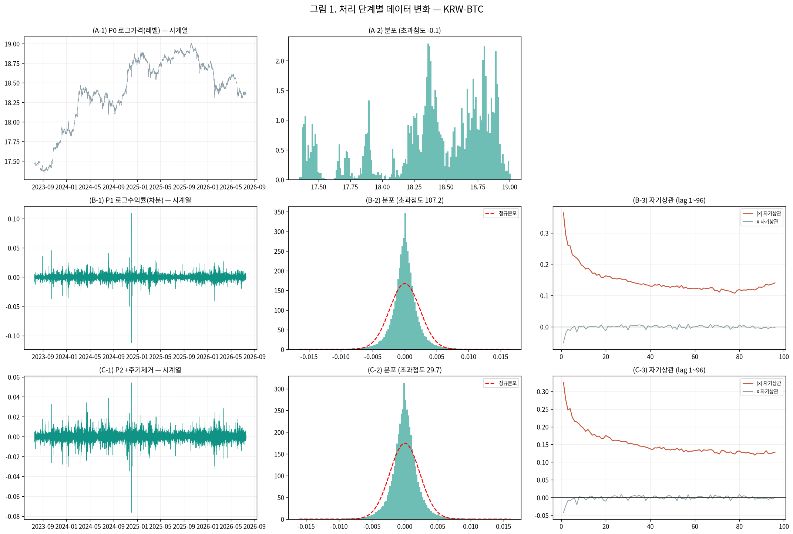
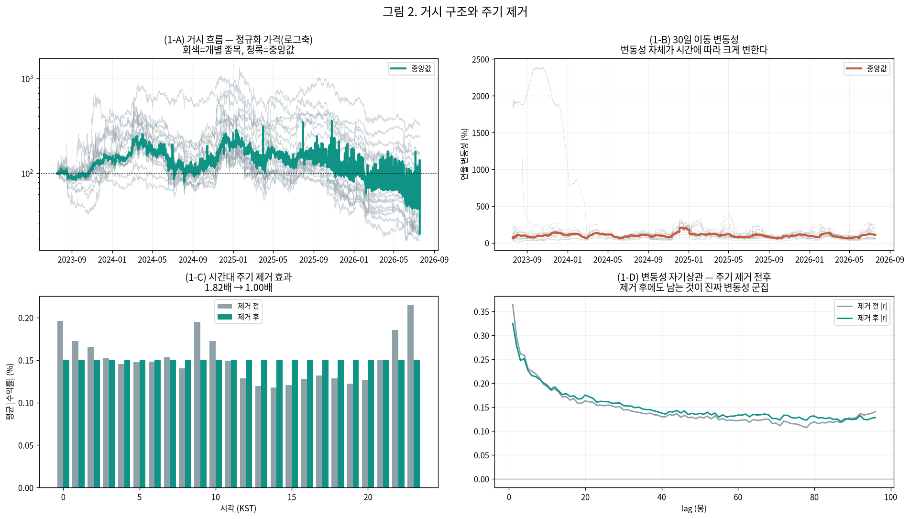

# 22번 — 변동성 예측 파이프라인: 처리마다 EDA

작성일 2026-09-08 · 브랜치 `stock` · 15분봉

> 그동안 통계 검정 수치만 뽑고 **눈으로 보는 EDA를 건너뛰었다**. 기초통계량 파악은 거시 plot에서 시작하며, **처리할 때마다 데이터가 어떻게 변하는지 매번 확인**한다.

---

### 0. 이번 회차 실제 분석 범위 ⚠

- **연구 대상(모집단)**: 상위 20종목 (아래 1절 목록)
- **이번 회차 실제 분석**: 대상 전체 20종목 ✅

## 분석 조건 (표준 헤더)

> 이 보고서만 읽어도 데이터 조건을 파악할 수 있도록, 매 회차 동일 항목을 싣는다(AGENTS.md 2.9g).

### 1. 데이터 출처·형식

- **DB / 테이블**: `data/upbit_data.db` (DuckDB) / `upbit_krw_candle`
- **봉 간격**: 15분봉 (하루 96봉)
- **원본 컬럼**: timestamp, open, high, low, close, volume, value
- **분석 종목 20개** — 이력 90,000봉(약 2.5년) 이상 종목 중 선정:
  거래대금 상위 10개 · 변동성 상위 10개

  선정 기준을 두 축으로 나눈 이유: 단일 결합 점수(변동성×거래대금)는 변동성이 지배해 신규·소형 종목만 뽑혀 시장 대표성이 약했다. **거래대금 축은 실제로 거래되는 주요 종목**을, **변동성 축은 연구 목적(변동성 예측)에 직접 부합하는 종목**을 담당한다. BTC는 저변동 대형 종목이라 두 축 모두에 들지 않지만 기준 자산으로 포함한다.

| # | 종목 | 선정 근거 | 봉 수 | 기간 | 표준편차 | 왜도 | 초과첨도 |
| ---: | :--- | :--- | ---: | :--- | ---: | ---: | ---: |
| 1 | KRW-XRP | 거래대금 상위 | 104,876 | 2023-07-19~2026-07-18 | 0.004155 | -0.3690 | 157.70 |
| 2 | KRW-BTC | 거래대금 상위 | 104,883 | 2023-07-19~2026-07-19 | 0.002386 | 0.0045 | 107.19 |
| 3 | KRW-DOGE | 거래대금 상위 | 104,863 | 2023-07-19~2026-07-18 | 0.005603 | -0.1511 | 50.63 |
| 4 | KRW-ETH | 거래대금 상위 | 104,869 | 2023-07-19~2026-07-18 | 0.003388 | -0.9237 | 482.65 |
| 5 | KRW-SOL | 거래대금 상위 | 104,879 | 2023-07-19~2026-07-19 | 0.004522 | 0.2330 | 27.32 |
| 6 | KRW-SHIB | 거래대금 상위 | 104,868 | 2023-07-19~2026-07-18 | 0.005935 | 0.2553 | 50.13 |
| 7 | KRW-SEI | 거래대금 상위 | 102,133 | 2023-08-16~2026-07-18 | 0.006708 | 1.6436 | 178.97 |
| 8 | KRW-XLM | 거래대금 상위 | 104,901 | 2023-07-18~2026-07-18 | 0.005228 | -0.0311 | 89.51 |
| 9 | KRW-SUI | 거래대금 상위 | 104,876 | 2023-07-19~2026-07-19 | 0.005934 | -0.9976 | 341.19 |
| 10 | KRW-ETC | 거래대금 상위 | 104,901 | 2023-07-18~2026-07-18 | 0.004365 | -2.3845 | 720.64 |
| 11 | KRW-BTT | 변동성 상위 | 104,207 | 2023-07-19~2026-07-19 | 0.041478 | 0.0021 | 13.29 |
| 12 | KRW-STRAX | 변동성 상위 | 102,279 | 2023-07-19~2026-07-19 | 0.007567 | 1.9133 | 92.65 |
| 13 | KRW-AQT | 변동성 상위 | 100,547 | 2023-07-18~2026-07-18 | 0.007531 | 0.6777 | 170.04 |
| 14 | KRW-BOUNTY | 변동성 상위 | 97,259 | 2023-07-19~2026-07-18 | 0.007438 | 2.1620 | 143.87 |
| 15 | KRW-ARDR | 변동성 상위 | 101,215 | 2023-07-19~2026-07-18 | 0.007407 | 1.9308 | 123.45 |
| 16 | KRW-MOC | 변동성 상위 | 97,027 | 2023-07-19~2026-07-19 | 0.007320 | 1.3894 | 261.28 |
| 17 | KRW-AERGO | 변동성 상위 | 102,358 | 2023-07-19~2026-07-18 | 0.007281 | 1.0060 | 80.34 |
| 18 | KRW-ARK | 변동성 상위 | 101,942 | 2023-07-18~2026-07-18 | 0.007251 | -0.5274 | 306.54 |
| 19 | KRW-TOKAMAK | 변동성 상위 | 99,844 | 2023-07-18~2026-07-18 | 0.007177 | 2.0427 | 225.76 |
| 20 | KRW-CBK | 변동성 상위 | 98,541 | 2023-07-18~2026-07-18 | 0.007097 | 1.7032 | 203.54 |

### 2. 수집 기간·규모·품질 (대표 종목 KRW-BTC)

- **기간**: 2023-07-19 19:00 ~ 2026-07-19 00:30
- **총 봉 수**: 104,883개 (약 2.99년)
- **연속성**: 15분이 아닌 간격 15개 (0.0143%) — 코인은 24시간 거래라 장 마감·주말 갭이 없다
- **결측**: 0개

### 3. 학습/검증 분할

- **방식**: 시간순 분할(셔플 없음) — 미래 정보 누설 방지
- **비율**: train 70% / validation 30%
- **train**: 2023-07-19 19:00 ~ 2025-08-24 09:30 (73,418봉, 약 765일)
- **validation**: 2025-08-24 09:45 ~ 2026-07-19 00:30 (31,465봉, 약 328일)
- 스케일러·모델 파라미터는 **train 구간에서만** 적합한다.

### 4. 기본 전처리 파이프라인과 가정

```
원본 close (KRW)
  → 로그 변환 log(close)        [스케일 안정화. 여전히 비정상: 단위근]
  → 1차 차분 r = Δlog(close)    [★ 여기서 정상성 확보 — 분석의 출발점]
  → (회차별 추가 처리)
  → 모델 적합
```

- **왜 차분하는가**: 로그가격은 단위근이 있어 비정상(ADF p=0.19)이고, 1차 차분하면 정상이 된다(ADF p=0.000). 정상성은 로그가 아니라 **차분**에서 온다.
- **예측 대상**: 수익률의 부호(방향)가 아니라 **크기(변동성)**. 방향은 자기상관이 0에 가까워 예측이 어렵고, 크기는 장기기억이 있어 예측 가능하다.

### 5. 기초통계량과 데이터 특성 (이전 EDA 확인 사항)

> 2026-10-14 소급 추가(AGENTS.md 2.9k). 실행 당시가 아니라 현재 `data/upbit_data.db`에서 종목별 DB 전체 이력을 다시 조회해 계산했다(업비트 과거 캔들은 바뀌지 않으므로 같은 창이면 같은 값이다). 종목별 봉 수가 1절 표와 모두 일치한다.

#### describe 표(pandas `describe()` 그대로, 종목별)

> 숫자 형식: count는 정수, 나머지는 소수 둘째 자리(1 미만 값은 유효숫자 4자리). 로그수익률은 15분봉 기준 % 단위다. 행 단위 원자료라 무체결 구간(캔들 없음)은 포함되지 않는다.

**종가(KRW)**

| 종목 | count | mean | std | min | 25% | 50% | 75% | max |
| :--- | ---: | ---: | ---: | ---: | ---: | ---: | ---: | ---: |
| KRW-XRP | 104,876 | 2,049.32 | 1,307.19 | 564.60 | 779.00 | 1,973.00 | 3,214.00 | 4,973.00 |
| KRW-BTC | 104,883 | 106,042,912.87 | 38,419,597.06 | 34,171,000.00 | 82,938,500.00 | 101,577,000.00 | 139,544,500.00 | 179,810,000.00 |
| KRW-DOGE | 104,863 | 219.64 | 121.09 | 78.80 | 133.70 | 192.00 | 271.00 | 674.00 |
| KRW-ETH | 104,869 | 3,869,407.47 | 1,141,136.87 | 2,091,000.00 | 2,994,000.00 | 3,552,000.00 | 4,809,000.00 | 6,834,000.00 |
| KRW-SOL | 104,879 | 187,085.83 | 83,122.49 | 23,900.00 | 126,900.00 | 197,600.00 | 241,500.00 | 448,150.00 |
| KRW-SHIB | 104,868 | 0.01863 | 0.009567 | 0.00603 | 0.011 | 0.01707 | 0.0235 | 0.0634 |
| KRW-SEI | 102,133 | 422.20 | 300.17 | 68.30 | 175.00 | 363.00 | 574.80 | 1,652.00 |
| KRW-XLM | 104,901 | 296.14 | 162.09 | 110.20 | 158.20 | 240.00 | 399.00 | 866.50 |
| KRW-SUI | 104,876 | 2,615.08 | 1,758.19 | 496.00 | 1,185.00 | 2,090.00 | 3,967.25 | 7,877.00 |
| KRW-ETC | 104,901 | 26,678.49 | 9,614.18 | 9,885.00 | 21,030.00 | 25,760.00 | 32,130.00 | 56,010.00 |
| KRW-BTT | 104,207 | 0.001036 | 0.0004874 | 0.000391 | 0.0006 | 0.000952 | 0.001314 | 0.003021 |
| KRW-STRAX | 102,279 | 76.15 | 44.11 | 11.80 | 53.14 | 65.13 | 104.00 | 247.00 |
| KRW-AQT | 100,547 | 1,456.84 | 555.74 | 268.00 | 1,093.00 | 1,407.00 | 1,843.00 | 5,929.00 |
| KRW-BOUNTY | 97,259 | 75.76 | 31.63 | 19.50 | 56.28 | 74.10 | 100.40 | 201.90 |
| KRW-ARDR | 101,215 | 109.20 | 33.32 | 30.40 | 87.56 | 108.90 | 133.00 | 241.00 |
| KRW-MOC | 97,027 | 97.16 | 36.47 | 24.50 | 76.05 | 95.61 | 125.00 | 297.10 |
| KRW-AERGO | 102,358 | 148.67 | 60.09 | 30.10 | 106.00 | 142.00 | 183.50 | 891.00 |
| KRW-ARK | 101,942 | 695.53 | 400.71 | 152.00 | 418.00 | 599.70 | 880.88 | 2,475.00 |
| KRW-TOKAMAK | 99,844 | 1,878.74 | 823.46 | 502.00 | 1,380.00 | 1,705.00 | 2,590.00 | 5,120.00 |
| KRW-CBK | 98,541 | 829.60 | 307.77 | 257.00 | 653.00 | 780.70 | 1,050.00 | 2,540.00 |

**거래량(코인 수)**

| 종목 | count | mean | std | min | 25% | 50% | 75% | max |
| :--- | ---: | ---: | ---: | ---: | ---: | ---: | ---: | ---: |
| KRW-XRP | 104,876 | 2,309,150.95 | 5,162,464.10 | 3.18 | 568,449.07 | 1,093,042.50 | 2,221,517.06 | 337,332,265.08 |
| KRW-BTC | 104,883 | 32.32 | 54.96 | 0.0001955 | 9.18 | 17.87 | 35.36 | 2,856.91 |
| KRW-DOGE | 104,863 | 5,851,580.12 | 15,264,510.88 | 382.30 | 983,126.51 | 2,269,513.36 | 5,389,642.66 | 835,077,981.93 |
| KRW-ETH | 104,869 | 413.39 | 708.16 | 0.002118 | 104.37 | 219.04 | 452.77 | 37,880.48 |
| KRW-SOL | 104,879 | 7,138.95 | 12,888.72 | 0.07987 | 1,887.83 | 3,688.95 | 7,497.68 | 497,384.26 |
| KRW-SHIB | 104,868 | 23,735,935,356.77 | 82,840,081,115.57 | 499,504.95 | 3,213,886,706.93 | 8,017,330,519.46 | 19,054,822,518.12 | 3,894,289,351,125.85 |
| KRW-SEI | 102,133 | 1,062,546.51 | 2,975,898.62 | 0.04303 | 181,524.11 | 415,899.66 | 959,713.86 | 197,777,066.46 |
| KRW-XLM | 104,901 | 1,021,570.16 | 4,613,689.87 | 30.80 | 109,888.11 | 265,025.57 | 652,980.11 | 271,434,126.42 |
| KRW-SUI | 104,876 | 207,610.74 | 449,294.50 | 4.49 | 41,595.95 | 93,693.22 | 211,351.57 | 39,433,535.30 |
| KRW-ETC | 104,901 | 12,509.97 | 45,351.15 | 0.00001135 | 1,463.33 | 3,562.33 | 9,614.34 | 3,461,797.22 |
| KRW-BTT | 104,207 | 84,826,266,708.91 | 470,217,786,802.45 | 943,464.83 | 5,049,986,457.83 | 15,719,673,442.94 | 45,505,247,227.46 | 41,267,635,401,715.23 |
| KRW-STRAX | 102,279 | 2,169,304.59 | 10,244,524.70 | 0.0000009 | 102,447.56 | 339,040.30 | 1,044,843.59 | 619,715,276.89 |
| KRW-AQT | 100,547 | 70,958.18 | 514,267.13 | 0.00000001 | 2,014.89 | 8,001.91 | 25,932.44 | 36,729,734.33 |
| KRW-BOUNTY | 97,259 | 1,111,381.75 | 7,345,472.28 | 0.00000008 | 29,011.41 | 123,137.83 | 412,585.32 | 570,717,812.35 |
| KRW-ARDR | 101,215 | 804,559.39 | 5,245,164.06 | 0.00000001 | 23,526.35 | 88,487.38 | 296,768.72 | 313,391,274.97 |
| KRW-MOC | 97,027 | 745,068.35 | 5,772,099.31 | 0.00000001 | 20,488.30 | 88,441.64 | 298,691.59 | 460,490,485.32 |
| KRW-AERGO | 102,358 | 920,891.74 | 4,870,029.30 | 0.00000011 | 33,124.22 | 120,117.26 | 377,906.51 | 407,000,980.08 |
| KRW-ARK | 101,942 | 319,474.04 | 1,449,187.03 | 0.00000001 | 13,879.35 | 46,286.54 | 148,790.07 | 58,717,627.02 |
| KRW-TOKAMAK | 99,844 | 60,237.77 | 397,506.70 | 0.00000003 | 1,688.71 | 6,578.40 | 21,392.30 | 23,862,239.06 |
| KRW-CBK | 98,541 | 105,793.55 | 723,970.87 | 0.00000008 | 2,645.61 | 10,816.94 | 35,911.80 | 48,804,958.79 |

**거래대금(KRW)**

| 종목 | count | mean | std | min | 25% | 50% | 75% | max |
| :--- | ---: | ---: | ---: | ---: | ---: | ---: | ---: | ---: |
| KRW-XRP | 104,876 | 4,685,050,065.41 | 12,732,702,803.15 | 10,000.00 | 795,184,925.94 | 1,696,783,415.19 | 4,078,852,670.09 | 946,388,756,068.87 |
| KRW-BTC | 104,883 | 3,172,491,762.68 | 5,428,471,142.82 | 19,979.49 | 904,263,990.73 | 1,717,315,381.02 | 3,393,464,709.24 | 317,019,670,845.50 |
| KRW-DOGE | 104,863 | 1,753,905,055.58 | 6,796,023,323.31 | 107,890.86 | 150,526,946.78 | 430,379,211.54 | 1,240,322,348.39 | 443,105,525,919.79 |
| KRW-ETH | 104,869 | 1,743,694,621.68 | 3,386,838,618.04 | 7,026.73 | 356,546,139.23 | 822,328,646.41 | 1,876,216,569.86 | 238,020,674,251.36 |
| KRW-SOL | 104,879 | 1,291,844,505.12 | 2,536,720,178.92 | 15,000.00 | 282,656,270.77 | 650,113,050.98 | 1,404,564,577.67 | 119,787,582,503.81 |
| KRW-SHIB | 104,868 | 701,838,480.78 | 3,391,564,998.28 | 5,000.00 | 39,608,434.16 | 125,644,556.11 | 405,156,674.92 | 187,518,505,514.42 |
| KRW-SEI | 102,133 | 499,795,791.06 | 1,544,271,910.69 | 3.70 | 45,592,344.23 | 137,964,213.65 | 412,609,361.42 | 139,569,640,025.00 |
| KRW-XLM | 104,901 | 455,150,019.15 | 2,944,758,280.24 | 5,000.00 | 23,510,330.57 | 67,212,469.71 | 194,409,958.45 | 176,131,184,868.69 |
| KRW-SUI | 104,876 | 449,592,553.01 | 885,090,612.08 | 6,029.00 | 83,569,600.84 | 202,319,431.18 | 478,744,327.76 | 44,936,055,583.62 |
| KRW-ETC | 104,901 | 439,671,304.00 | 1,822,559,780.71 | 0.2228 | 30,030,512.92 | 87,349,092.63 | 290,195,704.84 | 132,774,330,908.11 |
| KRW-BTT | 104,207 | 129,146,519.49 | 822,962,031.13 | 456.64 | 3,628,774.45 | 13,992,748.48 | 53,183,801.03 | 60,354,867,797.54 |
| KRW-STRAX | 102,279 | 202,390,829.34 | 1,036,814,917.46 | 0.00004675 | 5,206,126.35 | 21,046,165.14 | 86,620,242.08 | 58,888,538,983.16 |
| KRW-AQT | 100,547 | 142,483,606.03 | 1,754,846,926.55 | 0.00000871 | 2,464,489.64 | 10,635,390.14 | 38,204,857.63 | 191,151,893,950.35 |
| KRW-BOUNTY | 97,259 | 100,332,388.09 | 840,341,670.79 | 0.00000247 | 1,741,614.15 | 8,409,880.73 | 32,049,676.23 | 81,151,336,799.05 |
| KRW-ARDR | 101,215 | 107,680,207.07 | 818,924,409.32 | 0.0000009 | 2,234,715.98 | 8,935,944.63 | 33,404,221.85 | 50,390,364,774.02 |
| KRW-MOC | 97,027 | 100,178,586.37 | 1,105,541,751.24 | 0.00000041 | 1,603,065.11 | 7,883,480.80 | 30,330,751.52 | 111,569,942,556.14 |
| KRW-AERGO | 102,358 | 203,983,989.06 | 1,458,985,913.85 | 0.00001287 | 4,005,857.81 | 15,666,171.65 | 57,022,288.81 | 110,652,893,534.42 |
| KRW-ARK | 101,942 | 244,083,391.20 | 1,104,984,237.33 | 0.00000493 | 6,950,424.99 | 28,834,300.91 | 109,712,064.04 | 54,471,832,365.84 |
| KRW-TOKAMAK | 99,844 | 148,430,526.27 | 1,160,060,406.44 | 0.00004392 | 2,401,751.89 | 11,016,765.46 | 43,674,617.18 | 67,362,017,784.77 |
| KRW-CBK | 98,541 | 111,952,845.67 | 1,050,336,708.40 | 0.0000399 | 1,789,177.15 | 8,233,811.07 | 31,526,177.80 | 111,482,198,978.71 |

**로그수익률(%)**

| 종목 | count | mean | std | min | 25% | 50% | 75% | max |
| :--- | ---: | ---: | ---: | ---: | ---: | ---: | ---: | ---: |
| KRW-XRP | 104,875 | 0.0004422 | 0.4155 | -22.95 | -0.1498 | 0 | 0.1475 | 17.20 |
| KRW-BTC | 104,882 | 0.0008566 | 0.2386 | -11.24 | -0.09803 | 0 | 0.0994 | 10.99 |
| KRW-DOGE | 104,862 | 0.0001731 | 0.5603 | -23.07 | -0.2424 | 0 | 0.2398 | 18.98 |
| KRW-ETH | 104,868 | 0.0001004 | 0.3388 | -25.10 | -0.1388 | 0 | 0.1405 | 22.25 |
| KRW-SOL | 104,878 | 0.001128 | 0.4522 | -14.54 | -0.2114 | 0 | 0.2088 | 9.62 |
| KRW-SHIB | 104,867 | -0.0004555 | 0.5935 | -22.91 | -0.2301 | 0 | 0.2257 | 18.67 |
| KRW-SEI | 102,132 | -0.001613 | 0.6709 | -28.40 | -0.3361 | 0 | 0.3233 | 38.00 |
| KRW-XLM | 104,900 | 0.0004742 | 0.5228 | -25.01 | -0.2356 | 0 | 0.2283 | 20.09 |
| KRW-SUI | 104,875 | 0.0001458 | 0.5934 | -40.32 | -0.2771 | 0 | 0.2673 | 35.18 |
| KRW-ETC | 104,900 | -0.0008022 | 0.4365 | -36.69 | -0.1811 | 0 | 0.1751 | 30.22 |
| KRW-BTT | 104,206 | -0.0003819 | 4.15 | -26.83 | -0.1741 | 0 | 0.1688 | 26.83 |
| KRW-STRAX | 102,278 | -0.001437 | 0.7567 | -26.94 | -0.2819 | 0 | 0.2731 | 29.07 |
| KRW-AQT | 100,546 | -0.001469 | 0.7531 | -39.01 | -0.2574 | 0 | 0.2584 | 30.41 |
| KRW-BOUNTY | 97,258 | -0.001222 | 0.7438 | -33.11 | -0.2781 | 0 | 0.2756 | 27.58 |
| KRW-ARDR | 101,214 | -0.001097 | 0.7407 | -28.50 | -0.2311 | 0 | 0.2317 | 28.20 |
| KRW-MOC | 97,026 | -0.00137 | 0.732 | -40.20 | -0.2381 | 0 | 0.238 | 33.55 |
| KRW-AERGO | 102,357 | -0.00139 | 0.7281 | -20.21 | -0.2488 | 0 | 0.246 | 20.48 |
| KRW-ARK | 101,941 | -0.0008267 | 0.7251 | -48.14 | -0.292 | 0 | 0.2796 | 37.67 |
| KRW-TOKAMAK | 99,843 | -0.001303 | 0.7177 | -39.06 | -0.2483 | 0 | 0.2489 | 30.14 |
| KRW-CBK | 98,540 | -0.001049 | 0.7097 | -36.65 | -0.2514 | 0 | 0.2553 | 28.72 |


- **조건부 이분산**: ARCH-LM p=0.000 → 변동성이 시간에 따라 변한다(GARCH 계열 사용 근거)
- **장기기억**: |수익률| 자기상관이 하루(96봉) 뒤에도 0.12로 완만히 감소
- **두꺼운 꼬리**: 초과첨도 107 (정규분포는 0). 좌우 대칭(왜도 0.004)이나 양쪽 꼬리가 모두 두껍다. 4σ 초과가 정규 대비 약 100배, 6σ는 약 87만배 빈발
- **선형성 기각**: RESET·BDS 검정 p=0.000 → 선형 모델을 쓸 근거가 없다(비선형·커널 계열 필요)
- **방향 무예측성**: 수익률 자기상관 ≈ 0

### 6. 이번 회차에 적용한 변환

| 처리 | 적용 이유 |
| :--- | :--- |
| 로그 + 1차 차분 | 정상성 확보(레벨은 단위근) |
| 주기 제거(전/후 비교) | 시간대·요일 주기가 GARCH 지속성을 왜곡하고 모델이 '쉬운 부분'만 학습해 성능이 부풀 수 있어 두 조건을 비교 |

---

## E0. 원본 데이터 — 거시 흐름부터 본다

- 종목 20개 · 15분봉 · 2023-07-18 09:15:00 ~ 2026-07-19 00:45:00 · 105,020행

- 정규화 가격(각 종목 첫 관측=100) 중앙값: 고점 357.0 (2025-10-26 02:00:00) → 최종 23.0
- 종목별 최종값 범위 19.2 ~ 326.5 (중앙값 43.1) — 편차가 크다

## E1. 처리 단계별 기초통계량과 검정 — 무엇이 어떻게 바뀌는가

대표 종목 **KRW-BTC** 기준. 각 처리가 데이터를 어떻게 바꾸는지 매 단계 확인한다.

| 단계 | n | 표준편차 | 왜도 | 초과첨도 | ADF p | KPSS p | ARCH p | LB(&#124;x&#124;) p |
| :--- | ---: | ---: | ---: | ---: | ---: | ---: | ---: | ---: |
| P0 로그가격(레벨) | 104,883 | 0.434794 | -0.897 | **-0.1** | 0.8929 | 0.0100 | 0.0000 | 0.0000 |
| P1 로그수익률(차분) | 104,882 | 0.002386 | 0.004 | **107.2** | 0.0000 | 0.1000 | 0.0000 | 0.0000 |
| P2 +주기제거 | 104,882 | 0.002286 | -0.105 | **29.7** | 0.0000 | 0.1000 | 0.0000 | 0.0000 |

**읽는 법**
- ADF p<0.05 = 정상 / KPSS p>0.05 = 정상 → **P0에서 P1로 갈 때 정상성이 확보**되는지 본다.
- ARCH p<0.05 = 조건부 이분산 존재 → 변동성 모델을 쓸 근거.
- LB(|x|) p<0.05 = 변동성에 자기상관 존재(변동성 군집).

## E2. 주기 제거 효과 — 실제로 주기가 사라졌는가

| 구분 | 시간대 최대/최소 | 요일 최대/최소 |
| :--- | ---: | ---: |
| 제거 전 | **1.82배** | 1.76배 |
| 제거 후 | **1.00배** | 1.00배 |

주기 제거는 STL 같은 분해가 아니라 **시계만 보면 알 수 있는 부분을 덜어내는 것**이다. 9시는 원래 변동성이 높고 4시는 낮은데, 그대로 두면 모델이 그 '쉬운 것'만 학습해 성능이 부풀고 GARCH 지속성이 왜곡된다(19번에서 반감기 54배 왜곡 확인).





