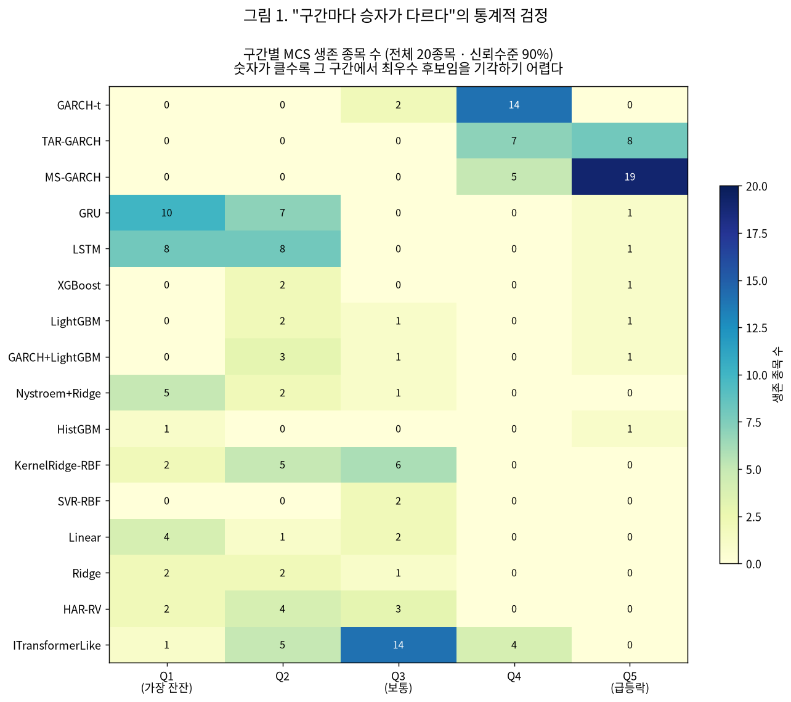
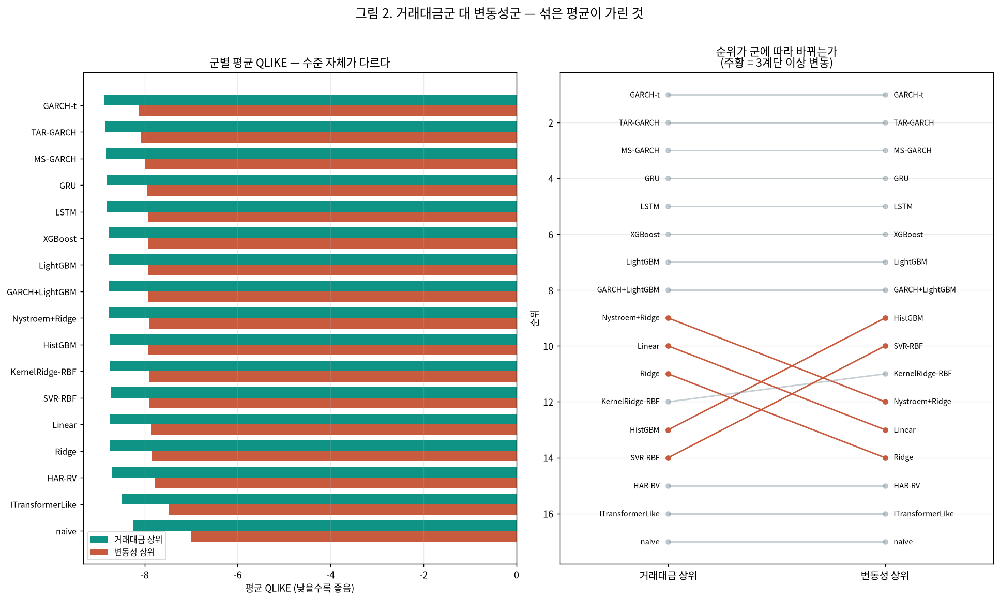

# 25번 — 모델 순위의 통계적 유의성 검정과 군별 분리 보고

작성일 2026-10-04 · **20종목** · 15분봉 · 1시간 뒤 실현변동성 · 모델 17개

> 24번은 17개 모델의 순위를 냈지만 **그 차이가 통계적으로 유의한지 검정하지 않았다.** 이 회차는 24번이 저장한 검증 예측값을 **재적합 없이** 다시 읽어 Diebold-Mariano 검정과 Model Confidence Set으로 순위의 강도를 측정하고, 24번이 한계로 남긴 군별(거래대금군·변동성군) 분리 보고를 수행한다.

**입력**: `test/results/24_maxscale_refit_20260928/24_maxscale_refit_validation_predictions.npz` (20종목×2조건×17모델 검증 예측값). 데이터 조건·전처리·분할은 24번과 **동일**하며 이 회차는 새로 적합하지 않는다 — 조건 상세는 24번 보고서의 표준 헤더를 참조한다.

---

## 실험 설계

> 드라이버 서두 설계 셀 원문(`test/models/25_significance_grouping_test.py`). 실행 전에 적은 설계이며, 결과를 본 뒤 바꾼 내용은 결과 절에 따로 적는다.

### 25번 — 모델 순위의 통계적 유의성 검정과 군별 분리 보고

24번은 17개 모델의 QLIKE 순위를 냈고 "구간마다 최우수 모델이 다르다"고 결론지었다.
그런데 **그 순위 차이가 통계적으로 의미 있는지는 한 번도 검정하지 않았다.** 이것이 문제인
이유는 두 가지다.

1. 변동성 예측은 지속성과 측정잡음이 지배해 모델이 쓸 수 있는 잔여 구조가 작다
   (Kaliutau 2026, `arXiv:2607.22491`). 따라서 QLIKE 격차가 **소수점 셋째 자리**에서
   갈리는 구간에서는 그것이 실력 차인지 표본 우연인지 구분되지 않을 수 있다.
2. 17개 모델을 비교하면 쌍별 비교가 136개다. 이 중 몇 개는 **우연히** 유의하게 나온다
   (다중비교 문제). 쌍별 t검정을 늘어놓는 방식으로는 이 문제를 피할 수 없다.

그래서 이 회차는 24번이 저장한 예측값을 **재적합 없이** 다시 읽어 두 가지 검정을 한다.

- **Diebold-Mariano 검정**: 두 모델의 손실 차이 평균이 0인지 본다. 손실 시계열에 남은
  자기상관을 HAC(Newey-West) 분산으로 보정한다.
- **Model Confidence Set**(Hansen, Lunde & Nason 2011): 주어진 신뢰수준에서 "최우수
  모델일 수 있는 집합"을 통째로 추려낸다. 다중비교를 설계 안에서 처리하므로 쌍별 검정을
  늘어놓는 것보다 이 문제에 맞다. 구현은 직접 짜지 않고 `arch.bootstrap.MCS`를 쓴다.

아울러 24번이 한계로 남긴 **군별 분리 보고**를 함께 한다. 우리 표본은 거래대금 상위
10종목과 변동성 상위 10종목으로 구성되는데, 23번 (M-2)에서 두 집단의 내부 상관이
0.555 대 0.156으로 3.6배 차이 났다. 성격이 다른 두 집단을 20종목 평균 하나로 요약하면
그 구조가 가려진다.

#### 이 회차가 답하려는 질문

| 질문 | 어떻게 답하는가 |
| :--- | :--- |
| 24번의 전체 순위는 통계적으로 뒷받침되는가 | 종목별 MCS — 각 모델이 몇 종목에서 생존하는가 |
| **"구간마다 승자가 다르다"가 유의한가** | 구간별 MCS·DM — 포스터 핵심 주장의 직접 검정 |
| Q5에서 레짐 전환 모델 우위가 우연인가 | GARCH-t 대비 DM 검정(구간별) |
| 두 집단을 섞은 평균이 구조를 가렸는가 | 군별 순위·MCS 분리 산출 |

---

## 기초통계량(describe 표)

> 2026-10-14 소급 추가(AGENTS.md 2.9k). 실행 당시가 아니라 현재 `data/upbit_data.db`에서 종목별 DB 전체 이력을 다시 조회해 계산했다(업비트 과거 캔들은 바뀌지 않으므로 같은 창이면 같은 값이다). 데이터 범위 근거: 25번은 24번 평가 예측을 재사용하므로 24번 보고서 표준 헤더의 20종목·DB 전체 이력과 같다.

#### describe 표(pandas `describe()` 그대로, 종목별)

> 숫자 형식: count는 정수, 나머지는 소수 둘째 자리(1 미만 값은 유효숫자 4자리). 로그수익률은 15분봉 기준 % 단위다. 행 단위 원자료라 무체결 구간(캔들 없음)은 포함되지 않는다.

**종가(KRW)**

| 종목 | count | mean | std | min | 25% | 50% | 75% | max |
| :--- | ---: | ---: | ---: | ---: | ---: | ---: | ---: | ---: |
| KRW-AERGO | 102,358 | 148.67 | 60.09 | 30.10 | 106.00 | 142.00 | 183.50 | 891.00 |
| KRW-AQT | 100,547 | 1,456.84 | 555.74 | 268.00 | 1,093.00 | 1,407.00 | 1,843.00 | 5,929.00 |
| KRW-ARDR | 101,215 | 109.20 | 33.32 | 30.40 | 87.56 | 108.90 | 133.00 | 241.00 |
| KRW-ARK | 101,942 | 695.53 | 400.71 | 152.00 | 418.00 | 599.70 | 880.88 | 2,475.00 |
| KRW-BOUNTY | 97,259 | 75.76 | 31.63 | 19.50 | 56.28 | 74.10 | 100.40 | 201.90 |
| KRW-BTC | 104,883 | 106,042,912.87 | 38,419,597.06 | 34,171,000.00 | 82,938,500.00 | 101,577,000.00 | 139,544,500.00 | 179,810,000.00 |
| KRW-BTT | 104,207 | 0.001036 | 0.0004874 | 0.000391 | 0.0006 | 0.000952 | 0.001314 | 0.003021 |
| KRW-CBK | 98,541 | 829.60 | 307.77 | 257.00 | 653.00 | 780.70 | 1,050.00 | 2,540.00 |
| KRW-DOGE | 104,863 | 219.64 | 121.09 | 78.80 | 133.70 | 192.00 | 271.00 | 674.00 |
| KRW-ETC | 104,901 | 26,678.49 | 9,614.18 | 9,885.00 | 21,030.00 | 25,760.00 | 32,130.00 | 56,010.00 |
| KRW-ETH | 104,869 | 3,869,407.47 | 1,141,136.87 | 2,091,000.00 | 2,994,000.00 | 3,552,000.00 | 4,809,000.00 | 6,834,000.00 |
| KRW-MOC | 97,027 | 97.16 | 36.47 | 24.50 | 76.05 | 95.61 | 125.00 | 297.10 |
| KRW-SEI | 102,133 | 422.20 | 300.17 | 68.30 | 175.00 | 363.00 | 574.80 | 1,652.00 |
| KRW-SHIB | 104,868 | 0.01863 | 0.009567 | 0.00603 | 0.011 | 0.01707 | 0.0235 | 0.0634 |
| KRW-SOL | 104,879 | 187,085.83 | 83,122.49 | 23,900.00 | 126,900.00 | 197,600.00 | 241,500.00 | 448,150.00 |
| KRW-STRAX | 102,279 | 76.15 | 44.11 | 11.80 | 53.14 | 65.13 | 104.00 | 247.00 |
| KRW-SUI | 104,876 | 2,615.08 | 1,758.19 | 496.00 | 1,185.00 | 2,090.00 | 3,967.25 | 7,877.00 |
| KRW-TOKAMAK | 99,844 | 1,878.74 | 823.46 | 502.00 | 1,380.00 | 1,705.00 | 2,590.00 | 5,120.00 |
| KRW-XLM | 104,901 | 296.14 | 162.09 | 110.20 | 158.20 | 240.00 | 399.00 | 866.50 |
| KRW-XRP | 104,876 | 2,049.32 | 1,307.19 | 564.60 | 779.00 | 1,973.00 | 3,214.00 | 4,973.00 |

**거래량(코인 수)**

| 종목 | count | mean | std | min | 25% | 50% | 75% | max |
| :--- | ---: | ---: | ---: | ---: | ---: | ---: | ---: | ---: |
| KRW-AERGO | 102,358 | 920,891.74 | 4,870,029.30 | 0.00000011 | 33,124.22 | 120,117.26 | 377,906.51 | 407,000,980.08 |
| KRW-AQT | 100,547 | 70,958.18 | 514,267.13 | 0.00000001 | 2,014.89 | 8,001.91 | 25,932.44 | 36,729,734.33 |
| KRW-ARDR | 101,215 | 804,559.39 | 5,245,164.06 | 0.00000001 | 23,526.35 | 88,487.38 | 296,768.72 | 313,391,274.97 |
| KRW-ARK | 101,942 | 319,474.04 | 1,449,187.03 | 0.00000001 | 13,879.35 | 46,286.54 | 148,790.07 | 58,717,627.02 |
| KRW-BOUNTY | 97,259 | 1,111,381.75 | 7,345,472.28 | 0.00000008 | 29,011.41 | 123,137.83 | 412,585.32 | 570,717,812.35 |
| KRW-BTC | 104,883 | 32.32 | 54.96 | 0.0001955 | 9.18 | 17.87 | 35.36 | 2,856.91 |
| KRW-BTT | 104,207 | 84,826,266,708.91 | 470,217,786,802.45 | 943,464.83 | 5,049,986,457.83 | 15,719,673,442.94 | 45,505,247,227.46 | 41,267,635,401,715.23 |
| KRW-CBK | 98,541 | 105,793.55 | 723,970.87 | 0.00000008 | 2,645.61 | 10,816.94 | 35,911.80 | 48,804,958.79 |
| KRW-DOGE | 104,863 | 5,851,580.12 | 15,264,510.88 | 382.30 | 983,126.51 | 2,269,513.36 | 5,389,642.66 | 835,077,981.93 |
| KRW-ETC | 104,901 | 12,509.97 | 45,351.15 | 0.00001135 | 1,463.33 | 3,562.33 | 9,614.34 | 3,461,797.22 |
| KRW-ETH | 104,869 | 413.39 | 708.16 | 0.002118 | 104.37 | 219.04 | 452.77 | 37,880.48 |
| KRW-MOC | 97,027 | 745,068.35 | 5,772,099.31 | 0.00000001 | 20,488.30 | 88,441.64 | 298,691.59 | 460,490,485.32 |
| KRW-SEI | 102,133 | 1,062,546.51 | 2,975,898.62 | 0.04303 | 181,524.11 | 415,899.66 | 959,713.86 | 197,777,066.46 |
| KRW-SHIB | 104,868 | 23,735,935,356.77 | 82,840,081,115.57 | 499,504.95 | 3,213,886,706.93 | 8,017,330,519.46 | 19,054,822,518.12 | 3,894,289,351,125.85 |
| KRW-SOL | 104,879 | 7,138.95 | 12,888.72 | 0.07987 | 1,887.83 | 3,688.95 | 7,497.68 | 497,384.26 |
| KRW-STRAX | 102,279 | 2,169,304.59 | 10,244,524.70 | 0.0000009 | 102,447.56 | 339,040.30 | 1,044,843.59 | 619,715,276.89 |
| KRW-SUI | 104,876 | 207,610.74 | 449,294.50 | 4.49 | 41,595.95 | 93,693.22 | 211,351.57 | 39,433,535.30 |
| KRW-TOKAMAK | 99,844 | 60,237.77 | 397,506.70 | 0.00000003 | 1,688.71 | 6,578.40 | 21,392.30 | 23,862,239.06 |
| KRW-XLM | 104,901 | 1,021,570.16 | 4,613,689.87 | 30.80 | 109,888.11 | 265,025.57 | 652,980.11 | 271,434,126.42 |
| KRW-XRP | 104,876 | 2,309,150.95 | 5,162,464.10 | 3.18 | 568,449.07 | 1,093,042.50 | 2,221,517.06 | 337,332,265.08 |

**거래대금(KRW)**

| 종목 | count | mean | std | min | 25% | 50% | 75% | max |
| :--- | ---: | ---: | ---: | ---: | ---: | ---: | ---: | ---: |
| KRW-AERGO | 102,358 | 203,983,989.06 | 1,458,985,913.85 | 0.00001287 | 4,005,857.81 | 15,666,171.65 | 57,022,288.81 | 110,652,893,534.42 |
| KRW-AQT | 100,547 | 142,483,606.03 | 1,754,846,926.55 | 0.00000871 | 2,464,489.64 | 10,635,390.14 | 38,204,857.63 | 191,151,893,950.35 |
| KRW-ARDR | 101,215 | 107,680,207.07 | 818,924,409.32 | 0.0000009 | 2,234,715.98 | 8,935,944.63 | 33,404,221.85 | 50,390,364,774.02 |
| KRW-ARK | 101,942 | 244,083,391.20 | 1,104,984,237.33 | 0.00000493 | 6,950,424.99 | 28,834,300.91 | 109,712,064.04 | 54,471,832,365.84 |
| KRW-BOUNTY | 97,259 | 100,332,388.09 | 840,341,670.79 | 0.00000247 | 1,741,614.15 | 8,409,880.73 | 32,049,676.23 | 81,151,336,799.05 |
| KRW-BTC | 104,883 | 3,172,491,762.68 | 5,428,471,142.82 | 19,979.49 | 904,263,990.73 | 1,717,315,381.02 | 3,393,464,709.24 | 317,019,670,845.50 |
| KRW-BTT | 104,207 | 129,146,519.49 | 822,962,031.13 | 456.64 | 3,628,774.45 | 13,992,748.48 | 53,183,801.03 | 60,354,867,797.54 |
| KRW-CBK | 98,541 | 111,952,845.67 | 1,050,336,708.40 | 0.0000399 | 1,789,177.15 | 8,233,811.07 | 31,526,177.80 | 111,482,198,978.71 |
| KRW-DOGE | 104,863 | 1,753,905,055.58 | 6,796,023,323.31 | 107,890.86 | 150,526,946.78 | 430,379,211.54 | 1,240,322,348.39 | 443,105,525,919.79 |
| KRW-ETC | 104,901 | 439,671,304.00 | 1,822,559,780.71 | 0.2228 | 30,030,512.92 | 87,349,092.63 | 290,195,704.84 | 132,774,330,908.11 |
| KRW-ETH | 104,869 | 1,743,694,621.68 | 3,386,838,618.04 | 7,026.73 | 356,546,139.23 | 822,328,646.41 | 1,876,216,569.86 | 238,020,674,251.36 |
| KRW-MOC | 97,027 | 100,178,586.37 | 1,105,541,751.24 | 0.00000041 | 1,603,065.11 | 7,883,480.80 | 30,330,751.52 | 111,569,942,556.14 |
| KRW-SEI | 102,133 | 499,795,791.06 | 1,544,271,910.69 | 3.70 | 45,592,344.23 | 137,964,213.65 | 412,609,361.42 | 139,569,640,025.00 |
| KRW-SHIB | 104,868 | 701,838,480.78 | 3,391,564,998.28 | 5,000.00 | 39,608,434.16 | 125,644,556.11 | 405,156,674.92 | 187,518,505,514.42 |
| KRW-SOL | 104,879 | 1,291,844,505.12 | 2,536,720,178.92 | 15,000.00 | 282,656,270.77 | 650,113,050.98 | 1,404,564,577.67 | 119,787,582,503.81 |
| KRW-STRAX | 102,279 | 202,390,829.34 | 1,036,814,917.46 | 0.00004675 | 5,206,126.35 | 21,046,165.14 | 86,620,242.08 | 58,888,538,983.16 |
| KRW-SUI | 104,876 | 449,592,553.01 | 885,090,612.08 | 6,029.00 | 83,569,600.84 | 202,319,431.18 | 478,744,327.76 | 44,936,055,583.62 |
| KRW-TOKAMAK | 99,844 | 148,430,526.27 | 1,160,060,406.44 | 0.00004392 | 2,401,751.89 | 11,016,765.46 | 43,674,617.18 | 67,362,017,784.77 |
| KRW-XLM | 104,901 | 455,150,019.15 | 2,944,758,280.24 | 5,000.00 | 23,510,330.57 | 67,212,469.71 | 194,409,958.45 | 176,131,184,868.69 |
| KRW-XRP | 104,876 | 4,685,050,065.41 | 12,732,702,803.15 | 10,000.00 | 795,184,925.94 | 1,696,783,415.19 | 4,078,852,670.09 | 946,388,756,068.87 |

**로그수익률(%)**

| 종목 | count | mean | std | min | 25% | 50% | 75% | max |
| :--- | ---: | ---: | ---: | ---: | ---: | ---: | ---: | ---: |
| KRW-AERGO | 102,357 | -0.00139 | 0.7281 | -20.21 | -0.2488 | 0 | 0.246 | 20.48 |
| KRW-AQT | 100,546 | -0.001469 | 0.7531 | -39.01 | -0.2574 | 0 | 0.2584 | 30.41 |
| KRW-ARDR | 101,214 | -0.001097 | 0.7407 | -28.50 | -0.2311 | 0 | 0.2317 | 28.20 |
| KRW-ARK | 101,941 | -0.0008267 | 0.7251 | -48.14 | -0.292 | 0 | 0.2796 | 37.67 |
| KRW-BOUNTY | 97,258 | -0.001222 | 0.7438 | -33.11 | -0.2781 | 0 | 0.2756 | 27.58 |
| KRW-BTC | 104,882 | 0.0008566 | 0.2386 | -11.24 | -0.09803 | 0 | 0.0994 | 10.99 |
| KRW-BTT | 104,206 | -0.0003819 | 4.15 | -26.83 | -0.1741 | 0 | 0.1688 | 26.83 |
| KRW-CBK | 98,540 | -0.001049 | 0.7097 | -36.65 | -0.2514 | 0 | 0.2553 | 28.72 |
| KRW-DOGE | 104,862 | 0.0001731 | 0.5603 | -23.07 | -0.2424 | 0 | 0.2398 | 18.98 |
| KRW-ETC | 104,900 | -0.0008022 | 0.4365 | -36.69 | -0.1811 | 0 | 0.1751 | 30.22 |
| KRW-ETH | 104,868 | 0.0001004 | 0.3388 | -25.10 | -0.1388 | 0 | 0.1405 | 22.25 |
| KRW-MOC | 97,026 | -0.00137 | 0.732 | -40.20 | -0.2381 | 0 | 0.238 | 33.55 |
| KRW-SEI | 102,132 | -0.001613 | 0.6709 | -28.40 | -0.3361 | 0 | 0.3233 | 38.00 |
| KRW-SHIB | 104,867 | -0.0004555 | 0.5935 | -22.91 | -0.2301 | 0 | 0.2257 | 18.67 |
| KRW-SOL | 104,878 | 0.001128 | 0.4522 | -14.54 | -0.2114 | 0 | 0.2088 | 9.62 |
| KRW-STRAX | 102,278 | -0.001437 | 0.7567 | -26.94 | -0.2819 | 0 | 0.2731 | 29.07 |
| KRW-SUI | 104,875 | 0.0001458 | 0.5934 | -40.32 | -0.2771 | 0 | 0.2673 | 35.18 |
| KRW-TOKAMAK | 99,843 | -0.001303 | 0.7177 | -39.06 | -0.2483 | 0 | 0.2489 | 30.14 |
| KRW-XLM | 104,900 | 0.0004742 | 0.5228 | -25.01 | -0.2356 | 0 | 0.2283 | 20.09 |
| KRW-XRP | 104,875 | 0.0004422 | 0.4155 | -22.95 | -0.1498 | 0 | 0.1475 | 17.20 |

---

## 0. 입력 정합성 — 재계산한 손실이 24번 수치와 맞는가

이 회차는 24번의 예측값에서 QLIKE를 **다시 계산**한다. 그 값이 24번이 보고한 평균 QLIKE와 어긋나면 이후 모든 검정이 무의미하므로 먼저 대조한다.

- 모델 17개 전부 대조 — **최대 절대 차이 4.35e-09**
- → 수치 불일치 없음. 이후 검정의 입력으로 쓸 수 있다.

## 1. 블록 길이를 왜 40으로 잡았는가

MCS는 블록 부트스트랩으로 분포를 만든다. 블록이 손실 시계열의 자기상관보다 짧으면 종속성을 깨뜨려 유의성이 과대평가된다. 임의로 고르지 않고 **실측해서** 정한다.

| 모델 | lag1 | lag5 | lag10 | lag20 | lag40 | lag80 |
| :--- | ---: | ---: | ---: | ---: | ---: | ---: |
| GARCH-t | 0.243 | 0.108 | 0.069 | 0.064 | 0.055 | 0.041 |
| TAR-GARCH | 0.316 | 0.152 | 0.097 | 0.087 | 0.075 | 0.057 |
| MS-GARCH | 0.330 | 0.140 | 0.110 | 0.096 | 0.080 | 0.060 |
| GRU | 0.104 | 0.057 | 0.037 | 0.036 | 0.031 | 0.025 |
| LSTM | 0.104 | 0.058 | 0.037 | 0.039 | 0.032 | 0.026 |
| XGBoost | 0.116 | 0.052 | 0.032 | 0.030 | 0.025 | 0.022 |
| LightGBM | 0.111 | 0.051 | 0.031 | 0.030 | 0.025 | 0.022 |
| GARCH+LightGBM | 0.109 | 0.050 | 0.031 | 0.031 | 0.026 | 0.022 |
| Nystroem+Ridge | 0.115 | 0.049 | 0.032 | 0.029 | 0.024 | 0.021 |
| HistGBM | 0.113 | 0.047 | 0.029 | 0.027 | 0.023 | 0.020 |
| KernelRidge-RBF | 0.128 | 0.056 | 0.036 | 0.033 | 0.029 | 0.025 |
| SVR-RBF | 0.131 | 0.064 | 0.041 | 0.037 | 0.032 | 0.024 |
| Linear | 0.137 | 0.046 | 0.028 | 0.025 | 0.022 | 0.021 |
| Ridge | 0.138 | 0.046 | 0.028 | 0.026 | 0.022 | 0.021 |
| HAR-RV | 0.175 | 0.049 | 0.025 | 0.023 | 0.021 | 0.019 |
| ITransformerLike | 0.139 | 0.117 | 0.084 | 0.080 | 0.078 | 0.047 |
| naive | 0.055 | 0.025 | 0.023 | 0.022 | 0.015 | 0.008 |

- 시차 40에서도 자기상관이 최대 **0.080**(모델 MS-GARCH)로 남는다 → 블록 길이 **40** 채택.
- 결론이 이 선택에 흔들리는지 보려고 (20, 40, 80) 세 값으로 민감도도 확인한다(§2 말미).

## 2. 전체 구간 — 어느 모델이 '최우수 후보'로 남는가

종목·조건마다 MCS를 따로 돌려 신뢰수준 90%에서 생존하는 모델을 센다. **생존 종목 수가 많을수록 그 모델이 최우수일 가능성을 기각하기 어렵다는 뜻**이다. 반대로 생존 0이면 그 모델은 어디서도 최우수 후보가 아니다.

| 순위(24번 평균 QLIKE) | 모델 | 생존 종목수 · 주기제거 전 | 생존 종목수 · 주기제거 후 |
| ---: | :--- | ---: | ---: |
| 1 | **GARCH-t** | 20/20 | 20/20 |
| 2 | **TAR-GARCH** | 10/20 | 7/20 |
| 3 | **MS-GARCH** | 7/20 | 4/20 |
| 4 | **GRU** | 7/20 | 5/20 |
| 5 | **LSTM** | 6/20 | 5/20 |
| 6 | **XGBoost** | 5/20 | 1/20 |
| 7 | **LightGBM** | 5/20 | 1/20 |
| 8 | **GARCH+LightGBM** | 5/20 | 1/20 |
| 9 | **Nystroem+Ridge** | 2/20 | 1/20 |
| 10 | **HistGBM** | 5/20 | 2/20 |
| 11 | **KernelRidge-RBF** | 3/20 | 1/20 |
| 12 | **SVR-RBF** | 3/20 | 2/20 |
| 13 | **Linear** | 2/20 | 1/20 |
| 14 | **Ridge** | 2/20 | 1/20 |
| 15 | **HAR-RV** | 1/20 | 0/20 |
| 16 | **ITransformerLike** | 1/20 | 0/20 |
| 17 | **naive** | 1/20 | 1/20 |

- 종목 하나당 생존 모델 수의 중앙값은 **2개**다(전체 17개 중). 이 값이 작을수록 모델 간 차이가 뚜렷하다는 뜻이다.
- 24번 전체평균 1위였던 **GARCH-t**은 주기제거 후 **20/20종목**에서 생존한다.
- 결측으로 MCS 비교에서 빠진 모델은 없다 — 전 종목·조건에서 17개 모델 전부가 비교 대상에 포함됐다.

### 블록 길이에 결론이 흔들리는가

대표 5종목(주기제거 후)에서 블록 길이만 바꿔 생존 횟수를 셌다. 생존이 한 번이라도 있는 모델만 싣는다.

| 블록 길이 | GARCH-t | TAR-GARCH | MS-GARCH | GRU | LSTM | XGBoost | LightGBM | GARCH+LightGBM | Nystroem+Ridge | HistGBM | KernelRidge-RBF | SVR-RBF | Linear | Ridge | naive |
| ---: | ---: | ---: | ---: | ---: | ---: | ---: | ---: | ---: | ---: | ---: | ---: | ---: | ---: | ---: | ---: |
| 20 | 5 | 3 | 1 | 2 | 3 | 1 | 1 | 1 | 1 | 2 | 1 | 1 | 1 | 1 | 1 |
| 40 | 5 | 3 | 1 | 2 | 3 | 1 | 1 | 1 | 1 | 2 | 1 | 1 | 1 | 1 | 1 |
| 80 | 5 | 3 | 2 | 2 | 3 | 1 | 1 | 1 | 1 | 2 | 1 | 1 | 1 | 1 | 1 |

## 3. 구간별 — "구간마다 승자가 다르다"는 통계적으로 뒷받침되는가

이것이 이 회차의 핵심이다. 포스터와 24번은 **"단일 최적 모델은 없다"**를 구간별 QLIKE 최솟값으로 주장했는데, 그 최솟값 차이가 유의한지는 보지 않았다. 구간마다 MCS를 따로 돌려 **각 구간의 최우수 후보 집합**을 구한다.

> **이 검정의 한계를 먼저 밝힌다.** 구간은 실제 변동성 5분위로 나누므로 그 부분표본은 시계열에서 **연속되지 않는다**. 블록 부트스트랩은 인접 관측의 종속성을 보존하는 기법인데, 흩어진 부분표본에서는 '인접'이 원 시계열의 인접이 아니다. 변동성 군집 때문에 같은 구간 관측이 뭉쳐 있는 경향은 있지만(24번 전이행렬 대각 0.45), 전체 구간 검정보다 신뢰도가 낮다. 그래서 블록을 10으로 줄여 쓴다.

**구간별 생존 종목수**(주기제거 후, 전체 20종목 중 · 신뢰수준 90%)

| 모델 | Q1 | Q2 | Q3 | Q4 | Q5 |
| :--- | ---: | ---: | ---: | ---: | ---: |
| GARCH-t | 0 | 0 | 2 | 14 | 0 |
| TAR-GARCH | 0 | 0 | 0 | 7 | 8 |
| MS-GARCH | 0 | 0 | 0 | 5 | 19 |
| GRU | 10 | 7 | 0 | 0 | 1 |
| LSTM | 8 | 8 | 0 | 0 | 1 |
| XGBoost | 0 | 2 | 0 | 0 | 1 |
| LightGBM | 0 | 2 | 1 | 0 | 1 |
| GARCH+LightGBM | 0 | 3 | 1 | 0 | 1 |
| Nystroem+Ridge | 5 | 2 | 1 | 0 | 0 |
| HistGBM | 1 | 0 | 0 | 0 | 1 |
| KernelRidge-RBF | 2 | 5 | 6 | 0 | 0 |
| SVR-RBF | 0 | 0 | 2 | 0 | 0 |
| Linear | 4 | 1 | 2 | 0 | 0 |
| Ridge | 2 | 2 | 1 | 0 | 0 |
| HAR-RV | 2 | 4 | 3 | 0 | 0 |
| ITransformerLike | 1 | 5 | 14 | 4 | 0 |

> 어느 구간·어느 종목에서도 생존하지 못한 모델 1개: naive

**구간별 최다 생존 모델**: Q1=GRU(10종목), Q2=LSTM(8종목), Q3=ITransformerLike(14종목), Q4=GARCH-t(14종목), Q5=MS-GARCH(19종목)

→ 서로 다른 모델 **5종**이 구간을 나눠 가진다. 24번이 단순 QLIKE 최솟값으로 관찰한 것과 **같은 방향**이며, 이번에는 다중비교를 통제한 검정으로도 유지된다.

### 3-B. 생존 수를 "성능"으로 읽으면 안 된다 — 실제 사례

위 표에서 **ITransformerLike가 Q3에서 14종목 생존으로 최다**다. 그런데 이 모델은 24번 전체 순위 16위로 naive보다 못했고, 학습곡선 진단에서 **일반화 실패**로 판정돼 다음 회차부터 제외하기로 한 모델이다. 모순처럼 보이므로 원인을 직접 측정했다.

**예측의 건강성 진단**(주기제거 후·전 구간·20종목 평균)

| 모델 | variance_ratio | 실제와의 상관 | Q3 MCS 생존 |
| :--- | ---: | ---: | ---: |
| KernelRidge-RBF | 0.182 ⚠ | 0.499 | 6 |
| ITransformerLike | 4.573 ⚠ | 0.290 | 14 |
| GARCH-t | 0.444 | 0.459 | 2 |
| GRU | 0.263 | 0.559 | 0 |
| naive | 0.793 | 0.404 | 0 |

ITransformerLike는 **예측 분산이 실제의 4.6배**(진폭 폭주)이면서 실제와의 상관은 **0.290로 가장 낮다**. `known_pitfalls` P1이 경계하는 진폭 압축(variance_ratio ≪ 1)의 **반대 방향 고장**이다 — 크게, 그러나 틀리게 예측한다.

그런데도 Q3에서 살아남는 이유는 **MCS가 측정하는 것이 "좋음"이 아니라 "최우수가 아님을 기각할 수 있는가"이기 때문**이다. Q3에서 KernelRidge-RBF 대비 손실 차이를 보면 다음과 같다(20종목 평균).

| KernelRidge-RBF 대비 | 평균 손실차 | 손실차 표준편차 | 평균 t통계량 |
| :--- | ---: | ---: | ---: |
| ITransformerLike | 0.0150 | **0.321** | -1.8 |
| GARCH-t | 0.0685 | **0.282** | 12.1 |
| GRU | 0.0591 | **0.234** | 9.8 |
| HAR-RV | 0.0391 | **0.226** | 6.8 |
| LightGBM | 0.0340 | **0.188** | 7.4 |

다른 모델들은 KernelRidge보다 **일관되게** 나쁘다(손실차가 안정적이라 t통계량이 6~12). 반면 ITransformerLike는 평균 손실차 자체는 작지만 **손실차 표준편차가 가장 크다** — 예측이 다른 모델과 전혀 다르게 움직여 손실 차이가 들쭉날쭉하다. 그래서 "유의하게 열세"임을 입증할 검정력이 나오지 않고, 결과적으로 제거되지 않는다.

> **따라서 §3 표는 "생존 수가 많다 = 좋다"로 읽으면 안 된다.** 생존은 두 가지 경로로 일어난다 — ① 실제로 우수해서, ② 불안정해서 열세를 입증할 수 없어서. 둘을 가르려면 평균 손실 순위와 진폭 건강성을 **함께** 봐야 한다. 아래 §6 결론은 이 구분을 적용한 것이다.

## 4. Diebold-Mariano 검정 — 핵심 주장 네 가지

MCS가 "집합"을 말한다면 DM은 "이 둘 중 누가 나은가"를 말한다. 24번의 핵심 주장을 쌍별로 직접 검정한다. 음수 통계량은 앞 모델이 낫다는 뜻이고, p<0.05면 그 차이가 표본 우연으로 설명되지 않는다는 뜻이다.

**GARCH-t 대비 · 주기제거 후 · 종목별 DM 검정 결과 집계**(유의수준 5%)

| 비교 | 구간 | 유의 우세 | 무차별 | 유의 열세 | 평균 DM 통계량 |
| :--- | :--- | ---: | ---: | ---: | ---: |
| TAR-GARCH vs GARCH-t | 전체 | **0**/20 | 6 | 14 | 4.53 |
| TAR-GARCH vs GARCH-t | Q1 | **0**/20 | 0 | 20 | 65.39 |
| TAR-GARCH vs GARCH-t | Q2 | **0**/20 | 0 | 20 | 53.29 |
| TAR-GARCH vs GARCH-t | Q3 | **0**/20 | 0 | 20 | 29.36 |
| TAR-GARCH vs GARCH-t | Q4 | **4**/20 | 4 | 12 | 3.67 |
| TAR-GARCH vs GARCH-t | Q5 | **20**/20 | 0 | 0 | -9.01 |
| MS-GARCH vs GARCH-t | 전체 | **0**/20 | 4 | 16 | 5.31 |
| MS-GARCH vs GARCH-t | Q1 | **0**/20 | 0 | 20 | 52.62 |
| MS-GARCH vs GARCH-t | Q2 | **0**/20 | 0 | 20 | 44.77 |
| MS-GARCH vs GARCH-t | Q3 | **1**/20 | 0 | 19 | 22.23 |
| MS-GARCH vs GARCH-t | Q4 | **2**/20 | 5 | 13 | 2.85 |
| MS-GARCH vs GARCH-t | Q5 | **19**/20 | 0 | 1 | -8.10 |
| GRU vs GARCH-t | 전체 | **0**/20 | 6 | 14 | 3.84 |
| GRU vs GARCH-t | Q1 | **20**/20 | 0 | 0 | -58.35 |
| GRU vs GARCH-t | Q2 | **20**/20 | 0 | 0 | -24.73 |
| GRU vs GARCH-t | Q3 | **8**/20 | 5 | 7 | -1.48 |
| GRU vs GARCH-t | Q4 | **0**/20 | 0 | 20 | 9.08 |
| GRU vs GARCH-t | Q5 | **0**/20 | 3 | 17 | 6.77 |
| LSTM vs GARCH-t | 전체 | **0**/20 | 6 | 14 | 3.97 |
| LSTM vs GARCH-t | Q1 | **20**/20 | 0 | 0 | -57.80 |
| LSTM vs GARCH-t | Q2 | **20**/20 | 0 | 0 | -24.42 |
| LSTM vs GARCH-t | Q3 | **8**/20 | 5 | 7 | -1.23 |
| LSTM vs GARCH-t | Q4 | **0**/20 | 0 | 20 | 9.34 |
| LSTM vs GARCH-t | Q5 | **0**/20 | 3 | 17 | 6.87 |

→ **Q5(급등락 구간)에서 레짐 전환 2종이 GARCH-t보다 유의하게 나은 사례는 39건**(2모델 × 20종목 = 40건 중)이다. 24번이 포착률·평균 QLIKE로 관찰한 Q5 우위가 검정으로도 확인되는지 이 수치로 판단한다.

## 5. 군별 분리 — 두 집단을 섞은 평균이 구조를 가렸는가

우리 표본은 **거래대금 상위 10종목**과 **변동성 상위 10종목**으로 구성된다. 23번 (M-2)에서 두 집단의 내부 상관이 0.555 대 0.156으로 3.6배 차이 났다 — 전자는 시장 요인이 지배하고 후자는 종목 고유 움직임이 크다. 24번은 이 둘을 20종목 평균 하나로 요약했고, 그것을 한계로 적었다. 여기서 갈라 본다.

| 모델 | 거래대금군 순위 | 거래대금군 QLIKE | 변동성군 순위 | 변동성군 QLIKE | 순위 차 |
| :--- | ---: | ---: | ---: | ---: | ---: |
| GARCH-t | 1 | -8.880 | 1 | -8.114 | +0 |
| TAR-GARCH | 2 | -8.840 | 2 | -8.069 | +0 |
| MS-GARCH | 3 | -8.833 | 3 | -8.000 | +0 |
| GRU | 4 | -8.823 | 4 | -7.940 | +0 |
| LSTM | 5 | -8.821 | 5 | -7.931 | +0 |
| XGBoost | 6 | -8.765 | 6 | -7.930 | +0 |
| LightGBM | 7 | -8.763 | 7 | -7.928 | +0 |
| GARCH+LightGBM | 8 | -8.760 | 8 | -7.924 | +0 |
| Nystroem+Ridge | 9 | -8.760 | 12 | -7.899 | **+3** |
| HistGBM | 13 | -8.746 | 9 | -7.923 | **-4** |
| KernelRidge-RBF | 12 | -8.751 | 11 | -7.900 | -1 |
| SVR-RBF | 14 | -8.722 | 10 | -7.910 | **-4** |
| Linear | 10 | -8.753 | 13 | -7.847 | **+3** |
| Ridge | 11 | -8.753 | 14 | -7.846 | **+3** |
| HAR-RV | 15 | -8.693 | 15 | -7.776 | +0 |
| ITransformerLike | 16 | -8.487 | 16 | -7.483 | +0 |
| naive | 17 | -8.249 | 17 | -6.997 | +0 |

→ **순위가 3계단 이상 바뀌는 모델**: HistGBM(-4), SVR-RBF(-4), Nystroem+Ridge(+3), Linear(+3), Ridge(+3). 20종목 평균 하나로는 이 차이가 보이지 않는다 — 24번이 한계로 적은 "두 집단을 섞은 평균" 문제가 실제로 존재함을 확인한다.

## 6. 24번 결론을 어디까지 유지할 수 있는가

### 6-A. 구간별 승자 — 세 기준을 함께 놓고 판정한다

§3-B에서 보았듯 MCS 생존 수 하나만으로는 판정할 수 없다. **평균 QLIKE 순위**(누가 실제로 손실이 작은가), **DM 검정**(그 차이가 우연이 아닌가), **MCS 생존**(최우수 후보에서 배제되지 않는가) 세 가지를 함께 본다.

| 구간 | 평균 QLIKE 1위 | GARCH-t 대비 DM(유의 우세/20종목) | MCS 최다 생존 | 종합 판정 |
| :--- | :--- | :--- | :--- | :--- |
| Q1 | GRU | **GRU 20/20**, **LSTM 20/20** | GRU(10) | GRU · LSTM **확정** |
| Q2 | GRU | **GRU 20/20**, **LSTM 20/20** | LSTM(8) | GRU · LSTM **확정** |
| Q3 | KernelRidge-RBF | MS-GARCH 1/20, GRU 8/20, LSTM 8/20 | ITransformerLike(14) ⚠(vr=4.6) | **결정 불가(혼전)** |
| Q4 | GARCH-t | TAR-GARCH 4/20, MS-GARCH 2/20 | GARCH-t(14) | **결정 불가(혼전)** |
| Q5 | TAR-GARCH | **TAR-GARCH 20/20**, **MS-GARCH 19/20** | MS-GARCH(19) | MS-GARCH · TAR-GARCH **확정** |

→ 5개 구간 중 **3개 구간에서 승자가 확정**되고, 그 승자는 서로 다른 **2종**이다(GRU · LSTM, MS-GARCH · TAR-GARCH). **"단일 최적 모델은 없다"는 다중비교를 통제한 검정으로도 유지된다.**

다만 **Q3, Q4는 결정 불가**다. 이 구간에서는 모델 간 차이가 표본 우연과 구별되지 않으므로, "이 구간의 최적 모델"을 말할 수 없다 — 24번이 단순 최솟값으로 승자를 지목했던 것을 여기서 **철회**한다.

### 6-B. 24번 주장별 판정

| 24번의 주장 | 이번 검정 결과 | 판정 |
| :--- | :--- | :--- |
| 전체평균 1위는 GARCH-t | 주기제거 후 20/20종목에서 MCS 생존 | **유지** |
| 구간마다 최우수 모델이 다르다 | 확정 구간 3개에서 승자 2종 | **유지** |
| Q5에서 레짐 전환 모델 우세 | DM 유의 우세 39건 / 40건 | **유지** |
| 20종목 평균이 두 집단을 가린다(24번 한계 (3)) | 3계단 이상 순위 변동 5개 모델 | **확인됨** |
| (24번 §6-B) Q3 최우수는 KernelRidge-RBF | 평균 1위는 맞으나 DM에서 GARCH-t 대비 혼전 | **철회 — 통계적으로 구별 안 됨** |

### 이 회차가 하지 않은 것

- **구간을 미리 예측하지 않았다.** 여기서도 구간은 실제 변동성으로 나눈 사후 분해다. "어느 구간인지 모르는 상태에서 모델을 고르는" 문제는 다음 회차의 과제다.
- **새로 적합하지 않았다.** 24번 예측값을 그대로 썼으므로 하이퍼파라미터·룩백 등 24번의 설계 한계(동일 룩백 192봉 등)를 그대로 물려받는다.
- **MCS 신뢰수준은 90% 하나만 썼다.** 수준을 바꾸면 생존 집합 크기가 달라진다.

