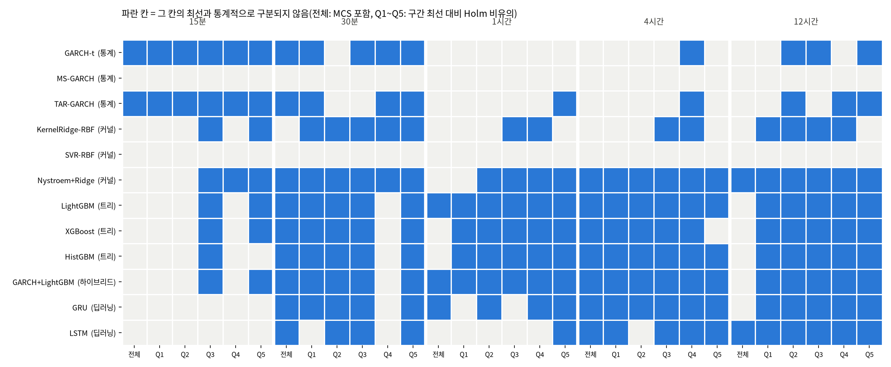

# 26b번: 26번 결과의 견고성·구분 불가 진단·유의성 검정

입력: `test/results/26_timebased_reeval_20261005`(26번, 20종목 × 5구간 × 13모델, 1300행). 재적합 없이 저장된 평가 예측만 쓴다. 데이터 정의와 결측 처리는 `test/research_materials/data_definition.md`, 모델 정의는 `test/research_materials/model_catalog.md`를 본다.

## 실험 설계

> 드라이버 서두 설계 셀 원문(`test/models/26b_robustness_significance_test.py`). 실행 전에 적은 설계이며, 결과를 본 뒤 바꾼 내용은 결과 절에 따로 적는다.

### 26b번: 26번 결과의 견고성(시드)·구분 불가 진단·유의성 검정

26번(시간 기준 재평가)의 예측값을 재적합 없이 읽어 세 가지를 확인한다. 결과는 성능 수치만이 아니라
"그 결과가 옳은가, 왜 그렇게 나왔는가"를 판정하는 근거로 쓴다.

1. **시드 견고성(전 모델)**: 무작위성이 있는 모델(트리 4종·Nystroem·GRU·LSTM)은 시드 0~4로 다시 학습한
   결과의 흔들림을 잰다. 무작위성이 없는 모델은 시드를 바꿔도 예측이 같아야 하므로, 시드 실행에 함께 돌린
   GARCH-t의 예측이 시드 0과 같은지 확인한다(선형 3종은 결정에 따라 비교에서 제외). MS-GARCH·TAR-GARCH·
   KernelRidge·SVR은 난수를 쓰지 않는 결정적 알고리즘이라 시드 실행에서 뺐다(코드상 무작위 상태 없음).
2. **4시간·12시간 구분 불가 진단**: 모델끼리 차이가 안 나는 이유가 적합 실패인지(조기종료 반복 수, 에폭,
   보정계수), 데이터 특성인지(평가 표본 수로 본 표준오차, 모델 예측끼리의 유사도, 예측 가능성 상한)를 가른다.
3. **유의성 검정**: 26번은 전 종목이 같은 정시 시각을 공유하므로, 시각마다 종목 평균 손실차를 만들면 종목 간
   상관이 그 시계열에 그대로 담긴다. 이 시계열에 DM 검정(Newey-West HAC)을 하고 다중비교를 Holm으로 보정하며,
   종목 평균 손실로 MCS를 돌린다. 사전 구간별로는 구간 최선 모델 대비 열세가 유의한지를 같은 방식으로 본다.

입력 회차는 환경변수 `RUN26B_SRC`로 고른다: `26`(기본, 26번) 또는 `26c`(최신 3년 창·두 부분 모형). 26c이면
두 부분 모형과 단일 처리의 차이를 같은 DM 검정으로 보는 절이 더해진다.

---

## 기초통계량(describe 표)

> 2026-10-14 소급 추가(AGENTS.md 2.9k). 실행 당시가 아니라 현재 `data/upbit_data.db`에서 종목별 DB 전체 이력을 다시 조회해 계산했다(업비트 과거 캔들은 바뀌지 않으므로 같은 창이면 같은 값이다). 데이터 범위 근거: 26b번은 26번 평가 예측을 재사용하므로 26번 보고서 표준 헤더의 20종목·DB 전체 이력과 같다.

#### describe 표(pandas `describe()` 그대로, 종목별)

> 숫자 형식: count는 정수, 나머지는 소수 둘째 자리(1 미만 값은 유효숫자 4자리). 로그수익률은 15분봉 기준 % 단위다. 행 단위 원자료라 무체결 구간(캔들 없음)은 포함되지 않는다.

**종가(KRW)**

| 종목 | count | mean | std | min | 25% | 50% | 75% | max |
| :--- | ---: | ---: | ---: | ---: | ---: | ---: | ---: | ---: |
| KRW-AERGO | 102,358 | 148.67 | 60.09 | 30.10 | 106.00 | 142.00 | 183.50 | 891.00 |
| KRW-AQT | 100,547 | 1,456.84 | 555.74 | 268.00 | 1,093.00 | 1,407.00 | 1,843.00 | 5,929.00 |
| KRW-ARDR | 101,215 | 109.20 | 33.32 | 30.40 | 87.56 | 108.90 | 133.00 | 241.00 |
| KRW-ARK | 101,942 | 695.53 | 400.71 | 152.00 | 418.00 | 599.70 | 880.88 | 2,475.00 |
| KRW-BOUNTY | 97,259 | 75.76 | 31.63 | 19.50 | 56.28 | 74.10 | 100.40 | 201.90 |
| KRW-BTC | 104,883 | 106,042,912.87 | 38,419,597.06 | 34,171,000.00 | 82,938,500.00 | 101,577,000.00 | 139,544,500.00 | 179,810,000.00 |
| KRW-BTT | 104,207 | 0.001036 | 0.0004874 | 0.000391 | 0.0006 | 0.000952 | 0.001314 | 0.003021 |
| KRW-CBK | 98,541 | 829.60 | 307.77 | 257.00 | 653.00 | 780.70 | 1,050.00 | 2,540.00 |
| KRW-DOGE | 104,863 | 219.64 | 121.09 | 78.80 | 133.70 | 192.00 | 271.00 | 674.00 |
| KRW-ETC | 104,901 | 26,678.49 | 9,614.18 | 9,885.00 | 21,030.00 | 25,760.00 | 32,130.00 | 56,010.00 |
| KRW-ETH | 104,869 | 3,869,407.47 | 1,141,136.87 | 2,091,000.00 | 2,994,000.00 | 3,552,000.00 | 4,809,000.00 | 6,834,000.00 |
| KRW-MOC | 97,027 | 97.16 | 36.47 | 24.50 | 76.05 | 95.61 | 125.00 | 297.10 |
| KRW-SEI | 102,133 | 422.20 | 300.17 | 68.30 | 175.00 | 363.00 | 574.80 | 1,652.00 |
| KRW-SHIB | 104,868 | 0.01863 | 0.009567 | 0.00603 | 0.011 | 0.01707 | 0.0235 | 0.0634 |
| KRW-SOL | 104,879 | 187,085.83 | 83,122.49 | 23,900.00 | 126,900.00 | 197,600.00 | 241,500.00 | 448,150.00 |
| KRW-STRAX | 102,279 | 76.15 | 44.11 | 11.80 | 53.14 | 65.13 | 104.00 | 247.00 |
| KRW-SUI | 104,876 | 2,615.08 | 1,758.19 | 496.00 | 1,185.00 | 2,090.00 | 3,967.25 | 7,877.00 |
| KRW-TOKAMAK | 99,844 | 1,878.74 | 823.46 | 502.00 | 1,380.00 | 1,705.00 | 2,590.00 | 5,120.00 |
| KRW-XLM | 104,901 | 296.14 | 162.09 | 110.20 | 158.20 | 240.00 | 399.00 | 866.50 |
| KRW-XRP | 104,876 | 2,049.32 | 1,307.19 | 564.60 | 779.00 | 1,973.00 | 3,214.00 | 4,973.00 |

**거래량(코인 수)**

| 종목 | count | mean | std | min | 25% | 50% | 75% | max |
| :--- | ---: | ---: | ---: | ---: | ---: | ---: | ---: | ---: |
| KRW-AERGO | 102,358 | 920,891.74 | 4,870,029.30 | 0.00000011 | 33,124.22 | 120,117.26 | 377,906.51 | 407,000,980.08 |
| KRW-AQT | 100,547 | 70,958.18 | 514,267.13 | 0.00000001 | 2,014.89 | 8,001.91 | 25,932.44 | 36,729,734.33 |
| KRW-ARDR | 101,215 | 804,559.39 | 5,245,164.06 | 0.00000001 | 23,526.35 | 88,487.38 | 296,768.72 | 313,391,274.97 |
| KRW-ARK | 101,942 | 319,474.04 | 1,449,187.03 | 0.00000001 | 13,879.35 | 46,286.54 | 148,790.07 | 58,717,627.02 |
| KRW-BOUNTY | 97,259 | 1,111,381.75 | 7,345,472.28 | 0.00000008 | 29,011.41 | 123,137.83 | 412,585.32 | 570,717,812.35 |
| KRW-BTC | 104,883 | 32.32 | 54.96 | 0.0001955 | 9.18 | 17.87 | 35.36 | 2,856.91 |
| KRW-BTT | 104,207 | 84,826,266,708.91 | 470,217,786,802.45 | 943,464.83 | 5,049,986,457.83 | 15,719,673,442.94 | 45,505,247,227.46 | 41,267,635,401,715.23 |
| KRW-CBK | 98,541 | 105,793.55 | 723,970.87 | 0.00000008 | 2,645.61 | 10,816.94 | 35,911.80 | 48,804,958.79 |
| KRW-DOGE | 104,863 | 5,851,580.12 | 15,264,510.88 | 382.30 | 983,126.51 | 2,269,513.36 | 5,389,642.66 | 835,077,981.93 |
| KRW-ETC | 104,901 | 12,509.97 | 45,351.15 | 0.00001135 | 1,463.33 | 3,562.33 | 9,614.34 | 3,461,797.22 |
| KRW-ETH | 104,869 | 413.39 | 708.16 | 0.002118 | 104.37 | 219.04 | 452.77 | 37,880.48 |
| KRW-MOC | 97,027 | 745,068.35 | 5,772,099.31 | 0.00000001 | 20,488.30 | 88,441.64 | 298,691.59 | 460,490,485.32 |
| KRW-SEI | 102,133 | 1,062,546.51 | 2,975,898.62 | 0.04303 | 181,524.11 | 415,899.66 | 959,713.86 | 197,777,066.46 |
| KRW-SHIB | 104,868 | 23,735,935,356.77 | 82,840,081,115.57 | 499,504.95 | 3,213,886,706.93 | 8,017,330,519.46 | 19,054,822,518.12 | 3,894,289,351,125.85 |
| KRW-SOL | 104,879 | 7,138.95 | 12,888.72 | 0.07987 | 1,887.83 | 3,688.95 | 7,497.68 | 497,384.26 |
| KRW-STRAX | 102,279 | 2,169,304.59 | 10,244,524.70 | 0.0000009 | 102,447.56 | 339,040.30 | 1,044,843.59 | 619,715,276.89 |
| KRW-SUI | 104,876 | 207,610.74 | 449,294.50 | 4.49 | 41,595.95 | 93,693.22 | 211,351.57 | 39,433,535.30 |
| KRW-TOKAMAK | 99,844 | 60,237.77 | 397,506.70 | 0.00000003 | 1,688.71 | 6,578.40 | 21,392.30 | 23,862,239.06 |
| KRW-XLM | 104,901 | 1,021,570.16 | 4,613,689.87 | 30.80 | 109,888.11 | 265,025.57 | 652,980.11 | 271,434,126.42 |
| KRW-XRP | 104,876 | 2,309,150.95 | 5,162,464.10 | 3.18 | 568,449.07 | 1,093,042.50 | 2,221,517.06 | 337,332,265.08 |

**거래대금(KRW)**

| 종목 | count | mean | std | min | 25% | 50% | 75% | max |
| :--- | ---: | ---: | ---: | ---: | ---: | ---: | ---: | ---: |
| KRW-AERGO | 102,358 | 203,983,989.06 | 1,458,985,913.85 | 0.00001287 | 4,005,857.81 | 15,666,171.65 | 57,022,288.81 | 110,652,893,534.42 |
| KRW-AQT | 100,547 | 142,483,606.03 | 1,754,846,926.55 | 0.00000871 | 2,464,489.64 | 10,635,390.14 | 38,204,857.63 | 191,151,893,950.35 |
| KRW-ARDR | 101,215 | 107,680,207.07 | 818,924,409.32 | 0.0000009 | 2,234,715.98 | 8,935,944.63 | 33,404,221.85 | 50,390,364,774.02 |
| KRW-ARK | 101,942 | 244,083,391.20 | 1,104,984,237.33 | 0.00000493 | 6,950,424.99 | 28,834,300.91 | 109,712,064.04 | 54,471,832,365.84 |
| KRW-BOUNTY | 97,259 | 100,332,388.09 | 840,341,670.79 | 0.00000247 | 1,741,614.15 | 8,409,880.73 | 32,049,676.23 | 81,151,336,799.05 |
| KRW-BTC | 104,883 | 3,172,491,762.68 | 5,428,471,142.82 | 19,979.49 | 904,263,990.73 | 1,717,315,381.02 | 3,393,464,709.24 | 317,019,670,845.50 |
| KRW-BTT | 104,207 | 129,146,519.49 | 822,962,031.13 | 456.64 | 3,628,774.45 | 13,992,748.48 | 53,183,801.03 | 60,354,867,797.54 |
| KRW-CBK | 98,541 | 111,952,845.67 | 1,050,336,708.40 | 0.0000399 | 1,789,177.15 | 8,233,811.07 | 31,526,177.80 | 111,482,198,978.71 |
| KRW-DOGE | 104,863 | 1,753,905,055.58 | 6,796,023,323.31 | 107,890.86 | 150,526,946.78 | 430,379,211.54 | 1,240,322,348.39 | 443,105,525,919.79 |
| KRW-ETC | 104,901 | 439,671,304.00 | 1,822,559,780.71 | 0.2228 | 30,030,512.92 | 87,349,092.63 | 290,195,704.84 | 132,774,330,908.11 |
| KRW-ETH | 104,869 | 1,743,694,621.68 | 3,386,838,618.04 | 7,026.73 | 356,546,139.23 | 822,328,646.41 | 1,876,216,569.86 | 238,020,674,251.36 |
| KRW-MOC | 97,027 | 100,178,586.37 | 1,105,541,751.24 | 0.00000041 | 1,603,065.11 | 7,883,480.80 | 30,330,751.52 | 111,569,942,556.14 |
| KRW-SEI | 102,133 | 499,795,791.06 | 1,544,271,910.69 | 3.70 | 45,592,344.23 | 137,964,213.65 | 412,609,361.42 | 139,569,640,025.00 |
| KRW-SHIB | 104,868 | 701,838,480.78 | 3,391,564,998.28 | 5,000.00 | 39,608,434.16 | 125,644,556.11 | 405,156,674.92 | 187,518,505,514.42 |
| KRW-SOL | 104,879 | 1,291,844,505.12 | 2,536,720,178.92 | 15,000.00 | 282,656,270.77 | 650,113,050.98 | 1,404,564,577.67 | 119,787,582,503.81 |
| KRW-STRAX | 102,279 | 202,390,829.34 | 1,036,814,917.46 | 0.00004675 | 5,206,126.35 | 21,046,165.14 | 86,620,242.08 | 58,888,538,983.16 |
| KRW-SUI | 104,876 | 449,592,553.01 | 885,090,612.08 | 6,029.00 | 83,569,600.84 | 202,319,431.18 | 478,744,327.76 | 44,936,055,583.62 |
| KRW-TOKAMAK | 99,844 | 148,430,526.27 | 1,160,060,406.44 | 0.00004392 | 2,401,751.89 | 11,016,765.46 | 43,674,617.18 | 67,362,017,784.77 |
| KRW-XLM | 104,901 | 455,150,019.15 | 2,944,758,280.24 | 5,000.00 | 23,510,330.57 | 67,212,469.71 | 194,409,958.45 | 176,131,184,868.69 |
| KRW-XRP | 104,876 | 4,685,050,065.41 | 12,732,702,803.15 | 10,000.00 | 795,184,925.94 | 1,696,783,415.19 | 4,078,852,670.09 | 946,388,756,068.87 |

**로그수익률(%)**

| 종목 | count | mean | std | min | 25% | 50% | 75% | max |
| :--- | ---: | ---: | ---: | ---: | ---: | ---: | ---: | ---: |
| KRW-AERGO | 102,357 | -0.00139 | 0.7281 | -20.21 | -0.2488 | 0 | 0.246 | 20.48 |
| KRW-AQT | 100,546 | -0.001469 | 0.7531 | -39.01 | -0.2574 | 0 | 0.2584 | 30.41 |
| KRW-ARDR | 101,214 | -0.001097 | 0.7407 | -28.50 | -0.2311 | 0 | 0.2317 | 28.20 |
| KRW-ARK | 101,941 | -0.0008267 | 0.7251 | -48.14 | -0.292 | 0 | 0.2796 | 37.67 |
| KRW-BOUNTY | 97,258 | -0.001222 | 0.7438 | -33.11 | -0.2781 | 0 | 0.2756 | 27.58 |
| KRW-BTC | 104,882 | 0.0008566 | 0.2386 | -11.24 | -0.09803 | 0 | 0.0994 | 10.99 |
| KRW-BTT | 104,206 | -0.0003819 | 4.15 | -26.83 | -0.1741 | 0 | 0.1688 | 26.83 |
| KRW-CBK | 98,540 | -0.001049 | 0.7097 | -36.65 | -0.2514 | 0 | 0.2553 | 28.72 |
| KRW-DOGE | 104,862 | 0.0001731 | 0.5603 | -23.07 | -0.2424 | 0 | 0.2398 | 18.98 |
| KRW-ETC | 104,900 | -0.0008022 | 0.4365 | -36.69 | -0.1811 | 0 | 0.1751 | 30.22 |
| KRW-ETH | 104,868 | 0.0001004 | 0.3388 | -25.10 | -0.1388 | 0 | 0.1405 | 22.25 |
| KRW-MOC | 97,026 | -0.00137 | 0.732 | -40.20 | -0.2381 | 0 | 0.238 | 33.55 |
| KRW-SEI | 102,132 | -0.001613 | 0.6709 | -28.40 | -0.3361 | 0 | 0.3233 | 38.00 |
| KRW-SHIB | 104,867 | -0.0004555 | 0.5935 | -22.91 | -0.2301 | 0 | 0.2257 | 18.67 |
| KRW-SOL | 104,878 | 0.001128 | 0.4522 | -14.54 | -0.2114 | 0 | 0.2088 | 9.62 |
| KRW-STRAX | 102,278 | -0.001437 | 0.7567 | -26.94 | -0.2819 | 0 | 0.2731 | 29.07 |
| KRW-SUI | 104,875 | 0.0001458 | 0.5934 | -40.32 | -0.2771 | 0 | 0.2673 | 35.18 |
| KRW-TOKAMAK | 99,843 | -0.001303 | 0.7177 | -39.06 | -0.2483 | 0 | 0.2489 | 30.14 |
| KRW-XLM | 104,900 | 0.0004742 | 0.5228 | -25.01 | -0.2356 | 0 | 0.2283 | 20.09 |
| KRW-XRP | 104,875 | 0.0004422 | 0.4155 | -22.95 | -0.1498 | 0 | 0.1475 | 17.20 |

---

## 1. 시드 견고성(전 모델)

읽은 시드: [0, 1, 2, 3, 4]. 시드 0은 26번 본 실행이다.

**결정적 알고리즘 확인**: 시드를 바꿔 다시 돌린 예측과 시드 0 예측의 최대 절대차(종목·구간 전체).

| 모델 | 최대 절대차 | 판정 |
| :--- | ---: | :--- |
| GARCH-t | 1.41e-08 | 동일(결정적) |

MS-GARCH·TAR-GARCH(고정 시작점의 Nelder-Mead)·KernelRidge·SVR(고정 부분표본)은 난수를 쓰지 않아 시드 실행에서 뺐다. 이 넷의 시드 표준편차는 정의상 0이다.

**무작위 모델의 시드 변동**: 종목·구간마다 시드 간 QLIKE 표준편차를 구해 중앙값을 보인다.

| 모델 | 15분 | 30분 | 1시간 | 4시간 | 12시간 |
| :--- | ---: | ---: | ---: | ---: | ---: |
| GARCH+LightGBM | 0.0037 | 0.0022 | 0.0010 | 0.0012 | 0.0025 |
| GRU | 0.0232 | 0.0125 | 0.0080 | 0.0115 | 0.0158 |
| HistGBM | 0.0000 | 0.0000 | 0.0000 | 0.0000 | 0.0000 |
| LSTM | 0.0198 | 0.0101 | 0.0100 | 0.0131 | 0.0185 |
| LightGBM | 0.0030 | 0.0020 | 0.0013 | 0.0018 | 0.0026 |
| Nystroem+Ridge | 0.0007 | 0.0009 | 0.0005 | 0.0006 | 0.0003 |
| XGBoost | 0.0034 | 0.0036 | 0.0015 | 0.0022 | 0.0020 |

동률 폭 0.01와 비교한다. 시드 표준편차가 이보다 작으면 시드는 결론을 바꾸지 않는다. HistGBM은 표본·특성 추출을 쓰지 않는 설정이라(조기종료도 직접 감시) 시드가 결과에 영향을 주지 않는다.

## 2. 왜 긴 예측 구간에서 모델이 구분되지 않는가: 적합 실패인가, 데이터 특성인가

| 예측 구간 | 평가 시각 수 | LightGBM 반복(중앙) | XGB 반복 | GRU 에폭 | LSTM 에폭 | 로그 모델 보정계수 | 상위 6개 쌍 격차 | 격차/표준오차 | 상위 6개 예측 상관 | 최선 로그 상관 | 최선 MZ R² |
| :--- | ---: | ---: | ---: | ---: | ---: | ---: | ---: | ---: | ---: | ---: | ---: |
| 15분 | 7,827 | 207 | 209 | 18 | 19 | 3.52 | 0.0520 | 5.54 | 0.893 | 0.384 | 0.130 |
| 30분 | 7,822 | 190 | 180 | 22 | 24 | 2.34 | 0.0038 | 1.67 | 0.958 | 0.494 | 0.188 |
| 1시간 | 7,822 | 168 | 171 | 18 | 24 | 1.71 | 0.0042 | 2.22 | 0.970 | 0.555 | 0.262 |
| 4시간 | 1,949 | 132 | 128 | 18 | 22 | 1.30 | 0.0018 | 0.84 | 0.968 | 0.640 | 0.277 |
| 12시간 | 646 | 96 | 100 | 12 | 16 | 1.18 | 0.0029 | 0.96 | 0.944 | 0.656 | 0.318 |

읽는 법: 적합 실패라면 반복 수·에폭이 1 근처에서 멈추거나(학습이 시작되지 않음) 보정계수가 비정상적으로 튄다. 데이터 특성이라면 적합 진단은 정상인데, 평가 시각이 적어 표준오차가 커지고(격차/표준오차가 2보다 작음), 상위 모델의 예측이 서로 거의 같다(예측 상관이 1에 가까움).

## 3. 유의성 검정

시각마다 20종목의 QLIKE 손실차를 평균한 시계열에 DM 검정(Newey-West HAC)을 한다. 종목 간 상관은 이 평균 시계열의 분산에 그대로 들어가므로 종목을 독립 반복으로 세는 문제가 없다. 다중비교는 예측 구간마다 전 모델 쌍에 Holm 보정(유의수준 0.05)을 한다. MCS는 종목 평균 손실 시계열에 블록 부트스트랩으로 돌린다(시각이 연속이라 블록 가정이 성립한다).

### 3-1. 예측 구간별 MCS(모델 신뢰 집합)와 최선 대비 DM

MCS 포함은 "최선이 아니라는 것을 기각할 수 없는 모델"이다. 최선 대비 열세 p는 Holm 보정 후 값이다.

#### 15분 (평가 시각 7,827, 블록 20)

| 모델 | 처리 방식 | 종목 평균 손실 − 최선 | MCS 포함 | 최선 대비 열세 p(Holm) |
| :--- | :--- | ---: | :--- | ---: |
| GARCH-t | 순차·재귀(통계) | +0.0000 | 예 | - |
| TAR-GARCH | 순차·재귀(통계) | +0.0036 | 예 | 1 |
| GRU | 순차·재귀 | +0.0556 | 아니오 | 1.16e-12 |
| Nystroem+Ridge | 특성 기반 회귀(비신경) | +0.0607 | 아니오 | 7.45e-14 |
| LSTM | 순차·재귀 | +0.0655 | 아니오 | 2.96e-16 |
| LightGBM | 특성 기반 트리(비신경) | +0.0694 | 아니오 | 3.98e-18 |
| GARCH+LightGBM | 순차·재귀 통계 + 트리 결합 | +0.0711 | 아니오 | 4.69e-18 |
| XGBoost | 특성 기반 트리(비신경) | +0.0712 | 아니오 | 8.05e-19 |
| HistGBM | 특성 기반 트리(비신경) | +0.0750 | 아니오 | 1.77e-22 |
| KernelRidge-RBF | 특성 기반 회귀(비신경) | +0.0917 | 아니오 | 1.29e-09 |
| SVR-RBF | 특성 기반 회귀(비신경) | +0.1729 | 아니오 | 2.4e-28 |
| MS-GARCH | 순차·재귀(통계) | +0.5806 | 아니오 | 0 |
| naive | 직전값 | +34.1660 | 아니오 | 0.000137 |

#### 30분 (평가 시각 7,822, 블록 20)

| 모델 | 처리 방식 | 종목 평균 손실 − 최선 | MCS 포함 | 최선 대비 열세 p(Holm) |
| :--- | :--- | ---: | :--- | ---: |
| GARCH+LightGBM | 순차·재귀 통계 + 트리 결합 | +0.0000 | 예 | - |
| XGBoost | 특성 기반 트리(비신경) | +0.0011 | 예 | 1 |
| LightGBM | 특성 기반 트리(비신경) | +0.0012 | 예 | 1 |
| HistGBM | 특성 기반 트리(비신경) | +0.0046 | 예 | 0.188 |
| GRU | 순차·재귀 | +0.0073 | 예 | 0.709 |
| LSTM | 순차·재귀 | +0.0085 | 예 | 0.422 |
| GARCH-t | 순차·재귀(통계) | +0.0096 | 예 | 0.564 |
| Nystroem+Ridge | 특성 기반 회귀(비신경) | +0.0100 | 예 | 0.318 |
| TAR-GARCH | 순차·재귀(통계) | +0.0118 | 예 | 0.336 |
| KernelRidge-RBF | 특성 기반 회귀(비신경) | +0.0517 | 아니오 | 0.000975 |
| SVR-RBF | 특성 기반 회귀(비신경) | +0.1092 | 아니오 | 4.53e-20 |
| MS-GARCH | 순차·재귀(통계) | +0.7094 | 아니오 | 0 |
| naive | 직전값 | +2.8972 | 아니오 | 2.55e-72 |

#### 1시간 (평가 시각 7,822, 블록 20)

| 모델 | 처리 방식 | 종목 평균 손실 − 최선 | MCS 포함 | 최선 대비 열세 p(Holm) |
| :--- | :--- | ---: | :--- | ---: |
| GARCH+LightGBM | 순차·재귀 통계 + 트리 결합 | +0.0000 | 예 | - |
| LightGBM | 특성 기반 트리(비신경) | +0.0016 | 예 | 0.997 |
| XGBoost | 특성 기반 트리(비신경) | +0.0030 | 아니오 | 0.0715 |
| GRU | 순차·재귀 | +0.0044 | 예 | 1 |
| HistGBM | 특성 기반 트리(비신경) | +0.0069 | 아니오 | 0.000112 |
| Nystroem+Ridge | 특성 기반 회귀(비신경) | +0.0111 | 아니오 | 0.000112 |
| LSTM | 순차·재귀 | +0.0152 | 아니오 | 5.22e-06 |
| GARCH-t | 순차·재귀(통계) | +0.0356 | 아니오 | 5.01e-17 |
| TAR-GARCH | 순차·재귀(통계) | +0.0361 | 아니오 | 4.9e-22 |
| KernelRidge-RBF | 특성 기반 회귀(비신경) | +0.0652 | 아니오 | 2.22e-10 |
| SVR-RBF | 특성 기반 회귀(비신경) | +0.1376 | 아니오 | 3.65e-31 |
| MS-GARCH | 순차·재귀(통계) | +0.8189 | 아니오 | 0 |
| naive | 직전값 | +1.0763 | 아니오 | 1.01e-104 |

#### 4시간 (평가 시각 1,949, 블록 12)

| 모델 | 처리 방식 | 종목 평균 손실 − 최선 | MCS 포함 | 최선 대비 열세 p(Holm) |
| :--- | :--- | ---: | :--- | ---: |
| Nystroem+Ridge | 특성 기반 회귀(비신경) | +0.0000 | 예 | - |
| XGBoost | 특성 기반 트리(비신경) | +0.0044 | 예 | 1 |
| LightGBM | 특성 기반 트리(비신경) | +0.0047 | 예 | 1 |
| GARCH+LightGBM | 순차·재귀 통계 + 트리 결합 | +0.0060 | 예 | 1 |
| LSTM | 순차·재귀 | +0.0062 | 예 | 1 |
| HistGBM | 특성 기반 트리(비신경) | +0.0076 | 예 | 1 |
| GRU | 순차·재귀 | +0.0084 | 예 | 1 |
| KernelRidge-RBF | 특성 기반 회귀(비신경) | +0.0476 | 아니오 | 0.000315 |
| GARCH-t | 순차·재귀(통계) | +0.0482 | 아니오 | 1.69e-06 |
| TAR-GARCH | 순차·재귀(통계) | +0.0582 | 아니오 | 1.14e-07 |
| SVR-RBF | 특성 기반 회귀(비신경) | +0.1146 | 아니오 | 1.84e-12 |
| naive | 직전값 | +0.6392 | 아니오 | 6.79e-13 |
| MS-GARCH | 순차·재귀(통계) | +0.9279 | 아니오 | 4.72e-91 |

#### 12시간 (평가 시각 646, 블록 9)

| 모델 | 처리 방식 | 종목 평균 손실 − 최선 | MCS 포함 | 최선 대비 열세 p(Holm) |
| :--- | :--- | ---: | :--- | ---: |
| Nystroem+Ridge | 특성 기반 회귀(비신경) | +0.0000 | 예 | - |
| GRU | 순차·재귀 | +0.0126 | 아니오 | 0.17 |
| LightGBM | 특성 기반 트리(비신경) | +0.0132 | 아니오 | 0.101 |
| LSTM | 순차·재귀 | +0.0135 | 예 | 1 |
| GARCH+LightGBM | 순차·재귀 통계 + 트리 결합 | +0.0152 | 아니오 | 0.0119 |
| XGBoost | 특성 기반 트리(비신경) | +0.0164 | 아니오 | 0.00392 |
| HistGBM | 특성 기반 트리(비신경) | +0.0186 | 아니오 | 0.0035 |
| KernelRidge-RBF | 특성 기반 회귀(비신경) | +0.0525 | 아니오 | 0.0366 |
| GARCH-t | 순차·재귀(통계) | +0.0715 | 아니오 | 2.24e-05 |
| TAR-GARCH | 순차·재귀(통계) | +0.0992 | 아니오 | 1.37e-16 |
| SVR-RBF | 특성 기반 회귀(비신경) | +0.1554 | 아니오 | 2.58e-08 |
| naive | 직전값 | +0.1642 | 아니오 | 1.13e-05 |
| MS-GARCH | 순차·재귀(통계) | +0.8819 | 아니오 | 1.25e-67 |

### 3-2. 사전 구간별 통계적 동률 집합

종목마다 사전 구간(직전 RV, 학습 구간 분위수)이 다르므로, 시각마다 그 구간에 든 종목들만으로 손실차를 평균한 시계열을 만들어 HAC 검정을 한다(해당 종목이 없는 시각은 빠진다). 구간 최선 모델 대비 열세가 Holm 보정 후 유의하지 않은 모델을 통계적 동률로 본다.

| 예측 구간 | 구간 | 최선 | 통계적 동률(최선 대비 열세가 유의하지 않음) |
| :--- | :--- | :--- | :--- |
| 15분 | Q1 | TAR-GARCH | GARCH-t |
| 15분 | Q2 | GARCH-t | TAR-GARCH |
| 15분 | Q3 | GARCH-t | TAR-GARCH, Nys, LGBM, G+LGBM, XGB, HGB, KRR |
| 15분 | Q4 | Nystroem+Ridge | TAR-GARCH, GARCH-t |
| 15분 | Q5 | GARCH-t | TAR-GARCH, Nys, LGBM, G+LGBM, XGB, naive, KRR |
| 30분 | Q1 | TAR-GARCH | GARCH-t, HGB, LGBM, XGB, G+LGBM, GRU, KRR, Nys |
| 30분 | Q2 | GARCH+LightGBM | GRU, LSTM, XGB, LGBM, HGB, Nys, KRR |
| 30분 | Q3 | GARCH+LightGBM | HGB, XGB, LGBM, Nys, LSTM, GRU, KRR, GARCH-t |
| 30분 | Q4 | Nystroem+Ridge | TAR-GARCH, KRR, GARCH-t |
| 30분 | Q5 | GRU | Nys, LGBM, G+LGBM, XGB, GARCH-t, LSTM, HGB, TAR-GARCH, naive, KRR |
| 1시간 | Q1 | GARCH+LightGBM | LGBM, XGB, HGB |
| 1시간 | Q2 | GARCH+LightGBM | LGBM, XGB, Nys, HGB, GRU |
| 1시간 | Q3 | GARCH+LightGBM | LGBM, XGB, Nys, HGB, KRR |
| 1시간 | Q4 | GARCH+LightGBM | Nys, LGBM, XGB, HGB, GRU, KRR |
| 1시간 | Q5 | GRU | LSTM, G+LGBM, LGBM, XGB, Nys, HGB, naive, TAR-GARCH |
| 4시간 | Q1 | GARCH+LightGBM | XGB, Nys, LGBM, HGB, GRU, LSTM |
| 4시간 | Q2 | Nystroem+Ridge | XGB, LGBM, G+LGBM, GRU, HGB |
| 4시간 | Q3 | Nystroem+Ridge | LGBM, G+LGBM, XGB, HGB, LSTM, KRR, GRU |
| 4시간 | Q4 | Nystroem+Ridge | XGB, LSTM, GRU, LGBM, G+LGBM, HGB, KRR, GARCH-t, TAR-GARCH, naive |
| 4시간 | Q5 | LSTM | GRU, HGB, Nys, LGBM, G+LGBM |
| 12시간 | Q1 | Nystroem+Ridge | LGBM, KRR, G+LGBM, XGB, LSTM, HGB, GRU |
| 12시간 | Q2 | Nystroem+Ridge | G+LGBM, LGBM, XGB, KRR, GRU, GARCH-t, HGB, LSTM, TAR-GARCH |
| 12시간 | Q3 | Nystroem+Ridge | XGB, LGBM, G+LGBM, GRU, KRR, HGB, LSTM, GARCH-t, naive |
| 12시간 | Q4 | Nystroem+Ridge | GRU, LSTM, naive, LGBM, G+LGBM, XGB, HGB, KRR, TAR-GARCH |
| 12시간 | Q5 | GRU | naive, Nys, LSTM, XGB, G+LGBM, LGBM, HGB, TAR-GARCH, GARCH-t |

### 3-3. 시드를 바꿔도 MCS 판정이 유지되는가

무작위 모델(트리·Nystroem·GRU·LSTM)의 예측만 시드 1~4의 것으로 바꾸고, 나머지 모델은 그대로 둔 채 같은 MCS를 다시 돌렸다. 셀은 시드 5개 중 MCS에 포함된 횟수다.

| 모델 | 15분(/5) | 30분(/5) | 1시간(/5) | 4시간(/5) | 12시간(/5) |
| :--- | ---: | ---: | ---: | ---: | ---: |
| naive | 0 | 0 | 0 | 0 | 0 |
| GARCH-t | 5 | 4 | 0 | 0 | 0 |
| MS-GARCH | 0 | 0 | 0 | 0 | 0 |
| TAR-GARCH | 5 | 4 | 0 | 0 | 0 |
| KernelRidge-RBF | 0 | 0 | 0 | 0 | 0 |
| SVR-RBF | 0 | 0 | 0 | 0 | 0 |
| Nystroem+Ridge | 0 | 3 | 0 | 5 | 5 |
| LightGBM | 0 | 5 | 3 | 5 | 0 |
| XGBoost | 0 | 5 | 2 | 5 | 0 |
| HistGBM | 0 | 1 | 0 | 5 | 0 |
| GARCH+LightGBM | 0 | 5 | 5 | 5 | 1 |
| GRU | 0 | 4 | 3 | 4 | 3 |
| LSTM | 0 | 2 | 0 | 3 | 5 |

## 4. 실무 동률(A등급, 0.01)과 통계 판정의 일치

| 예측 구간 | A등급(0.01 이내) | MCS 포함 | 둘 다 | A등급만 | MCS만 |
| :--- | :--- | :--- | :--- | :--- | :--- |
| 15분 | GARCH-t, TAR-GARCH | GARCH-t, TAR-GARCH | GARCH-t, TAR-GARCH | - | - |
| 30분 | G+LGBM, GARCH-t, GRU, HGB, LSTM, LGBM, XGB | G+LGBM, GARCH-t, GRU, HGB, LSTM, LGBM, Nys, TAR-GARCH, XGB | G+LGBM, GARCH-t, GRU, HGB, LSTM, LGBM, XGB | - | Nys, TAR-GARCH |
| 1시간 | G+LGBM, GRU, HGB, LGBM, XGB | G+LGBM, GRU, LGBM | G+LGBM, GRU, LGBM | HGB, XGB | - |
| 4시간 | G+LGBM, GRU, HGB, LSTM, LGBM, Nys, XGB | G+LGBM, GRU, HGB, LSTM, LGBM, Nys, XGB | G+LGBM, GRU, HGB, LSTM, LGBM, Nys, XGB | - | - |
| 12시간 | Nys | LSTM, Nys | Nys | - | LSTM |

## 5. 예측 구간별 선형성 재검정(선형 모델 제외 결정의 근거 확인)

2026-09-07 가정 진단에서 선형성 검정(RESET·BDS)이 기각되어 Linear·Ridge는 비선형·커널 계열로 대체하기로 결정했다(이 분석의 순위·검정에서 제외). 그 판정은 1시간 타깃 기준이었으므로, 예측 구간마다 같은 판정이 유지되는지 다시 본다(HAR-RV도 같은 이유로 제외). 표본이 수만 개면 아주 작은 비선형도 기각되므로, 종목마다 학습 표본을 최근 5,000개(긴 구간은 H시간 간격으로 겹침을 줄여 뽑은 수)로 맞추고 **비선형 항이 늘리는 설명력의 크기**를 함께 본다.

| 예측 구간 | 표본(중앙) | 선형 R²(중앙) | 비선형 항 증분 R²(중앙) | RESET 기각 종목 | BDS 기각 종목 | 트리 최선 격차 |
| :--- | ---: | ---: | ---: | ---: | ---: | ---: |
| 15분 | 5,000 | 0.122 | 0.0034 | 14/20 | 11/20 | 0.069 |
| 30분 | 5,000 | 0.218 | 0.0022 | 13/20 | 6/20 | 0.000 |
| 1시간 | 5,000 | 0.302 | 0.0027 | 17/20 | 10/20 | 0.000 |
| 4시간 | 4,534 | 0.475 | 0.0015 | 16/20 | 12/20 | 0.004 |
| 12시간 | 1,497 | 0.508 | 0.0011 | 6/20 | 13/20 | 0.013 |

읽는 법: 격차는 그 구간 최선 모델 대비 QLIKE 차(26번 보정후, 종목 평균)다. 선형 R²가 예측 구간과 함께 커지면 긴 구간에서 선형 근사로 충분해진다는 뜻이다(변동성을 길게 합산할수록 잡음이 평균으로 줄어든다). 비선형 항 증분이 작아도 짧은 구간에서 트리가 선형보다 크게 앞서면, 그 비선형은 RESET이 보는 거듭제곱 형태가 아니라 문턱·상호작용 형태라는 뜻이다. BDS는 잔차의 독립성 위반 전반(이분산 포함)을 잡으므로 선형성만의 검정이 아니다.

