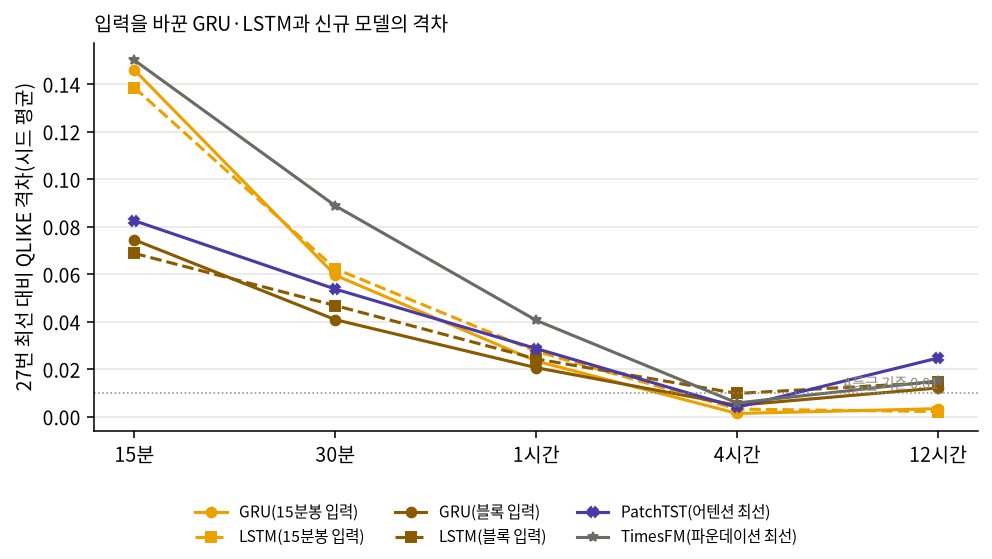

# 27c번: 순환망(GRU·LSTM)에 블록 입력을 넣은 순차 대 병렬 비교

## 실험 설계

> 드라이버 서두 설계 셀 원문(`test/models/27c_rnn_block_input_test.py`). 실행 전에 적은 설계이며, 결과를 본 뒤 바꾼 내용은 결과 절에 따로 적는다.

### 27c번: 순환망(GRU·LSTM)에 신규 모델과 같은 블록 입력을 넣어 순차 대 병렬 비교에서 입력 차이를 통제

27번에서 순환 딥러닝(GRU·LSTM)이 30분~12시간에 병렬 어텐션 계열보다 유의하게 나았다(27b D2b). 그런데 두 계열은 같은
15분봉 종가에서 출발해도 **모델에 넣는 모양**이 달랐다.

| 항목 | 26c GRU·LSTM | 27번 신규 신경망 |
| :--- | :--- | :--- |
| 입력 | 15분봉 96개의 (d, \|d\|) | H분 블록 로그 RV 이력(96·96·96·60·30블록) |
| 학습 표본 | 15분마다 겹치는 예측 시점(약 61,000행, 모든 구간) | 겹치지 않는 블록(12시간이면 약 1,270개) |

그래서 "순차 구조가 낫다"인지 "15분봉 입력·많은 표본이 낫다"인지 가를 수 없었다. 이 회차는 GRU·LSTM에 **신규 모델과 같은
블록 입력·같은 블록 표본·같은 보정 구간·같은 정지 확률 π**를 주고, GRU·LSTM 자체의 학습 절차(26c)는 그대로 둔다.

#### 통제하지 않은 것(결론의 범위, Codex 리뷰 2026-10-08)

이 회차가 맞춘 것은 입력·학습 표본·보정 구간·π뿐이다. 학습 절차는 각자의 것을 쓴다. 순환망은 학습률 3개 탐색·내부검증 에폭
선택·전체 재적합이고, 신규 모델은 라이브러리 기본값·학습 구간 끝 15% 조기종료(그 15%는 학습에서 빠짐)이며, iTransformer·
S-Mamba는 블록 수익률 변수가 하나 더 있다. 따라서 같은 입력에서 남는 차이는 **구조와 학습 절차가 섞인 차이**이고, 순차
구조만의 효과로 단정하지 않는다. 이 회차가 답하는 질문은 "27번의 순환 우위가 입력 차이만으로 생겼는가"이다.

#### 바꾸지 않는 것(26c GRU·LSTM 절차)

모델 구조(`engine/models.py`, 은닉 128), AdamW(가중감쇠 1e-4)·코사인 학습률, 학습률 후보 3개(2e-3, 5e-4, 1e-4)를 내부검증
손실로 고름, 최대 60에폭·조기종료 인내 10, 고른 학습률·에폭으로 학습 구간 전체 재적합, 손실은 표준화 로그 RV의 MSE.

#### 바꾸는 것과 이유

- **입력**: 직전 L블록의 표준화 로그 RV(L = 27번 `INPUT_BLOCKS`, 1변수). RV=0·점검 블록은 27번과 같이 직전값 유지.
  어텐션 계열 4종 중 3종(PatchTST·Autoformer·TimeXer)과 합성곱 3종이 1변수 입력이라 1변수로 맞춘다.
- **표본**: 블록 e(값이 있는 블록)마다 한 표본. 내부학습은 [L, k_in), 내부검증(학습률·에폭 선택, 보정)은 [k_in, k_sp),
  전체 재적합은 [L, k_sp), 평가는 [k_sp, nb). 블록 경계·k_in·k_sp는 27번 `block_masks`와 같다.
- **배치 크기**: 26c는 배치 2,048로 학습 행 약 61,000개를 돌아 **에폭당 약 30번** 가중치를 갱신했다. 블록 표본은 12시간에
  약 1,270개라 같은 배치면 에폭당 1번만 갱신되어(60에폭 = 60번) 학습이 거의 되지 않는다. 그러면 입력이 아니라 학습량 차이가
  결과를 가른다. 그래서 **에폭당 갱신 횟수를 같은 종목·구간의 26c GRU와 같게** 배치 = 2,048 × (블록 표본 수 / 26c 학습 행
  수)로 정한다(16~2,048로 자름). 15분은 블록 하나가 15분봉 하나라 표본 수가 26c와 거의 같아 배치 2,048 그대로다.

산출: `test/results/27c_rnn_block_input_20261008/`. 시드 0~4(27번과 같은 시드 집합).

---

## 기초통계량(describe 표)

> 2026-10-14 소급 추가(AGENTS.md 2.9k). 실행 당시가 아니라 현재 `data/upbit_data_20261005.db`에서 2023-10-06 00:00 ~ 2026-10-05 20:45(끝 미포함)을 다시 조회해 계산했다(업비트 과거 캔들은 바뀌지 않으므로 같은 창이면 같은 값이다). 데이터 범위 근거: 27c번은 26c번 데이터 창·학습 절차를 그대로 쓴다.

#### describe 표(pandas `describe()` 그대로, 종목별)

> 숫자 형식: count는 정수, 나머지는 소수 둘째 자리(1 미만 값은 유효숫자 4자리). 로그수익률은 15분봉 기준 % 단위다. 행 단위 원자료라 무체결 구간(캔들 없음)은 포함되지 않는다.

**종가(KRW)**

| 종목 | count | mean | std | min | 25% | 50% | 75% | max |
| :--- | ---: | ---: | ---: | ---: | ---: | ---: | ---: | ---: |
| KRW-AERGO | 95,289 | 149.75 | 62.10 | 30.10 | 100.00 | 144.10 | 188.00 | 891.00 |
| KRW-AQT | 93,269 | 1,472.14 | 573.56 | 268.00 | 1,050.00 | 1,460.00 | 1,867.00 | 5,929.00 |
| KRW-ARDR | 100,692 | 105.40 | 38.37 | 24.20 | 84.90 | 109.00 | 133.00 | 241.00 |
| KRW-ARK | 100,337 | 683.66 | 415.10 | 120.00 | 411.20 | 596.50 | 893.10 | 2,475.00 |
| KRW-BOUNTY | 94,720 | 72.45 | 34.37 | 13.50 | 38.90 | 70.99 | 101.00 | 201.90 |
| KRW-BTC | 104,960 | 110,710,412.41 | 33,455,406.43 | 36,368,000.00 | 90,194,750.00 | 105,944,000.00 | 139,499,000.00 | 179,810,000.00 |
| KRW-BTT | 104,118 | 0.001023 | 0.0005007 | 0.000363 | 0.000589 | 0.0009525 | 0.001314 | 0.003021 |
| KRW-CBK | 96,803 | 798.61 | 337.89 | 211.00 | 553.00 | 770.10 | 1,052.00 | 2,540.00 |
| KRW-DOGE | 104,957 | 221.20 | 119.47 | 78.80 | 134.00 | 191.90 | 271.00 | 674.00 |
| KRW-ETC | 104,843 | 25,839.14 | 10,452.18 | 8,460.00 | 18,210.00 | 25,770.00 | 32,140.00 | 56,010.00 |
| KRW-ETH | 104,960 | 3,929,849.14 | 1,081,446.43 | 2,091,000.00 | 3,098,000.00 | 3,588,000.00 | 4,808,250.00 | 6,834,000.00 |
| KRW-MOC | 95,087 | 92.74 | 40.06 | 20.50 | 59.50 | 91.99 | 125.00 | 297.10 |
| KRW-SEI | 104,728 | 408.21 | 306.32 | 53.60 | 153.00 | 356.00 | 560.65 | 1,652.00 |
| KRW-SHIB | 104,943 | 0.01836 | 0.00983 | 0.00602 | 0.0105 | 0.01705 | 0.0235 | 0.0634 |
| KRW-SOL | 104,958 | 194,260.01 | 73,049.47 | 28,930.00 | 131,212.50 | 197,600.00 | 241,500.00 | 448,150.00 |
| KRW-STRAX | 101,302 | 73.43 | 46.71 | 11.40 | 34.50 | 65.21 | 104.50 | 247.00 |
| KRW-SUI | 104,943 | 2,642.91 | 1,730.50 | 496.00 | 1,227.00 | 2,089.00 | 3,966.00 | 7,877.00 |
| KRW-TOKAMAK | 98,367 | 1,799.60 | 894.66 | 357.00 | 1,111.00 | 1,643.00 | 2,606.00 | 5,120.00 |
| KRW-XLM | 104,903 | 302.22 | 158.97 | 110.20 | 160.20 | 255.00 | 399.00 | 866.50 |
| KRW-XRP | 104,959 | 2,121.00 | 1,262.34 | 564.60 | 813.60 | 2,005.00 | 3,213.00 | 4,973.00 |

**거래량(코인 수)**

| 종목 | count | mean | std | min | 25% | 50% | 75% | max |
| :--- | ---: | ---: | ---: | ---: | ---: | ---: | ---: | ---: |
| KRW-AERGO | 95,289 | 978,459.35 | 5,041,561.02 | 0.00000011 | 36,058.24 | 127,895.59 | 401,419.23 | 407,000,980.08 |
| KRW-AQT | 93,269 | 74,413.88 | 532,961.42 | 0.00000001 | 2,039.47 | 8,166.09 | 26,750.12 | 36,729,734.33 |
| KRW-ARDR | 100,692 | 834,033.59 | 5,328,048.51 | 0.00000001 | 24,582.05 | 94,011.86 | 316,126.84 | 313,391,274.97 |
| KRW-ARK | 100,337 | 262,390.36 | 1,207,081.12 | 0.00000001 | 12,261.33 | 41,432.63 | 131,731.23 | 58,717,627.02 |
| KRW-BOUNTY | 94,720 | 1,019,102.29 | 7,232,190.89 | 0.00000008 | 25,570.17 | 111,659.45 | 375,971.59 | 570,717,812.35 |
| KRW-BTC | 104,960 | 30.79 | 54.33 | 0.0001955 | 8.12 | 16.38 | 33.44 | 2,856.91 |
| KRW-BTT | 104,118 | 86,232,102,578.54 | 473,993,000,302.10 | 0.00000003 | 5,729,150,783.32 | 16,603,113,277.09 | 46,543,747,978.42 | 41,267,635,401,715.23 |
| KRW-CBK | 96,803 | 93,579.33 | 684,973.98 | 0.00000008 | 2,334.68 | 9,844.86 | 32,971.10 | 48,804,958.79 |
| KRW-DOGE | 104,957 | 5,702,999.77 | 14,926,272.64 | 382.30 | 905,447.25 | 2,202,694.89 | 5,312,301.36 | 835,077,981.93 |
| KRW-ETC | 104,843 | 12,342.93 | 45,258.61 | 0.00001135 | 1,342.92 | 3,390.61 | 9,444.58 | 3,461,797.22 |
| KRW-ETH | 104,960 | 424.43 | 710.19 | 0.002118 | 114.89 | 229.44 | 464.34 | 37,880.48 |
| KRW-MOC | 95,087 | 745,223.50 | 5,836,114.20 | 0.00000001 | 19,645.24 | 87,115.88 | 296,832.34 | 460,490,485.32 |
| KRW-SEI | 104,728 | 911,026.64 | 2,164,204.22 | 0.04303 | 167,034.62 | 386,140.23 | 876,311.55 | 96,036,027.26 |
| KRW-SHIB | 104,943 | 24,239,281,128.80 | 82,870,436,798.07 | 790,797.26 | 3,688,510,048.00 | 8,456,730,819.82 | 19,539,257,531.27 | 3,894,289,351,125.85 |
| KRW-SOL | 104,958 | 6,853.28 | 12,620.91 | 0.07987 | 1,719.80 | 3,479.65 | 7,196.41 | 497,384.26 |
| KRW-STRAX | 101,302 | 2,133,436.27 | 10,177,469.78 | 0.0000009 | 100,391.66 | 336,934.27 | 1,034,422.35 | 619,715,276.89 |
| KRW-SUI | 104,943 | 194,096.52 | 420,598.06 | 4.49 | 38,770.76 | 87,394.60 | 198,273.48 | 39,433,535.30 |
| KRW-TOKAMAK | 98,367 | 57,341.84 | 389,179.04 | 0.00000003 | 1,581.46 | 6,351.66 | 20,685.25 | 23,862,239.06 |
| KRW-XLM | 104,903 | 1,001,211.76 | 4,562,976.81 | 30.80 | 111,287.95 | 267,956.45 | 654,197.79 | 271,434,126.42 |
| KRW-XRP | 104,959 | 2,246,325.49 | 5,126,660.69 | 3.18 | 525,075.07 | 1,035,220.99 | 2,156,837.70 | 337,332,265.08 |

**거래대금(KRW)**

| 종목 | count | mean | std | min | 25% | 50% | 75% | max |
| :--- | ---: | ---: | ---: | ---: | ---: | ---: | ---: | ---: |
| KRW-AERGO | 95,289 | 217,666,403.17 | 1,511,173,547.55 | 0.00001287 | 4,332,542.98 | 16,742,583.06 | 61,430,334.67 | 110,652,893,534.42 |
| KRW-AQT | 93,269 | 150,775,559.06 | 1,821,256,937.78 | 0.00000871 | 2,503,113.75 | 10,875,064.21 | 39,815,208.93 | 191,151,893,950.35 |
| KRW-ARDR | 100,692 | 108,278,452.15 | 821,304,764.25 | 0.0000009 | 2,168,027.53 | 8,807,251.14 | 33,610,547.33 | 50,390,364,774.02 |
| KRW-ARK | 100,337 | 205,766,777.45 | 972,948,879.08 | 0.00000493 | 5,725,795.46 | 24,810,656.03 | 97,259,942.91 | 54,471,832,365.84 |
| KRW-BOUNTY | 94,720 | 91,508,299.71 | 836,533,710.88 | 0.00000247 | 1,374,306.31 | 6,975,465.29 | 27,610,284.89 | 81,151,336,799.05 |
| KRW-BTC | 104,960 | 3,162,252,483.65 | 5,431,738,295.17 | 19,979.49 | 884,569,332.74 | 1,708,989,153.05 | 3,394,901,520.36 | 317,019,670,845.50 |
| KRW-BTT | 104,118 | 129,855,889.22 | 823,866,058.01 | 0 | 4,022,529.63 | 14,438,953.87 | 53,660,484.37 | 60,354,867,797.54 |
| KRW-CBK | 96,803 | 99,051,684.46 | 1,026,135,707.14 | 0.0000399 | 1,437,444.28 | 6,950,520.48 | 27,708,001.19 | 111,482,198,978.71 |
| KRW-DOGE | 104,957 | 1,742,126,227.04 | 6,788,156,284.26 | 75,808.00 | 144,155,005.24 | 427,360,843.47 | 1,230,504,369.60 | 443,105,525,919.79 |
| KRW-ETC | 104,843 | 433,384,768.75 | 1,822,043,273.60 | 0.2228 | 25,174,372.26 | 79,495,081.12 | 283,177,680.72 | 132,774,330,908.11 |
| KRW-ETH | 104,960 | 1,784,966,989.69 | 3,385,801,337.68 | 7,026.73 | 402,242,470.13 | 862,115,768.12 | 1,914,163,033.49 | 238,020,674,251.36 |
| KRW-MOC | 95,087 | 98,225,809.32 | 1,114,120,447.03 | 0.00000041 | 1,356,247.16 | 7,148,105.38 | 28,670,962.46 | 111,569,942,556.14 |
| KRW-SEI | 104,728 | 451,323,416.73 | 1,301,453,206.36 | 3.70 | 35,847,057.15 | 118,730,111.10 | 368,925,855.25 | 83,597,313,939.69 |
| KRW-SHIB | 104,943 | 703,440,426.61 | 3,389,926,682.33 | 8,619.69 | 43,369,259.59 | 127,412,724.54 | 405,542,462.63 | 187,518,505,514.42 |
| KRW-SOL | 104,958 | 1,299,801,226.90 | 2,535,075,975.36 | 15,000.00 | 294,409,205.22 | 658,453,672.23 | 1,409,549,319.41 | 119,787,582,503.81 |
| KRW-STRAX | 101,302 | 198,289,199.81 | 1,035,795,305.45 | 0.00004675 | 4,461,209.51 | 19,067,525.97 | 82,468,041.26 | 58,888,538,983.16 |
| KRW-SUI | 104,943 | 445,277,343.13 | 882,826,018.08 | 5,350.00 | 78,672,222.87 | 199,227,915.01 | 475,177,555.84 | 44,936,055,583.62 |
| KRW-TOKAMAK | 98,367 | 141,643,297.81 | 1,151,294,390.92 | 0.00004392 | 2,010,404.13 | 9,807,921.12 | 40,677,794.78 | 67,362,017,784.77 |
| KRW-XLM | 104,903 | 455,757,800.50 | 2,941,999,806.26 | 5,000.00 | 24,489,881.16 | 70,134,016.63 | 200,883,498.12 | 176,131,184,868.69 |
| KRW-XRP | 104,959 | 4,716,267,627.41 | 12,754,528,822.41 | 10,000.00 | 792,430,930.12 | 1,724,329,259.43 | 4,134,288,354.00 | 946,388,756,068.87 |

**로그수익률(%)**

| 종목 | count | mean | std | min | 25% | 50% | 75% | max |
| :--- | ---: | ---: | ---: | ---: | ---: | ---: | ---: | ---: |
| KRW-AERGO | 95,288 | -0.00147 | 0.7397 | -20.21 | -0.2505 | 0 | 0.2478 | 20.48 |
| KRW-AQT | 93,268 | -0.001639 | 0.7682 | -39.01 | -0.2541 | 0 | 0.2545 | 30.41 |
| KRW-ARDR | 100,691 | -0.0008122 | 0.7661 | -28.50 | -0.2541 | 0 | 0.2567 | 28.20 |
| KRW-ARK | 100,336 | -0.0007802 | 0.7291 | -48.14 | -0.3044 | 0 | 0.2854 | 37.67 |
| KRW-BOUNTY | 94,719 | -0.001554 | 0.7563 | -33.11 | -0.2943 | 0 | 0.2917 | 27.58 |
| KRW-BTC | 104,959 | 0.001075 | 0.2395 | -11.24 | -0.09909 | 0 | 0.1008 | 10.99 |
| KRW-BTT | 104,117 | 0.00001146 | 2.78 | -26.83 | -0.1795 | 0 | 0.1741 | 26.83 |
| KRW-CBK | 96,802 | -0.001137 | 0.7121 | -36.65 | -0.2613 | 0 | 0.2635 | 28.72 |
| KRW-DOGE | 104,956 | 0.0004287 | 0.5761 | -23.07 | -0.2599 | 0 | 0.2585 | 18.98 |
| KRW-ETC | 104,842 | -0.0005266 | 0.4447 | -36.69 | -0.1884 | 0 | 0.1846 | 30.22 |
| KRW-ETH | 104,959 | 0.0004832 | 0.3418 | -25.10 | -0.1432 | 0 | 0.1453 | 22.25 |
| KRW-MOC | 95,086 | -0.001416 | 0.7382 | -40.20 | -0.244 | 0 | 0.2436 | 33.55 |
| KRW-SEI | 104,727 | -0.0004438 | 0.6328 | -28.40 | -0.3221 | 0 | 0.3133 | 22.31 |
| KRW-SHIB | 104,942 | -0.0001804 | 0.5728 | -22.91 | -0.2288 | 0 | 0.2249 | 18.67 |
| KRW-SOL | 104,957 | 0.001575 | 0.4497 | -14.54 | -0.2067 | 0 | 0.2053 | 9.62 |
| KRW-STRAX | 101,301 | -0.001378 | 0.7742 | -26.94 | -0.2912 | 0 | 0.2842 | 29.07 |
| KRW-SUI | 104,942 | 0.000976 | 0.5967 | -40.32 | -0.2782 | 0 | 0.2701 | 35.18 |
| KRW-TOKAMAK | 98,366 | -0.001317 | 0.7254 | -39.06 | -0.2405 | 0 | 0.2416 | 30.14 |
| KRW-XLM | 104,902 | 0.0006512 | 0.516 | -25.01 | -0.2385 | 0 | 0.2326 | 20.09 |
| KRW-XRP | 104,958 | 0.001008 | 0.4173 | -22.95 | -0.151 | 0 | 0.149 | 17.20 |

---

## 0. 이 회차가 한 것과 이유

27번에서 순환 딥러닝(GRU·LSTM)이 30분~12시간에 병렬 어텐션 계열보다 유의하게 나았다(27b D2b). 두 계열은 같은 15분봉 종가에서 출발하지만 모델에 넣는 모양과 학습 표본이 달랐다. 이 회차는 GRU·LSTM에 신규 모델과 같은 블록 입력·표본을 주고 다시 비교해, 순환망의 우위가 **입력·표본 차이만으로** 생긴 것인지 확인한다. 학습 절차(아래 표의 학습률·에폭 선택 행)와 변수 수는 맞추지 않았으므로, 같은 입력에서 남는 차이는 **구조와 학습 절차가 섞인 차이**이고 순차 구조만의 효과로 단정하지 않는다.

| 항목 | 26c GRU·LSTM(27번에 쓰인 값) | 블록 입력 GRU·LSTM(이 회차) | 27번 신규 신경망 |
| :--- | :--- | :--- | :--- |
| 원천 데이터 | 15분봉 종가 | 같음 | 같음 |
| 입력 | 15분봉 96개의 (d, \|d\|) | 직전 L블록 표준화 로그 RV(1변수), L=96·96·96·60·30 | 같은 블록 이력(iTransformer·S-Mamba는 +블록 수익률) |
| 학습 표본 | 15분마다 겹치는 예측 시점 | 겹치지 않는 블록 | 겹치지 않는 블록 |
| 학습률·에폭 선택 | 내부검증 구간(학습률 3개, 최대 60에폭, 인내 10) | 같음(블록 단위 내부검증 구간) | 학습 구간 끝 15%로 조기종료 |
| 보정·정지 확률 π | 26c 내부검증 정시, 26c π | 27번 블록 경계 정시, 27번 π | 27번 블록 경계 정시, 27번 π |
| 배치 | 2,048 | 2,048 × (블록 표본 수 / 26c 학습 행 수) | 라이브러리·저자 설정 |

**배치 규칙의 이유**: 26c GRU는 학습 행 약 6만 개를 배치 2,048로 돌아 에폭당 약 30번 가중치를 갱신했다. 블록 표본은 12시간에 약 1,270개라 같은 배치면 에폭당 1번만 갱신되어, 입력이 아니라 학습량 때문에 결과가 갈린다. 그래서 같은 종목·구간의 26c와 에폭당 갱신 횟수가 같도록 배치만 줄였다. 시드 0의 종목 중앙값은 다음과 같다.

| 구간 | 블록 학습 표본 | 26c 학습 행 | 배치 |
| :--- | ---: | ---: | ---: |
| 15분 | 53,800 | 53,530 | 2,048 |
| 30분 | 29,868 | 59,356 | 1,032 |
| 1시간 | 15,416 | 61,336 | 515 |
| 4시간 | 3,839 | 61,522 | 128 |
| 12시간 | 1,266 | 60,850 | 43 |

**하지 않은 것**: 신규 모델에 15분봉을 넣는 반대 방향 통일은 하지 않았다. 신규 모델은 '같은 시계열의 다음 값'을 예측하는 라이브러리 구조라, 15분봉을 넣으려면 15분 값 여러 개를 예측해 합치는 다단계 예측으로 바꾸거나(출력 형태라는 새 차이가 생김) 학습 절차를 고쳐야 한다(표준 사용법에서 벗어남). GRU는 어떤 수열이든 받는 범용 순차 회귀라 입력만 바꿔도 절차가 그대로다.

## 1. 결과 산출 점검

- 읽은 시드: [0, 1, 2, 3, 4]. 시드마다 20종목 × 5구간 × 2모델 = 200행이 기대값이다. 실제 행 수: 시드 0 200행, 시드 1 200행, 시드 2 200행, 시드 3 200행, 시드 4 200행.
- QLIKE 결측 0행, (시드, 종목, 구간, 모델) 중복 0행, 적합 실패 0건.
- 평가 시각과 실제값은 27번 결합 결과와 100칸 모두 같다(합치는 단계에서 대조, 다르면 멈춘다).
- 정지 확률 π: 27번 결합 결과(26c GRU·LSTM이 쓴 π)와의 최대 절대차 0.00e+00. 0이면 두 GRU의 차이에 π는 관여하지 않는다. 15분은 블록 경계가 모든 15분 시점이라 보정 구간도 26c와 같으므로, 15분의 GRU 대 블록 입력 GRU 차이는 입력 표현 차이만 남는다.
- 보정계수(두 부분 모형의 크기 배율) 범위 1.05~5.46, 중앙 1.66. 27번 전체 범위(0.36~9.65) 안이면 정상으로 본다.

## 2. 구간별 손실: 27번 최선 대비 격차

| 모델 | 입력 | 15분 | 30분 | 1시간 | 4시간 | 12시간 |
| :--- | :--- | ---: | ---: | ---: | ---: | ---: |
| GRU | 15분봉 | +0.1460 | +0.0596 | +0.0234 | +0.0014 | +0.0034 |
| LSTM | 15분봉 | +0.1386 | +0.0623 | +0.0276 | +0.0032 | +0.0022 |
| GRU-block | 블록 | +0.0745 | +0.0409 | +0.0207 | +0.0048 | +0.0121 |
| LSTM-block | 블록 | +0.0688 | +0.0468 | +0.0244 | +0.0098 | +0.0146 |
| PatchTST | 블록 | +0.0825 | +0.0538 | +0.0287 | +0.0040 | +0.0248 |
| TimesFM | 블록(512) | +0.1501 | +0.0888 | +0.0406 | +0.0058 | +0.0151 |
| (27번 최선) | | MS-GARCH | HistGBM | GARCH+LightGBM | LightGBM | Nystroem+Ridge |

**읽는 법**: 셀은 종목마다 (그 모델 − 그 구간 27번 최선 모델)의 시드 평균 QLIKE 차를 20종목 평균한 값이다(0에 가까울수록 최선에 가깝고, 0.01 이하는 27번의 A등급 기준). PatchTST는 27번 어텐션 계열 최선, TimesFM은 파운데이션 계열 최선이다.

**해석**: 같은 GRU의 입력만 바꿨을 때 격차 변화는 15분 GRU +0.1460 → 블록 +0.0745, 30분 GRU +0.0596 → 블록 +0.0409, 1시간 GRU +0.0234 → 블록 +0.0207, 4시간 GRU +0.0014 → 블록 +0.0048, 12시간 GRU +0.0034 → 블록 +0.0121이다. 격차가 커지면 15분봉 입력·많은 표본이 GRU에 유리했던 것이고, 비슷하면 입력이 결과를 가르지 않았다는 뜻이다. 통계적 판정은 3절의 검정으로 한다.

## 3. 검정: 입력을 맞춘 뒤 남는 차이와 입력 효과

**검정 설계**

| 검정 | 비교 집단(A − B) | H0 | H1 | H0 기각의 의미 |
| :--- | :--- | :--- | :--- | :--- |
| S1 같은 입력(어텐션) | 순환(블록 입력: GRU-block·LSTM-block) − 병렬 어텐션(PatchTST·iTransformer·Autoformer·TimeXer) | 두 계열의 기대 손실이 같다 | 다르다 | 입력·표본을 맞춰도 차이가 남는다 → 27번 차이는 입력 차이만으로 설명되지 않는다(남는 차이는 구조와 학습 절차가 섞여 있다) |
| S2 같은 입력(합성곱) | 순환(블록 입력) − 병렬 합성곱(TCN·TimesNet·ModernTCN) | 같다 | 다르다 | 같은 입력에서 순환 모델군과 합성곱 모델군(각자의 학습 절차)의 손실이 다르다 |
| S3 같은 입력(상태공간) | 순환(블록 입력) − S-Mamba | 같다 | 다르다 | 같은 입력에서 순환 모델군과 S-Mamba(각자의 학습 절차)의 손실이 다르다 |
| I1 입력 효과(같은 구조) | 순환(15분봉 입력: GRU·LSTM) − 순환(블록 입력) | 같다 | 다르다 | 같은 구조에서 입력·표본만 바꿔도 손실이 달라진다 → 27번 차이에 입력 효과가 섞여 있었다 |
| R1 참고(27b 재현) | 순환(15분봉 입력) − 병렬 어텐션 | 같다 | 다르다 | 27b D2b의 결과(입력이 다른 상태의 비교) |
| R2 참고 | 순환(블록 입력) − 파운데이션(zero-shot) | 같다 | 다르다 | 입력 길이가 다르다(파운데이션은 512블록 이상)는 점이 남은 비교 |

계열 손실은 시각마다 구성원 QLIKE(시드 평균)를 단순 평균한 값을 종목에 걸쳐 평균한 것이다(27b D절과 같은 정의, 대표 모델을 고르지 않아 선택 편향이 없다). 통계량은 대응 차이 d_t의 HAC t(Newey-West, lag=⌊4(n/100)^(2/9)⌋)이고, 구간마다 위 6개 검정에 Holm 보정, 유의수준 0.05다. 평균차가 음수면 A가 낫다.

### 3-1. 계열 검정(Holm 보정 p, 구간마다 6개 검정)

| 검정 | 비교(A − B) | 15분 | 30분 | 1시간 | 4시간 | 12시간 |
| :--- | :--- | :--- | :--- | :--- | :--- | :--- |
| S1 | 순환(블록) − 어텐션 | -0.0728 (p=2e-61, 순환(블록) 우세) | -0.0822 (p=5.7e-89, 순환(블록) 우세) | -0.0848 (p=3e-55, 순환(블록) 우세) | -0.0461 (p=6.2e-13, 순환(블록) 우세) | -0.0464 (p=5.5e-06, 순환(블록) 우세) |
| S2 | 순환(블록) − 합성곱 | -0.0334 (p=8.3e-25, 순환(블록) 우세) | -0.0344 (p=4.7e-40, 순환(블록) 우세) | -0.0439 (p=8.9e-81, 순환(블록) 우세) | -0.0895 (p=6.4e-80, 순환(블록) 우세) | -0.2112 (p=1.5e-19, 순환(블록) 우세) |
| S3 | 순환(블록) − 상태공간 | -0.0802 (p=9.4e-27, 순환(블록) 우세) | -0.1081 (p=1.6e-22, 순환(블록) 우세) | -0.0823 (p=5.1e-18, 순환(블록) 우세) | -0.0378 (p=6.4e-05, 순환(블록) 우세) | -0.0413 (p=0.034, 순환(블록) 우세) |
| I1 | 순환(15분봉) − 순환(블록) | +0.0746 (p=2.8e-08, 순환(블록) 우세) | +0.0193 (p=2e-05, 순환(블록) 우세) | +0.0033 (p=0.35, 구분 안 됨) | -0.0040 (p=0.48, 구분 안 됨) | -0.0104 (p=0.2, 구분 안 됨) |
| R1 | 순환(15분봉) − 어텐션 | +0.0018 (p=0.9, 구분 안 됨) | -0.0629 (p=3e-19, 순환(15분봉) 우세) | -0.0814 (p=5.7e-27, 순환(15분봉) 우세) | -0.0501 (p=1.2e-07, 순환(15분봉) 우세) | -0.0568 (p=5.8e-05, 순환(15분봉) 우세) |
| R2 | 순환(블록) − 파운데이션 | -0.0993 (p=4.6e-35, 순환(블록) 우세) | -0.0512 (p=3.7e-35, 순환(블록) 우세) | -0.0288 (p=3.2e-15, 순환(블록) 우세) | -0.0088 (p=0.028, 순환(블록) 우세) | -0.0093 (p=0.2, 구분 안 됨) |

평가 시각 수: 15분 7,878, 30분 7,874, 1시간 7,873, 4시간 1,964, 12시간 651.

### 3-2. 모델 검정(Holm 보정 p, 구간마다 4개 검정)

| 검정 | 비교(A − B) | 15분 | 30분 | 1시간 | 4시간 | 12시간 |
| :--- | :--- | :--- | :--- | :--- | :--- | :--- |
| M1 | GRU − GRU-block | +0.0758 (p=1.4e-06, GRU-block 우세) | +0.0201 (p=8.7e-05, GRU-block 우세) | +0.0032 (p=0.68, 구분 안 됨) | -0.0021 (p=1, 구분 안 됨) | -0.0089 (p=0.25, 구분 안 됨) |
| M2 | LSTM − LSTM-block | +0.0733 (p=2.2e-09, LSTM-block 우세) | +0.0186 (p=0.00012, LSTM-block 우세) | +0.0035 (p=0.68, 구분 안 됨) | -0.0058 (p=0.79, 구분 안 됨) | -0.0119 (p=0.25, 구분 안 됨) |
| M3 | GRU-block − PatchTST | -0.0098 (p=0.024, GRU-block 우세) | -0.0137 (p=2.9e-06, GRU-block 우세) | -0.0079 (p=1.7e-05, GRU-block 우세) | +0.0008 (p=1, 구분 안 됨) | -0.0117 (p=0.25, 구분 안 됨) |
| M4 | LSTM-block − PatchTST | -0.0152 (p=0.0012, LSTM-block 우세) | -0.0079 (p=0.019, LSTM-block 우세) | -0.0042 (p=0.061, 구분 안 됨) | +0.0059 (p=0.52, 구분 안 됨) | -0.0096 (p=0.25, 구분 안 됨) |

## 4. 구간별 판정: 27번의 '순환 딥러닝 > 어텐션'은 입력 차이 때문인가

| 구간 | R1 27번 비교(입력 다름) | S1 같은 입력(계열 평균) | M3 같은 입력(GRU 대 PatchTST) | I1 입력 효과 | 판정 |
| :--- | :--- | :--- | :--- | :--- | :--- |
| 15분 | 구분 안 됨 | 순환(블록) 우세 | GRU-block 우세 | 순환(블록) 우세 | 같은 입력에서만 순환이 낫다(15분봉 입력이 순환에 불리했음) |
| 30분 | 순환(15분봉) 우세 | 순환(블록) 우세 | GRU-block 우세 | 순환(블록) 우세 | 입력 차이로 설명되지 않음: 입력·표본을 맞춰도 순환 계열이 낫다 (입력 효과도 함께 있음) |
| 1시간 | 순환(15분봉) 우세 | 순환(블록) 우세 | GRU-block 우세 | 구분 안 됨 | 입력 차이로 설명되지 않음: 입력·표본을 맞춰도 순환 계열이 낫다 |
| 4시간 | 순환(15분봉) 우세 | 순환(블록) 우세 | 구분 안 됨 | 구분 안 됨 | 입력 차이로 설명되지 않음: 입력·표본을 맞춰도 순환 계열이 낫다. 단 최선끼리(GRU 대 PatchTST)는 구분되지 않는다 |
| 12시간 | 순환(15분봉) 우세 | 순환(블록) 우세 | 구분 안 됨 | 구분 안 됨 | 입력 차이로 설명되지 않음: 입력·표본을 맞춰도 순환 계열이 낫다. 단 최선끼리(GRU 대 PatchTST)는 구분되지 않는다 |

**읽는 법**: R1이 27번의 결론이고, S1이 입력·표본을 맞춘 뒤의 같은 비교다. I1은 GRU·LSTM의 입력만 바꿨을 때의 차이다. R1과 S1이 같은 방향으로 유의하면 27번의 순환 우위가 입력 차이만으로 생긴 것은 아니라는 근거가 된다(계열 평균, 곧 전형적인 모델끼리의 비교). 다만 학습 절차(순환망은 학습률 3개 탐색·에폭 선택·전체 재적합, 신규 모델은 라이브러리 기본값·학습 구간 끝 15% 조기종료)와 변수 수(iTransformer·S-Mamba는 2변수)는 맞추지 않았으므로 남는 차이를 순차 구조만의 효과로 단정할 수 없다. M3는 각 계열의 대표 모델끼리 같은 입력에서 비교한 결과다. 계열 평균의 우위가 약한 구성원(예: iTransformer·Autoformer) 때문이면 M3가 구분되지 않는다. R1은 유의한데 S1이 구분되지 않고 I1이 유의하면 27번 차이는 입력·표본에서 왔다고 본다. H0를 기각하지 못한 것은 같다는 증명이 아니라 차이의 증거가 부족하다는 뜻이다.

## 5. 시드 변동

| 모델 | 15분 | 30분 | 1시간 | 4시간 | 12시간 |
| :--- | ---: | ---: | ---: | ---: | ---: |
| GRU-block | 0.0295 | 0.0087 | 0.0057 | 0.0074 | 0.0146 |
| LSTM-block | 0.0238 | 0.0070 | 0.0061 | 0.0107 | 0.0133 |

**읽는 법**: 종목·구간마다 시드 5개의 QLIKE 표준편차를 구해 구간별 중앙값을 보였다. 0.01(27번 동률 폭)보다 크면 시드 하나만으로는 판정이 흔들릴 수 있으므로, 아래 표에서 시드마다 따로 검정해 판정이 유지되는지 확인한다.

### 5-1. 시드별 판정 일치(시드 5개 중 시드 평균 판정과 같은 시드 수)

| 검정 | 비교(A − B) | 15분 | 30분 | 1시간 | 4시간 | 12시간 |
| :--- | :--- | :--- | :--- | :--- | :--- | :--- |
| S1 | 순환(블록) − 어텐션 | 5/5 (순환(블록) 우세) | 5/5 (순환(블록) 우세) | 5/5 (순환(블록) 우세) | 5/5 (순환(블록) 우세) | 5/5 (순환(블록) 우세) |
| I1 | 순환(15분봉) − 순환(블록) | 5/5 (순환(블록) 우세) | 4/5 (순환(블록) 우세) | 5/5 (구분 안 됨) | 4/5 (구분 안 됨) | 3/5 (구분 안 됨) |
| R1 | 순환(15분봉) − 어텐션 | 5/5 (구분 안 됨) | 5/5 (순환(15분봉) 우세) | 5/5 (순환(15분봉) 우세) | 5/5 (순환(15분봉) 우세) | 5/5 (순환(15분봉) 우세) |
| M1 | GRU − GRU-block | 5/5 (GRU-block 우세) | 2/5 (GRU-block 우세) | 5/5 (구분 안 됨) | 5/5 (구분 안 됨) | 3/5 (구분 안 됨) |
| M3 | GRU-block − PatchTST | 2/5 (GRU-block 우세) | 5/5 (GRU-block 우세) | 4/5 (GRU-block 우세) | 5/5 (구분 안 됨) | 3/5 (구분 안 됨) |

**읽는 법**: 시드 하나의 예측만으로 같은 HAC 검정을 다시 하고(Holm은 R1·S1·I1 3개, M1·M3 2개 묶음), 그 판정이 괄호 안의 시드 평균 판정과 같은 시드 수를 셌다. 시드 하나는 시드 평균보다 잡음이 커서 '구분 안 됨'이 늘어나는 것이 정상이다. 결정론 모델(통계·커널·파운데이션)은 시드와 무관해 모든 시드에서 같은 예측을 쓴다. 시드별 판정 전체는 `27c_rnn_block_input_per_seed_verdicts.csv`에 있다.

**반대 방향으로 유의한 시드**: I1 4시간(시드 평균 '구분 안 됨', 시드 4에서 '순환(15분봉) 우세'); I1 12시간(시드 평균 '구분 안 됨', 시드 0·3에서 '순환(15분봉) 우세'); M1 12시간(시드 평균 '구분 안 됨', 시드 0·3에서 'GRU 우세'); M3 12시간(시드 평균 '구분 안 됨', 시드 0·1에서 'GRU-block 우세').

## 6. 그림

**읽는 법**: 가로축은 예측 구간, 세로축은 2절 표의 격차다(낮을수록 좋음, 점선 아래는 A등급). 같은 색의 진한 선이 블록 입력, 연한 선이 15분봉 입력이다. 두 선의 간격이 입력 효과이고, 진한 선과 PatchTST 선의 간격이 같은 입력에서 남는 차이(구조와 학습 절차가 섞인 차이)다.

